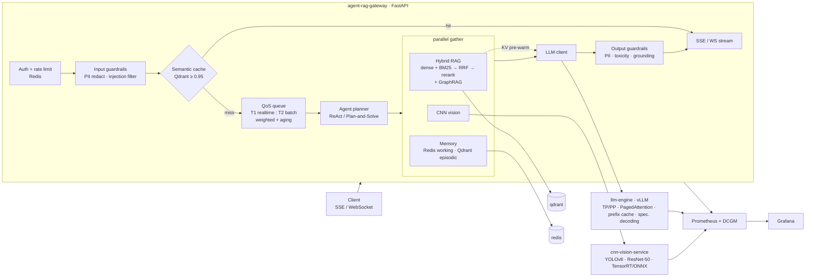

# VigilAI Engine Mesh

Unified AI infrastructure backbone: distributed LLM inference (vLLM), agentic orchestration, hybrid multimodal RAG,
CNN vision (ONNX/TensorRT), SLA-tiered real-time gateway, guardrails and full observability — one `docker compose up`.

## 1. Architecture / data flow



Request path: **Client → Guardrails → Semantic cache → QoS router/queue → Agent planner → RAG ∥ CNN ∥ memory → vLLM → output guardrails → SSE**.

## 1b. v2 additions
* `site/index.html` - mission-control site (header, live request console, metrics, modules, security, credits, footer). Static: host on GitHub Pages. *Simulated* by default; **Live gateway** mode streams from `/v1/chat/stream` (set `CORS_ORIGINS` to your Pages origin).
* Tamper-evident audit chain (`gateway/app/audit.py`): every request appends a SHA-256-linked record (query hash, tier, status, PII counts, tokens). Verify with `GET /v1/audit/verify`.
* Planned, not yet built: prefill/decode disaggregation, MCP tool server, LoRA routing, OpenTelemetry, Kubernetes autoscaling.

## 2. Quick start

```bash
cp .env.example .env                  # set HF_TOKEN, TP_SIZE, model
pip install ultralytics torch torchvision onnx onnxsim && python scripts/export_models.py   # CNN models -> ./models
docker compose up -d --build          # first start downloads LLM + embedding weights (several minutes)
./benchmarks/seed_kb.sh               # tiny demo knowledge base
curl -N -X POST localhost:8080/v1/chat/stream -H 'X-API-Key: dev-t1-key' -H 'Content-Type: application/json' \
  -d '{"message":"What is the escalation path for a P1 incident?","use_rag":true}'
```
Grafana: http://localhost:3000 (admin / `GRAFANA_PASSWORD`) · Prometheus: http://localhost:9090

Requires an NVIDIA GPU host with `nvidia-container-toolkit`. Keys are `key:tier:tenant` in `API_KEYS`.

## 3. API

| Endpoint | Purpose |
|---|---|
| `POST /v1/chat/stream` | SSE. Events: `status`, `token`, `guardrail`, `done` (ttft/tpot/queue/cache/usage/sources), `error` |
| `WS /v1/ws?api_key=…` | Same events as JSON frames; send one request JSON per turn |
| `POST /v1/chat` | Non-streaming JSON |
| `POST /v1/rag/ingest` | `{doc_id, text, metadata, graph}` → chunk, dense+BM25 index, GraphRAG triples |
| `GET /healthz`, `GET /metrics` | Health / Prometheus |

Request fields: `message`, `mode` (`chat`\|`agent`), `use_rag`, `use_memory`, `images[]` (base64), `session_id`, `user_id`, `max_tokens`, `temperature`, `cache`.

## 4. Design notes

* **Tensor/pipeline parallel**: `TP_SIZE`, `PP_SIZE` → vLLM + NCCL. Single node works as-is; multi-node PP needs a Ray cluster (see vLLM distributed docs) and `--distributed-executor-backend ray`.
* **PagedAttention / prefix caching / speculative decoding**: vLLM-native (`--enable-prefix-caching`, `--speculative-config`). The draft model must share the target's vocabulary; if unsupported for your model/vLLM version, switch to an n-gram speculator (`{"method":"ngram","num_speculative_tokens":5,"prompt_lookup_max":4}`).
* **FP8 / AWQ / GPTQ**: point `LLM_MODEL` at a quantized checkpoint (auto-detected) or add `--quantization fp8`.
* **KV pre-warming**: prompts are ordered `system → <context> → conversation/memory/vision → question`. As soon as RAG returns, the gateway sends a `max_tokens=1` prefill of `system + <context>` (`vigil_kv_prewarm_total`) so the real request reuses cached KV blocks.
* **QoS**: gateway scheduler (weighted 8:1 dispatch + aging so Tier-2 never starves, Tier-2 shed first) **and** vLLM `--scheduling-policy=priority` (gateway passes `priority` 0/10).
* **Semantic cache**: tenant-scoped, TTL’d, never used for image or personal-memory requests, only filled when the answer passed grounding/PII checks.
* **Vision → LLM**: detections are injected as `<vision>` tags (text). Set `LLM_MULTIMODAL=true` with a VLM `LLM_MODEL` to also attach the image itself.
* **Guardrails** are heuristic (regex PII with Luhn, weighted injection rules, term-list toxicity, lexical grounding). They are a first line; plug a classifier into `guardrails.py` for production. Streaming output is held back 32 chars to catch split entities; grounding is scored after streaming (annotated, not retracted).
* The gateway runs one worker per container (in-process scheduler); scale with replicas behind a sticky-free LB and size `MAX_INFLIGHT` per replica.
* Telemetry service `prometheus-grafana` is split into `prometheus`, `grafana`, `dcgm-exporter` containers.

## 5. Metrics spec (Prometheus)

| Metric | Type | Labels |
|---|---|---|
| `vigil_ttft_seconds` / `vigil_tpot_seconds` / `vigil_e2e_seconds` | histogram | tier |
| `vigil_llm_ttft_seconds` (gateway→vLLM) | histogram | tier |
| `vigil_queue_wait_seconds` / `vigil_queue_depth` / `vigil_queue_shed_total` | histogram / gauge / counter | tier |
| `vigil_inflight_requests` | gauge | – |
| `vigil_semantic_cache_total` / `vigil_semantic_cache_similarity` | counter / histogram | result=hit\|miss\|store\|skip |
| `vigil_stage_latency_seconds` / `vigil_stage_errors_total` | histogram / counter | stage (rag, vision, memory, cache_lookup, agent_plan, tool_*) |
| `vigil_guardrail_events_total` | counter | type, action |
| `vigil_grounding_score` | histogram | – |
| `vigil_tokens_total` | counter | tier, kind=prompt\|completion |
| `vigil_gpu_cost_per_hour_usd` | gauge | – |
| `vigil_agent_steps_total`, `vigil_tool_calls_total`, `vigil_kv_prewarm_total` | counter | tool,status / status |
| `vllm:prefix_cache_hits_total`, `vllm:prefix_cache_queries_total`, `vllm:gpu_cache_usage_perc`, `vllm:time_to_first_token_seconds`, … | vLLM native | – |
| `DCGM_FI_DEV_MEM_COPY_UTIL`, `DCGM_FI_PROF_DRAM_ACTIVE`, `DCGM_FI_PROF_NVLINK_*` | DCGM | gpu |

Recording rules (`monitoring/rules.yml`): `vigil:ttft_p95_seconds`, `vigil:tpot_p95_seconds`, `vigil:semantic_cache_hit_ratio`, `vigil:prefix_cache_hit_ratio`, `vigil:cost_per_1k_tokens_usd = (GPU $/h ÷ 3600) ÷ tokens/s × 1000`. Alerts: Tier-1 TTFT p95 > 1 s, queue backpressure, KV cache > 95 %, Tier-2 starvation. vLLM renames some metrics between releases (e.g. TPOT → inter-token latency): adjust `rules.yml` to your pinned version.

## 6. Benchmark (TTFT, TPOT, queue latency, KV efficiency, 100+ users)

```bash
pip install locust
mkdir -p results
locust -f benchmarks/locustfile.py --headless -u 120 -r 10 -t 5m --host http://localhost:8080 --csv results/run
# or interactive UI: locust -f benchmarks/locustfile.py --host http://localhost:8080
```
Traffic mix: 4 : 1 Tier-1 realtime : Tier-2 batch users; repeated prompts (semantic cache), RAG, unique, agent. TTFT/TPOT/QUEUE appear as separate rows per tier; at the end it scrapes vLLM + gateway `/metrics` and prints prefix-cache and semantic-cache hit rates. Exit code is non-zero if Tier-1 TTFT p95 exceeds `SLO_TTFT_P95_MS`.

## 7. Tests
`python tests/test_core.py` — PII/injection guardrails, stream redaction, grounding, QoS priority/starvation/shedding, RRF.

> Status: unit-tested locally; the full GPU stack (vLLM, TensorRT, DCGM) has not been run end-to-end by the author of this scaffold — pin image versions in `.env` for your CUDA/driver and expect to tune `GPU_MEM_UTIL`, `MAX_NUM_SEQS` and the draft model.

---
Designed and developed by **Nikhil Chary Sriramoju** - [GitHub](https://github.com/Nikhil-creat) - [LinkedIn](https://in.linkedin.com/in/nikhil-chary-sriramoju-95041b38a)
