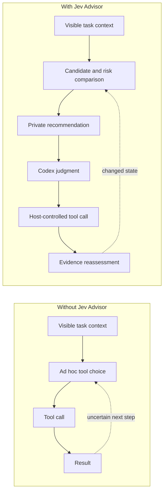
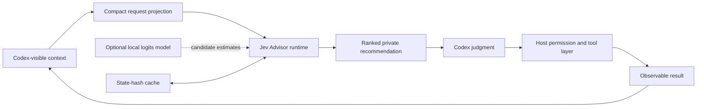
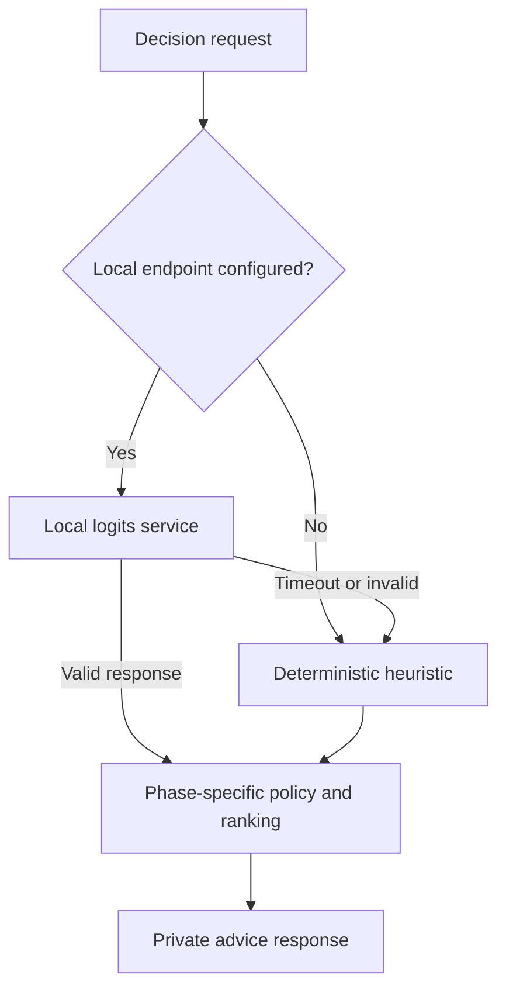

# Jev Advisor for Codex

**English** | [简体中文](README.zh-CN.md)

[](https://www.python.org/)
[](LICENSE)
[](#requirements)

Jev Advisor is a private, local decision-advice Skill for Codex. At meaningful decision points, it compares the available actions and gives the host model a compact recommendation about:

- whether another tool call is useful;
- which candidate tool/action is most promising;
- what could go wrong before the call is made;
- how to recover after a failure or partial result; and
- whether there is enough observable evidence to finish the task.

The recommendation goes back to the host model, not to the user. Codex remains responsible for the final choice and the host remains responsible for permissions and tool execution.

> [!IMPORTANT]
> Jev Advisor is advisory only. It cannot execute, approve, block, intercept, or retry a tool call. It cannot expand Codex permissions or bypass host safety controls.

## What Changes With Jev Advisor?

Without a decision advisor, the host model must repeatedly evaluate every tool option, cost, risk, and stopping condition inside its main reasoning loop. Jev Advisor moves that comparison into a small, structured decision step and returns only the useful result.

The table below describes the intended behavior of the design. It is not a claim of measured performance improvement.

| Without Jev Advisor | With Jev Advisor |
| --- | --- |
| The host model evaluates tool alternatives by itself. | The advisor returns a ranked, compact comparison of realistic candidates. |
| Tool choice can be made before missing evidence is explicit. | Facts, inferences, open questions, and recent outcomes are separated in the request. |
| A failed call can lead to an unstructured retry. | The `recover` phase compares retry, switch-tool, continue, and ask-user options. |
| Risk is handled as one broad judgment. | Ten named risk categories are estimated per candidate. |
| The task may be declared complete from confidence alone. | The `finish` policy requires observable verification evidence. |
| Repeated equivalent decisions consume fresh work. | State fingerprints allow equivalent decisions to use the local cache. |



## How It Fits Into Codex

The Skill decides when a decision is substantial enough to consult the runtime. It projects the current visible context into a compact JSON request, batches all realistic candidates, and privately applies the returned advice.



Jev Advisor never asks for hidden chain-of-thought. Its input contains only context already visible to Codex: the goal, observed facts, explicitly marked inferences, open questions, recent tool outcomes, tool descriptions, schemas, annotations, and proposed arguments.

## Decision Lifecycle

The same protocol covers the complete tool-use lifecycle:

| Phase | Question answered by the advisor |
| --- | --- |
| `understand` | Is the request clear enough to act, or is more evidence needed? |
| `explore` | Which read, search, browser, network, or external-service action has the best information value? |
| `trace` | Which action is most likely to expose the relevant call chain or dependency? |
| `implement` | Which edit or execution candidate best balances success, speed, and risk? |
| `verify` | Which test, build, check, or runtime observation provides the strongest evidence? |
| `recover` | After failure or partial success, should Codex retry, switch approach, continue, or ask the user? |
| `finish` | Is there enough observable evidence to stop and report completion? |

Each candidate is ranked with phase-specific weights using:

- success probability;
- expected latency;
- information gain;
- token-cost score;
- reversibility;
- risk probability and severity; and
- optional local-model preference logits.

The output also includes `need_tool_probability`, `continue_probability`, `task_complete_probability`, `ask_user`, the selected action, and a short natural-language recommendation for the host model.

## Example: Locate Before Editing

Suppose Codex needs to fix a failing request handler but does not yet know where that handler is defined. Two candidates are considered:

1. Search the source tree for the handler.
2. Apply an edit immediately with incomplete arguments.

Run the bundled example:

```powershell
py -3.12 scripts\jev-advisor.py examples\request.json --pretty
```

The default backend ranks the evidence-gathering action first and identifies the premature edit's incomplete parameters:

```json
{
  "model_version": "heuristic-0.1",
  "phase": "explore",
  "need_tool_probability": 0.92,
  "recommended_action": "use_search_code_search",
  "task_complete_probability": 0.16,
  "ask_user": false,
  "advice": "建议调用 search_code，用于获取高信息量证据；根据结果再决定是否继续。"
}
```

This advice is private input to Codex. It is not a user-facing message and it does not trigger the tool call by itself.

## Risk Model

Risk is evaluated per candidate rather than as a single task-wide label:

| Category | Examples |
| --- | --- |
| `destructive` | Delete, overwrite, force, reset, or irreversible mutations |
| `command_execution` | Shell commands and executable test steps |
| `git_history` | Commits, pushes, rebases, resets, and other history changes |
| `network` | Browser, network, and open-world access |
| `data_exposure` | Uploading or sending workspace content |
| `credentials` | Passwords, API keys, tokens, and secrets |
| `external_side_effect` | Publishing, deploying, submitting, posting, or sending |
| `financial` | Purchases, payments, subscriptions, or charges |
| `stale_evidence` | Acting on results that may no longer describe current state |
| `incomplete_parameters` | Missing required tool arguments or an underspecified target |

Thresholds may differ by phase and risk category. They add caution to the recommendation; they never grant permission or replace deterministic confirmation rules in Codex or the host.

## Runtime Modes

### Deterministic heuristic backend

This is the default and requires only Python's standard library. It is fast, local, deterministic, and fails open: if an optional model endpoint is unavailable or invalid, normal Codex work continues with `model_version: heuristic-0.1`.

### Optional local logits backend

A separately managed local service can supply model-based candidate estimates. The bundled server supports `next-token`, `von`, `kev`, and `multitask` adapters. Model packages and weights are deliberately excluded because they are large and hardware-specific.



The current synthetic multi-task checkpoint is a research candidate, not a production release. Domain-external testing found template overfitting. See [MODEL_SETUP.md](MODEL_SETUP.md) for the pinned Windows/CUDA environment, artifact contract, 4 GB process memory guard, and server command.

## Requirements

- Python 3.11 or newer
- Windows and PowerShell are supported first
- The Python launcher also works on macOS and Linux
- No third-party package is required for the default backend
- An optional local model endpoint must be managed separately

## Install the Runtime

From this plugin directory on Windows:

```powershell
powershell -ExecutionPolicy Bypass -File .\scripts\install.ps1
```

The installer creates `jev-advisor.cmd` under `%LOCALAPPDATA%\JevAdvisor\bin`. Add that directory to `PATH`, or invoke the repository launcher directly:

```powershell
.\scripts\jev-advisor.ps1 examples\request.json --pretty
```

Cross-platform invocation:

```text
python scripts/jev-advisor.py examples/request.json --pretty
```

Alternatively, install the Python command from this directory:

```powershell
py -3.12 -m pip install .
jev-advisor examples\request.json --pretty
```

The command reads one UTF-8 JSON request from a file, or from standard input when the file is omitted, and writes one JSON advice response. See the complete [protocol specification](skills/jev-advisor/references/protocol.md).

## Codex Skill

The installable Skill is [skills/jev-advisor/SKILL.md](skills/jev-advisor/SKILL.md). It tells Codex when to consult the advisor, how to batch realistic candidates, how to apply the response, and how to preserve the private advisory boundary.

The plugin manifest is located at [.codex-plugin/plugin.json](.codex-plugin/plugin.json). After installing the plugin in Codex, install the runtime separately if you want the Skill to call the local CLI.

## Optional Local Endpoint

Start the service as described in [MODEL_SETUP.md](MODEL_SETUP.md), then pass its loopback endpoint and matching immutable model identifier:

```powershell
.\scripts\jev-advisor.ps1 examples\request.json `
  --endpoint http://127.0.0.1:8765/v1/systemone `
  --model jev-multitask-local `
  --timeout 2
```

Keep the service bound to `127.0.0.1`. It has no authentication and must not be exposed to a public or shared network.

## Privacy and Permission Boundaries

- Advice stays local unless you explicitly configure another endpoint.
- Advice is returned privately to the host model and is not shown to the user by default.
- The request should summarize large output and sensitive values instead of copying them verbatim.
- The advisor does not receive hidden reasoning or chain-of-thought.
- The advisor cannot call tools, approve actions, change permissions, or bypass confirmation.
- Model weights, credentials, private logs, workspace snapshots, and sensitive threshold files must not be committed.

## Caching and Batch Decisions

All realistic candidates should be sent in one request. This lets the runtime compare them on a common scale instead of issuing a separate model call for every option.

Equivalent decisions can be cached using the compact visible state, workspace and Git fingerprints, model version, and threshold-policy hash. After a tool changes observable state, Codex reassesses with a new fingerprint instead of reusing stale advice.

## Evaluation Status

The project is structured to evaluate:

- decision latency;
- host-model token use;
- incorrect or unnecessary tool calls;
- task completion rate; and
- final-answer quality.

No paired baseline-versus-advisor benchmark is published yet. The diagrams and comparisons in this README describe the intended workflow, not measured gains. Claims about speed, token savings, or quality should only be added after repeatable A/B evaluation on representative Codex tasks.

## Repository Layout

```text
jev-advisor/
|-- .codex-plugin/plugin.json      # Codex plugin manifest
|-- skills/jev-advisor/            # Skill instructions and protocol reference
|-- runtime/jev_advisor/           # Advisor, policy, cache, risk, and model adapters
|-- scripts/                       # Python and PowerShell launchers
|-- examples/request.json          # Minimal end-to-end example
|-- tests/test_runtime.py          # Runtime tests
|-- MODEL_SETUP.md                 # Optional local-model setup
|-- pyproject.toml                 # Python package and CLI entry points
`-- LICENSE                        # MIT license
```

## Test

```powershell
py -3.12 -m unittest discover -s tests -v
```

## Project Scope

This repository contains the Codex plugin, Skill, protocol, and small local runtime. Training runs, model weights, shadow traces, private workspace data, and research benchmarks belong outside the published plugin package.

## License

Released under the [MIT License](LICENSE).
