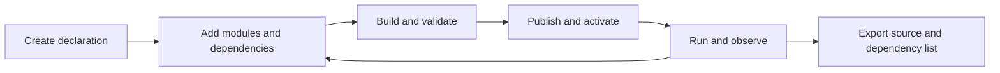

# Nofy — Let Agents Build Agents

**A declarative framework for composing models, tools, workflows, memory, permissions, and sessions.**

Give a coding agent a goal, let it create and test an agent through CLI or MCP, and keep the resulting source and dependency list. Specialized agents share the Rust kernel, Loader, execution path, and persistent state.

[Get started](docs/getting-started.en.md) · [CLI/MCP handbook](docs/manual/README.md) · [Release scope](docs/release-notes.md) · [简体中文](README.zh-CN.md)

> Usable developer preview. The Rust CLI, inbound MCP server, source projects, and modular sessions are implemented. This release contains no frontend; the UI will be rebuilt separately. Complete pi, Codex, and OpenCode behavior presets have not been released.

## Available today

- **Create and compose agents.** Configure models, prompts, tools, context, policies, budgets, and sessions. CLI and MCP edit the same source of truth.
- **Connect external implementations.** Use Rhai, standalone scripts/programs, HTTP, or external MCP tools. Ordinary business extensions do not require Rust kernel changes.
- **Build, publish, and recover.** Build complete systems, inspect differences, activate generations, and observe events, approvals, cancellation, and recovery.
- **Keep session state.** Seventeen session operations cover admission, subsequent turns, metadata, archives, and policy changes between turns.
- **Share portable source.** Archives contain declarations, module source, and ordinary dependency lists. Credentials are injected separately; users install interpreters, compilers, and external libraries.

Development protocol: `nofy.kernel/v1`, contract revision `0.6`. There are 98 operations, including 96 inbound MCP tools. Secret values use a separate private local entry point.

## Core concept: goals and recursive self-improvement (RSI)

Recursive self-improvement in this framework does not rewrite the kernel at runtime. It is a controlled, declarative loop:

1. **Goal-driven.** Once an agent is given a goal, the host tracks it across turns through the Goal state module: state encoding, lifecycle, snapshots and recovery, budgets, and stall detection (`nofy-goal`). Planning models and orchestration are provided by the host; the goal state itself is persistent, pausable, and recoverable.
2. **Declarative improvement.** Agents turn improvements into data through the 79 CLI/MCP operations — creating source projects, composing modules and dependencies, building and validating, publishing and activating, running and verifying, and exporting source. What gets improved are declarations, modules, and preset artifacts; ordinary capability changes do not modify the kernel Rust, and every call is re-authorized by the kernel.
3. **Recursive structure.** Agents under development and the agents developing them run on the same Loader and execution path. The [coding preset](presets/coding/文件说明.md) is itself an editable declaration on this framework. Agents can use the same operations to build other agents — or to improve the very presets and modules they themselves run on — forming a loop of agents building agents and agents improving agents.

Boundaries: kernel authorization, approvals, budgets, and cancellation are enforced boundaries of this loop. Each step has its own verification records ([real-model repair](docs/verification/coding-real-model-build.md), [MCP sub-agent end-to-end](docs/verification/mcp-sub-agent.md)); the complete autonomous improvement loop has not yet been accepted end-to-end.

## Get started

Linux is the primary evaluation platform. Install the [Rust toolchain](rust-toolchain.toml), then build from the repository root:

```sh
cargo build --locked -p nofy-agent-host -p nofy-cli
./target/debug/nofy --help
```

Follow the [setup guide](docs/getting-started.en.md) to create a private access token and start the kernel. Use CLI or connect Codex through MCP; this release contains no frontend.

```sh
./target/debug/nofy describe \
  --endpoint http://127.0.0.1:7331 \
  --token-file "$NOFY_STATE_DIR/access-token"
```

The development cycle:



Source projects may be incomplete during editing; only a complete, validated system can be published and run. Users provide model services, API keys, and business tool dependencies.

## CLI usage

Full commands, options, and exit codes are in the [CLI handbook](docs/manual/cli.md) (Chinese). `nofy` connects to the resident kernel over HTTP; CLI, HTTP, and MCP edit the same source of truth:

```sh
nofy --endpoint http://127.0.0.1:7331 \
     --token-env NOFY_ACCESS_TOKEN <command group> <subcommand>
```

| Common global options | Meaning |
|---|---|
| `--token-env` / `--token-file` | Access token source; pick one. Supplying both mutually exclusive sources is rejected as a parameter error |
| `--config PATH` / `--profile NAME` | Select a client connection profile; token values are never stored in it |
| `--format json\|text` | JSON by default; `text` is for reading |
| `--input PATH` / `--output PATH` | Read the complete input object from a file or stdin; outputs refuse to overwrite existing files by default |
| `--help` | Command tree, parameters, scope hints, and schema entry points |

Create an agent and compose capabilities — three ways to add modules:

```sh
nofy agent create coder                    # Creates a source project; returns incomplete until model/prompt are set
nofy agent module add coder --module "$MODULE_REF" --slot tools      # 1. Reference an existing module
nofy agent tool add coder --id search --factory tool.http_connected \
  --set /contract/name=search --set /path=search --set /method=POST \
  --bind connection=service                # 2. Configure directly from factory parameters and bind dependency slots
nofy agent module add coder --from ./calculate.module.json --slot tools # 3. Import a module definition JSON
nofy agent inspect coder                   # Inspect module relations, missing slots, and the source revision
```

Build, publish, and activate:

```sh
nofy agent build coder --output deployment.json
nofy system validate --file deployment.json
nofy system publish --file deployment.json        # The receipt contains the release; save it as $RELEASE
nofy system plan coder --release "$RELEASE"       # Diff against the current system
nofy system apply coder --release "$RELEASE" \
  --expected-generation none --command-id "$COMMAND_ID"   # Existing systems pass the exact generation from a query
```

Run, observe, approve, and continue sessions:

```sh
nofy run start --input run.json
nofy run events "$RUN_ID" --after "$CURSOR" --follow      # Events carry the original cursor; reads resume after a disconnect
nofy run approvals "$RUN_ID"                     # decide submits the complete original request exactly as read, plus allow
nofy run cancel "$RUN_ID" --command-id "$CANCEL_ID"

nofy session start --input session.json          # Atomically creates the first root session; all 20 session operations are in the handbook
nofy session turn --input turn.json
```

Deliver and roll back:

```sh
nofy agent export coder --output coder-source.tar.gz      # Source plus an ordinary dependency list; credentials are injected separately
nofy system rollback coder --release "$OLD_RELEASE" \
  --expected-generation "$GENERATION" --command-id "$ROLLBACK_ID"
```

You can also edit a project in the same format in a local directory: `nofy project init ./coder --empty --agent coder`, built with `nofy project build ./coder`. Complex requests can use `nofy call <operation-id> --input request.json`. Secret values go only through the stdin/private-file entry of `nofy credential put` and never appear in command lines or logs.

## MCP integration

Full protocol details are in the [MCP handbook](docs/manual/mcp.md) (Chinese). The inbound MCP server shares the operation contract with the CLI, and `tools/list` exposes a fixed catalog of 77 implemented operations. Secret value injection does not go through MCP; it remains a separate local private entry point.

stdio (local clients such as Codex):

```sh
nofy mcp serve --transport stdio \
  --endpoint http://127.0.0.1:7331 \
  --token-env NOFY_ACCESS_TOKEN
```

Codex configuration (never written into your environment automatically):

```toml
[mcp_servers.nofy]
command = "nofy"
args = ["mcp", "serve", "--transport", "stdio", "--endpoint", "http://127.0.0.1:7331", "--token-env", "NOFY_ACCESS_TOKEN"]
env_vars = ["NOFY_ACCESS_TOKEN"]
```

Streamable HTTP (callers bring their own Bearer identity; the bridge uses that same identity for kernel requests):

```sh
nofy mcp serve --transport http --listen 127.0.0.1:7332 \
  --endpoint http://127.0.0.1:7331
# The MCP address is http://127.0.0.1:7332/mcp
```

MCP agent creation mirrors the CLI: `nofy_agent_create` → `nofy_agent_module_add` (tool shortcut `nofy_agent_tool_add`) → `nofy_agent_build` → `nofy_system_publish` / `nofy_system_plan` / `nofy_system_apply` → `nofy_run_start` / `nofy_run_events` → the session tool group; approvals and recovery use `nofy_run_approvals` / `nofy_run_decide` / `nofy_run_recovery`. MCP takes structured parameters directly, so JSON files are usually unnecessary. The presence of a configuration does not mean connectivity or business acceptance has been validated; the validated scope is in the [implementation record](docs/verification/agent-development-cli-mcp.md).

## Coding preset and real acceptance runs

The [coding preset](presets/coding/文件说明.md) is a source template on the same framework. It provides file operations, optional command execution, and read-only code review. A [real-model project repair](docs/verification/coding-real-model-build.md) read code, ran tests, fixed the problem, and changed all six tests from failing to passing.

A separate [real sub-agent run](docs/verification/mcp-sub-agent.md) used standard MCP to create an agent from an empty declaration, compose nine modules, and run a real model. The model invoked a calculation tool, obtained `42`, and completed. The source archive passed byte-for-byte verification.

These records establish their stated scope. Full module cross-testing and pi reproduction remain incomplete, including pi session trees and its distinct steering/follow-up queues.

## Development checks

```sh
bash scripts/check-release.sh
```

This runs formatting, workspace compilation, CLI/MCP development tests, coding source tests, and dependency-boundary checks. See [contributing](CONTRIBUTING.md) and [verification records](docs/verification) for full runtime tests and real process-tree/model acceptance.

- [Module integration](docs/manual/modules.md): factories, slots, dependencies, and external implementations.
- [Sessions](docs/manual/sessions.md): policies and lifecycle.
- [MCP](docs/manual/mcp.md): stdio, Streamable HTTP, and Codex configuration.
- [File guide](文件说明.md): workspace packages and directory responsibilities.

Detailed technical documentation is currently primarily in Chinese.

## License

[Apache License 2.0](LICENSE). Third-party code retains its licenses and attribution; see [THIRD-PARTY-NOTICES](THIRD-PARTY-NOTICES).
