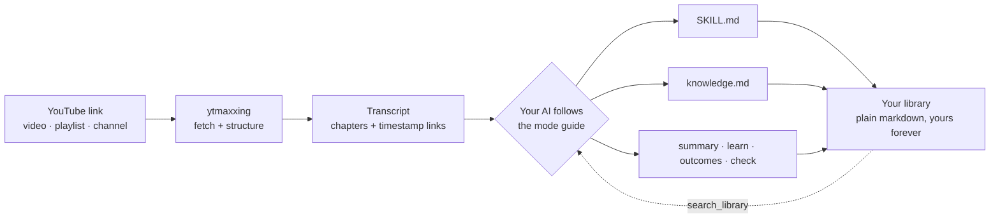

<div align="center">


<h3>Watch it once. Your AI keeps the skill.</h3>

<p>
  <a href="LICENSE"></a>
  
  
  
  
  <a href="https://github.com/Oal36ar/ytmaxxing/stargazers"></a>
</p>

<p>
  <a href="#quick-start">Quick start</a> ·
  <a href="#seven-ways-to-max-a-video">Modes</a> ·
  <a href="#research-one-question-many-videos">Research</a> ·
  <a href="#real-example-a-10-minute-tutorial-becomes-a-skill">Example</a> ·
  <a href="#how-it-works">How it works</a> ·
  <a href="#faq">FAQ</a>
</p>

</div>

---

You watch a two-hour video, nod along, and by Friday it's gone. Your AI never saw it at all.

**ytmaxxing** fixes both. Give it any YouTube link and your AI turns the video into things you keep: a **skill** your agent can follow, **cited notes** it can search months later, a **plan** for your own goal, or **upgrades** for a project you're already working on. Everything is plain markdown on your machine, with every claim linked to the exact second in the video.

Got a bigger question? Point it at up to 50 videos, a channel, a playlist or a YouTube search, and get one **research report**: where the speakers agree, where they contradict each other and who said what. ytmaxxing checks every citation against the transcript in code, so a made-up quote or moment can't reach the report.

It runs inside the AI you already use (Claude, Cursor, or any [MCP](https://modelcontextprotocol.io) client). There's no API key and nothing to pay for.

## Contents

- [Seven ways to max a video](#seven-ways-to-max-a-video)
- [Research: one question, many videos](#research-one-question-many-videos)
- [Real example: a 10-minute tutorial becomes a skill](#real-example-a-10-minute-tutorial-becomes-a-skill)
- [Quick start](#quick-start)
- [What to say](#what-to-say)
- [How it works](#how-it-works)
- [Your library](#your-library)
- [Configuration](#configuration)
- [Troubleshooting](#troubleshooting)
- [Roadmap](#roadmap)
- [Contributing](#contributing)
- [FAQ](#faq)

## Seven ways to max a video

Different videos are worth different things. Pick what you need, or let `max` do it all.

| Mode | You get | Best for |
|---|---|---|
| **`skill`** | A `SKILL.md` your agent loads whenever the task comes up | Tutorials, walkthroughs, "here's exactly how I do X" |
| **`knowledge`** | Claims, frameworks, numbers and tools, each cited to the second | Talks, interviews, anything you'll want to look up later |
| **`summary`** | TL;DR, chapter by chapter, best moments, and a watch/skim/skip verdict | Deciding if a video deserves your time |
| **`learn`** | Plain explanations, key terms, a quiz and a review plan | Lectures, courses, explainers |
| **`outcomes`** | Decisions and this-week actions for *your* goal | Business, strategy, career, health advice |
| **`check`** | What the video adds to your skill, codebase or plan, as concrete changes | Upgrading something you already have |
| **`max`** | All of the above that fit the video | When you just want everything |

> [!NOTE]
> ytmaxxing is honest about skills. If a video doesn't teach a repeatable procedure (most interviews and opinion pieces don't), it says so and makes knowledge instead of inventing steps.

Every output is checked when it's saved: each timestamp link must land inside the video, and quoted words on the same line must be in the transcript at that moment. Your AI gets a list of what didn't match and fixes it.

## Research: one question, many videos


<sub>The 15 videos of a real research run. Thumbnails belong to their creators; ytmaxxing is independent and not endorsed by them or by YouTube.</sub>

Summarising one video is easy. Answering a question from twenty is where an AI usually skims, blends and invents. `research` is built to stop that:

1. **Your AI frames the question** as a few sub-questions and builds the source list: links, a playlist, a channel, or a YouTube search. You confirm the list.
2. **ytmaxxing fetches the transcripts slowly**, so YouTube doesn't block you, and keeps a ledger of what it couldn't get and why.
3. **Every video is read in full**, by subagents where your AI supports them (Claude Code does), each taking one video or a few in turn. Each one sends back claims with a short quote copied from the transcript.
4. **ytmaxxing checks every claim in code.** The quote has to be in the transcript at the cited moment. A name the captions misspell may differ; any other changed word, number or "not" is sent back to be fixed, and every rejection is logged so it can be reviewed. A quote from a teaser clip moves to where the same words come later in the interview. Each claim that passes gets an ID like `V07.12`, and is flagged if it gives a number that isn't said at that moment.
5. **Your AI groups the claims into positions**, and ytmaxxing writes the report: it turns IDs into timestamp links that land near the quoted words, counts the videos and speakers behind each position, flags a video that sits on both sides of a split, and adds the coverage line.

The report has the answer, a coverage line ("Read 14 of 15 videos… Not read: V09 (no captions)"), where they agree, where they contradict each other (every side cited in its own video), a who-said-what grid, evidence notes, gaps and the source list. Counts come from code, not from the model.

**A real check**, on a two-hour Diary of a CEO episode: two exact quotes passed; a paraphrase written as a quote ("we'll pause when AI can automate AI research") and a real quote cited at the wrong moment (55:00 instead of 51:37) were both rejected, with the reason sent back to the agent.

**Honest limits.** A checked quote proves those words were said at that moment. It doesn't prove the paraphrase next to it is fair, so the report keeps the quote beside it. Captions don't record who is speaking, so speakers come from context; a name that isn't said in the video, its title or description is marked as inferred. Videos without captions are skipped unless you turn on local transcription for the project.

Try: *"Research how soon AI will match top human experts. Use a YouTube search for long interviews from 2025–2026, 15 videos, and show me where they disagree."*

## Real example: a 10-minute tutorial becomes a skill

Input: [*git rebase: Why, When & How to fix conflicts*](https://youtu.be/DkWDHzmMvyg) by Philomatics (9 min 44 s).

Output, in [`examples/rebase-feature-branch/SKILL.md`](examples/rebase-feature-branch/SKILL.md):

```markdown
---
name: rebase-feature-branch
description: Bring the latest main-branch commits into a local feature branch with git
  rebase instead of merge, keeping history linear, and resolve conflicts commit by commit.
  Use when the user wants to update a feature branch from main, avoid merge commits, ...
---

## Before you start
- The feature branch must **not** have been pushed or shared. Rebasing rewrites commit
  hashes ... ([03:23](https://youtu.be/DkWDHzmMvyg?t=203))

## Steps
5. Stage the fixed files: `git add <file>` for every conflicted file. ([05:29](...))
6. Run `git rebase --continue`. **Don't run `git commit`**: that's the step that
   differs from a merge. ([05:29](...))
```

From now on, when you ask your agent to update a branch, it follows the video's method, checks the golden rule first, and can show you the second of the video each step came from.

## Quick start

You need [uv](https://docs.astral.sh/uv/getting-started/installation/) (one command, installs Python tools):

```bash
curl -LsSf https://astral.sh/uv/install.sh | sh
```

<details open>
<summary><b>Claude Code</b>: plugin (MCP server + skill in one step)</summary>

Inside Claude Code:

```
/plugin install ytmaxxing --marketplace Oal36ar/ytmaxxing
```

Or add just the MCP server from your terminal:

```bash
claude mcp add ytmaxxing -s user -- uvx --from git+https://github.com/Oal36ar/ytmaxxing ytmaxxing serve
```

</details>

<details>
<summary><b>Claude Desktop</b></summary>

Open **Settings → Developer → Edit Config** and add:

```json
{
  "mcpServers": {
    "ytmaxxing": {
      "command": "uvx",
      "args": ["--from", "git+https://github.com/Oal36ar/ytmaxxing", "ytmaxxing", "serve"]
    }
  }
}
```

Restart Claude Desktop. If it can't find `uvx`, use its full path (run `which uvx` to see it).

</details>

<details>
<summary><b>Cursor, Windsurf, Cline and other MCP clients</b></summary>

Use the same JSON as Claude Desktop in your client's MCP settings file (for Cursor: `~/.cursor/mcp.json`).

</details>

<details>
<summary><b>ChatGPT, Gemini or any chatbot (no MCP)</b></summary>

Build a ready-to-paste prompt (the guide plus the full transcript) and copy it to your clipboard:

```bash
uvx --from git+https://github.com/Oal36ar/ytmaxxing ytmaxxing prompt "https://youtu.be/DkWDHzmMvyg" --mode skill --copy
```

Paste it into any chat. Swap `--mode` for `knowledge`, `summary`, `learn`, `outcomes --goal "..."` or `check --target "..."`.

</details>

## What to say

Once it's installed, just talk to your AI:

- *"Max this: https://youtu.be/…"*
- *"Turn this tutorial into a skill and install it for this project."*
- *"Watch this and tell me what I should do this week to grow my newsletter."*
- *"Check this video against my `skills/deploy` skill. What should I change?"*
- *"Make me a study guide for this lecture and quiz me."*
- *"List the last 10 videos on @channel and make knowledge notes for the ones about pricing."*
- *"What did the videos I saved say about onboarding?"*
- *"Research this question across the last 20 videos on @channel: where do they agree and disagree?"*

Every mode is also an MCP prompt, so in Claude Code you can type `/` and search for `ytmaxxing` to pick one.

## How it works



ytmaxxing does the parts a model is bad at: fetching captions reliably, splitting long videos into readable parts, keeping chapters, linking every paragraph to its timestamp, and filing everything. Your own AI does the thinking, guided by a written guide for each mode. That split is why it needs no API key, and why its outputs are as good as the model you already use.

**Tools your AI gets:**

| Tool | What it does |
|---|---|
| `maxx` | Fetches the video and returns the guide for the chosen mode |
| `get_video` | Transcript with chapters and timestamp links, in parts for long videos |
| `save_output` | Files the result in your library and checks its citations against the transcript |
| `list_playlist` | Lists videos in a playlist or channel |
| `search_library` · `list_library` · `read_output` | Find what you've already maxxed |
| `install_skill` | Copies a skill into `~/.claude/skills` or a project (only when you say so) |
| `search_videos` | Searches YouTube, no API key |
| `research_start` · `research_edit` | Starts a research project from links, playlists, channels or a search; adds or drops videos |
| `research_fetch` · `research_status` | Fetches transcripts with pacing; shows what's read, skipped or queued |
| `research_brief` · `save_claims` | Instructions for reading one video; stores its claims after checking each one |
| `research_claims` · `save_report` | All checked claims; renders the report with links, counts and coverage |

## Your library

Everything lands in `~/ytmaxxing` as plain markdown, so any agent, editor or note app can read it:

```
~/ytmaxxing/
├── index.md                                   ← every video and what you made from it
├── videos/
│   └── git-rebase-why-when-how-to-fix-conflicts-DkWDHzmMvyg/
│       ├── transcript.md                      ← chapters + clickable timestamps
│       ├── summary.md  knowledge.md  learn.md  outcomes.md
│       └── check-my-deploy-skill.md
├── skills/
│   └── rebase-feature-branch/SKILL.md         ← ready to install
└── research/
    └── how-soon-will-ai-match-human-experts/
        ├── brief.md  sources.json             ← the question and the video ledger
        ├── cards/V01.md …                     ← checked claims, one file per video
        └── report.md                          ← the report
```

From a terminal: `ytmaxxing research list`, `ytmaxxing research status <project>`, and `ytmaxxing research fetch <project>` to fetch a long list outside a chat. `ytmaxxing verify <url> <file.md>` checks any saved note's citations.

Point an Obsidian vault at it, commit it to a repo, or add it to a ChatGPT project.

## Configuration

All optional, set as environment variables:

| Variable | Default | What it does |
|---|---|---|
| `YTMAXXING_HOME` | `~/ytmaxxing` | Where your library lives |
| `YTMAXXING_LANGUAGES` | `en` | Preferred caption languages, e.g. `en,ar,es`. Falls back to any language the video has |
| `YTMAXXING_PROXY` | none | Proxy URL for networks YouTube blocks (cloud servers, some VPNs) |
| `YTMAXXING_WHISPER_MODEL` | `small` | Model for local transcription, e.g. `base`, `medium`, `large-v3` |

## Troubleshooting

**"This video has no captions"** or **"YouTube is blocking requests"**: turn on local transcription. ytmaxxing then downloads the audio and transcribes it on your machine with [faster-whisper](https://github.com/SYSTRAN/faster-whisper):

```bash
claude mcp add ytmaxxing -s user -- uvx --from "ytmaxxing[whisper] @ git+https://github.com/Oal36ar/ytmaxxing" ytmaxxing serve
```

On a server or cloud machine, YouTube often blocks requests outright. Set `YTMAXXING_PROXY` to a residential proxy.

**The tools don't show up**: MCP servers load when a session starts. Restart your client after installing.

## Roadmap

- [x] Seven modes, cited outputs, local library, Claude Code plugin
- [x] Playlists and channels
- [x] Local Whisper fallback
- [ ] One-click Claude Desktop extension (`.mcpb`)
- [x] `research`: one question across up to 50 videos, with every citation checked in code
- [x] Citation check on every saved output
- [ ] Research on one very long video or stream (split into segments)
- [ ] `claim_check`: "does anything I've read contradict this?"
- [ ] Re-run a research project and show what changed since last time
- [ ] `merge`: research results turned into one stronger skill, with disagreements marked
- [ ] Freshness check: flag skills whose tools have changed since the video was recorded
- [ ] Skill self-test: the agent tries a new skill on a sample task and reports gaps
- [ ] Podcasts and other video sites
- [ ] Publish to PyPI (`uvx ytmaxxing`)

Got an idea? [Open an issue](https://github.com/Oal36ar/ytmaxxing/issues). The most-wanted ones get built first.

## Contributing

Contributions are welcome, especially new modes and better guides. The guides in [`src/ytmaxxing/guides/`](src/ytmaxxing/guides) are plain markdown, so you can improve how ytmaxxing thinks without writing code.

```bash
git clone https://github.com/Oal36ar/ytmaxxing && cd ytmaxxing
uv sync
uv run pytest
uv run ytmaxxing transcript "https://youtu.be/DkWDHzmMvyg"
```

See [CONTRIBUTING.md](CONTRIBUTING.md) for how to add a mode.

## FAQ

<details>
<summary><b>Is it free? Do I need an OpenAI or Anthropic key?</b></summary>

Free and MIT-licensed. No key: ytmaxxing hands the transcript and a guide to the AI you're already using, and that AI writes the output.
</details>

<details>
<summary><b>Does anything leave my machine?</b></summary>

ytmaxxing itself only talks to YouTube, to fetch captions, details and (for Whisper) audio. Your library stays on your disk. The transcript is read by whichever AI you use, under that AI's own privacy terms.
</details>

<details>
<summary><b>Which videos work best?</b></summary>

For skills: tutorials and walkthroughs with clear steps. For knowledge and outcomes: long interviews, talks and podcasts. Short clips and music videos have little to extract.
</details>

<details>
<summary><b>What about creators' rights?</b></summary>

ytmaxxing is built for personal learning. Outputs are your own notes, written in your AI's words, with short quotes at most and a link back to the exact moment in the original video, which sends people to the creator. Don't republish transcripts or pass a creator's work off as yours.
</details>

<details>
<summary><b>Is this affiliated with YouTube?</b></summary>

No. ytmaxxing is an independent open-source project, not affiliated with or endorsed by YouTube or Google.
</details>

## License

[MIT](LICENSE).

<div align="center">

**If ytmaxxing taught your AI something, give it a star so more people find it.**

<a href="https://star-history.com/#Oal36ar/ytmaxxing&Date"></a>

</div>
