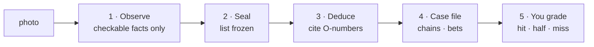

<div align="center">

# 🔍 Holmes

**An agent skill that reads a photo the way Sherlock Holmes reads a stranger, and shows its work.**

<p align="center">
  <a href="README.md"></a>
  <a href="README.zh-CN.md"></a>
</p>

<p align="center">
  <a href="LICENSE"></a>
  <a href="https://agentskills.io"></a>
  
  <a href="CONTRIBUTING.md"></a>
  <a href="https://github.com/Oldcircle/holmes-skill/stargazers"></a>
</p>

<p align="center">
  <b>Works with</b><br>
  <a href="https://code.claude.com/docs/en/skills"></a>
  <a href="https://developers.openai.com/codex/skills"></a>
  <a href="https://cursor.com/docs/skills"></a>
  <a href="https://geminicli.com/docs/cli/skills/"></a>
  <a href="https://opencode.ai/docs/skills/"></a>
  <a href="https://docs.github.com/en/copilot/concepts/agents/about-agent-skills"></a>
  <br><sub>…and any other agent that reads <code>SKILL.md</code> and can see images.</sub>
</p>


*A real desk photo. It wrote 16 observations and sealed the list before reasoning. Six conclusions followed, each citing its evidence. The desk's owner graded them: 5 hits, 1 miss, 0 made-up observations.*

</div>

---

## Quick start

```bash
npx skills add Oldcircle/holmes-skill
```

Pick your agents when prompted. Then give your agent a photo of your desk, your room or yourself and say:

> Read this like Sherlock Holmes.

The agent lists what it can see, seals that list, and only then starts to reason. Every conclusion names the observations it stands on and offers another explanation for the same marks. You mark each one hit, half or miss. Prefer to copy the folder yourself? See [Installation](#installation).

## Why Holmes

- **It looks first and thinks second.** Everything it can see goes on a numbered list, and the list is sealed before the trace library is opened. A model that already knows it is looking for a runner will find running shoes that are not there.
- **Every conclusion shows its evidence.** Each one cites observation numbers, gives a chain of at most three steps, a calibrated confidence, and an alternative explanation. A conclusion that needs something off the list is dropped.
- **You grade it.** Hit, half or miss for each conclusion, and a flag for any observation that is not in the photo. It reports two numbers: the hit rate, and the false-observation rate, which matters more.
- **It commits.** At least one conclusion has to combine two or more unrelated observations, and one or two have to be bold bets stated without hedging.
- **Marks, never looks.** Reading a person, it records what their habits left behind: pressure marks, tan lines, wear, calluses, which wrist the watch is on. Faces, bodies, age, ethnicity and health stay off the list.
- **No API key, no server.** The skill is one Markdown file and a trace library. The model your agent already uses does the looking.
- **One skill, every agent.** A standard Agent Skill, so the same folder works in Claude Code, Codex, Cursor, Gemini CLI, OpenCode and GitHub Copilot.

## Two real photos

Both photos were read with this skill and graded line by line by the person they belong to.

| Photo | Observations | Made up | Conclusions | Hit | Miss |
|---|---|---|---|---|---|
| A desk | 16 | 0 | 6 | 5 | 1 |
| A selfie, read as a person | 13 (9 of them about the room) | 0 | 5 | 5 | 0 |

### The desk

Before any reasoning it wrote 16 observations. Two of them look like filler: *a red can standing on the mouse pad*, and *the desk edge is unusually thick, with a metal frame and a hanging cable underneath*.

The second one became a conclusion: **"This is an electric standing desk."** An ordinary desk has no reason to be plugged in. The owner confirmed it.

The first one went into the only miss. D3 said the desktop on the right had not been turned on today. Its three reasons were all true: the screen was dark, the keyboard was pushed at an angle onto the mouse pad, and a can was standing on the pad. The owner's answer was *"It's off now, but I used it at noon."* The marks supported "not in use right now", and the claim said "not used today". That miss is now a rule in [`SKILL.md`](skills/holmes/SKILL.md): a claim may not reach further in time than its marks support.

### The selfie

The face is in the middle of the frame. Of the 13 observations, 4 are about the person (glasses, an ear cuff, a waffle-knit shirt, stubble) and 9 are about the room behind them. None of them describes facial features.

The conclusion the owner did not expect: **"You didn't furnish this room. You just use it as a workspace."** The bookcase and the door frame are one matched rosewood set, fitted when the flat was decorated. The shelves hold boxed book sets, framed calligraphy and photo frames, which is a display. The one piece of furniture that does not match is the pale teal office chair behind the owner, and that chair is the thing they brought in.

Two of the five conclusions come from the room alone, and none is drawn from facial features.

<details>
<summary>Full case file: the desk (translated from Chinese)</summary>

```
Case No. 0910-1720 · Scene: desk · 16 observations

── Observations ──
O1  [high] Two screens side by side on the left: a dark terminal, a light beige web page
           · back of the desk
O2  [high] A large screen on the right, completely dark, on a white arm · back right
O3  [high] A dark laptop open in the middle, plugged in · center
O4  [high] White-and-blue mechanical keyboard with a pink-and-white wrist rest, angled
           across the mouse pad, facing none of the screens · right
O5  [high] Black mouse pad printed with "LPL", a trophy and an alien head · right
O6  [high] A red can standing on the mouse pad, right next to the keyboard
           · right of the keyboard
O7  [high] White gaming mouse at the far right of the pad · right end of the pad
O8  [high] Black tower glowing blue, white over-ear headphones hanging beside it · far right
O9  [high] Pale teal ceramic mug next to the right monitor arm, away from the keyboard
           · back right
O10 [med]  An empty black phone stand · front left
O11 [med]  A metal bead chain and a key on the left of the desk · left
O12 [high] A white cable coiled on the left, a black cable coiled in front of the right
           screen · left, center right
O13 [med]  A flat white oblong device in front of the laptop · front left of the laptop
O14 [med]  The desk edge is unusually thick; a metal frame and a hanging cable underneath
           · whole desk
O15 [med]  Something white glowing red near the base of the right monitor arm
           · under the monitor
O16 [low]  Dark brown wooden cabinet doors on the left; the other walls are bare
           · background

── Deductions ──
D1 · confidence 0.68 · safe                                                        HIT
You play League of Legends, and you follow the pro league as well as playing it.
  ① LPL is League of Legends' pro league in China; a pad printed with its trophy is official
    merchandise.
  ② White gaming mouse, glowing tower, over-ear headphones: a matched set, bought for games.
  Evidence O5 O7 O8 | trace desk.gaming-setup
  Could also be: the pad was a gift, or you just like how it looks.

D2 · confidence 0.58 · safe                                                        HIT
You keep work and games on separate machines: the laptop for work, the desktop for games.
  ① The laptop sits open in the middle, plugged in, with a document on screen; the two left
    screens work with it.
  ② The big right screen goes with the tower and the gaming gear, at the other end of the
    desk.
  Evidence O1 O2 O3 O8
  Could also be: the desktop is the main machine and the laptop took over only today.

D3 · confidence 0.52 · bold 🎲                                                     MISS
The desktop on the right hasn't been turned on today.
  ① The big screen is fully black, not dimmed.
  ② The keyboard is pushed onto the mouse pad at an angle, on the wrist rest, facing no
    screen.
  ③ A can stands on the mouse pad; nobody using that mouse would put it there.
  Evidence O2 O4 O6
  Could also be: you just finished a game and the screen went to sleep.
  Owner: "It's off now, but I used it at noon."

D4 · confidence 0.50 · safe                                                        HIT
This is an electric standing desk. You have spent money on sitting all day.
  ① The desk edge is thick, with a metal frame visible underneath.
  ② A cable hangs below the desk; an ordinary desk doesn't need power.
  Evidence O14
  Could also be: it's the cable hole of an ordinary desk.

D5 · confidence 0.45 · safe                                                        HIT
You stay at this desk all day, and your drinks sit in two places, one per zone.
  ① A can and a mug, apart: the can in the gaming zone, the mug in the monitor zone.
  ② Neither has been cleared away.
  Evidence O6 O9 | trace desk.multi-cups
  Could also be: the mug is someone else's, or just wasn't put away.

D6 · confidence 0.42 · bold 🎲                                                     HIT
You chose everything on this desk yourself. None of it was issued by an employer.
  ① White-and-blue keyboard with its own wrist rest, a pro-league pad, headphones and mouse
    from one white set.
  ② A monitor arm and a glowing tower: extras that cost money and time.
  Evidence O2 O4 O5 O7 O8
  Could also be: some of it came from company perks or giveaways.

── Closing ──
I'm open on your left-hand screen right now. Whichever one missed, mark it.
```

</details>

<details>
<summary>Full case file: the selfie (translated from Chinese)</summary>

```
Case No. 0910-1740 · Scene: person · 13 observations

── Observations ──
O1  [high] Thin-rimmed glasses, darker along the top; metal nose pads and arms · person
O2  [med]  Metal jewelry on the rim of one ear, like an ear cuff or a row of studs · person
O3  [high] Dark charcoal short-sleeved top, round neck with a button placket, waffle-knit
           fabric · person
O4  [med]  Sparse short stubble along the jaw and chin, uneven edge · person
O5  [high] A whole wall of dark reddish-brown wooden bookcase with glass doors, Chinese
           style · background
O6  [high] Rows of books inside, including several boxed sets · inside the bookcase
O7  [high] Several photo frames in the bookcase, one of them a group photo
           · inside the bookcase
O8  [med]  A card or framed piece with vertical text on white on the top shelf · top shelf
O9  [high] A pale teal office chair in front of the bookcase, its back facing out
           · behind the person
O10 [high] The door frame on the right is the same dark reddish-brown wood; white walls with
           nothing on them · right
O11 [med]  White stepped ceiling · top
O12 [med]  A white light switch on the right wall · right
O13 [low]  The edge of a desk, bottom right, with a dark object and something bottle-shaped
           on it · bottom right

── Deductions ──
D1 · confidence 0.55 · safe                                                        HIT
You didn't furnish this room. You just use it as a workspace.
  ① The bookcase and the door frame are one matched rosewood set, fitted when the place was
    decorated.
  ② Boxed book sets, framed calligraphy, photo frames: this shelf is for display, not for
    reading.
  ③ The one piece of furniture that doesn't match is the pale teal office chair behind you.
    It was brought in later.
  Evidence O5 O6 O7 O8 O9 O10
  Could also be: it is your own study, and you like a traditional style.

D2 · confidence 0.50 · safe                                                        HIT
You come here to sit and work for long stretches, not to read.
  ① You brought a functional office chair into a display-style study.
  ② You are sitting, framed casually, in an everyday T-shirt.
  Evidence O3 O9
  Could also be: you are only here for a while.

D3 · confidence 0.45 · bold 🎲                                                     HIT
This home was decorated some years ago. It is not a recent flat.
  ① Matched rosewood cabinets, a matching door frame and a stepped plaster ceiling belong to
    a particular era of home decoration.
  ② The walls are completely bare, with nothing added since.
  Evidence O5 O10 O11
  Could also be: a new flat done up in a deliberately old style.

D4 · confidence 0.42 · bold 🎲                                                     HIT
Your taste and this room's taste are not the same.
  ① Metal jewelry on your ear, a waffle-knit top with a button placket.
  ② You chose those two things. You didn't choose the room.
  Evidence O2 O3 O5
  Could also be: you just put on whatever was at hand.

D5 · confidence 0.40 · safe                                                        HIT
You wear your glasses all day, not now and then.
  ① Thin metal frames: people who wear glasses all day care about weight; occasional wearers
    don't choose for it.
  Evidence O1
  Could also be: you just like the style.

── Closing ──
I didn't read a thing from your face. Which one missed?
```

</details>

## Installation

Holmes is a standard [Agent Skill](https://agentskills.io): one folder holding `SKILL.md` and `references/`. There are no scripts to run and nothing to configure. Install it with the [`skills`](https://github.com/vercel-labs/skills) CLI, or copy the folder yourself.

**All six agents, user-wide, one command:**

```bash
npx skills add Oldcircle/holmes-skill -g -y \
  -a claude-code -a codex -a cursor -a gemini-cli -a opencode -a github-copilot
```

**Claude Code only, by hand:**

```bash
git clone https://github.com/Oldcircle/holmes-skill.git
cp -r holmes-skill/skills/holmes ~/.claude/skills/
```

**Every agent, by hand:**

```bash
git clone https://github.com/Oldcircle/holmes-skill.git
mkdir -p ~/.agents/skills ~/.claude/skills
# Codex, Cursor, Gemini CLI, OpenCode, GitHub Copilot
cp -r holmes-skill/skills/holmes ~/.agents/skills/
# Claude Code
ln -s ~/.agents/skills/holmes ~/.claude/skills/holmes
```

`~/.agents/skills/` is read by Codex, Cursor, Gemini CLI, OpenCode and GitHub Copilot, so one copy there covers all five. Each agent's own folders, from its docs:

| Agent | User-wide | Per project |
|---|---|---|
| [Claude Code](https://code.claude.com/docs/en/skills) | `~/.claude/skills/` | `.claude/skills/` |
| [Codex](https://developers.openai.com/codex/skills) | `~/.agents/skills/` | `.agents/skills/` |
| [Cursor](https://cursor.com/docs/skills) | `~/.cursor/skills/` or `~/.agents/skills/` | `.cursor/skills/` or `.agents/skills/` |
| [Gemini CLI](https://geminicli.com/docs/cli/skills/) | `~/.gemini/skills/` or `~/.agents/skills/` | `.gemini/skills/` or `.agents/skills/` |
| [OpenCode](https://opencode.ai/docs/skills/) | `~/.config/opencode/skills/` or `~/.agents/skills/` | `.opencode/skills/` or `.agents/skills/` |
| [GitHub Copilot](https://docs.github.com/en/copilot/concepts/agents/about-agent-skills) | `~/.copilot/skills/` or `~/.agents/skills/` | `.github/skills/` or `.agents/skills/` |

The one requirement is a model that can see images. If the agent only has a file path, the skill tells it to open the image first, and to stop rather than describe a photo it has not seen.

In Claude Code you can also call it by name with `/holmes`. Some things to try:

> Read my desk like Sherlock Holmes.

> Here's what's in my bag. What does it say about me?

> 像福尔摩斯一样推理一下这张照片

## How it works



The whole method is in [`skills/holmes/SKILL.md`](skills/holmes/SKILL.md). Its rules, and the reason for each:

| Rule | Why |
|---|---|
| The observation list is written and sealed before the trace library is opened | A model that already knows what it is looking for tends to see it, whether or not it is there. |
| An observation must be something the owner can point at and confirm | "A programmer's desk" is a conclusion. "Keycaps worn shiny on W, A, S, D only" is an observation. |
| Every conclusion cites observation numbers; one that needs something off the list is dropped | It keeps what the model saw apart from what it thought. |
| At least one conclusion combines two or more unrelated observations | One mark is a coincidence. Watson's tan, his stiff arm, his bearing and his manner were each worthless alone. |
| One or two conclusions are bold bets | A reading that cannot be wrong is not worth sharing. |
| A claim may not reach further in time than its marks | This rule came from the one miss on the desk above. |
| Every conclusion has an alternative explanation | It gives the owner something to weigh the conclusion against. |

**Two numbers come out of every graded reading:**

- **hit rate** = (hits + 0.5 × halves) ÷ graded conclusions
- **false-observation rate** = observations marked "not there" ÷ all observations

The second matters more. A wrong conclusion drawn from real marks is an honest miss, and the owner can correct it in one sentence. An observation that was never in the photo voids every conclusion that cites it.

## The trace library

98 traces in two languages, 44 for things and 56 for people (bag traces count for both). Each maps a mark to the causes that could have left it, with a weight on each cause, and some carry a caution about when they mislead. A few examples from [`references/`](skills/holmes/references):

| Trace | The mark | What could have left it |
|---|---|---|
| `desk.keyboard-shine` | Keycap shine or wear concentrated on certain keys | WASD and space: long hours of gaming (strong) · even shine across the letters: heavy typing (medium) · numpad wear: finance or data entry (medium) |
| `desk.dust-gradient` | Some items dust-free while their surroundings are dusty | The clean ones are used daily; the dusty ones were bought and abandoned (strong) |
| `clothing.rolled-one-trouser-leg` | One trouser leg rolled up, on the chain side | Commutes by bicycle and keeps the cuff out of the chain (strong) |
| `hands.ring-mark-no-ring` | A pale band at the base of the ring finger, with no ring on it | Wore a ring for a long time and took it off recently (strong) · a job that requires removing jewelry (medium) |
| `accessories.pawn-scratches` | Pawnbroker ticket numbers scratched inside a watch case | The watch was pawned and redeemed more than once (strong). From *The Sign of Four* |

The library is the model's reference, and it can reason past it. A conclusion cites a trace only when the trace genuinely matches. Adding one is the easiest way to contribute, see [Contributing](#contributing).

## Web version

For people who would rather use a browser: a static page, no backend, bring your own key for any model that can see images (Anthropic, Gemini, or an OpenAI-compatible endpoint such as Qwen-VL, GLM or OpenRouter). The key stays in your browser's localStorage, and the photo goes straight from your browser to the provider you picked.

```bash
pnpm install
pnpm dev          # http://localhost:5173
```

Open `?demo=1` (things) or `?demo=person` (a person) to see a finished case file without calling any model. `?replay=1` plays the desk case above from the first observation to the share card (the replay is in Chinese).

The web version runs the two passes as two separate model calls. The deduction call never receives the photo, only the observation list and the trace library, so "what it saw wrong" and "what it thought wrong" can be counted apart.

It also runs a check that the model actually saw the image. The observation call has to report the photo's orientation and dominant color first, and these are compared against the real file, along with a floor on input tokens. A mismatch marks the reading as suspect and disables sharing. This check exists because of a real failure: one provider's OpenAI-compatible endpoint accepted a request with an image, returned no error, dropped the image, and described a desk that did not exist, 14 observations, all invented. The check caught it.

<details>
<summary>Developer commands</summary>

```bash
pnpm test           # trace schema, safety guard, generated files in sync, prompts
pnpm typecheck
pnpm build
pnpm build:skill    # src/traces/*.ts → skills/holmes/references/*.md
pnpm probe --dir photos --lang en    # a folder of photos → a grading sheet
pnpm smoke                           # deduction pass only, no image
```

If you need a proxy to reach a provider from Node: `NODE_USE_ENV_PROXY=1 HTTPS_PROXY=http://127.0.0.1:<port> pnpm probe …`

</details>

## What it will not do

It never infers health, illness, medication, disability, pregnancy, mental state, ethnicity or race, religion, sexual orientation, political views, immigration status or exact income. If a pill bottle or a religious object is in the frame, it leaves it off the list entirely.

Reading a person, it also never reads character or fate from facial features, never says who someone is or where they work, never comments on looks, weight or body shape, and never states an exact age.

It reads a person only when the photo is theirs or they agreed to it. Given a candid photo of a stranger, a screenshot of someone's profile or a picture of a public figure, it declines. Please use it on your own photos. Following people, checking up on a partner and background checks are off limits.

## Beyond photos

The order is the useful part, and it works on more than photos. For a contract, a lab report or a long chat log: have the model number the facts first, stop, and only then let it conclude, with every conclusion naming the facts it came from. Each conclusion then has to point at something that is actually there.

## Roadmap

- [ ] A fourth grade, *true of almost anyone*, scored apart from hit, and a rule that a conclusion should fail for most other people
- [ ] A public set of graded readings from more photos and more people
- [ ] More traces with base rates from outside mainland China
- [ ] Run the web version against more vision models and publish the numbers

## Contributing

Issues and pull requests are welcome, see [CONTRIBUTING.md](CONTRIBUTING.md). The most useful contributions are one new trace, or a reading that went wrong with the first line where it went wrong.

## Star History

<a href="https://star-history.com/#Oldcircle/holmes-skill&Date">
  
</a>

## Acknowledgements

Arthur Conan Doyle, and his teacher Joseph Bell, the Edinburgh surgeon who could name a patient's trade from their hands and their accent.

## License

MIT, see [LICENSE](LICENSE).

<sub>**Responsible use:** read your own photos, or photos of people who agreed to be read.</sub>
