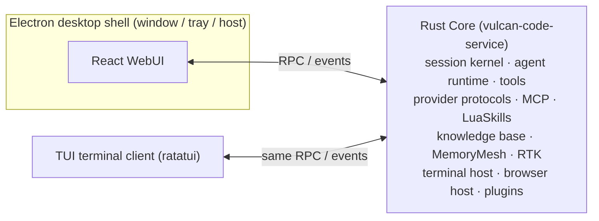

<div align="center">


# Vulcan Code

**An open-source AI Coding workbench: GUI desktop app + terminal TUI**

Rust Core · Electron desktop shell · React WebUI · ratatui TUI

[](LICENSE)
[](https://github.com/OpenVulcan/vulcan-code/issues)
[](https://github.com/OpenVulcan/vulcan-code/pulls)

**English** | [简体中文](README.zh-CN.md) | [繁體中文](README.zh-TW.md) | [日本語](README.ja.md) | [한국어](README.ko.md) | [Español](README.es.md) | [Français](README.fr.md) | [Deutsch](README.de.md) | [Русский](README.ru.md) | [Português](README.pt-BR.md)

</div>

> This is a translation of the [Simplified Chinese README](README.zh-CN.md). If the two differ, the Chinese version is authoritative. Translation fixes are welcome via PR.

---

## About

Vulcan Code is an **AI Coding application** with two clients: a GUI desktop app and a terminal TUI. It brings projects, sessions, terminals, a browser, code review and Git commits into a single workbench, so AI can understand your code, move tasks forward, and deliver results you can inspect.

The project has been developed and debugged internally for a long time and is now open source under the **MIT License**. We want it to be more than one team's product — a tool the community shapes together:

- 🐛 Found a problem or have an idea? Open an [Issue](https://github.com/OpenVulcan/vulcan-code/issues)
- 🔧 Fixed a bug or built a feature? Send a [Pull Request](https://github.com/OpenVulcan/vulcan-code/pulls)
- 🤝 Users and developers alike are welcome to join in and help build an AI Coding tool everyone loves

## Highlights

### 🧭 Desktop workbench

- Multiple projects and sessions, with freely combined panels for files, review, memory and sub-agents
- Built-in project terminal with tabs; AI can hold long-running or interactive command sessions
- Streaming answers with Markdown, code blocks, Mermaid/SVG diagrams and tool-call cards rendered inline
- Edit a past prompt to regenerate, or fork a new session from any completed turn
- Chinese and English UI, light and dark themes

### 💻 Terminal client (TUI)

- The same workbench in your terminal: projects and sessions, conversation and thinking, tool calls, questions, Git changes and commits, plus memory, knowledge base, skills, agents, plugin management and system settings
- Shares the same service interface as the WebUI and connects to the same Core
- Full mouse support: click, double-click, context menu and wheel; command palette, slash commands and shortcuts
- Open it from the tray menu, or build and start it with `make bt`; see the [TUI guide](apps/vulcan-code-tui/README.md)

### 🎯 Getting tasks done

- **Goal mode**: set a goal and a token budget; AI keeps working turn by turn, and you can pause, resume or clear it
- **Plan mode**: explore and draft a plan first, execute after you confirm
- **Steering while running**: add instructions or queue follow-up requests while a task is running
- **Sub-agents**: built-in roles such as Explore and Plan, plus 260+ role templates from [agency-agents](https://github.com/msitarzewski/agency-agents) (off by default, enable as needed)
- **Structured questions**: when AI needs a decision from you, it asks with option cards

### 🧠 Understanding code and retaining experience

- **CodeKit code navigation**: structure lookup, text search, function body extraction and whole-function replacement directly on the live working tree; there is no prebuilt index, so nothing goes stale. Connect an external MCP service when you need semantic code search
- **AI-managed knowledge base**: AI organizes, reads and searches long-term material with dedicated tools, with BM25, vector and hybrid search; history is kept permanently and can be restored; grant access per project and select per session
- **MemoryMesh long-term memory**: distills experience after each turn and recalls it before the next; memories can be viewed, corrected and deleted, with a recycle bin and source tracing

### 🔍 Results you can inspect

- **Diff review**: unified/split views, word-level diffs, full-text search, stage and revert
- **Git commits**: AI-generated commit messages, commit to the current or a new branch, and push directly
- **AI browser**: AI navigates, clicks, takes screenshots and reads the console in a real Chromium page; you can take over control at any time

### 🧩 Extensible

- **Prompt skills** (`SKILL.md`): capture how your team works and reuse it next time
- **LuaSkills**: package common actions into configurable, installable programmatic capability packs
- **MCP**: local-process and HTTP MCP servers, with connection diagnostics and tool schema inspection
- **MCP service**: Vulcan is an MCP server too. Other AI tools such as Claude Code and Codex can, as granted, list projects and sessions, send a message and wait for the reply, start sessions, stop runs and answer questions, and call separately granted image and video models; each tool gets its own token, and permission approvals always stay in Vulcan
- **Plugin system**: plugins can provide tools and mount their own UI. Built-in plugins: Context7 docs lookup, AI browser, usage statistics, CDP/DAP debugging tools

### ⚙️ Models and providers

- Supports the OpenAI, Anthropic, Gemini and Cohere protocol families, with built-in configurations for OpenAI, Anthropic, Google, DeepSeek, Kimi, MiniMax, Alibaba, OpenRouter and more; custom providers can be added
- Chat, memory retrieval, knowledge-base vectors and media generation can each use a different model
- Extended capabilities: web search and fetch, image/video/audio understanding, image and video generation, speech synthesis and transcription
- Layered context-window policies, with automatic or manual (`/compact`) context compaction
- **RTK command-output compression**: RTK is integrated natively in the host, compressing command output and Git commit context to cut token use; toggle it in settings and view savings statistics
- Token usage, latency and reference cost statistics

## Roadmap

The **GUI desktop app** and the **terminal TUI** are available today. Next up:

- [ ] **Remote mobile connection**: view and control sessions running on your desktop from your phone
- [ ] **Linux / macOS verification**: build scripts are in place, full verification on each platform is still needed

If any of these interest you, or you have new ideas, let's discuss in the Issues.

## Architecture



The Core service can run on its own in the background (system tray); closing the desktop window or quitting the TUI does not interrupt running tasks. The desktop app, the WebUI in a browser and the TUI all connect to the same Core.

| Directory | Description |
| --- | --- |
| `apps/vulcan-code-service` | Core service host: session kernel, agent runtime and WebUI RPC/streaming services |
| `apps/vulcan-code-desktop` | Electron desktop shell: window and tray; starts the local Core and loads the WebUI |
| `apps/vulcan-code-web` | React/Vite WebUI: workbench, settings, sessions, diff, skills and more |
| `apps/vulcan-code-tui` | TUI terminal client (ratatui), calling the same service interface with the WebUI's functions and parameters |
| `crates/vulcan-agent-runtime` | Shared agent runtime: providers, tools, LuaSkills, MCP, streaming execution |
| `crates/vulcan-service-*` | Backend service API, core service kernel and runtime adapters |
| `crates/vulcan-memorymesh-*` | MemoryMesh long-term memory |
| `crates/vulcan-runtime-assets` | Authoritative resources: system prompts, provider manifests, sub-agent templates |
| `plugins/` | Built-in plugins |
| `docs/contracts/` | Development contract documents |

## Getting started

> Full verification has been done on **Windows x86_64**. Linux and macOS have a matching `make.sh` script but have not been fully run end to end yet — help verifying is welcome.

### Requirements

- `make`
- [Rustup](https://rustup.rs/): the toolchain version is pinned by `rust-toolchain.toml` and installed automatically
- PowerShell 7
- Node.js and pnpm

### Build and run

```bash
make init-system   # First time: install Rust tools, host dependencies and managed Node/pnpm
make sync          # Sync config, system skills, plugins and browser runtime into output/
make build         # Build Core, WebUI and the Electron desktop shell
make run           # Launch the desktop app
```

You can also use `make br` to build and run in one step; `make bt` does a full build, starts Core and opens the TUI, without the desktop app or Vite. Use `make release` for release builds.

See [`docs/contracts/development-environment.md`](docs/contracts/development-environment.md) for detailed environment notes.

### Day-to-day development

The Vite dev server, the Core service and the Electron shell are independent and can be started and restarted separately:

```bash
make vite start      # Start the WebUI Vite dev server (also supports status / stop)
make service         # Start only the background Core, without the desktop window
make core-restart    # Rust Core changes only: incremental build and hot-swap the Core (Windows Debug)
make sync            # Re-sync after changing resources, config, skills or plugins
```

- For WebUI-only changes, keep Vite and the desktop shell running to get hot reload
- In debug mode, `make run` / `make br` make sure Vite is running
- Do not edit `output/` directly; authoritative resources live in `crates/vulcan-runtime-assets/resources/`

## Contributing

All kinds of contributions are welcome: bug reports, docs, UX improvements, new platforms, new providers, plugins and skills…

**Opening an Issue**

- Bugs: include your OS, reproduction steps, expected vs. actual behavior, and relevant logs or screenshots
- Feature requests: describe the use case and the problem you want to solve

**Opening a PR**

1. Fork the repository and create a branch from `main`
2. Read [`AGENTS.md`](AGENTS.md) before making changes. It records the repository's long-term conventions; for specific areas, also read the matching documents in [`docs/contracts/`](docs/contracts/)
3. Verify locally before submitting:

   ```bash
   # Rust: prefer targeted checks on the crates you changed
   cargo check -p <crate> --all-targets
   cargo nextest run -p <crate>

   # WebUI
   pnpm --dir apps/vulcan-code-web run lint
   pnpm --dir apps/vulcan-code-web run test
   pnpm --dir apps/vulcan-code-web run build
   ```

4. In the PR description, explain what changed, why, and how you verified it

A few conventions:

- AI-facing tool names, descriptions and schemas are written in English; user-facing UI text is localized
- Build and test concurrency is limited to 4 by default; please don't remove this limit in verification commands
- Keep each PR focused on one thing to make review easier

## Acknowledgments

Vulcan Code is built on many excellent open-source projects. Thanks to their authors and communities.

**Bundled components and tools**

- [RTK](https://github.com/rtk-ai/rtk): command-output compression to save tokens (integrated natively in the host)
- [Context7](https://github.com/upstash/context7): up-to-date, version-aware library docs (Context7 plugin)
- [Playwright](https://github.com/microsoft/playwright) / [Playwright MCP](https://github.com/microsoft/playwright-mcp): driver and tools for the AI browser
- [LuaSkills](https://github.com/LuaSkills/luaskills): LuaSkills runtime
- [ripgrep](https://github.com/BurntSushi/ripgrep) and [ast-grep](https://github.com/ast-grep/ast-grep): bundled text and syntax-tree search tools

**Desktop and UI**

- [Electron](https://www.electronjs.org/): desktop shell
- [React](https://react.dev/) and [Vite](https://vite.dev/): WebUI framework and build tool
- [shadcn/ui](https://ui.shadcn.com/), [Radix UI](https://www.radix-ui.com/), [Tailwind CSS](https://tailwindcss.com/): components and styling
- [xterm.js](https://xtermjs.org/): terminal rendering
- [Shiki](https://shiki.style/): code and diff syntax highlighting
- [Mermaid](https://mermaid.js.org/): diagram rendering
- [Lucide](https://lucide.dev/), [Iconify](https://iconify.design/): icons

**Terminal client**

- [Ratatui](https://ratatui.rs/): TUI rendering framework

**Rust Core**

- [Tokio](https://tokio.rs/) and [Axum](https://github.com/tokio-rs/axum): async runtime and service framework
- [rmcp](https://github.com/modelcontextprotocol/rust-sdk): the official MCP Rust SDK
- [LanceDB](https://github.com/lancedb/lancedb) and [Apache Arrow](https://arrow.apache.org/): vector index and columnar data
- [SQLite](https://sqlite.org/) ([rusqlite](https://github.com/rusqlite/rusqlite)): local data storage
- [jieba-rs](https://github.com/messense/jieba-rs): Chinese word segmentation for knowledge-base full-text search
- [portable-pty](https://github.com/wezterm/wezterm) (WezTerm): cross-platform pseudo-terminal

**Design and implementation references**

- [OpenAI Codex](https://github.com/openai/codex): reference for Responses protocol transport, retries and context compaction; the Apply Patch grammar and streaming parser are adapted from Codex
- [cc-switch](https://github.com/farion1231/cc-switch): reference for multi-protocol conversion, streaming tool calls and model pricing data
- [CLIProxyAPI](https://github.com/router-for-me/CLIProxyAPI): reference for the Gemini protocol and compatibility conversion
- [OpenCode](https://github.com/anomalyco/opencode): reference for provider catalogs and system prompts
- [agency-agents](https://github.com/msitarzewski/agency-agents): source of the sub-agent role templates
- [Answer me with HTML](https://github.com/QingYunA/answer-me-with-html): design inspiration for answer components (findings, comparisons, flows and other structured blocks); our component syntax and native in-conversation rendering are implemented independently, without its CLI

**Community**

- [LINUX DO](https://linux.do/): thanks to the LINUX DO community for its support and discussions

For the full list of third-party dependencies and licenses, see [`THIRD_PARTY_NOTICES.md`](crates/vulcan-runtime-assets/resources/licenses/THIRD_PARTY_NOTICES.md), or browse them in the app under **Settings → About and licenses**.

## License

[MIT](LICENSE) © 2026 OpenVulcan
