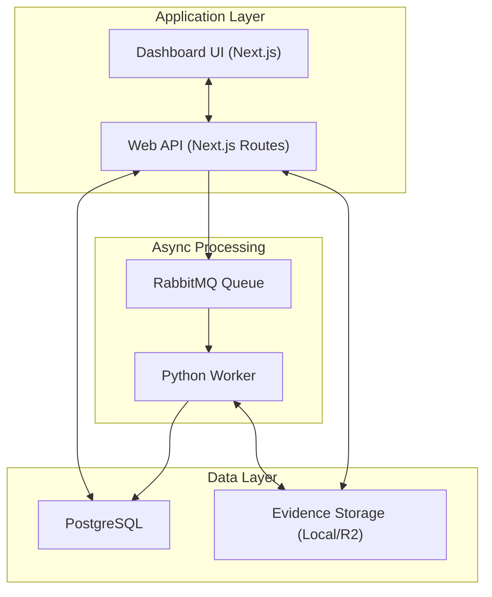

# Genwolf OSS

<p align="center">
  
</p>

[](LICENSE)

Genwolf is an open-source AI monitoring platform that tracks how brands appear inside AI-generated answers. It provides data and analytics so you can make informed decisions about your content strategy.

Website: [genwolf.ai](https://www.genwolf.ai/)

## How It Works

1. You define prompts for your workspace.
2. Genwolf triggers runs against selected AI engines.
3. Worker extracts detections (mentions + citations) and enriches brands/domains.
4. Results are written to the DB and mapped to Brand Registry entities.
5. Dashboard aggregates metrics (visibility, citations, share of voice, trends).

## Quickstart

This is the shortest path: run the full stack with Docker Compose (web, worker, RabbitMQ, Postgres).

### Prerequisites

- Docker + Docker Compose v2

### 1. Configure environment

```bash
cp .env.example .env
```

Add API key(s) in `.env` for the providers you want to use.
One key is enough for local start, but disable unused engines to avoid run failures.

Example (OpenAI-only):

```env
ENABLE_OPENAI_API=true
ENABLE_GEMINI_API=false
ENABLE_PERPLEXITY_API=false
OPENAI_API_KEY=your_openai_api_key_here
```

### 2. Start everything

```bash
docker compose -f infra/docker-compose.yml up --build -d
```

Then open:

- App: `http://localhost:3000`

## Production / Self-Hosting Notes

- Use managed Postgres and durable RabbitMQ in production.
- Configure object storage for evidence (`STORAGE_BACKEND=r2`) and R2 credentials.
- Set all auth and worker JWT secrets explicitly (do not use dev defaults).
- Run web and worker as separate services; scale worker horizontally by queue load.
- Put `/api/worker/*` behind service JWT auth and restrict ingress by network policy.
- Add backups for Postgres and lifecycle retention for evidence assets.

## Authentication

Genwolf OSS uses two auth modes:

- User auth (dashboard): Better Auth with email/password sessions
- Service auth (worker callbacks): JWT Bearer tokens for worker/internal API routes

User auth (web app):

- Public routes: `/sign-in`, `/sign-up`
- App routes require a valid session
- Email/password enabled, no OAuth providers in OSS flow
- Email verification is not required in OSS flow

Worker/service auth:

- `/api/worker/*` and `/api/internal/*` use service JWT auth (not session auth)
- Worker sends `Authorization: Bearer <jwt>` signed with `WORKER_JWT_SECRET`
- Web validates issuer/audience/expiry/scopes/workspace access for worker tokens

Production checklist:

- set strong `BETTER_AUTH_SECRET` and `WORKER_JWT_SECRET`
- keep `WORKER_JWT_ISSUER` / `WORKER_JWT_AUDIENCE` aligned between web and worker
- restrict access to `/api/worker/*` and `/api/internal/*` by network policy
- place web behind a reverse proxy / TLS terminator

## Monorepo Structure

```
genwolf-oss/
  apps/web/       Next.js dashboard, API routes, database (Prisma/PostgreSQL)
  apps/worker/    Python worker: LLM processing, brand detection, enrichment
  docs/           Unified documentation (features, architecture, setup, operations)
  infra/          Docker Compose for local dev (PostgreSQL, RabbitMQ)
  .env.example    Shared environment variable reference
```

## Architecture



## Documentation

Comprehensive docs live in [docs/README.md](docs/README.md).

## Sub-Project READMEs

- [Web Dashboard README](apps/web/README.md)
- [Worker README](apps/worker/README.md)

## CI

GitHub Actions workflow [`.github/workflows/ci.yml`](.github/workflows/ci.yml) runs on pull requests and pushes to `main`:

- `apps/web`: `npm test` and `npm run build`
- `apps/worker`: `pytest -q`

## Roadmap

- Add more LLM providers and models beyond current OpenAI/Gemini/Perplexity connectors

## Community & Governance

- [Contributing Guide](CONTRIBUTING.md)
- [Code of Conduct](CODE_OF_CONDUCT.md)
- [Security Policy](SECURITY.md)

## License

MIT
