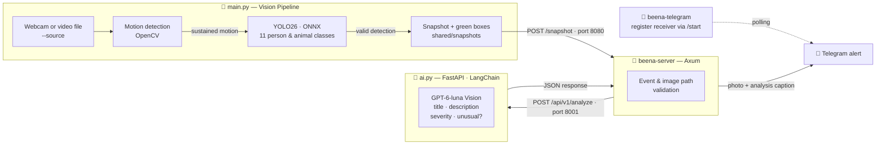

<p align="center">
  
</p>

<h1 align="center">🐝 Beena</h1>

<p align="center">
  <b>The Watchful Eye of Your Home</b> · Smart, open-source home guardian · v1.0
</p>

<p align="center">
  
  
  
  
  
  
  
  
</p>

**Beena** watches your camera feed — but not like a dumb recorder. Like a guard that understands. It senses motion, takes only **people and animals** seriously, captures a snapshot of the moment that matters, analyzes the scene with AI, and sends the result straight to your **Telegram** along with the photo itself.

Everything runs **on your own machine**: motion and object detection are fully local, and only the snapshot of that specific moment goes to a vision-language model to produce a short description.

##  Beena at a Glance

-  **Smart motion detection** — frame differencing with Gaussian blur and mathematical morphology; camera shake and subtle lighting changes are not mistaken for real movement.
-  **Local machine vision** — a **YOLO26** model on ONNX Runtime and CPU; of COCO's 80 classes, only the 11 that matter for home security: `person`, `bird`, `cat`, `dog`, `horse`, `sheep`, `cow`, `elephant`, `bear`, `zebra`, `giraffe`.
-  **AI scene analysis** — for every event it produces a **short title, a 1–3 sentence description, a severity level** (low / medium / high) and an **unusual** flag.
-  **Smart snapshots** — only when a person or animal is really in the frame; green boxes with class labels drawn on the image, and a **5-second cooldown** between events.
-  **Instant Telegram alerts** — photo + analysis through a lightweight teloxide bot; setting it up is a single `/start`.
-  **Privacy-first and ethics-aware** — no identification of people, no intent judgment, strict image-path validation, and no reads outside the shared folder.

<p align="center">
  
  <br/>
  <sub>Real output of v1.0 — a <code>person</code> detected at 0.94 confidence on the test video, with automatic analysis of the same frame</sub>
</p>

##  Architecture

Beena is built from **four independent processes** that talk to each other over HTTP and a shared disk space; each one can be kept separate, restarted, or later moved to another machine.



| Service | Run | Technology | Address | Role |
|---|---|---|---|---|
| **Vision pipeline** | `python main.py` | Python · OpenCV · ONNX Runtime | — | camera, motion, YOLO, snapshots |
| **AI service** | `python ai.py` | Python · FastAPI · LangChain | `127.0.0.1:8001` | visual analysis of each event |
| **Coordination core** | `cargo run --bin beena-server` | Rust · Axum · Tokio | `127.0.0.1:8080` | receive events, analyze, send alerts |
| **Telegram bot** | `cargo run --bin beena-telegram` | Rust · teloxide | polling | register the alert receiver via `/start` |

### The journey of an event, in six steps

1. **Frame acquisition** — frames come from the live webcam (no arguments) or a video file via `--source`; video files play at their real FPS.
2. **Motion detection** — each frame is grayscaled, Gaussian-blurred and compared with the previous one; morphology cleans up noise, and motion only counts as "real" after at least **2 consecutive frames**.
3. **Machine vision** — after every **10 frames of sustained motion**, a copy of the frame goes **asynchronously** to YOLO26, so the camera loop never stalls for inference.
4. **Snapshot** — if a person or animal is present with enough confidence, the labeled frame is saved to `shared/snapshots/`; back-to-back events are rate-limited by a **5-second cooldown**.
5. **AI analysis** — the Rust core forwards the event to the AI service; the image (with a size limit and path checks) reaches the vision model and comes back as a **guaranteed structured response** (JSON Schema).
6. **Notification** — the core sends the photo with the analysis caption to Telegram and returns `202 Accepted` to the pipeline.

##  Quick Start

### Prerequisites

- **Rust** (stable) — via [rustup](https://rustup.rs)
- **Python 3.11+**
- An OpenAI-compatible API key (or any compatible service)
- A Telegram bot: get a token from [@BotFather](https://t.me/BotFather)

### Installation

```bash
git clone https://github.com/Owurk/Beena.git     # your repository URL
cd beena

# Python dependencies
python -m venv .venv
source .venv/bin/activate   # Windows: .venv\Scripts\activate
pip install -r requirements.txt
pip install fastapi "uvicorn[standard]" pydantic python-dotenv langchain-openai langchain-core

# Configuration
cp .env.example .env        # fill in the values, see the table below
```

>  **Important:** run all commands from the **project root**; the model path (`models/yolo26n.onnx`) is resolved relative to it.

### Run — four terminals

```bash
# 1) AI service  (127.0.0.1:8001)
python ai.py

# 2) Coordination core  (127.0.0.1:8080)
cargo run --bin beena-server

# 3) Telegram bot
cargo run --bin beena-telegram
#    Now open your bot in Telegram and send /start
#    so your chat_id is stored in telegram.json.

# 4) Vision pipeline
python main.py                          # live webcam
python main.py --source walking.mp4     # video file
python main.py --source walking.mp4 --no-show   # headless
```

The preview window shows the live status: `Motion: TRUE/FALSE`, the changed-pixel ratio, the thresholds and the camera index. Press `q` to quit. A video file keeps playing until it ends and then exits cleanly.

### `main.py` command-line parameters

| Parameter | Default | Description |
|---|---|---|
| `pixelThreshold` | `25` | per-pixel difference threshold — 1 to 255 |
| `minChangedRatio` | `0.002` | minimum changed-pixel ratio per frame — 0 to 1 |
| `confidenceThreshold` | `0.5` | minimum confidence to accept a YOLO detection |
| `yoloInterval` | `10` | run YOLO once every N frames with motion |
| `cameraIndex` | `0` | webcam index — 0 to 10 |
| `--source FILE` | — | play a video file instead of the webcam, e.g. `walking.mp4` |
| `--no-show` | — | run without the preview window |

##  Configuration (`.env`)

```env
OPENAI_API_KEY=sk-...
OPENAI_BASE_URL=...            # optional — for OpenAI-compatible services
AI_PROVIDER=openai
AI_MODEL=gpt-6-luna
AI_TIMEOUT_SECONDS=30
SHARED_STORAGE_ROOT=./shared
MAX_IMAGE_SIZE_MB=10
TELOXIDE_TOKEN=123456:ABC-...  # bot token from BotFather — required by both Rust binaries
```

| Variable | Default | Used by | Description |
|---|---|---|---|
| `OPENAI_API_KEY` | — | `ai.py` | vision model API key — required |
| `OPENAI_BASE_URL` | — | `ai.py` | OpenAI-compatible service URL — optional |
| `AI_PROVIDER` | `openai` | `ai.py` | only `openai` is supported for now |
| `AI_MODEL` | `gpt-6-luna` | `ai.py` | image analysis model |
| `AI_TIMEOUT_SECONDS` | `30` | `ai.py` | timeout for each analysis request |
| `SHARED_STORAGE_ROOT` | `./shared` | `ai.py` and both Rust binaries | root of the shared snapshots space |
| `MAX_IMAGE_SIZE_MB` | `10` | `ai.py` | size cap for images sent to analysis |
| `TELOXIDE_TOKEN` | — | `beena-server` and `beena-telegram` | Telegram bot token — required |

On top of these, **`telegram.json`** is created automatically: with the first `/start`, your chat ID is stored in it and Beena sends alerts to **that single receiver** only.

##  API

### `POST /snapshot` — coordination core (port 8080)

Every verified event reported by `main.py` uses this structure:

```json
{
  "event_id": "7c9e6679-7425-40de-944b-e07fc1f90ae7",
  "image_path": "snapshots/detect_20261112_155123.jpg",
  "local_time": "2026-11-12T15:51:23+03:30",
  "detected_class": "person",
  "confidence": 0.94,
  "camera_name": "walking.mp4"
}
```

- `image_path` is always **relative** to `SHARED_STORAGE_ROOT`; absolute paths or paths containing `..` are rejected with `400`.
- If the Telegram bot is not configured yet, the response is `503`; if the AI analysis fails, `502`.
- On success: `202 Accepted`.

### `POST /api/v1/analyze` — AI service (port 8001)

Takes the same event payload, loads the image from the shared space (allowed extensions: `jpg` / `jpeg` / `png` / `webp`, at most `MAX_IMAGE_SIZE_MB`) and returns a structured response:

```json
{
  "event_id": "7c9e6679-7425-40de-944b-e07fc1f90ae7",
  "analysis": {
    "title": "Person Standing in Hallway",
    "description": "A person wearing a pink button-up shirt stands facing the camera in a dim hallway.",
    "severity": "low",
    "is_unusual": false
  }
}
```

Errors: `404` image not found · `400` invalid image · `502` analysis failed.

### `GET /health` — AI service health check

```json
{ "status": "ok", "service": "Beena-ai" }
```

##  Project structure

```
.
├── main.py                  # main vision loop: motion → YOLO → snapshot → alert
├── ai.py                    # AI analysis service (FastAPI · 127.0.0.1:8001)
├── capture.py               # video source access layer (webcam / video file)
├── motion_detector.py       # motion detection: Gaussian + frame diff + morphology
├── yolo_detector.py         # YOLO26 on ONNX Runtime (CPU) + class filtering
├── requirements.txt
├── .env.example
├── models/
│   ├── yolo26n.onnx         # object detection model (640×640, CPUExecutionProvider)
│   └── coco.names           # the 80 COCO class names; 11 person/animal classes are used
└── beena-core/
    ├── Cargo.toml
    └── src/bin/
        ├── server.rs        # beena-server — coordination core (Axum · 127.0.0.1:8080)
        └── telegram.rs      # beena-telegram — alert receiver registration (teloxide)
```

##  Privacy & design principles

These principles are not just slogans; they are written directly into the system prompt and the code:

- **Describe behavior, never judge intent** — the analysis never calls anyone a thief or an intruder; a person's mere presence is not suspicious.
- **No identification of people** — age, gender, ethnicity or other personal traits are never guessed; clothing and visible actions are fine.
- **Cautious by default** — when unsure, it picks the lower severity and sets `is_unusual: false`.
- **Trust the image, not the label** — the green boxes are just detector output; if the image disagrees with the detector's claim, the scene is described as it really is.
- **Immune to in-image instructions** — text visible inside the scene is never followed as an instruction.
- **Minimal data** — motion and object detection are fully local; only the snapshot of that event is used to analyze that event.
- **Path validation** — neither the Rust core nor the AI service will read an image from outside the shared folder.
- **Single receiver** — only the first user who sends `/start` receives notifications.

##  Roadmap

- [ ] **RTSP** network camera support (not available in v1.0 — webcam and video files only for now)
- [ ] Multiple simultaneous cameras
- [ ] Receiver management through the bot itself (multi-user)
- [ ] Event storage and search
- [ ] One-command deployment with Docker

##  Troubleshooting

| Problem | Likely cause and fix |
|---|---|
| `Could not open video source!` | The webcam is used by another program or the index is wrong; change the index as the fifth argument (e.g. `python main.py 25 0.002 0.5 10 1`). |
| `Failed to load ONNX model` | You are not running from the project root; the `models/` path is relative. |
| `OPENAI_API_KEY is not configured.` | Create the `.env` file next to `ai.py` with a valid key. |
| Telegram message never arrives | You have not sent `/start` to the bot (`telegram.json` missing) or `TELOXIDE_TOKEN` is wrong. |
| `503` response when sending an event | The Telegram bot is not configured yet — send `/start` and try again. |
| Video plays faster than reality | It shouldn't; `main.py` paces playback to the file's FPS — if the file's FPS is zero, 30 is used automatically. |

---

<p align="center">
  Built with ☕ and love ·
  <a href="https://github.com/Owurk/Beena">GitHub</a>
</p>
