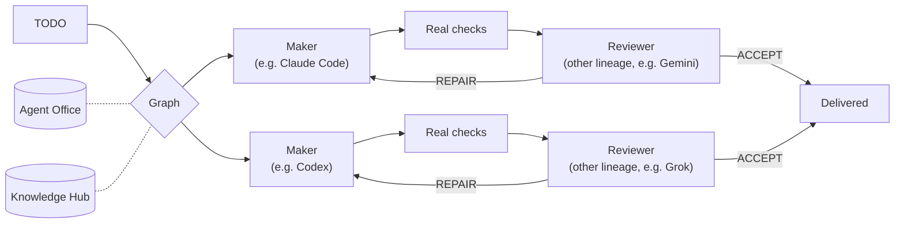

<div align="center">

# AI Stack

**One model builds. A different model reviews. Nothing ships on a single model's word.**

A multi-model agent stack that runs the coding CLIs you already pay for —
Claude Code, Codex, Gemini (Antigravity), Grok, Kimi, Qwen, Mistral, OpenCode,
local models and more — as one team, with task graphs, 60+ skills,
agent-to-agent messaging and shared memory.

[](LICENSE)
[](global/codex/skills)
[](fleet-suite)
[](SECURITY.md)

From the team at [Synaptivo](https://synaptivo.eu).


</div>

## Why it exists

Single-agent coding tools grade their own homework. AI Stack never does:

- **Cross-lineage review by default.** Every task is a maker/reviewer pair from
  different model families (for example Claude builds, Gemini or Grok reviews).
  A failed review triggers a targeted repair, not a rewrite.
- **Your subscriptions, not surprise API bills.** The native Fleet drives the
  official CLIs headless with their own authentication, verifies which model
  actually answered, and never falls back to pay-as-you-go silently.
- **Task graphs for real parallel work.** Small jobs use one pair; larger jobs
  run as a dependency graph with independent reviewers per node.
- **Agents that talk to each other.** Agent Office is a local, durable message
  bus with presence and handoffs between sessions of different tools.
- **Shared memory.** Knowledge Hub is a source-grounded wiki every agent reads
  before work and records to after it.
- **A stack that reports its own bugs.** RSI Helpdesk lets agents file defects in
  the stack itself and run bounded, reviewed repairs.



## Quick start: use the skills today

Each folder in [`global/codex/skills/`](global/codex/skills) is a skill in the
`SKILL.md` format. Many are self-contained and work in any client that loads
skill folders. For example, with Claude Code:

```sh
git clone https://github.com/PapeMati98/Ai-Stack.git
cp -r Ai-Stack/global/codex/skills/html-video ~/.claude/skills/
```

Good standalone starting points: `html-video`, `video-gen`, `voice-gen`,
`audio-bed-gen`, `operations-playbook`, `growth-experiments`,
`search-visibility`, `simulation-and-optimization`. Orchestration skills such as
`agent-graph`, `plan-delivery`, `model-council` and `clone-thread` need the Fleet,
Agent Office or Knowledge Hub. Some skill instructions are written in Polish;
English translations are welcome (see [CONTRIBUTING](CONTRIBUTING.md)).

The full stack (Fleet, Office, Hub) is Windows-first and tested by one
operator. Read [Getting started](docs/GETTING_STARTED.md) before installing it.

## What's inside

AI Stack combines reusable skills, native CLI execution, a dependency scheduler,
durable inter-agent coordination, shared project knowledge and a repair helpdesk.
Its main unit of work is a short TODO: an executor produces an artifact, real
checks run, and a reviewer from another model lineage accepts it or requests a
targeted repair. A Graph is useful when tasks have real parallel branches or
dependencies; a small task uses one maker/reviewer pair.

The release excludes private Git history, operator accounts, transcripts,
mail, wiki contents, customer records, runtime state, model weights and CLI
binaries. A source edition does not transfer anyone's subscription or access.

## Components

| Component | Source | Purpose |
|---|---|---|
| Native Fleet | `fleet-suite/` | Provider adapters, model and mode validation, quota evidence, pinned deployment and recovery |
| Graph and common skills | `global/codex/skills/` | TODO execution, independent review, historical context routing and reusable task guidance |
| Agent Office | `shared/agent-office/` | Presence, explicit durable messages, handoffs and coordination |
| Knowledge Hub | `shared/knowledge-hub/` | Source-grounded context, session capture and reviewed knowledge workflows |
| RSI Helpdesk | `global/codex/skills/rsi-helpdesk/` | Durable incident filing and bounded repair execution |
| Optional bridges | `shared/` and `global/tools/` | Desktop, browser, connector and service integrations with separate prerequisites |
| Release workbench | `tools/release-workbench/` | Pinned source export, exact inventory verification, privacy checks and provenance reports |

Optional connectors are source integrations, not services enabled by cloning
the repository. They require their own configured environment and permissions.
The release evidence must state which combinations actually passed; inclusion
of an adapter is not proof that all providers or operating systems were tested.

## Start safely

1. Read [Getting started](docs/GETTING_STARTED.md) and
   [Security boundaries](docs/SECURITY_BOUNDARIES.md).
2. Run the [offline synthetic walkthrough](tools/release-workbench/docs/QUICKSTART.md).
   It needs Python and Git, uses no model account and makes no external calls.
3. Inspect a fresh-profile installer plan before installing anything. Keep
   explicit profile and state directories separate from an existing stack.
4. Configure only the native providers you actually have permission to use.
   Preserve their data-use, billing and model identity checks. Run the
   synthetic native journey and retain its real execution and review evidence.

The offline walkthrough and native journey are different evidence. Neither
one constitutes security certification, legal clearance or permission to publish.
The [24-case offline reference](examples/delivery-evidence/README.md) and
[validation status](docs/VALIDATION_STATUS.md) describe their separate scope.

## What makes a delivery credible

An accepted delivery has the actual artifact, executable checks, the native
execution identity and an independent product review. A successful message,
scheduled task or process exit alone is insufficient. Failures and unavailable
measurements remain visible. Cached input and reasoning are not added again to
a provider's total-token figure.

Model selection follows configured capability classes and current evidence.
Unknown quota is unknown; a local token ledger is not an account-balance API.
There is no paid fallback implied by a failed subscription or free trial.

## Status and licensing

This is an engineering release, not a supported general release. See
[Validation status](docs/VALIDATION_STATUS.md) for completed checks and
remaining gaps. The repository is licensed under the [Apache License 2.0](LICENSE)
(see also [NOTICE](NOTICE)). Existing third-party notices remain with their
components and keep their own licenses, for example the vendored TypeScript
under `fleet-suite/payload/agent-fleet/scripts/vendor/typescript/`.

Client and project names in tests and examples are fictional placeholders.

Do not copy private production policies or qualification receipts into a public
installation. Configure your own trusted policy and prove your own provider
readiness. No model account, credential, production endpoint or access grant is
included in this repository.
