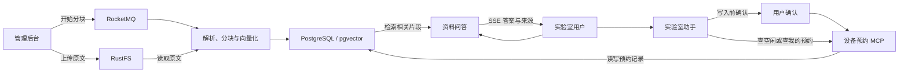

# LabDesk 实验室助手

**查实验规程、核对原文、预约设备。**

LabDesk 面向校内实验室。学生可以查设备操作规程和安全须知，从答案打开原文，也可以查设备空闲时段，在确认后提交预约。管理员可以上传资料、查看分块进度、管理成员和检查操作记录。

### 项目工作

- 将资料上传、向量入库、流式问答与引用预览串成实验室资料查询流程，配套编写可复现的样例和评测集。
- 新增设备、预约数据库和三个 MCP 工具，接入通用 Agent 的人工确认。用数据库约束裁决并发，处理同一用户重复提交。
- 整理 LabDesk 的工作台和 Windows 启停脚本，统一 Java 包名、制品和 API。通用 RAG、Agent、会话及工具确认框架来自既有底座，来源与许可见文末。

[界面预览](#界面预览) · [核心功能](#核心功能) · [系统流程](#系统流程) · [本机启动](#本机启动) · [演示与验收](#演示与验收) · [目录结构](#目录结构)

## 界面预览


<details>
<summary>查看登录、带引用的资料问答与预约确认</summary>

**登录页**


**资料问答**


**预约确认**


</details>

截图采自本机运行中的 LabDesk。资料与设备使用虚构演示数据，问答引用与确认卡由实际请求生成。

## 核心功能

### 资料入库与可追溯问答

- 原始文档保存在 RustFS。开始分块后，后端通过 RocketMQ 投递任务，消费者解析文档、计算向量，再写入 PostgreSQL/pgvector。
- 资料问答先检索相关片段，再通过 SSE 逐步显示答案。回答完成后可以展开来源，打开对应的原始文档核对。

### 设备预约与人工确认

- Agent 可以通过 MCP 查询某天的空闲时段和当前用户的预约。提交预约前，界面展示设备、日期和时段，用户确认后才执行写入。
- MCP 工具从服务端会话获取用户身份。预约只接受北京时间 `09:00` 到 `17:00` 的整点起始时间，每段一小时。

| MCP 工具 | 用途 |
| --- | --- |
| `lab_list_availability` | 按日期查询空闲时段，可指定设备。 |
| `lab_book_equipment` | 确认后为当前用户提交预约。 |
| `lab_list_my_bookings` | 查询当前用户的预约记录和编号。 |

### 重复提交与并发冲突

PostgreSQL 对「设备 + 起始时间」施加唯一约束。两人抢同一个时段时，先写入的一方成功，另一方收到时段已占用的提示。同一账户重复提交同一时段会得到原预约编号。预约保存在数据库，项目停止后可随原数据卷恢复。

## 系统流程



[源码导读与断点位置](docs/labdesk-guide.md)

## 技术栈

| 层次 | 技术 | 用途 |
| --- | --- | --- |
| 前端 | React、TypeScript、Vite | 实验室工作台、文档预览、流式对话与确认卡 |
| 后端 | Java 17、Spring Boot、MyBatis-Plus | 账号鉴权、知识库、文档处理、SSE 接口 |
| Agent 与模型 | AgentScope、MCP、DeepSeek、阿里云百炼 | 对话推理、工具调用与文本向量化 |
| 数据与中间件 | PostgreSQL、pgvector、Redis、RocketMQ、RustFS | 预约持久化、向量检索、登录状态、异步任务、原文存储 |
| 本机部署 | Docker Compose、PowerShell | 编排中间件、初始化数据库、启停 LabDesk |

## 本机启动

### 1. 准备环境

| 组件 | 要求 |
| --- | --- |
| 系统 | Windows，启动和停止使用 PowerShell 脚本或双击入口 |
| Java | JDK 17，可通过 `java -version` 检查 |
| 前端 | Node.js 22.12 或更新版本，可通过 `node --version` 检查 |
| 构建 | Maven，可通过 `mvn.cmd -v` 检查 |
| 中间件 | Docker Desktop 已启动 Linux 引擎，可通过 `docker compose version` 检查 |
| 模型 | 准备 DeepSeek 和阿里云百炼 API Key，启动时在本机输入 |

### 2. 下载并构建

在 PowerShell 运行以下命令。克隆只取 `main` 的最新提交。

```powershell
git clone --depth 1 --single-branch --branch main https://github.com/QYL66/labdesk.git
cd labdesk
mvn.cmd -DskipTests package
Push-Location frontend
npm.cmd ci
npm.cmd test
Pop-Location
```

Maven 生成 `bootstrap/target/labdesk-bootstrap-0.0.1-SNAPSHOT.jar` 和 `mcp-server/target/labdesk-mcp-server-0.0.1-SNAPSHOT.jar`。浏览器通过 Vite 代理访问 `/api/labdesk`。

### 3. 启动和登录

启动脚本使用本机 Docker 镜像。首次运行前，若本机缺少镜像，可用 `docker pull <镜像>` 拉取下表对应版本。

| 服务 | 镜像 |
| --- | --- |
| PostgreSQL + pgvector | `pgvector/pgvector:pg16` |
| Redis | `redis:8.4-alpine` |
| RustFS | `rustfs/rustfs:1.0.0-alpha.72` |
| RocketMQ | `apache/rocketmq:5.2.0` |

1. 双击 [启动 LabDesk](local/Start-LabDesk.cmd)。首次启动时设置至少 12 个字符的管理员密码。每次启动后端时，按窗口提示输入两把模型 Key。
2. 打开 [本机工作台](http://127.0.0.1:15173/) 后，用 `admin` 和刚设置的密码登录。
3. 双击 [导入演示资料](local/Import-LabDeskDemo.cmd)。脚本创建 `LabDeskDemo` 知识库、导入三份虚构文档并检查分块状态。
4. 用完后双击 [停止 LabDesk](local/Stop-LabDesk.cmd)。数据库和对象存储数据保存在 `labdesk-local` 的 Compose 数据卷中。

### 常见问题

| 现象 | 检查位置 |
| --- | --- |
| 提示缺少构建产物 | 在根目录完成 Maven 打包，在 `frontend/` 完成 `npm.cmd ci`。 |
| 提示 Docker 引擎不可用 | 启动 Docker Desktop 并等待 Linux 引擎就绪。Docker CLI 路径也可用 `LABDESK_DOCKER_EXE` 指定。 |
| 脚本提示端口占用 | 检查提示中的端口，尤其是前端 `15173`、后端 `9090` 和 MCP `9099`。中间件端口见 [Compose 配置](local/compose.yaml)。 |
| 问答或分块失败 | 查看 `local/logs/` 中对应服务的日志。确认模型 Key 可用、网络可达、目标知识库已有分块成功的资料。 |

模型 Key 通过本地进程环境传递。调用云模型时，提问和召回的资料片段会发送给对应模型服务。演示可使用项目随附的虚构资料。

## 演示与验收

| 场景 | 操作 | 核对结果 |
| --- | --- | --- |
| 资料问答 | 进入「资料问答」，问“教学显微镜用完后要贴什么颜色的复位卡？” | 答案给出“青绿色”，可以展开来源并对照《设备操作规程》。 |
| 查看空闲 | 在「实验室助手」查询未来某天的 `SCOPE-01`。 | 返回设备、房间和可预约整点。 |
| 设备预约 | 从空闲列表选一个整点，发起预约并在卡片中确认。 | 获得预约编号，可在「查询我的预约」中找到。 |
| 冲突与重试 | 用两个账号预约同一时段，或用同一账号重试。 | 另一账号收到已占用提示，同一账号重试返回原编号。 |

[样例资料](resources/labdesk-demo) · [完整演示与验收步骤](docs/labdesk-demo.md) · [固定问答评测](docs/evaluation/README.md) · [预约设计与旧数据升级](docs/labdesk-booking.md)

### 本机实测

- **资料问答**。三份样例完成分块和向量入库。在线回答流式返回“青绿色复位卡”，打开引用可在《设备操作规程》中核对原文。
- **设备预约**。真实 Agent 发出确认请求。拒绝后没有写入，确认后生成一条预约。重启 PostgreSQL 容器后，查询个人预约仍返回原编号。
- **并发与重试**。两次并发 MCP 请求竞争同一时段时，数据库只保存一条记录。成功账户重试得到原编号，另一账户只能查询自己的预约。
- **自动检查**。命名迁移后，从空输出目录构建成功。前端类型检查、38 项前端回归、805 项后端测试和 18 项 MCP 实测通过。另有 24 项后端用例按条件跳过。

## 目录结构

| 路径 | 内容 |
| --- | --- |
| [`frontend/`](frontend) | 登录、资料问答、预约交互与管理后台 |
| [`bootstrap/`](bootstrap) | Spring Boot 应用入口与默认配置 |
| [`rag/`](rag) | 知识库、分块、检索、来源整理与流式问答 |
| [`agent/`](agent) | Agent 对话、MCP 调用、确认与流式事件 |
| [`mcp-server/`](mcp-server) | 日期与预约工具、设备数据及预约表 |
| [`system/`](system)、[`framework/`](framework)、[`infra-ai/`](infra-ai) | 账号和业务管理、通用基础能力、模型服务适配 |
| [`local/`](local) | Windows 启停、演示导入和 Compose 配置 |
| [`resources/`](resources) | 初始化 SQL、数据库迁移与演示资料 |
| [`docs/`](docs) | 源码导读、演示步骤和界面截图 |

## 开源许可

[Apache-2.0](LICENSE) · [第三方声明](OPEN_SOURCE.md)
