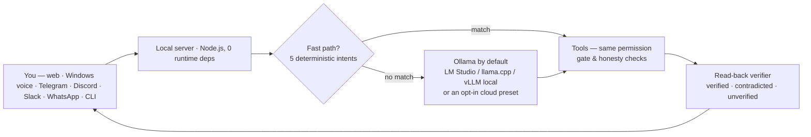

<p align="center">
  
</p>

<h1 align="center">Quasnooze</h1>

<p align="center">
  <strong>Your voice. In fluid motion. On your machine.</strong><br>
  A local-first personal AI assistant by <a href="https://github.com/Quasynvo">Quasynvo</a> — Ollama + MCP tools,<br>
  permission-first actions, verified results, and a voice interface you can watch think.
</p>

<p align="center">
  <a href="https://github.com/Quasynvo/Quasnooze/actions/workflows/ci.yml"></a>
  <a href="LICENSE"></a>
  
  
  
  <a href="docs/VOICE.md"></a>
</p>

<p align="center">
  <a href="#try-it-in-30-seconds-no-install">▶ Live demo</a> ·
  <a href="#start-in-three-steps">Quick start</a> ·
  <a href="#measured-results">Results</a> ·
  <a href="#how-it-compares">Compare</a> ·
  <a href="docs/GUIDE.md">Guide</a> ·
  <a href="docs/RESULTS.md">Reproduce the numbers</a>
</p>

**Quasnooze** is a personal AI assistant that runs on **your own computer**. Ask a question, plan your day, search your documents, set a reminder, or run tools — through the web, Windows voice, Telegram, Discord, Slack, or WhatsApp. Local reasoning comes from [Ollama](https://ollama.com); nothing needs a cloud account. Every tool is risk-classified: read-only work runs immediately, low-risk personal actions (memory, tasks, reminders) run through the same verified path, and sensitive actions — shell, files, system control — ask first.

Its deterministic fast path answers everyday intents — *“what time is it”, “remind me to call Priya in 15 minutes”* — in **4.3 ms p50 end-to-end instead of a ≥700 ms model round-trip**, with **31/31 labelled intents matched and 0 of 28 look-alike phrasings wrongly acted on** ([measured results](#measured-results)). And when an action claims success, Quasnooze reads the result back: **20/20 injected faults caught, 0 silent wrong-successes**.

```bash
git clone https://github.com/Quasynvo/Quasnooze.git && cd Quasnooze
npm run demo        # real panel, canned brain — no keys, no Ollama, ~2 seconds
```

- **Local by default** — Ollama reasoning on your machine; cloud providers, browser speech, and messaging channels are each opt-in with separate, explicit data boundaries
- **Permission-first** — read-only work runs instantly; sensitive, state-changing actions show a bounded preview and wait for **Allow once / Deny**; low-risk personal actions are verified after they run, never silently
- **Control plane** — owner kill switch, identity/ACL retrieval, model gateway + spend cap, durable HITL queue, and A2A worker envelopes that **cannot** inherit shell ([docs/CONTROL-PLANE.md](docs/CONTROL-PLANE.md))
- **Verified, not just “done”** — file writes, tasks, reminders, and calculations are read back and marked `verified`, `contradicted`, or honestly `unverified`
- **Zero runtime dependencies** — plain Node.js 22+, no mandatory packages, no CDN, no browser bundle for basic use
- **Surfaces** — web panel, Windows tray/voice host, CLI, Telegram, Discord, Slack, WhatsApp
- **License** — [MIT](LICENSE), open source

Repository: [github.com/Quasynvo/Quasnooze](https://github.com/Quasynvo/Quasnooze) · Live preview: [quasynvo.github.io/Quasnooze/demo](https://quasynvo.github.io/Quasnooze/demo/) · Full guide: [docs/GUIDE.md](docs/GUIDE.md)

> **Preview provenance:** the header is a silent, scripted walkthrough — not live AI, recorded microphone input, or a performance benchmark. Prefer less motion? Use the [static SVG](assets/banner.svg), or open the interface with your OS reduced-motion preference enabled. Existing installations: the product name, saved data, configuration aliases, and `pinch` CLI remain supported — this identity refresh does not move data or enable a microphone. [Compatibility details →](docs/REBRANDING.md)

---

## Try it in 30 seconds (no install)

**[▶ Open the live preview](https://quasynvo.github.io/Quasnooze/demo/)** — the conversation surface, scripted, in your browser. No install, no model, no tools, no microphone. Or explore the five Fluid Motion states directly: [visualizer playground ↗](https://quasynvo.github.io/Quasnooze/demo/visualizer.html).

Already have a checkout? `npm run demo` boots the real panel with a canned brain in about two seconds — no keys, no Ollama, no network.

## Start in three steps

**Requirements:** Node.js **22+**. Windows 10/11 for the native voice host; the web/channel assistant also runs on Linux and macOS.

### 1 · Get the code

```bash
git clone https://github.com/Quasynvo/Quasnooze.git
cd Quasnooze
```

### 2 · Configure and check

```bash
npm run setup     # guides model, workspace, access-key and optional-channel setup
npm run doctor    # verify the configuration
npm run brain     # probe the configured model and tools
```

Install/start **Ollama** and select an installed model for real local reasoning. Setup does not download a model, install a speech pack, or grant microphone permission automatically.

### 3 · Start your interface

```bash
npm start         # cross-platform web + configured-channel assistant (panel on port 7777)
# OR, on Windows:
npm run desktop   # native tray/widget + local voice host (starts muted)
```

Open the panel URL printed by the launcher. A keyless default server stays on loopback — **do not expose an unauthenticated assistant or forward its port**.

<details>
<summary><strong>Just want to look around first? Canned demo</strong></summary>

```bash
npm run demo
```

This uses a **canned brain**, not real model reasoning. It disables the panel key and is **not a security sandbox** — keep it local and treat tool permissions seriously. For a motion-only conversation preview open `/cosmic.html?demo=1`; for the five-state motion playground and optional microphone analysis open `/visualizer.html`.

</details>

---

## Measured results

Every number below ships with its sample size, its method, and a one-command reproduction. The full audit trail — including the failures — lives in **[docs/RESULTS.md](docs/RESULTS.md)**.

<p align="center">
  
</p>

| Result | Value | n | Reproduce |
|---|---|---:|---|
| Fast-path routing — deterministic intents matched | **31/31 (100%)** | 59 labelled utterances | `node scripts/fast-path-eval.js` |
| Look-alike phrasings wrongly acted on | **0/28** | 28 negatives | `node scripts/fast-path-eval.js` |
| Fast turn end-to-end (replaces a ≥700 ms model round-trip) | **p50 4.3 ms · p95 7.9 ms** | 50 turns | [docs/FAST-PATH-EVAL.md](docs/FAST-PATH-EVAL.md) |
| Conversation bench — deterministically gated turns | **60/60 (100%)** | 60 turns (16 live-loop, 44 recorded) | `node scripts/evaluate-conversation.js` |
| Verified execution — fault-injection verdicts | **20/20 · 0 silent wrong-successes** | 20 injected faults | `node --test test/verify.test.js` |
| Retrieval — Recall@1 / Recall@5 · MRR@5 | **0.93 / 1.00 · 1.00** | 7 answerable + 3 no-answer queries | `node scripts/evaluate-retrieval.js` |
| Speech command accuracy — clean / accented / noisy / numbers-&-names | **100% / 75.0% / 66.7% / 70.0%** | 48 synthetic text utterances | `npm run speech` |
| Full regression suite | **817/817 passed** | 67 test files, ~26 s | `node --test --test-concurrency=4` |

### Where Quasnooze loses — kept in the README on purpose

- **Speech on numbers-and-names: 70.0%** (was 60.0% — spoken digit groups like “88 42” are now joined before routing). The rest are acoustically wrong digits in the transcript itself (*15* heard as *50*); no router can recover those, and this repo will not edit its own exam to pretend otherwise. Attacking them properly — confirmation read-back for numeric arguments — is tracked in the issues.
- **Retrieval no-answer: fixed and measured.** A ≥50% query-term coverage gate now refuses vocabulary-overlap passages: **3/3 no-answer queries return empty, Recall@5 unchanged at 1.00**.
- **Voice latency:** ~1.5 s+ to first sound, silence-only turn-taking — far behind ~200 ms full-duplex research systems. Scored honestly in [docs/COMPETITIVE-FRONTIER.md](docs/COMPETITIVE-FRONTIER.md).
- **Not measured at all:** physical-microphone accuracy, real-user phrasing, and any named model's intelligence (the conversation bench's live tier uses an in-process mock brain). The speech figures are hand-authored *text* hypotheses scored by the shipped router — no microphone, no acoustic model, no recordings.

> Numbers are from the versioned corpora in `test-fixtures/` (speech corpus CC0-1.0), first measured 5 November 2026 and re-verified 6 November 2026 (`817/817` tests and every evaluator below re-run). The committed baselines are the runners' own output — a test compares them byte-for-byte, so a stale number fails the build instead of sitting here looking measured.

## How it compares

| | **Quasnooze** | Cloud voice assistants | Chat-channel assistant harnesses | Local LLM chat UIs |
|---|---|---|---|---|
| Runs fully on your machine | ✅ Ollama / LM Studio / llama.cpp / vLLM | ❌ cloud | ◐ optional | ✅ |
| Any major API key you already have | ✅ OpenAI · Anthropic · Gemini · Groq · OpenRouter · Mistral · DeepSeek · Together · xAI (`quasnooze providers`) | ◐ own ecosystem | ◐ varies | ◐ depends on the app |
| No account / API key needed | ✅ | ❌ | ◐ | ✅ |
| Permission gate before state-changing actions | ✅ risk tiers + bounded previews | ◐ confirmations for some actions | ◐ varies by harness | ❌ (no actions) |
| Actions verified by independent read-back | ✅ `verified / contradicted / unverified` | ❌ | ❌ | ❌ |
| Voice interface | ◐ Windows native + browser analysis | ✅ | ❌ text-first | ❌ |
| Chat channels (Telegram/Discord/Slack/WhatsApp) | ✅ | ❌ | ✅ | ❌ |
| Everyday tools (files, shell, reminders, tasks, docs) | ✅ 24 built-in + MCP | ◐ closed ecosystem | ✅ | ❌ chat only |
| Runtime dependencies to audit | **0** | n/a (hosted) | hundreds (typical) | varies |
| License | MIT | proprietary | varies | varies |

*Feature-level snapshot, November 2026, compiled from [docs/COMPETITIVE-FRONTIER.md](docs/COMPETITIVE-FRONTIER.md) — which also scores Quasnooze **behind** the field on latency, turn-taking, and OS-control breadth. Something out of date or wrong? Please [open an issue](https://github.com/Quasynvo/Quasnooze/issues/new/choose).*

---

## What it can do

| Ask it to… | What happens |
|---|---|
| *“What time is it?”* / *“What's 18% of 250?”* | Answered deterministically in ~4 ms — no model call ([fast path](docs/FAST-PATH-EVAL.md)) |
| *“Remind me to call Priya in 15 minutes”* | Reminder stored, then read back and marked verified |
| *“Find the travel policy in my documents”* | Bounded local BM25 search over your workspace, with citable sources |
| *“Add a task to renew the domain”* | Task created, verified against the task list |
| *“Remember the parking bay is 12”* | Stored in local memory; recall/forget any time |
| *“Run the tests”* / edit a file | Risk-classified: read-only runs instantly, state-changing asks first |
| *“Tidy my downloads”* | One approval for the whole plan; every move journaled, nothing deleted, `undo_last` reverses the batch |
| Anything ambiguous | Falls through to the local model — the fast path never guesses |

**37 built-in tools** — `shell`, `read_file`, `write_file`, `list_dir`, `grep`, `scan_project`, `calculator`, `time_now`, `remember`, `recall`, `forget`, `search_history`, `search_documents`, `search_web`, `add_task`, `list_tasks`, `complete_task`, `remind`, `list_reminders`, `cancel_reminder`, `schedule`, `open_url`, `screenshot`, `system_control`, `list_windows`, `focus_window`, `minimise_window`, `close_window`, `launch_app`, `type_text`, `read_clipboard`, `write_clipboard`, `move_path`, `rename_path`, `trash_path`, `undo_last`, `list_recent_changes` — plus custom tools and MCP servers. Inspect them without executing anything: `quasnooze tools` ([docs/TOOL-INVENTORY.md](docs/TOOL-INVENTORY.md)). The window/app tools act through the Windows companion only: names match open windows or an approved-executable list, ambiguous names return candidates instead of acting, and nothing model-provided is ever typed into a shell. Clipboard reads and writes ask on every call (never per session), show an exact write preview, refuse secret-shaped reads, and can be disabled with `QUASNOOZE_CLIPBOARD=off`. File actions (`move_path`, `rename_path`, `trash_path`) are approved as one plan and only ever rename: trash moves the file into a local `.quasnooze-trash` folder — never a delete — every mutation is journaled with its batch id, cross-root moves are refused rather than copied, `undo_last` reverses a batch (including a partially applied one, reporting exactly what it restored), and `list_recent_changes` shows the record.

### The permission gate

Read-only commands — `ls`, `cat`, `grep`, `git status` and friends run straight through. Anything that can change state is classified **act** (bounded preview, then **Allow once / Deny**) or **blocked**. An animation or a spoken “yes” can never approve an action. Details: [docs/ACTION-PREVIEWS.md](docs/ACTION-PREVIEWS.md) and the risk-tier table in [docs/GUIDE.md](docs/GUIDE.md).

## How it works



1. **Fast path first.** Five closed intents (`time_now`, `calculator`, `remember`, `add_task`, `remind`) match in microseconds and skip the model entirely — but never skip the permission classification, honesty guard, or telemetry. Unsure? It falls through to the model, 100% of the time. `QUASNOOZE_FAST_PATH=off` disables it exactly.
2. **Model second.** Ollama locally by default; LM Studio, llama.cpp, and vLLM locally, or one of nine cloud presets (OpenAI, Anthropic, Gemini, Groq, OpenRouter, Mistral, DeepSeek, Together, xAI) only if you select and key one — see [docs/PROVIDERS.md](docs/PROVIDERS.md). An unknown provider name falls back to local Ollama, never to a cloud.
3. **Verification last.** Tool results are read back where a trustworthy read-back exists; contradictions are surfaced to you, not paraphrased away.

## The Fluid Motion Voice Engine

Three phase-offset interference ribbons around a dark glass core. Each state changes geometry, rhythm, and colour — not just a label:

| State | Signature motion | Colour | What the signal means |
|---|---|---|---|
| **Idle** | Slow-breathing core, drifting ribbons | Ion cyan / violet | Ready or inactive — no claim a microphone is on |
| **Listening** | Expanding plasma ring, frequency-shaped ripples (when an analyser is connected) | Cyan / magenta | Live mic analysis in the playground, or listening reported by the native host |
| **Processing** | Accelerating orbital trails, a fourth ribbon | Violet / amber | Model or tool work — not a percentage-complete indicator |
| **Speaking** | High-contrast radial spectrum, luminous trails | Bright cyan / magenta | Native speech state, or a clearly labelled silent preview |
| **Error / interrupted** | One brief damped shake, warm glow that settles | Crimson / amber | Failed request, denied permission, interrupted stream |

**Signal honesty is a feature:** the UI distinguishes live FFT bands, a native scalar level, synthetic demo data, and state-only motion — and never presents one as another. Text deltas map to *thinking*, never *speaking*. Reduced-motion preferences (OS or in-app) are respected. Full contract: [docs/VISUALIZER.md](docs/VISUALIZER.md).

**Try it:** after starting Quasnooze, open `/visualizer.html` → explore the five states as silent synthetic previews → optionally **Enable microphone** for real, local frequency analysis (permission is requested only after that click; hiding the page releases it). The playground analyses audio — it does not transcribe speech or call a model.

> **Status:** the Windows voice host and browser conversation experience are previews. Physical Windows microphone, wake-word, startup, and accessibility acceptance still need hardware testing. The visualizer is a 2D canvas signal — not a 3D avatar, lip-sync system, or measurement of model progress.

## Voice and microphone setup

### Native Windows speech (`npm run desktop`)

Requires Windows PowerShell 5.1, .NET Framework 4.8, WinForms/System.Speech, and a compatible **English desktop speech recognizer** (modern Windows Voice Access alone does not establish that the classic recognizer is installed).

- Launch starts **muted**. Select **Talk locally**, or explicitly enable **Hey Quasnooze**, and wait for **LISTENING** before one instruction.
- **Mute** releases recognition. **Stop voice** stops speech/listening behaviour — it is not task cancellation.
- Recognition and synthesis are local. There is no silent cloud speech fallback.

[Windows setup and limitations →](docs/DESKTOP.md) · [Voice boundaries →](docs/VOICE.md)

### Browser microphone analysis (`/visualizer.html`)

Uses `getUserMedia()` + `AnalyserNode`; analysis stays in the page — no recording, no upload, no transcription. Needs HTTPS or a trustworthy loopback origin (e.g. `http://localhost:7777`); permission is never inferred from an `.env` setting. Denial, a missing device, and a busy device produce actionable messages; text controls remain usable.

## Surfaces and CLI

| Surface | Start |
|---|---|
| Web panel + channels | `npm start` |
| Windows native voice host | `npm run desktop` |
| Canned demo (no model) | `npm run demo` |
| Terminal | `quasnooze chat` / `quasnooze ask "…"` |

| Command | Purpose |
|---|---|
| `quasnooze desktop` | Windows native voice host |
| `quasnooze providers` | Every brain preset — local and cloud — what each needs, and whether it is configured (never prints a key) |
| `quasnooze chat` / `quasnooze ask "…"` | Terminal conversation / one-shot question |
| `quasnooze pair` / `quasnooze brain-test` | Phone pairing / model and tool probe |
| `quasnooze tools` | Read-only capability & trust inventory (no plugin execution) |
| `quasnooze export` / `quasnooze cost` | Personal-data export / recorded token-cost estimate |
| `quasnooze audit` / `quasnooze radar` | Local guardrails / runtime and repository drift |
| `quasnooze support-bundle` | Preview an allowlisted diagnostic artifact (saving needs `--out FILE --write` + confirmation; never uploaded) |
| `quasnooze retention-plan --json` | Bounded, metadata-only retention inventory — preview only, deletes nothing |

Configuration uses `.env` or the process environment — prefer `QUASNOOZE_*` names; corresponding `PINCH_*` names remain accepted, and real environment variables override `.env`. Packaged installs keep `.env` and personal data in a stable per-user location, never in the npm/npx cache (`quasnooze migrate-state` previews any move). See [docs/USER-STATE.md](docs/USER-STATE.md) and [docs/RETENTION.md](docs/RETENTION.md).

**npm status:** metadata uses `@quasynvo/quasnooze`; publication and scope ownership are not established by this repository. Use the Git checkout until maintainers publish and verify a release.

## Privacy and data boundaries

- **Local by default:** reasoning (Ollama), memory, tasks, reminders, and documents stay on your machine.
- **Each network feature is separately opt-in:** cloud model provider, browser speech, web search, and each messaging channel — each with its own documented boundary in [docs/VOICE.md](docs/VOICE.md) and [docs/CHANNELS.md](docs/CHANNELS.md).
- **Microphone is opt-in,** starts muted, and is released when you mute, stop, hide, or leave the page.
- **No silent uploads:** the support bundle is allowlisted, previewed, and written only on explicit confirmation.

## Build and verify

```bash
node --test --test-concurrency=4   # 817 tests across 67 files
node scripts/audit.js               # local audit
npm run health                      # environment, baselines, speech-corpus freshness
npm run verify                      # tests + audit together
```

Every claim in this README is either linked to its evidence or tested: documentation examples are executed against the real risk classifier, CLI commands named here are asserted to exist, and measured baselines fail the build when stale. To rebuild README/brand assets, install Python 3 + Pillow as developer tools and run `python3 scripts/build-brand-assets.py`. The [validation record](docs/brand/VALIDATION.md) separates checks actually run from pending platform acceptance.

## Documentation

[User guide](docs/GUIDE.md) · [Providers](docs/PROVIDERS.md) · [Results & reproduction](docs/RESULTS.md) · [Voice boundaries](docs/VOICE.md) · [Visualizer contract](docs/VISUALIZER.md) · [Channels](docs/CHANNELS.md) · [Fast-path evaluation](docs/FAST-PATH-EVAL.md) · [Verified execution](docs/VERIFIED-EXECUTION.md) · [Conversation bench](docs/CONVERSATION-BENCH.md) · [Retrieval evaluation](docs/RETRIEVAL-EVALUATION.md) · [Competitive frontier](docs/COMPETITIVE-FRONTIER.md) · [Product roadmap](docs/ROADMAP-PROPOSED.md) · [Runtime support](docs/SUPPORT.md) · [Tool inventory](docs/TOOL-INVENTORY.md)

## Contribute

1. Choose an [open contributor task](https://github.com/Quasynvo/Quasnooze/issues?q=is%3Aissue+is%3Aopen+label%3A%22help+wanted%22).
2. Comment before starting, to coordinate ownership.
3. Add focused regressions, run `npm run verify`, and open a small PR.

Motion changes must preserve signal honesty, keyboard access, and reduced-motion behaviour. See [CONTRIBUTING.md](CONTRIBUTING.md).

## FAQ

- **Does it work without internet?** Yes — local model, tools, memory, and the deterministic fast path are fully offline. Channels, web search, and cloud providers obviously need their networks.
- **Do I need a cloud API key?** No. Ollama locally is the default; a cloud provider is optional and configured by you.
- **Is my microphone always listening?** No. It starts muted, is enabled only by an explicit action, and is released on mute/stop/page-hide.
- **Can it act without asking me?** Read-only work (listing, reading, searching, checking the time) runs straight through. Low-risk personal actions (remember a fact, add a task, set a reminder) also run — and are read back and verified. Anything sensitive (shell commands, file writes, system control) needs **Allow once** first — an animation or a spoken “yes” can never approve it.
- **What does “verified” mean in a reply?** An independent read-back agreed with the claim. `Contradicted` means the world disagrees — you'll see a warning. `Unverified` means no trustworthy read-back exists, and it is labelled as such instead of being dressed up as success.

---

Maintained by **[Ranjith Rosan](https://github.com/RANJITHROSAN17)** and the [open-source contributors](https://github.com/Quasynvo/Quasnooze/graphs/contributors), under **[Quasynvo](https://github.com/Quasynvo)**. Previous attribution is preserved. [MIT license](LICENSE).

Scoped local memory, correction history, owner API examples, and migration/rollback privacy notes: [docs/MEMORY.md](docs/MEMORY.md).

For an opt-in, owner-allowlisted scheduled source briefing, see [docs/SCOUT.md](docs/SCOUT.md).

For opt-in per-repository tickets kept as plain Markdown — local, offline, and approval-gated on every draft — see [docs/TRACKER.md](docs/TRACKER.md).

PRs receive a [per-area change table](docs/PR-AREA-METRICS.md). Its percentages describe tracked text size, not proven improvements or user growth.
