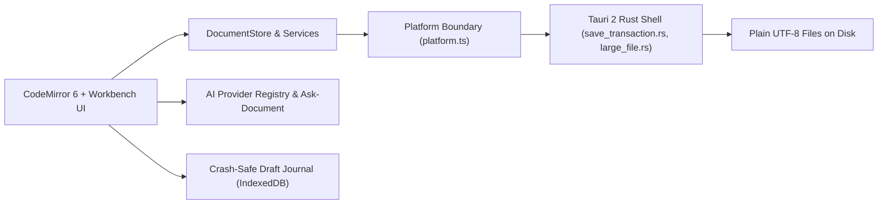

<p align="center">
  
</p>

<h1 align="center">Wrytrove</h1>

<p align="center">
  <strong>A local-first Windows text, code, and Markdown editor built for plain-file portability, crash-safe recovery, and verifiable AI.</strong>
</p>

<p align="center">
  <a href="https://github.com/RANJITHROSAN17/Wrytrove/actions/workflows/ci.yml"></a>
  <a href="https://github.com/RANJITHROSAN17/Wrytrove/releases"></a>
  <a href="LICENSE"></a>
  
</p>

<p align="center">
  <a href="#why-wrytrove">Why Wrytrove</a> ·
  <a href="#key-features">Features</a> ·
  <a href="#architecture">Architecture</a> ·
  <a href="#benchmarks">Benchmarks</a> ·
  <a href="#quick-start">Quick Start</a> ·
  <a href="#security-and-trust">Security</a> ·
  <a href="#contributing">Contributing</a>
</p>

---

## Why Wrytrove

- **The Problem:** Modern editors force a trade-off between heavyweight, telemetry-heavy, extension-risky IDEs and bare-bones text editors that lack Markdown structure, crash-safe recovery, or safe AI workflows.
- **The Solution:** Wrytrove combines a **Rust / Tauri 2** native shell with **CodeMirror 6** and strict capability boundaries—keeping your notes and code as ordinary UTF-8 files on disk while adding verifiable AI, hash-checked note moves, and an append-only draft journal.
- **The Value:** Zero telemetry, no account required, no proprietary database lock-in, and explicit pre-send visibility before any byte leaves your machine.

---

## Key Features

- **Plain-File Markdown & Code Editing:** Native Windows file I/O with UTF-8 validation, NUL-byte/surrogate checks, line-ending normalization, outline, minimap, focus mode, and 100+ CodeMirror language modes.
- **Crash-Safe Draft Journal & 3-Way Review:** Append-only IndexedDB draft journal (`src/recovery-journal.ts`) with a 3-way restore view (disk vs. last saved snapshot vs. newest draft) that never silently overwrites files.
- **Capability-Gated AI & Verifiable Citations:** Explicit session consent and pre-send byte/hash previews (`src/ai-provider.ts`) for local **Ollama** or **Arena**, plus **Ask-Document Q&A** (`src/ask-document.ts`) that verifies every cited line range and SHA-256 hash—marking unverified claims as `citation unavailable`.
- **Reviewable Note Move & Link Repair:** `src/note-transaction.ts` previews affected `[[wikilinks]]`, flags ambiguous stem matches for manual review, verifies expected file hashes, and rebuilds the index only after commit.
- **Untrusted-Workspace Tool Broker:** `src/tool-broker.ts` keeps subprocess execution disabled by default in untrusted workspaces and enforces environment allowlists.
- **Large-File Streaming:** Streams 100–500 MiB files in bounded windows with cancelable worker search (`src/large-file-view.ts`).

---

## Architecture



---

## Benchmarks

<!-- BENCHMARK_RESULTS:START -->
Measured large-file streaming & cancellation (`node scripts/benchmark-large-file.mjs`, Node v22.22.3, linux x64):

| File Size | First Window | Streaming Search | Worker Cancel | Peak RSS |
| --- | ---: | ---: | ---: | ---: |
| 100 MiB | 1.17 ms | 756.12 ms | 1.44 ms | 142,924 KiB |
| 500 MiB | 1.20 ms | 3,636.65 ms | 1.29 ms | 144,020 KiB |
<!-- BENCHMARK_RESULTS:END -->

> **Note:** These are synthetic Linux baseline measurements. Windows WebView2 startup, memory, and typing-latency benchmarks are defined in [`docs/VAL01-BENCHMARK-PROTOCOL.md`](docs/VAL01-BENCHMARK-PROTOCOL.md).

### Comparison with Other Editors

| Product | Their Best Technical Strengths | Where Wrytrove Stands Out |
| --- | --- | --- |
| **Wrytrove** | Tauri 2 + CodeMirror 6 + Rust native FS | Capability-gated AI with verifiable citations, crash-safe draft journal, hash-checked note move transactions, untrusted-workspace tool broker |
| **VS Code / Zed** | Mature LSP/extension ecosystems; Zed's GPU-rendered Rust UI | Zero-telemetry local-first Markdown without account/extension-marketplace supply-chain exposure |
| **Notepad++** | Ultra-fast native Win32/Scintilla startup & large-file handling | Built-in Markdown preview, wikilink/backlink index, 3-way recovery review, and capability-gated AI |
| **MarkText / Joplin** | Rich WYSIWYG Markdown (MarkText); E2EE sync & plugins (Joplin) | Plain-file portability (no SQLite lock-in), pre-send AI byte/hash preview, and signed/attested release provenance |

---

## Quick Start

### Windows Installer (Preview `.exe`)

Download the **`v0.5.0` Windows x64 `.exe` installer** directly from [**GitHub Releases (`v0.5.0`)**](https://github.com/RANJITHROSAN17/Wrytrove/releases/tag/v0.5.0) (or browse all [**Releases**](https://github.com/RANJITHROSAN17/Wrytrove/releases)).

> **Signing notice:** Preview builds without a configured publisher certificate are labeled **`unsigned-preview`**. Windows SmartScreen may show an unknown-publisher warning. Every release includes `SHA256SUMS.txt`, CycloneDX/Cargo SBOMs, and GitHub SLSA provenance attestations—see the [release verification and rollback guide](docs/RELEASE-VERIFICATION.md).

### Test in Your Browser (No Windows Required)

Contributors on **Linux, macOS, or Windows** can test the editor UI and run the full test suite without installing Rust or Tauri:

```sh
git clone https://github.com/RANJITHROSAN17/Wrytrove.git
cd Wrytrove
npm ci
./run.sh        # Runs unit/fixture tests, tsc + vite build, static security audit, and roadmap check
./run.sh dev    # Starts the browser preview on http://localhost:5173
```

---

## Security and Trust

- **Static Security Gate:** `npm run audit:static` (`scripts/security-audit.mjs`) enforces CSP, capability scope, and forbids `innerHTML` and dynamic code execution.
- **No Silent Egress:** AI requests require session consent (`AiSessionConsent`), and cloud requests (`arena`) require explicit per-action confirmation with destination, model, and character-count previews.
- **Responsible Disclosure:** See [`SECURITY.md`](SECURITY.md).

---

## Documentation

- [`docs/USER-GUIDE.md`](docs/USER-GUIDE.md) — Keyboard shortcuts, workflows, and settings
- [`docs/RELEASE-VERIFICATION.md`](docs/RELEASE-VERIFICATION.md) — Offline checksum, SBOM, and provenance verification
- [`docs/ACCESSIBILITY-VALIDATION.md`](docs/ACCESSIBILITY-VALIDATION.md) — Keyboard-only, Narrator/NVDA, and 200% scaling matrix
- [`docs/VAL01-BENCHMARK-PROTOCOL.md`](docs/VAL01-BENCHMARK-PROTOCOL.md) — Competitor & Windows benchmark protocol

---

## Contributing

Contributions are welcome! Non-Windows development (Linux/macOS) is fully supported for TypeScript, Vitest, and Vite workflows. See [`CONTRIBUTING.md`](CONTRIBUTING.md) and [`CODE_OF_CONDUCT.md`](CODE_OF_CONDUCT.md).

## License

[MIT](LICENSE)
