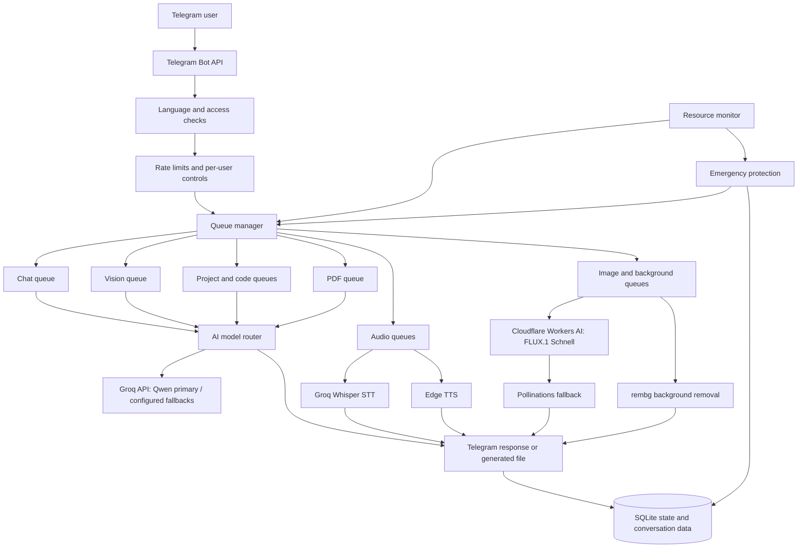

# ClaudGPT

**An extensible, open-source Telegram AI assistant built with Python.**

ClaudGPT brings AI chat, programming help, file and project review, image understanding, speech transcription, text-to-speech, image generation, PDF processing, and background removal into one Telegram bot. It is designed around bounded task queues, per-user request controls, resource monitoring, and configurable provider/model failover.

[](https://github.com/RadLamine)
[](https://github.com/RadLamine/ClaudGPT)
[](LICENSE)

[](https://github.com/RadLamine)
[](https://www.facebook.com/share/1DajxfevBx/)
[](https://t.me/dexwep2)
[](https://github.com/RadLamine/ClaudGPT/discussions)
[](https://github.com/RadLamine/ClaudGPT)

---

## Why ClaudGPT is different

- **A complete Telegram workflow:** users can chat, send images, PDFs, audio, code files, and ZIP projects without leaving Telegram.
- **Provider and model resilience:** the AI router can try multiple configured Groq API keys and model IDs, applying cooldowns after quota, authentication, or temporary network/server errors.
- **Work is separated by service:** chat, vision, image generation, speech, PDF, project review, code editing, and background removal use bounded queue lanes rather than one unlimited worker pool.
- **Resource-aware operation:** the bot monitors memory, disk, database size, temporary files, and queue pressure. Emergency mode can pause expensive services to protect a constrained host.
- **Open for contributions:** the code, configuration template, architecture notes, and contribution rules are included so other developers can inspect and extend the project.

> **High-traffic readiness:** ClaudGPT is built with layered safeguards for busy Telegram communities: bounded service queues, per-user throttling and fair scheduling, duplicate-task checks, provider/model failover with cooldowns, resource monitoring, and emergency controls. These systems help absorb traffic bursts, prevent uncontrolled job growth, and keep essential services responsive. The project can be prepared for deployments targeting communities of up to **one million registered users** when paired with production-sized compute, shared durable storage, and distributed workers. One million registered users is not the same as one million simultaneous requests; real throughput depends on infrastructure, Telegram and provider quotas, payload sizes, and queue configuration. The supplied default deployment is a single process using SQLite, in-process queues, and Telegram long polling; the production architecture needed for high availability and horizontal scale is described below.

## Feature overview

| Area | What it does |
|---|---|
| AI chat | General conversation, explanations, writing, translation, planning, and coding assistance. |
| Code work | Generate, explain, review, and edit supported code/text files. |
| Image understanding | Accept an image and include it in the AI request. |
| PDF | Extract text, process scanned pages with the vision model, summarize, and translate PDF content. |
| Audio input | Transcribe Telegram voice/audio and supported video audio using Groq Whisper. |
| Text-to-speech | Convert text to an Arabic or English voice/audio file using Edge TTS. |
| Image generation | Use Cloudflare Workers AI with FLUX.1 Schnell; Pollinations is attempted as a fallback. |
| Background removal | Remove an image background with `rembg`. |
| Project review | Collect multiple source files or a ZIP archive, inspect the project, and optionally return fixed files in a ZIP. |
| Webpage reading | Fetch and read a public webpage when a user asks the assistant to analyze a URL. This is not a general-purpose web search engine. |
| Utilities | Built-in calculator and assistant-invoked tools such as reading a webpage or creating a file. |
| Languages | Arabic and English interface selection; the AI response language follows the user's latest message or explicit request. |

Video generation is **not enabled** in this version. The `/video` command returns a disabled-feature message.

## Architecture



### Request lifecycle

1. Telegram delivers the message to the bot's long-polling process.
2. The bot asks new users to choose English or Arabic, then checks any administrator-added mandatory channels.
3. Per-user request limits and duplicate/active-task checks are applied.
4. The request enters the relevant bounded queue lane. A worker starts it when capacity is available.
5. The task calls the relevant provider/model or local processor. The AI router handles configured key/model retries and cooldowns for managed AI requests.
6. The result is sent back to Telegram. Temporary task directories are removed when queued work finishes or is cancelled.

## AI models and provider routing

The model IDs below are the defaults in the supplied `main.py` and `.env.example`. Provider model availability and quotas can change; check the provider's current model catalogue before deployment.

| Function | Default model/service | Provider | How it is used |
|---|---|---|---|
| Main chat | `qwen/qwen3.8-27b` | Groq | Main text model. The same primary model is assigned to the text, chat, vision, and agent model roles in the current code. |
| Vision | `qwen/qwen3.8-27b` | Groq | Receives image content as part of a multimodal request. |
| Project/agent review | `qwen/qwen3.8-27b` | Groq | Project review and repair workflow; the “agents” feature is a workflow/queue mode, not a separate API-key provider. |
| Emergency model | `openai/gpt-oss-20b` | Groq-hosted model ID | Selected for managed AI requests while emergency mode is active. This is not an OpenAI API connection. |
| Additional fallbacks | `MODEL_FALLBACKS` | Groq-hosted model IDs | Optional comma-separated fallback list tried for managed model requests. |
| Speech-to-text | `whisper-large-v3-turbo` | Groq | Transcribes supported voice/audio inputs. |
| Text-to-speech | Arabic `ar-SA-HamedNeural`; English `en-US-AriaNeural` | Edge TTS | Creates voice/audio output; no separate TTS API key is configured in this project. |
| Image generation | `@cf/black-forest-labs/flux-1-schnell` | Cloudflare Workers AI | Primary configured image-generation service. |
| Image-generation fallback | FLUX via Pollinations endpoint | Pollinations | Tried when the Cloudflare image request fails. It is an external fallback and its availability/terms are outside this repository's control. |
| Background removal | `rembg` | Local Python package | Processes the image on the bot host; it does not use the Groq chat model. |

### How the main AI fallback works

- `AI_API_KEY` is the first Groq key. `AI_API_KEYS` can contain additional Groq keys separated by commas.
- `MODEL_FALLBACKS` accepts model IDs separated by commas, for example `model-a,model-b`.
- For managed AI calls, the router tries the selected model and configured fallback models across available API keys. It applies cooldowns for quota/rate-limit errors, rejected credentials, and transient failures.
- A 429/quota error places that key/model combination on a short cooldown; a rejected key is cooled down longer; transient errors receive a shorter retry cooldown. Exact behavior is implemented in `ai_chat()` in `main.py`.
- `EMERGENCY_MODEL` is a different model ID, but it is still requested through the Groq client. Do **not** put an OpenAI Platform key in `AI_API_KEY` expecting this code to call the OpenAI API directly.
- Backup keys are optional. They should be valid keys for the same compatible Groq API integration, and each key remains subject to its own provider rate limits and account quota.

Official model references: [Groq supported models](https://console.groq.com/docs/models) · [Groq API keys](https://console.groq.com/keys) · [Cloudflare FLUX.1 Schnell](https://developers.cloudflare.com/workers-ai/models/flux-1-schnell/).

## Queue and concurrency system

The queue manager separates work into service lanes: `chat`, `vision`, `agents`, `image`, `tts`, `stt`, `project`, `code_edit`, `pdf`, and `rembg`.

It includes:

- A configurable maximum waiting count per lane (`QUEUE_MAX_WAITING`).
- Independent worker limits for heavier tasks (`CHAT_CONCURRENCY`, `PROJECT_CONCURRENCY`, `CODE_EDIT_CONCURRENCY`, `PDF_CONCURRENCY`, and `REMBG_CONCURRENCY`; some lane counts are currently fixed in code).
- Per-user active-task and duplicate-request checks.
- Round-robin scheduling between users in each queue lane.
- A task timeout (`QUEUE_TASK_TIMEOUT`) and cancellation support through `/cancel`.
- A separate heavy-work classification that can be paused or cancelled during emergency mode.

Queues are a core protection layer: they smooth bursts, preserve per-service isolation, and prevent unbounded work from overwhelming the host. Size worker concurrency to the compute resources and provider quotas available; increase it after load testing.

## Protection and maintenance systems

ClaudGPT contains multiple layers of resource and data protection. Read this section before using it with real users because some cleanup operations are intentionally destructive.

### 1. Startup storage maintenance

At startup, `cleanup_storage()` removes expired records according to `CHAT_RETENTION_DAYS` and `USER_RETENTION_DAYS`, enforces database row caps, trims each user's stored message history to `MEMORY_LIMIT`, removes expired temporary usage records, and can vacuum the SQLite database. This is run during the current startup path.

### 2. Scheduled full cleanup

The active maintenance loop checks 12-hour time slots using `TZ_OFFSET_HOURS`: `00:00` and `12:00`. When scheduled cleanup is enabled (the default database setting is enabled), it calls `full_wipe()` at the next new slot. This is more destructive than ordinary retention cleanup: it deletes user rows, conversation messages, temporary user-file records, reports, and cleanup notices. System settings and the administrator configuration are kept.

The schedule can be controlled by the administrator with `/cleanup_on` and `/cleanup_off`. `/cleanup` displays status; `/cleanup_now` runs a manual full cleanup.

### 3. Emergency protection

The resource monitor watches disk usage, RAM, SQLite size, temporary storage, and queue pressure. Thresholds are controlled by the `EMERGENCY_*_PCT` variables. If automatic emergency mode is enabled (enabled by default in the settings store), reaching a threshold can:

- Pause and cancel heavy service queues.
- Disable multi-agent review temporarily.
- Run a full user-data cleanup, including stored users/messages/reports.
- Keep lightweight text chat available with stricter request pacing.
- Recheck resources after approximately 46 minutes. If resources are still critical, emergency mode remains active and the next check is extended.

Administrators can inspect `/emergency` or `/system`, and control the feature with `/emergency_on`, `/emergency_off`, `/emergency_auto_on`, and `/emergency_auto_off`. A forced manual stop is possible with `/emergency_off force`, but bypassing a critical-resource check is risky.

### Important data-loss warning

**The shipped default scheduled full cleanup can erase user and conversation records twice per day. Emergency mode can also erase those records when triggered.** This is not a backup system. Back up `bot_data.db` before production, review the cleanup logic, and decide whether this policy is suitable for your deployment. Set `/cleanup_off` to disable the scheduled full-wipe cycle. Set `/emergency_auto_off` only if you understand the risks of disabling automatic protection.

### Idle-user notice scheduler status

The source also defines an inactivity-notice workflow using `CLEAN_HOUR`, `CLEAN_INACTIVE_HOURS`, and `CLEAN_GRACE_MIN`: it can notify inactive users and give them a grace period before clearing their memory. **However, `night_scheduler()` is not started by the current `if __name__ == "__main__"` startup block. Therefore this idle-user notice workflow does not run in the supplied default entry point.** Those three environment variables are documented as reserved/inactive unless a maintainer explicitly wires that scheduler into startup.

## Security controls

The current source includes these protections and limits:

- Private-chat handling for the main user workflows.
- Administrator checks based on `ADMIN_ID` for admin commands and callbacks.
- Mandatory subscription checks only for additional channels added by the administrator. The original founder channels `@dexwep1` and `@dexwep2` are optional and do not block access.
- Per-user request throttling and duplicate/active-task checks.
- ZIP path validation, traversal rejection, encrypted/special-file rejection, and compression-ratio checks.
- File, image, PDF, ZIP, project, text, and temporary-storage size limits.
- Restricted webpage URL validation to reduce requests to private/local network addresses.
- Secret redaction in error notifications sent to the administrator.
- A source-level identity-marker guard used by the project's AI-assisted code-edit workflow to reject some edits that remove protected author/repository/channel markers.

The identity guard is not cryptographic protection and cannot stop a person with write access from editing a fork or changing the source. Use GitHub repository permissions, protected branches, and required CODEOWNER reviews to protect the canonical upstream repository.

## User commands

| Command | Purpose |
|---|---|
| `/start` | Start the bot; first-time users choose English or Arabic. |
| `/help` | Show localized help and available commands. |
| `/clear` | Delete the user's conversation memory and temporary file/task state. |
| `/cancel` | Cancel the active or queued task and pending workflow. |
| `/image prompt` | Generate an image from a text prompt. Default quota is 3 images per 12-hour cycle; administrators are exempt. |
| `/tts text` | Convert text to a voice/audio message. The user can also reply to a message with `/tts`. |
| `/rembg` | Ask for an image, then remove its background. |
| `/project` | Start collecting project files for review. |
| `/done` | Submit the collected files for review. |
| `/Agents` | Enable the expanded multi-agent project-review workflow; it can use more AI quota and requires user confirmation for a project review. `/Agents off` disables it. |

Users can also send text, images, voice/audio, short video/audio, PDFs, supported text/code files, and ZIP project archives. The `/video` command is disabled in this version.

## Administrator commands

Only the Telegram ID configured in `ADMIN_ID` receives administrator privileges.

| Command | Purpose |
|---|---|
| `/admin` | Open the administration panel. |
| `/system` | Display system resource and protection status. |
| `/queue` | Show per-lane active and waiting jobs. |
| `/limits` | Show configured concurrency and task time limits. |
| `/cleanup` | Show scheduled cleanup status and last-run details. |
| `/cleanup_now` | Run a full manual cleanup. **Destructive.** |
| `/cleanup_on` / `/cleanup_off` | Enable or disable scheduled full cleanup. |
| `/emergency` | Show emergency status and resource snapshot. |
| `/emergency_on` / `/emergency_off` | Start or stop emergency mode. |
| `/emergency_auto_on` / `/emergency_auto_off` | Enable or disable automatic emergency activation. |
| `/agents_on` / `/agents_off` | Enable or disable the multi-agent service globally. |

The `/admin` inline panel also provides user browsing, user summaries, conversation PDF export, direct messages, broadcasts with confirmation, AI behavior instructions, system/queue status, cleanup and emergency toggles, and management of additional required subscription channels.

### Required-channel behavior

- The protected founder channels `@dexwep1` and `@dexwep2` are **optional** and do not gate bot access.
- Additional public channels added by the administrator in the panel are mandatory for non-admin users.
- The bot must be an administrator in each additional channel so it can check membership.
- The admin cannot add the two founder channels as mandatory channels through the additional-channel form.

## Publish the project on GitHub

1. Create a **public** repository on GitHub. For the canonical upstream, use the repository owned by `RadLamine`; contributors should normally fork that repository instead of creating a competing upstream.
2. Make sure `.env`, `bot_data.db`, and private logs are not staged. The included `.gitignore` excludes these files.
3. From the project directory, commit and push the source:

   ```bash
   git init
   git add .
   git status
   git commit -m "Prepare ClaudGPT open-source release"
   git branch -M main
   git remote add origin https://github.com/RadLamine/ClaudGPT.git
   git push -u origin main
   ```

   If `origin` already exists, inspect it with `git remote -v` and update it only when you are sure it points to the intended repository. Do not use a force push unless you intentionally want to overwrite remote history.

## Basic file and usage limits

The supplied defaults include a 10 MB general file limit, 60 KiB code-file limit, 1 MiB image limit, 5 MiB ZIP/project temporary-size limits, a maximum of 100 PDF pages, and a 15,000-word per-file reading limit. These values are configurable in `.env.example`, but several are clamped by the source code. Large project review is performed by sending multiple source files or a ZIP archive, then using `/done`.

## Installation on Linux / Kali Linux

### Requirements

- Python 3.11 or newer (Python 3.11 is a sensible baseline for this dependency set).
- Git, pip, and a virtual environment.
- FFmpeg is recommended for audio conversion. `imageio-ffmpeg` is also installed by `requirements.txt` as a bundled fallback.
- Internet access to Telegram and configured model/media providers.

### Install and run

```bash
sudo apt update
sudo apt install -y git python3 python3-venv python3-pip ffmpeg

git clone https://github.com/RadLamine/ClaudGPT.git
cd ClaudGPT

python3 -m venv .venv
source .venv/bin/activate
python -m pip install --upgrade pip
pip install -r requirements.txt

cp .env.example .env
nano .env

python main.py
```

Fill in at least `BOT_TOKEN`, one Groq API key (`AI_API_KEY` or a key in `AI_API_KEYS`), and preferably `ADMIN_ID`. Keep `.env` private. Do not commit it to GitHub.

## Getting the required tokens

### 1. Telegram bot token

1. Open [@BotFather](https://t.me/BotFather).
2. Send `/newbot` and follow the prompts.
3. Copy the token and set it as `BOT_TOKEN` in `.env` or as a Render environment variable.
4. Treat the token like a password. Revoke it with BotFather if it is exposed.

Official guide: [Telegram — From BotFather to “Hello World”](https://core.telegram.org/bots/tutorial).

### 2. Groq API key (required for AI chat)

1. Create or sign in to a GroqCloud account.
2. Open [Groq API Keys](https://console.groq.com/keys).
3. Create a key and put it in `AI_API_KEY`.
4. For optional backups, create additional keys and enter them in `AI_API_KEYS`, separated by commas.

This source imports the `groq` Python SDK and sends its chat/vision/transcription calls to Groq. An OpenAI Platform key or Gemini key is not a substitute for this integration.

### 3. Cloudflare credentials (recommended for primary image generation)

1. Create/sign in to a [Cloudflare account](https://dash.cloudflare.com/).
2. Open the Workers AI page and choose the REST API setup.
3. Create a Workers AI API token and copy the Account ID.
4. Set `CLOUDFLARE_ACCOUNT_ID` and `CLOUDFLARE_API_TOKEN`.
5. For multiple accounts, set `CLOUDFLARE_ACCOUNTS` as comma-separated `ACCOUNT_ID:API_TOKEN` pairs.

Cloudflare is the configured primary image provider. The current code attempts Pollinations if Cloudflare image generation fails, but that public fallback is not a guaranteed service and may have its own usage limits or policies.

Official guide: [Cloudflare Workers AI REST API](https://developers.cloudflare.com/workers-ai/get-started/rest-api/).

### 4. Administrator Telegram ID

Get your numeric Telegram user ID using a trusted ID utility or your own Telegram update inspection, then put the number in `ADMIN_ID`. Keep `ADMIN_ID=0` only if you intentionally want to run without admin-only controls (not recommended).

## Environment configuration (`.env`)

The complete, commented template is [`.env.example`](.env.example). Copy it to `.env` locally, or add the values in Render's Environment section. The `.env` file is intentionally excluded from Git.

### Essential and optional settings

| Variable | Required? | Explanation |
|---|---|---|
| `BOT_TOKEN` | **Required** | Telegram bot token from BotFather. |
| `AI_API_KEY` | **Required unless a backup key is supplied** | Primary Groq API key. |
| `AI_API_KEYS` | Optional backup | Comma-separated additional Groq keys. At least one usable Groq key must be configured for AI-powered features. |
| `ADMIN_ID` | Strongly recommended | Numeric Telegram user ID allowed to operate admin commands; `0` means no configured admin. |
| `CLOUDFLARE_ACCOUNT_ID` / `CLOUDFLARE_API_TOKEN` | Optional, recommended | Cloudflare Workers AI credentials for primary image generation. |
| `CLOUDFLARE_ACCOUNTS` | Optional | Additional Cloudflare credentials in `ACCOUNT_ID:API_TOKEN` pairs, comma-separated. |
| `MODEL_FALLBACKS` | Optional | Comma-separated Groq model IDs tried as additional fallbacks. |
| `SITE_URL` | Optional | Public base URL for the app's keep-alive request. If blank, the code falls back to `RENDER_EXTERNAL_URL`. |
| `RENDER_EXTERNAL_URL` | Render-managed | Leave empty locally; Render supplies this value for a deployed web service. |
| `PORT` | Usually Render-managed | HTTP port. Defaults to `5000` locally; the code binds to `0.0.0.0`. |
| `BMO_URL` | Optional | Link shown in quota-related messages. Defaults to the BMO Telegram bot URL in the template. |
| `BOT_NAME` | Optional | Display name used in bot messages and payment descriptions. |

### AI models and output behavior

| Variable | Default | Explanation |
|---|---:|---|
| `EMERGENCY_MODEL` | `openai/gpt-oss-20b` | Groq-hosted model ID used for managed requests during emergency mode. |
| `IMAGE_MODEL` | `@cf/black-forest-labs/flux-1-schnell` | Cloudflare Workers AI image model ID. |
| `STT_MODEL` | `whisper-large-v3-turbo` | Groq speech-to-text model. |
| `AI_TIMEOUT` | `120` | AI request timeout in seconds. |
| `MAX_CONTINUATIONS` | `10` | Maximum continuation passes when a model response is cut off. |
| `MAX_COMPLETION_TOKENS` | `16384` | Maximum completion-token setting, clamped by the code. |
| `AGENTS_REASONING_EFFORT` | `medium` | Accepted reasoning level for agent operations: `low`, `medium`, or `high`. |
| `CHAT_REASONING_EFFORT` | `low` | Accepted reasoning level for chat: `low`, `medium`, or `high`. |
| `REASONING_EFFORT` | `medium` | General reasoning setting: `low`, `medium`, or `high`. |
| `MEMORY_LIMIT` | `8000` | Maximum stored conversation text budget per user. |
| `MAX_INPUT_CHARS` | `8000` | Maximum normal input character setting. |

### File, image, PDF, and project limits

Values ending in `_BYTES` are bytes, not megabytes.

| Variable | Default | Explanation |
|---|---:|---|
| `MAX_CODE_FILE_BYTES` | `61440` | Maximum code file size (60 KiB; the code caps this setting at 60 KiB). |
| `MAX_IMAGE_BYTES` | `1048576` | Image size limit (1 MiB; code caps the setting at 1 MiB). |
| `MAX_TEMP_STORAGE_BYTES` | `5242880` | Temporary/output storage limit (5 MiB; code caps the setting at 5 MiB). |
| `MAX_OUTPUT_FILE_CHARS` | `1000000` | Maximum output text-file characters. |
| `MAX_PDF_PAGES` | `100` | Maximum PDF pages accepted by the parser. |
| `MAX_PDF_TEXT_CHARS` | `300000` | Maximum extracted PDF text characters. |
| `MAX_PDF_AI_CHARS` | `100000` | Maximum PDF text amount passed into the AI processing path. |
| `MAX_PDF_OCR_PAGES` | `30` | Maximum scanned PDF pages sent through AI-based OCR. |
| `MAX_ZIP_BYTES` | `5242880` | Maximum ZIP input size (5 MiB). |
| `MAX_PROJECT_FILE_BYTES` | `61440` | Maximum size of an individual project source file. |
| `MAX_PROJECT_FILES` | `400` | Maximum number of ZIP/project entries accepted. |
| `MAX_PROJECT_UNZIPPED` | `5242880` | Maximum total uncompressed project size (5 MiB). |
| `PROJECT_BATCH_CHARS` | `28000` | Target maximum characters per project batch. |
| `PROJECT_MAX_CHARS` | `600000` | Maximum total project text processed. |
| `PROJECT_AGENTS` | `2` | Reserved setting read by the current code; it does not currently set the queue's agent worker count. |
| `PROJECT_WAIT_SEC` | `3` | Delay before the project file buffer is flushed for processing. |
| `PROJECT_MAX_FIX_FILES` | `20` | Maximum files targeted for fixes in the expanded project workflow. |
| `MAX_FILE_WORDS` | `15000` | Maximum words read from a single file. |

### Queue and concurrency controls

| Variable | Default | Explanation |
|---|---:|---|
| `QUEUE_MAX_WAITING` | `100` | Maximum waiting tasks per queue lane. |
| `QUEUE_TASK_TIMEOUT` | `900` | Maximum task runtime in seconds. |
| `CHAT_CONCURRENCY` | `1` | Chat queue workers. |
| `PROJECT_CONCURRENCY` | `1` | Project-review queue workers. |
| `CODE_EDIT_CONCURRENCY` | `1` | Code-edit queue workers. |
| `PDF_CONCURRENCY` | `1` | PDF queue workers. |
| `REMBG_CONCURRENCY` | `1` | Background-removal queue workers. |

Vision, agents, image, TTS, and STT lane worker counts are currently set in `main.py` (4, 3, 2, 4, and 5 respectively); they are not separately configurable through this `.env` template.

### Emergency resource thresholds

Each value is a percentage threshold. Automatic emergency mode is enabled by default in the database settings unless the administrator turns it off.

| Variable | Default | Explanation |
|---|---:|---|
| `EMERGENCY_DISK_PCT` | `88` | Disk usage threshold. |
| `EMERGENCY_RAM_PCT` | `90` | RAM usage threshold. |
| `EMERGENCY_DB_PCT` | `88` | SQLite database size compared with `DB_MAX_MB`. |
| `EMERGENCY_TEMP_PCT` | `85` | Temporary directory usage threshold. |
| `EMERGENCY_QUEUE_PCT` | `85` | Queue waiting pressure threshold. |
| `LITE_MAX_BATCHES` | `2` | Maximum batches used by the faster/economical project-review path. |
| `LITE_MAX_FIX_FILES` | `5` | Maximum files fixed in the lite project path. |

### Image limits, database, time, and text processing

| Variable | Default | Explanation |
|---|---:|---|
| `IMAGE_DAILY_LIMIT` | `3` | Per-user image quota per 12-hour cycle (administrators are exempt). |
| `USER_RETENTION_DAYS` | `90` | User-record age threshold used by startup storage cleanup. |
| `CHAT_RETENTION_DAYS` | `30` | Chat/report age threshold used by startup storage cleanup. |
| `DB_MAX_MB` | `140` | SQLite size threshold used for maintenance/vacuum decisions and emergency calculations. |
| `DB_MAX_MESSAGES` | `30000` | Maximum retained message-row count in startup storage cleanup. |
| `DB_MAX_USERS` | `50000` | Maximum retained user-row count in startup storage cleanup. |
| `DB_MAX_REPORTS` | `5000` | Maximum retained report-row count in startup storage cleanup. |
| `DB_PATH` | `bot_data.db` | SQLite database path. Set this to a persistent-disk path on Render if using a mounted disk. |
| `TZ_OFFSET_HOURS` | `1` | Fixed local UTC offset used by scheduled time-slot calculations. |
| `CLEAN_HOUR` | `0` | Reserved for the idle-user notice scheduler; inactive in the current startup path. |
| `CLEAN_INACTIVE_HOURS` | `24` | Reserved idle-user inactivity threshold; inactive in the current startup path. |
| `CLEAN_GRACE_MIN` | `20` | Reserved idle-user response grace period; inactive in the current startup path. |
| `READ_CHUNK_CHARS` | `9000` | Text chunk size used by file-reading helpers. |
| `SUMMARY_SRC_CHARS` | `5500` | Leading file-text amount used to generate a file summary. |
| `DIRECT_FILE_CHARS` | `5000` | Threshold for processing a file directly instead of using the summary-first path. |
| `ENABLE_REACTIONS` | `1` | `1` enables message reactions; `0` disables them. |

### What must be configured vs. what can stay at its default

**Configure before first run:** `BOT_TOKEN` and a working Groq key (`AI_API_KEY` or `AI_API_KEYS`). Set `ADMIN_ID` so you can manage the instance.

**Optional but useful:** backup Groq keys, Cloudflare credentials, a public `SITE_URL`, a custom `BOT_NAME`, and a custom `BMO_URL`.

**Usually leave unchanged at first:** file-size limits, queue limits, concurrency, reasoning effort, database caps, and emergency thresholds. Tune these only after testing on the actual host and reviewing the effects of the cleanup policy.

**Render-managed:** do not manually set `RENDER_EXTERNAL_URL` on Render. Let the platform supply it. `PORT` is also supplied by the platform; the local default is `5000`.

## Deploy on Render

The project exposes a small Flask HTTP endpoint at `/` and starts Telegram long polling in a background thread when `main.py` is executed. Use a **Web Service** for this current combined-process design.

1. Push the project to a GitHub repository.
2. Open the [Render Dashboard](https://dashboard.render.com/).
3. Select **New → Web Service** and connect your GitHub account if needed.
4. Select the ClaudGPT repository and the branch you want to deploy (usually `main`).
5. Choose **Python** as the runtime.
6. Set the build command to:

   ```bash
   pip install -r requirements.txt
   ```

7. Set the start command to:

   ```bash
   python main.py
   ```

8. In **Environment**, add `BOT_TOKEN`, `ADMIN_ID`, `AI_API_KEY`, and any optional keys/settings. Render also supports importing a valid `.env` file from the dashboard; never upload a real `.env` file to GitHub.
9. Optional: set the health-check path to `/`.
10. Deploy and inspect the logs. Send `/start` to the Telegram bot and confirm that the language-selection screen appears.

Render references: [Flask deployment guide](https://render.com/docs/deploy-flask) · [Web Services](https://render.com/docs/web-services) · [Environment variables and secrets](https://render.com/docs/configure-environment-variables).

### Persistent SQLite storage on Render

Render filesystems can be ephemeral unless a persistent disk is attached. If your selected plan supports a persistent disk, attach one and use a mount path such as `/var/data`. Then set:

```env
DB_PATH=/var/data/bot_data.db
```

Without persistent storage, local SQLite data may be lost when the instance is replaced or redeployed. Keep external backups regardless of disk configuration.

### Production scaling and availability

- **Default single-process profile:** Run **one active instance** for a single bot token with the current long-polling implementation. This keeps polling and in-process queue state consistent. For a larger deployment, move job processing to distributed workers before adding replicas.
- **Production availability:** Choose a hosting plan with CPU, RAM, persistent storage, and uptime characteristics sized for the expected traffic. Render's free web services may spin down after inactivity, so use a suitable production plan for continuous service.
- **Path to large-scale deployment:** The current app runs Flask's built-in server from `main.py` while polling and maintenance threads share the same process. For deployments targeting very large communities, including a one-million-user audience, separate the Telegram worker from the HTTP health service and replace in-process queues/SQLite with shared production infrastructure before horizontal scaling. Validate the target with workload-specific load tests; the supplied single-process profile is not a benchmark for one million simultaneous requests.
- Monitor Render logs, Groq usage and limits, Cloudflare usage, disk, RAM, and the bot's `/system` and `/queue` reports.

## Open-source ownership and project integrity

ClaudGPT is open source so developers can study it, fork it, submit fixes, and build improvements. The upstream project's original authorship must remain accurately attributed:

- Original author: **RadLamine**.
- Canonical upstream: [https://github.com/RadLamine/ClaudGPT](https://github.com/RadLamine/ClaudGPT).
- Owner profile: [https://github.com/RadLamine](https://github.com/RadLamine).
- Project community page: [Facebook](https://www.facebook.com/share/1DajxfevBx/).
- Project updates channel: [Telegram — @dexwep2](https://t.me/dexwep2).
- Project discussions: [GitHub Discussions](https://github.com/RadLamine/ClaudGPT/discussions).

The repository includes `AUTHORS.md`, `NOTICE.md`, `CONTRIBUTING.md`, `LICENSE`, and `.github/CODEOWNERS`. The source also includes an identity-marker check used by the AI-assisted code-editing workflow to reject certain edits that strip protected project attribution markers.

**A realistic protection model:** no source file can technically prevent someone who controls a fork from modifying that fork. The MIT license allows reuse and modification under its terms, including preservation of the copyright and license notice. To protect the canonical upstream repository, keep ownership of the GitHub organization/repository, enable branch protection on `main`, require pull requests, and require CODEOWNER approval. Forks should clearly identify themselves as forks and must not falsely present themselves as the official upstream project.

### Recommended GitHub settings for the owner

1. Keep the canonical repository under the owner's GitHub account.
2. Protect the `main` branch and require pull requests before merging.
3. Require at least one approval and require review from Code Owners.
4. Restrict who can push directly to the protected branch.
5. Enable private vulnerability reporting if available.
6. Keep API tokens only in GitHub/Render secret settings, never in tracked files or commits.

## Contributing

Contributions are welcome. Please read [CONTRIBUTING.md](CONTRIBUTING.md) before opening a pull request. Bug reports should include reproducible steps, logs with all secrets removed, Python version, and hosting details. Never include a real Telegram token or API key in an issue.

## Support the project

If ClaudGPT is useful to you, please give the project a ⭐ **star on GitHub** to help more developers discover it and encourage further updates and progress:

[](https://github.com/RadLamine/ClaudGPT)

The bot also retains its separate optional Telegram Stars gifting feature through the **Support us** button in the bot; this is distinct from starring the GitHub repository. You can also follow the project on [Facebook](https://www.facebook.com/share/1DajxfevBx/), receive announcements through the [Telegram updates channel](https://t.me/dexwep2), and discuss ideas in [GitHub Discussions](https://github.com/RadLamine/ClaudGPT/discussions).

## License

ClaudGPT is released under the MIT License. See [LICENSE](LICENSE). The license permits use, modification, and redistribution, provided the required copyright and license notice is retained. The MIT License does not grant rights to use project trademarks or imply endorsement by the original author.
