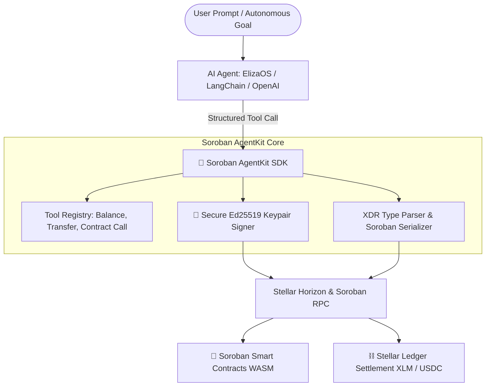

# 🦀 Soroban AgentKit

[](https://github.com/Ranjeet2063/soroban-agentkit/actions/workflows/ci.yml)
[](https://opensource.org/licenses/MIT)
[](https://nodejs.org)
[](https://stellar.org)

**Soroban AgentKit** is a production-grade, modular TypeScript toolkit and SDK that connects autonomous AI agents (ElizaOS, LangChain, CrewAI, AutoGen, and OpenAI function calling) directly to the **Stellar blockchain** and **Soroban smart contracts**.

Empower your LLMs to query balances, transfer native XLM or SAC tokens, simulate and invoke Soroban contracts, and interact with the decentralized financial ecosystem in natural language.

---

## 🏛️ System Architecture



---

## 🌟 Key Features

- ⚡ **Lightweight & Modular**: Zero unnecessary bloat. Pure TypeScript with first-class `@stellar/stellar-sdk` support.
- 🤖 **Universal Framework Adapters**: Out-of-the-box adapters for **OpenAI / Anthropic Function Calling**, **LangChain Structured Tools**, and **ElizaOS Actions**.
- 🔐 **Secure Key Management**: Client-side transaction signing with Stellar Keypairs. Private keys never leave your runtime environment.
- 📦 **Smart Contract Support**: Seamlessly simulate and execute invocations on any deployed Soroban smart contract with automatic type serializations.
- 🌐 **Multi-Network Ready**: First-class support for `testnet`, `mainnet`, and local `standalone` networks.

---

## 📦 Installation

```bash
npm install soroban-agentkit
```

---

## 🚀 Quickstart

### 1. Initialize the Agent Kit

```typescript
import { SorobanAgentKit, toOpenAITools } from 'soroban-agentkit';

// Initialize with your Stellar secret key
const agent = new SorobanAgentKit({
  secretKey: process.env.STELLAR_SECRET_KEY!,
  network: 'testnet' // 'testnet' | 'mainnet' | 'standalone'
});

console.log('Agent Public Key:', agent.getPublicKey());
console.log('Network:', agent.getNetwork());
```

### 2. Use with OpenAI Function Calling

```typescript
import OpenAI from 'openai';
import { SorobanAgentKit, toOpenAITools } from 'soroban-agentkit';

const agent = new SorobanAgentKit({ secretKey: process.env.STELLAR_SECRET_KEY! });
const tools = agent.getTools();
const openaiTools = toOpenAITools(tools);

const openai = new OpenAI();
const response = await openai.chat.completions.create({
  model: 'gpt-4o-mini',
  messages: [{ role: 'user', content: 'What is my current XLM balance?' }],
  tools: openaiTools
});
```

### 3. Use with LangChain

```typescript
import { SorobanAgentKit, toLangChainTools } from 'soroban-agentkit';

const agent = new SorobanAgentKit({ secretKey: process.env.STELLAR_SECRET_KEY! });
const langchainTools = toLangChainTools(agent.getTools());
```

---

## 🛠️ Built-in Agent Tools

| Tool Name | Description |
| :--- | :--- |
| `stellar_get_balance` | Queries native XLM and issued asset balances for any Stellar address. |
| `stellar_transfer_token` | Sends native XLM or assets to a recipient with an optional memo. |
| `stellar_get_account_info` | Retrieves account sequence, thresholds, subentry count, and active signers. |
| `soroban_call_contract` | Simulates and executes smart contract function calls with arguments. |

---

## 🧪 Development & Testing

```bash
# Clone the repository
git clone https://github.com/Ranjeet2063/soroban-agentkit.git
cd soroban-agentkit

# Install dependencies
npm install

# Build TypeScript
npm run build

# Run unit tests
npm test
```

---

## 💼 Author, Commercial Consulting & Hiring

Need to integrate autonomous AI agents into your Web3 protocol, build custom Soroban tool plugins, or audit your smart contracts?

- **Author & Architect**: [Ranjeet Kumar Gupta](https://github.com/Ranjeet2063) (Full-Stack Web3 & Soroban Engineer)
- 💬 **Telegram**: [@guptakumarranjeet](https://t.me/guptakumarranjeet)
- 📧 **Direct Email**: [guptakumarranjeet150@gmail.com](mailto:guptakumarranjeet150@gmail.com)
- 🚀 Available for **Full-Time Remote Roles, Protocol Architecture & High-Impact Consulting Contracts**.

---

## 🤝 Contributing

Contributions are warmly welcome! Please see [CONTRIBUTING.md](./CONTRIBUTING.md) for details on submitting pull requests and reporting issues.

---

## 📄 License

This project is licensed under the [MIT License](./LICENSE).

