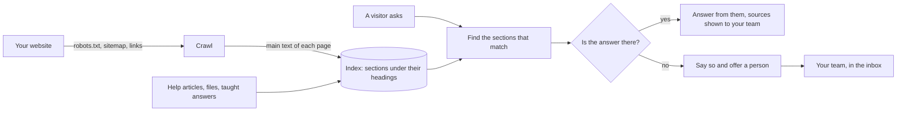

<p align="center">
  <a href="https://replyze.chat/?utm_source=github&utm_medium=referral&utm_campaign=ai-chatbot-for-website">
    <picture>
      <source media="(prefers-color-scheme: dark)" srcset="https://raw.githubusercontent.com/Replyze/.github/main/assets/logo-on-dark.png">
      
    </picture>
  </a>
</p>

# AI chatbot for your website, trained on your own pages

A practical guide to putting an AI chatbot on your website that answers visitors from your own pages: how it learns the site, what makes its answers trustworthy, how to write pages it can use, and tested code for documentation sites built with Docusaurus, VitePress, MkDocs, Astro Starlight and Nextra. It is for anyone who runs a website, a shop or a docs site and wants an AI that answers what it can and hands the rest to a person.

**[Create a free account](https://client.replyze.chat/register?utm_source=github&utm_medium=referral&utm_campaign=ai-chatbot-for-website&utm_content=cta-top)** · [Live demo](https://replyze.chat/?utm_source=github&utm_medium=referral&utm_campaign=ai-chatbot-for-website&utm_content=live-demo) · [Docs](https://github.com/Replyze/replyze)

The examples use [Replyze](https://replyze.chat/?utm_source=github&utm_medium=referral&utm_campaign=ai-chatbot-for-website), AI customer support for websites: an AI agent that answers from your website and knowledge base, live chat on your site, and one inbox for web chat, email, WhatsApp and Telegram (Messenger and Instagram are in beta). The advice applies to any website chatbot.

## Contents

1. [Quickstart](#quickstart)
2. [How it works](#how-it-works)
3. [What makes a website chatbot good](#what-makes-a-website-chatbot-good)
4. [Writing pages the AI can use](#writing-pages-the-ai-can-use)
5. [AI chatbot for documentation sites](#ai-chatbot-for-documentation-sites): [Docusaurus](#docusaurus) · [VitePress](#vitepress) · [MkDocs](#mkdocs-material) · [Starlight](#astro-starlight) · [Nextra](#nextra) · [Mintlify](#mintlify)
6. [FAQ](#faq)

## Quickstart

1. **Sign up and add your website.** [Create a free account](https://client.replyze.chat/register?utm_source=github&utm_medium=referral&utm_campaign=ai-chatbot-for-website&utm_content=quickstart), open **AI Agent → Knowledge sources**, type your address (or the sitemap's) and click **Add website**. If Replyze already knows your domain, it offers **Learn from yourdomain.com** instead. The status goes from "Finding pages" to "Reading pages, N of M". It takes a few minutes; you can leave the page. The AI agent is part of the paid plans, which you can try first ([Is it free?](#is-it-free)).

   Then click **Pages** next to the website. Filter by **Used**, **Skipped**, **Failed**, **Waiting** and **Left out**; a skipped or failed page says why (robots.txt, noindex, not found, no text, duplicate). Add skip rules for pages that shouldn't answer customers, such as the cart, account pages or old posts.
2. **Put the chat on your site.** **Settings → Integrations → Install widget** has your snippet with your token:

   ```html
   <script>
     window.ReplyzeConfig = {
       token: 'wgt_YOUR_TOKEN',
       apiUrl: 'https://client.replyze.chat'
     };
   </script>
   <script src="https://cdn.replyze.chat/widget.js" async></script>
   ```

   Paste it before `</body>` on every page. Where that is on WordPress, Shopify, Wix, Squarespace, Webflow, Framer, Ghost, React, Next.js, Laravel and more: [add-live-chat-to-website](https://github.com/Replyze/add-live-chat-to-website). Docs sites: [below](#ai-chatbot-for-documentation-sites).
3. **Test it.** **AI Agent → Test agent** opens a practice chat; under each answer, "Based on" lists the pages, articles, files or taught answers it was given. Ask what your customers ask, then ask something your site doesn't cover and check that the AI says it doesn't know. Then try the chat on your live site.

If the chat doesn't show on your site, check the widget's allowed domains (**Settings → Chat Widget**) and the [troubleshooting list](https://github.com/Replyze/add-live-chat-to-website#troubleshooting).

## How it works

"Trained on your pages" doesn't mean a model is retrained on your site. The chatbot reads your pages ahead of time, and when a visitor asks something, it looks up the parts that match and answers from them.



1. **Crawl.** The bot reads `robots.txt` and the sitemap, then the pages, following links on the same site.
2. **Index.** It keeps the main text of each page (not the menu or the footer), split into sections that remember their headings.
3. **Retrieve.** For each question it finds the sections whose words match best.
4. **Answer or hand off.** The AI answers from those sections only. If the answer isn't there, it says so and offers a person.

### How Replyze reads a website

Everything here is how the Replyze crawler behaves today.

- **Where it starts.** The address you enter: your home page (`example.com`), a section (`example.com/help`) or a sitemap (`example.com/sitemap.xml`). A section is only where reading starts: links to the rest of the same site are followed too, so use skip rules to leave parts out.
- **Sitemaps.** The ones your `robots.txt` lists, otherwise `/sitemap.xml`, then `/sitemap_index.xml`. Sitemap indexes are followed. On top of that, every page it reads adds the links on it, up to five clicks from the start page.
- **One site.** `example.com` and `www.example.com` count as one site. Other domains and subdomains are not followed: a docs site on `docs.example.com` is a website of its own, so add it separately.
- **robots.txt.** Followed. Rules for `User-agent: ReplyzeBot` apply, otherwise the `*` rules. `Crawl-delay` is honoured. It reads one page at a time, at least a second apart.
- **noindex.** A page with `<meta name="robots" content="noindex">`, `<meta name="replyzebot" content="noindex">` or an `X-Robots-Tag: noindex` header is skipped. With `nofollow`, the page's links aren't followed.
- **Pages behind a login.** Not read. The crawler sends no cookies and no passwords, so it sees what a signed-out visitor sees.
- **JavaScript.** Not run. It reads the HTML your server sends, so text that only appears after scripts run in the browser is not seen.
- **What text it keeps.** The page's main content (`<main>`, or its one `<article>`), without menus, header, footer, sidebars, forms, buttons, scripts and cookie banners. Headings, lists and tables stay; each table row keeps its column names. Hidden text, such as collapsed FAQ answers and tabs, is kept. Text inside images is not.
- **PDFs.** PDFs linked from your pages are read too, if their text can be selected. Links to other documents (Word files, spreadsheets) are not followed: upload Word files, or spreadsheets saved as CSV.
- **Duplicates.** A page whose canonical link names another page, a redirect to a page already listed, or a page with exactly the same text as another is used once.
- **Skip rules.** "Skip pages whose address starts with", for example `/blog, /cart, /account*` (`*` matches anything). Matching pages are removed right away and never read again. Single pages can be left out too.
- **Refresh.** Every website is read again each week by itself. You can refresh a whole site, or one page with "Read this page again". Until a page is read again, the AI keeps using its previous text.
- **Page limit.** Each plan has a page limit, for all your websites together. Pages over it wait until there is room. See [pricing](https://replyze.chat/pricing?utm_source=github&utm_medium=referral&utm_campaign=ai-chatbot-for-website).
- **AI credits.** Reading your website calls no AI model, so it uses no AI credits. Answers do.
- **Where.** Dashboard → **AI Agent → Knowledge sources**. Owners and admins add and change websites; everyone in the workspace can see them.

### What else the AI answers from

- **Help articles** you write in **Knowledge Base**.
- **Files** you upload under **AI Agent → Knowledge sources**: PDF, Word (.docx), text, Markdown or CSV.
- **Taught answers**: the right answer you gave the AI after a wrong reply (see [below](#4-you-see-what-it-couldnt-answer-and-fill-the-gap)).

For each question the AI gets the taught answers that match first, then the matching help articles, then the matching sections of your website and files.

## What makes a website chatbot good

Four things decide whether visitors trust a website chatbot. Check them in any tool you consider.

### 1. It answers only from your content

A language model knows a lot about the world and nothing about your refund window. Left alone, it fills gaps with answers that sound right: a trial length, a discount, a support email that doesn't exist. A good website chatbot answers from what your pages say and nothing else, and lets you see which pages each answer came from.

**In Replyze:** the AI is told that your knowledge base is all it knows about your business. It must not invent prices, trial terms, refund rules, delivery times, limits, links or contact details: it gives a URL or an email address only if your content has that exact one. In the inbox, each AI reply lists under "Based on" the pages, articles, files or taught answers it was given for that question.

### 2. It says when it doesn't know

"I don't have the details on that" is a good answer. A confident wrong one costs you more than a handoff.

**In Replyze:** when the answer isn't in your content, the AI says briefly that it doesn't have the details and points the visitor to a person.

### 3. It hands off to a person

The visitor should reach a human in one step, be told honestly when nobody is there, and not have to repeat themselves.

**In Replyze:**
- In the web chat, AI replies come with a **Talk to an agent** button. Writing "human", "agent" or "real person" works too.
- The conversation goes to your team's inbox with everything said so far.
- When nobody is online, the visitor is told so, asked for an email if they haven't given one, and told roughly when to expect a reply; outside business hours, when the team is back.
- The AI is told never to promise a handoff itself. If a reply says a person will take over anyway, Replyze hands the chat over, so the promise is kept.

More: [the AI agent handoff guide](https://replyze.chat/blog/ai-agent-handoff-guide?utm_source=github&utm_medium=referral&utm_campaign=ai-chatbot-for-website).

### 4. You see what it couldn't answer, and fill the gap

Every question the bot can't answer is a page you haven't written yet. Review them regularly and fix the source, not just the one chat.

**In Replyze:**
- **Knowledge Base → Unanswered questions**: what visitors asked in the last 30 days that the AI couldn't answer, grouped by topic, with a suggested article for each and a **Write article** button. Questions only your team can settle (an order, a payment, an account) are kept apart. It is rebuilt every night, and you can refresh it.
- **Ratings**: your team rates AI replies with a thumbs up or down in the inbox, and customers can rate them in the chat.
- **Teaching**: on a wrong reply, **Teach the right answer**. The AI gives it the next time someone asks something like it. **AI Agent → Learning from ratings** lists the replies to review and the answers you taught.

## Writing pages the AI can use

A checklist for any website chatbot. The notes say how Replyze treats each point.

- [ ] **One topic per page**, with a title that says what it is: "Shipping to the EU", not "Info".
- [ ] **Headings your customers would type.** Sections are found by their words, and a section keeps its headings. In Replyze, a match in a heading or the page title counts more.
- [ ] **The words customers use.** Search matches words. If customers say "refund" and your page only says "returns", add "refund".
- [ ] **Facts written out**: prices, delivery times, refund windows, opening hours, the support email. A careful chatbot won't guess what isn't written down, so a missing fact becomes "I don't know".
- [ ] **Text, not pictures of text.** A price table as an HTML table, not a screenshot. Text inside images and banners isn't read.
- [ ] **Key details in the page body.** Menus, headers, footers and sidebars are dropped, so an address or phone number that only appears in the footer isn't learned. Put it on a Contact page.
- [ ] **An FAQ page**: one question per heading, the answer right under it. Collapsed accordion answers are fine; hidden text is read.
- [ ] **Text in the HTML.** If your pages draw their text with JavaScript in the browser (a client-only single-page app), the crawler sees an empty page. Server-side rendering or static generation fixes it. The five docs frameworks tested below all generate static HTML.
- [ ] **Public.** Pages behind a login aren't read. Put what customers need on public pages, in help articles or in uploaded files.
- [ ] **Not blocked by accident.** Check that `robots.txt` and `noindex` don't block pages you want used. To keep a page from the AI but not from Google, use a `User-agent: ReplyzeBot` group with a `Disallow:` line in `robots.txt` (for Replyze it then replaces the `*` group, so repeat any `*` rules you still want), `<meta name="replyzebot" content="noindex">` or a skip rule.
- [ ] **Current.** Delete or redirect outdated pages: old pages give old answers. Skip sections that shouldn't answer customers, such as old blog posts, the cart and account pages.
- [ ] **A sitemap**, so every page is found. If yours isn't at `/sitemap.xml` or `/sitemap_index.xml`, list it in `robots.txt` with a `Sitemap:` line.
- [ ] **One address per page.** Correct canonical tags keep duplicates out.
- [ ] **PDFs with real text.** A scanned PDF is a picture; upload one with selectable text.
- [ ] **The languages your visitors write in.** The AI replies in the visitor's language, but it finds sections by the words of the question, so it works best when your pages are in those languages too.

## AI chatbot for documentation sites

Docs sites suit an AI chatbot well: every page is static HTML, one topic per page, with headings and usually a sitemap. Two steps:

1. **Let the AI read your docs.** Add the docs address under **AI Agent → Knowledge sources**. A docs subdomain (`docs.example.com`) is its own website, next to your main site.
2. **Put the chat on every page**, the way your framework expects, with the snippets below.

Each snippet below is a complete, minimal project in [`examples/`](examples/). We built each one, served the build and loaded it in Chromium with the live widget (November 2026), then opened the chat and clicked between pages:

| Framework | Where the widget goes | Moving between pages | Sitemap a crawler finds |
|---|---|---|---|
| [Docusaurus](examples/docusaurus/) 3.10 | A local plugin (`injectHtmlTags`) | Without reloading: `widget.js` loads once, the chat stays open | `/sitemap.xml` (from `url`) |
| [VitePress](examples/vitepress/) 1.6 | `head` in the config | Without reloading: loads once, the chat stays open | `/sitemap.xml` (from `sitemap.hostname`) |
| [MkDocs](examples/mkdocs/) 1.6, Material 9.8 | `overrides/main.html` | With `navigation.instant`: loads once, the chat stays open. Without it: once per page | `/sitemap.xml` (from `site_url`) |
| [Astro Starlight](examples/starlight/) 0.42 | `head` in the Starlight config | Full page loads: once per page | `/sitemap-index.xml`: list it in `robots.txt` |
| [Nextra](examples/nextra/) 4.6 | `next/script` in `app/layout.jsx` | Without reloading: loads once, the chat stays open | None built in: links are followed |

The widget notices page changes in single-page apps by itself, so you don't call anything on navigation. If the script ends up on a page twice, only one chat starts.

Replace `wgt_YOUR_TOKEN` with your widget token from **Settings → Integrations → Install widget**. To try a site on `localhost`, add `localhost` to the widget's allowed domains if you have set any (**Settings → Chat Widget**).

### Docusaurus

A Docusaurus chatbot plugin in a few lines. Save this as `plugins/replyze-chat.js`:

```js
// Adds the Replyze chat widget to every page of a Docusaurus site.
export default function replyzeChat(context, options) {
  const config = {
    token: options.token,
    apiUrl: 'https://client.replyze.chat',
  };

  return {
    name: 'replyze-chat',
    injectHtmlTags() {
      return {
        postBodyTags: [
          `<script>window.ReplyzeConfig = ${JSON.stringify(config)};</script>`,
          '<script src="https://cdn.replyze.chat/widget.js" async></script>',
        ],
      };
    },
  };
}
```

and register it in `docusaurus.config.js`:

```js
plugins: [
  ['./plugins/replyze-chat.js', { token: 'wgt_YOUR_TOKEN' }],
],
```

The tags go into every page's HTML at build time, before `</body>`. The preset's sitemap needs `url` set to your site's address. Full project: [`examples/docusaurus`](examples/docusaurus/).

### VitePress

In `docs/.vitepress/config.mjs`:

```js
export default defineConfig({
  head: [
    ['script', {}, `window.ReplyzeConfig = { token: 'wgt_YOUR_TOKEN', apiUrl: 'https://client.replyze.chat' };`],
    ['script', { src: 'https://cdn.replyze.chat/widget.js', async: '' }],
  ],
  // Writes /sitemap.xml
  sitemap: {
    hostname: 'https://docs.example.com',
  },
});
```

VitePress puts these tags in every page's HTML and leaves them alone when the reader moves between pages. Full project: [`examples/vitepress`](examples/vitepress/).

### MkDocs (Material)

`overrides/main.html`:

```html



  {{ super() }}
  <script>
    window.ReplyzeConfig = { token: 'wgt_YOUR_TOKEN', apiUrl: 'https://client.replyze.chat' };
  </script>
  <script src="https://cdn.replyze.chat/widget.js" async></script>

```

`mkdocs.yml`:

```yaml
site_url: https://docs.example.com/   # also gives you /sitemap.xml

theme:
  name: material
  custom_dir: overrides
  features:
    - navigation.instant   # optional: page changes without reloading, the chat stays open
```

Full project: [`examples/mkdocs`](examples/mkdocs/).

### Astro Starlight

In `astro.config.mjs`:

```js
starlight({
  title: 'My docs',
  head: [
    {
      tag: 'script',
      content: `window.ReplyzeConfig = { token: 'wgt_YOUR_TOKEN', apiUrl: 'https://client.replyze.chat' };`,
    },
    {
      tag: 'script',
      attrs: { src: 'https://cdn.replyze.chat/widget.js', async: true },
    },
  ],
}),
```

Starlight loads every page in full, so the script runs on each page (from the browser cache after the first) and the chat starts closed on the next page. With `site` set, Starlight writes `/sitemap-index.xml`, a name crawlers don't guess: add it to `public/robots.txt`:

```
Sitemap: https://docs.example.com/sitemap-index.xml
```

or enter that address as your website in Replyze. Full project: [`examples/starlight`](examples/starlight/).

### Nextra

In `app/layout.jsx`, inside `<body>` after Nextra's `<Layout>`:

```jsx
import Script from 'next/script';

<Script id="replyze-config" strategy="afterInteractive">
  {`window.ReplyzeConfig = { token: 'wgt_YOUR_TOKEN', apiUrl: 'https://client.replyze.chat' };`}
</Script>
<Script src="https://cdn.replyze.chat/widget.js" strategy="afterInteractive" />
```

The root layout stays mounted across page changes, so the script loads once. Nextra 4.6.1 fails to build with zod 4.4 and later, which npm installs by default; the example pins zod 4.3.6 with an npm `overrides` entry ([why](examples/nextra/README.md#why-overrides-pins-zod)). Full project: [`examples/nextra`](examples/nextra/).

### Mintlify

Mintlify [runs any `.js` file in your content directory on every page](https://www.mintlify.com/docs/customize/custom-scripts), once per visit, and recommends loading third-party scripts by adding a `<script>` element from that file. Save this as `replyze.js` next to `docs.json`:

```js
window.ReplyzeConfig = { token: 'wgt_YOUR_TOKEN', apiUrl: 'https://client.replyze.chat' };
(function () {
  var s = document.createElement('script');
  s.src = 'https://cdn.replyze.chat/widget.js';
  s.async = true;
  document.head.appendChild(s);
})();
```

We haven't run this one on a Mintlify site: it follows Mintlify's documented method, and it is the JavaScript-only form of the snippet tested in [add-live-chat-to-website](https://github.com/Replyze/add-live-chat-to-website#the-snippet). Check that your Mintlify plan includes custom JavaScript.

## FAQ

### Is it free?

Live chat you answer yourself has a free plan. The AI agent and learning from your website are part of the paid plans, which you can try first. What each plan includes: [pricing](https://replyze.chat/pricing?utm_source=github&utm_medium=referral&utm_campaign=ai-chatbot-for-website).

### Which languages does it speak?

The AI replies in the language the visitor writes in. The chat's own buttons and labels come in 17 languages, including Arabic, Hebrew and Persian written right to left; set one with `language` in `window.ReplyzeConfig` or `Replyze.setLanguage('de')`. Search works in any language, but it matches the words of the question, so answers are best when your pages are in the languages your visitors use.

### Does it read PDFs?

Yes. PDFs linked from your pages are read during the crawl, and you can upload PDF, Word (.docx), text, Markdown and CSV files under **AI Agent → Knowledge sources**. A scanned PDF has no text to read; use one with selectable text.

### Does it work with WordPress?

Yes. The crawler reads any public website, WordPress and WooCommerce included, and finds the sitemap your SEO plugin or WordPress lists. For the chat itself, use the [WordPress plugin](https://github.com/Replyze/wordpress-live-chat) or [paste the snippet](https://github.com/Replyze/add-live-chat-to-website#wordpress).

### What does it store, and where does my content go?

From your website, Replyze keeps each page's address, title and main text, split into sections for search, not the page's HTML. The crawler only reads pages: it never signs in or submits forms. Delete a website under **Knowledge sources** and its pages and text go with it. Conversations are kept in your inbox. To write an answer, the visitor's recent messages and the parts of your content that match are sent to Anthropic's Claude models; Replyze doesn't use chat data to train AI models. Visitor tracking can stay off until the visitor accepts cookies ([how](https://github.com/Replyze/add-live-chat-to-website#cookie-consent)). Details: [privacy policy](https://replyze.chat/privacy?utm_source=github&utm_medium=referral&utm_campaign=ai-chatbot-for-website) and [DPA](https://replyze.chat/dpa?utm_source=github&utm_medium=referral&utm_campaign=ai-chatbot-for-website).

### What about pages behind a login?

They are not read: the crawler sees your site as a signed-out visitor does. Put what the AI should know in help articles (**Knowledge Base**), upload it as files, or teach answers. Questions about one customer's own order or account are for your team: the AI points those to a person, and Unanswered questions keeps them apart.

### How do I keep a page away from the AI?

A skip rule ("Skip pages whose address starts with") or **Leave this page out** in the dashboard, a `User-agent: ReplyzeBot` group with a `Disallow:` line in `robots.txt`, or `<meta name="replyzebot" content="noindex">` on the page.

### How soon does it see a change on my site?

At the weekly re-read, or right away if you click **Refresh** on the website or **Read this page again** on the page.

---

The snippets in [AI chatbot for documentation sites](#ai-chatbot-for-documentation-sites) were built and tested in Chromium against the live widget in November 2026, except Mintlify; the versions are in each example's README. Found something out of date? Open an issue or a pull request.

## Development

CI builds the five examples with `npm install` (or `pip install`) and their build command, then checks that every built page carries the widget and that the sitemap is where the table above says. It also checks that the code in the READMEs matches the example files, and the links in the READMEs. To run the checks locally:

```bash
node scripts/check-snippets.mjs
cd examples/vitepress && npm install && npm run docs:build && node ../../scripts/check-build.mjs vitepress
```

## More from Replyze

| Repository | What is inside |
|---|---|
| [add-live-chat-to-website](https://github.com/Replyze/add-live-chat-to-website) | Copy-paste code to add the chat to HTML, WordPress, Shopify, Wix, Webflow, React, Next.js, Vue, Laravel and more |
| [replyze](https://github.com/Replyze/replyze) | Developer docs: widget JavaScript API, identity verification, REST API, webhooks |
| [wordpress-live-chat](https://github.com/Replyze/wordpress-live-chat) | WordPress live chat and AI chatbot plugin |
| [react-native-live-chat](https://github.com/Replyze/react-native-live-chat) | Live chat and AI support in React Native and Expo apps |
| [flutter-live-chat](https://github.com/Replyze/flutter-live-chat) | Live chat and AI support in Flutter apps |
| [replyze-mcp](https://github.com/Replyze/replyze-mcp) | The Replyze MCP server for Claude, Cursor and VS Code |

## License

MIT, see [LICENSE](LICENSE).
