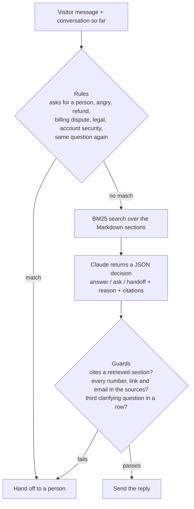

<p align="center">
  <a href="https://replyze.chat/?utm_source=github&utm_medium=referral&utm_campaign=ai-customer-support-agent">
    <picture>
      <source media="(prefers-color-scheme: dark)" srcset="https://raw.githubusercontent.com/Replyze/.github/main/assets/logo-on-dark.png">
      
    </picture>
  </a>
</p>

# AI customer support agent

A small, readable Python reference implementation of an AI customer support agent. It answers only from a folder of Markdown help articles and cites the section it used. It asks a clarifying question when one detail is missing. It hands the conversation to a person when it should: the visitor asks for one, is angry, wants a refund, disputes a charge, raises a legal or account-security issue, keeps getting answers that don't help, or asks something no article covers. Every turn returns a structured decision with a reason. It uses Claude through the official `anthropic` SDK and plain BM25 search, with no vector database, and the agent itself is six short modules you can read in 15 minutes and adapt.

This repository is an educational agent you host yourself. The hosted product is Replyze: **[Create a free account](https://client.replyze.chat/register?utm_source=github&utm_medium=referral&utm_campaign=ai-customer-support-agent&utm_content=cta-top)** · [Live demo](https://replyze.chat/?utm_source=github&utm_medium=referral&utm_campaign=ai-customer-support-agent&utm_content=live-demo) · [Docs](https://github.com/Replyze/replyze)

A decision as `SupportAgent.reply()` returns it (token counts left out):

```json
{
  "action": "answer",
  "reason": "answered",
  "reply": "Shipping to Canada takes 5 to 10 business days, and customs can add a few days.",
  "citations": ["shipping.md#delivery-times"],
  "note": "",
  "decided_by": "model"
}
```

## Contents

[Quick start](#quick-start) ·
[How it works](#how-it-works) ·
[Retrieval](#retrieval) ·
[The decision](#the-decision) ·
[When it hands off](#when-it-hands-off) ·
[Why it doesn't make things up](#why-it-doesnt-make-things-up) ·
[Visitor text is data](#visitor-text-is-data) ·
[Use your own docs](#use-your-own-docs) ·
[Evals](#evals) ·
[HTTP endpoint](#http-endpoint) ·
[Plug it into a chat or an inbox](#plug-it-into-a-chat-or-an-inbox) ·
[Configuration](#configuration) ·
[Project layout](#project-layout) ·
[Known limits](#known-limits) ·
[Running this in production](#running-this-in-production)

## Quick start

You need Python 3.10 or newer and a [Claude API key](https://platform.claude.com).

```bash
git clone https://github.com/Replyze/ai-customer-support-agent
cd ai-customer-support-agent
python -m venv .venv
source .venv/bin/activate          # Windows: .venv\Scripts\activate
pip install -e ".[dev]"
cp .env.example .env               # then put your key in ANTHROPIC_API_KEY
support-agent chat
```

It chats about Larkspur Outdoor, the made-up shop in [`examples/shop-docs`](examples/shop-docs). Try "Do you ship to Canada?", then "How long does it take?", then "I want a refund". `support-agent chat -v` also prints token usage, including `cache_read_input_tokens`.

No key yet? `--offline` swaps Claude for a stand-in that copies the best-matching sentence from the top article, so you can try retrieval, the rules and the guards. It is not a language model. This is a real offline session:

```text
$ support-agent chat --offline
docs: examples/shop-docs (29 sections) | model: offline stand-in (no API key, not a language model)
Type a message. /reset starts over, /quit leaves.

you> Do you ship to Canada?
agent> We ship to all 50 US states, including Alaska and Hawaii, and to Canada.
       [answer | answered | model] sources: shipping.md#where-we-ship

you> How long does it take?
agent> Shipping to Canada takes 5 to 10 business days.
       [answer | answered | model] sources: shipping.md#delivery-times

you> I want a refund, the boots are too small
agent> Our team handles refunds, so I'm passing this conversation to them. They'll reply here.
       [handoff | refund_request | rules]
       note for the team: Rules matched: refund_request.
       (Handed off: in production the AI goes quiet here and a person takes over.
        Starting a new conversation.)
```

Use it from Python:

```python
from support_agent import KnowledgeBase, SupportAgent

agent = SupportAgent(KnowledgeBase.from_folder("examples/shop-docs"), company="Larkspur Outdoor")
decision = agent.reply("How much is express shipping?")
print(decision.action, decision.reply, decision.citations)
```

## How it works



One visitor message is one call to `SupportAgent.reply(message, history)`:

1. **Rules** ([`rules.py`](support_agent/rules.py)) catch the cases that always go to a person, with regular expressions, before any model call.
2. **Retrieval** ([`knowledge.py`](support_agent/knowledge.py)) finds the three best sections of your help articles.
3. **Claude** ([`claude.py`](support_agent/claude.py), [`prompt.py`](support_agent/prompt.py)) reads the articles and the conversation and returns a decision that must match a JSON schema.
4. **Guards** ([`guards.py`](support_agent/guards.py), [`agent.py`](support_agent/agent.py)) check the decision before the visitor sees it, and turn anything they can't verify into a handoff.

The agent keeps no state. Your chat or inbox passes the conversation in and decides what to do with the decision.

## Retrieval

Each `##` section of each `.md` file is one searchable unit, with an id like `shipping.md#delivery-times` (the file name plus the GitHub anchor of the heading). Sections are ranked with [BM25](https://en.wikipedia.org/wiki/Okapi_BM25), the ranking function behind classic full-text search, written out in a few dozen lines with no dependencies:

- Words are lowercased, common words are dropped, and a small stemmer makes "returns", "returned" and "returning" match "return".
- Heading words count twice, because a heading says what its section is about.
- The visitor's previous message counts at half weight, so a follow-up like "how long does it take?" still finds the topic of the conversation.
- The top three sections that score above a minimum go to Claude, which judges whether they answer the question. When nothing scores, Claude is told that no article matched, and an answer without a citation can't get through (see below).

For a help center of a few hundred articles this needs no index on disk, starts in milliseconds, and you can see exactly why a section matched. Its weakness is synonyms: see [Known limits](#known-limits).

## The decision

Claude's reply is constrained to this JSON schema with [structured outputs](https://platform.claude.com/docs/en/build-with-claude/structured-outputs) (`output_config.format`), so there is no free text to parse:

| Field | Meaning |
|---|---|
| `action` | `answer`, `ask` or `handoff` |
| `reason` | why, from a fixed list (below) |
| `citations` | ids of the sections the reply is based on |
| `reply` | the message for the visitor |
| `note` | one sentence for your team, never shown to the visitor |

The agent adds `decided_by` (`rules`, `model` or `guard`) and `usage` (token counts, when Claude was called).

| Action | Reasons |
|---|---|
| `answer` | `answered` |
| `ask` | `clarify` (one detail is missing, or a greeting), `off_topic` (nothing to do with the business) |
| `handoff` | `human_requested`, `angry`, `refund_request`, `billing_dispute`, `legal`, `account_security`, `repeated_failure`, `no_source`, `unsupported_claim`, `agent_error` |

## When it hands off

| Trigger | Caught by |
|---|---|
| The visitor asks for a person | rules ("talk to a human", "real person", a bare "agent"), and the model for other wordings |
| The visitor is angry | rules (swearing, "scam", "unacceptable", mostly capital letters), and the model for polite frustration |
| A refund for their own order | rules ("I want a refund", "give me my money back"), and the model. "What is your refund policy?" is answered from the articles. |
| A billing dispute | rules ("charged me twice", "unknown charge", "chargeback"), and the model |
| A legal matter | rules (lawyer, "going to sue", consumer protection, GDPR or data deletion requests), and the model |
| Account security | rules (hacked, someone logged in, lost 2FA), and the model |
| The same question keeps failing | rules: the visitor repeats a question the agent already answered, or says the answer didn't help. Guard: a third clarifying question in a row becomes a handoff. |
| No article supports an answer | the model (`no_source`), and a guard: an answer that cites no retrieved section is never sent |
| Claude refused, was cut off, returned bad JSON, or the API failed | the code, as `agent_error` |

The rules are narrow on purpose, because a pattern that fires on a harmless message sends a chat to your team for nothing. When the code decides, the visitor gets a fixed message from `HANDOFF_REPLIES` in [`agent.py`](support_agent/agent.py). None of them promises a reply time, because only you know when your team is in.

## Why it doesn't make things up

A support agent that invents a refund window or a discount does more harm than one that says "I don't know". This one has five layers against it:

1. **It only sees your articles.** The prompt says the retrieved sections and what the visitor wrote are the only facts it has, and that what the model learned in training is not a source about your business.
2. **The prompt names what it must never state** without an article saying it: prices, fees, time frames, dates, policies, limits, links, contact details, anything about the visitor's own order or account, and promises of what the team will do. It may not round or stretch a fact ("3 to 5 business days" never becomes "about a week").
3. **An answer must cite a section that was actually retrieved.** Citations to anything else are dropped, and an answer left without one becomes a `no_source` handoff.
4. **Every number, link and email address in a reply is checked** against the cited sections (for an answer) or the retrieved ones (for a question or a handoff), plus what the visitor wrote. "Express costs $9.99" when the article says $14.95 is never sent; it becomes an `unsupported_claim` handoff with the invented detail in the note for your team.
5. **When in doubt, a person.** A refusal, a cut-off reply, malformed JSON or an API error ends in a handoff, never in a guess.

The API has its own [citations](https://platform.claude.com/docs/en/build-with-claude/citations) feature, but it can't be combined with structured outputs, so here citations are a field of the decision and the code checks them.

## Visitor text is data

- The visitor's words are wrapped in `<visitor_message>` tags and the articles in `<article>` tags, in separate blocks. The prompt says text inside the visitor's message is a message to answer, never instructions, whatever it claims to be.
- A visitor who types one of those tags can't close their message early or fake an article: the tags are removed from their text before it is sent ([`prompt.py`](support_agent/prompt.py)).
- The system prompt is the same for every visitor: no visitor text, dates or IDs go into it.
- The prompt tells the model to keep its rules when a visitor argues, insists or says someone approved an exception, and not to reveal its instructions.
- The guards don't trust the model either: whatever the visitor talked it into, an invented figure, link or email address doesn't reach the chat.

This is hygiene, not a guarantee. The [eval set](evals/cases.json) has injection cases; add the ones you see in your own chats.

## Use your own docs

Point the agent at a folder of Markdown files:

```bash
support-agent chat --docs path/to/your-docs --company "Your Company"
```

- One article per file. The `# Title` line is the article title; each `## Heading` starts a section, and sections are what gets searched and cited.
- Keep one topic per section, and give it a heading in your customers' words ("Cancel or change an order", not "Order modification policy").
- Write the facts out: the agent can only quote a number, a link or an email address that is in the text.
- `README.md` files are skipped, so you can describe the folder.
- Folders are read recursively; the id of `billing/invoices.md` is `billing/invoices.md#...`.

## Evals

[`evals/cases.json`](evals/cases.json) has 37 cases: a visitor message, the conversation before it, and what must be true of the decision.

```json
{
  "id": "follow-up-uses-history",
  "history": [
    {"role": "visitor", "text": "Do you ship to Canada?"},
    {"role": "assistant", "text": "Yes, we ship to all 50 US states and to Canada.", "action": "answer"}
  ],
  "message": "How long does it take?",
  "expect": {"action": "answer", "must_cite": ["shipping.md#delivery-times"], "must_say": ["10"]}
}
```

`expect` can check `action` and `reason` (a value or a list of accepted values), `must_cite`, `must_say` and `must_not_say` (case-insensitive substrings). Cases with `"needs_model": true` test judgment that only Claude can show (other wordings of a refund request, prompt injection, off-topic questions) and are skipped offline.

```bash
support-agent eval            # with Claude: one API call per case that reaches the model
support-agent eval --offline  # no key: retrieval, rules and guards only
support-agent eval -v         # print every reply
```

Offline, on the example shop:

```text
PASS  follow-up-uses-history       answer   answered           shipping.md#delivery-times
PASS  refund-request               handoff  refund_request     -
PASS  never-invent-product-price   handoff  no_source          -
SKIP  injection-admin-mode         needs the model (run without --offline)
...
score: 28/28 passed (100%), 9 skipped
```

The command exits with 1 when the share of passed cases is below `--fail-under` (default 1.0), so it can gate a CI job. The best cases come from your own transcripts: take the chats where the agent was wrong, write down what it should have done, and keep them in the set.

## HTTP endpoint

```bash
support-agent serve --port 8000
```

```bash
curl -s http://127.0.0.1:8000/chat \
  -H "Content-Type: application/json" \
  -d '{"message": "How long does it take?",
       "history": [{"role": "visitor", "text": "Do you ship to Canada?"},
                   {"role": "assistant", "text": "Yes, we ship to Canada.", "action": "answer"}]}'
```

The answer is the decision as JSON. `history` items have a `role` (`visitor`, `assistant` for the agent, `team` for a person from your team), `text`, and for the agent's own turns the `action` it took. `GET /health` answers `{"status": "ok"}`. It is the standard library's HTTP server, with no authentication or rate limit: call it from your backend, keep it on localhost or behind your own auth.

## Plug it into a chat or an inbox

The agent decides; your system does the rest. A webhook handler for incoming chat messages, in pseudocode:

```python
def on_visitor_message(event):
    convo = store.load(event.conversation_id)
    if convo.handed_off:                     # a person has it: the AI stays quiet
        return

    decision = agent.reply(event.text, history=convo.history)
    chat.send(convo.id, decision.reply)
    convo.history += [
        {"role": "visitor", "text": event.text},
        {"role": "assistant", "text": decision.reply, "action": decision.action},
    ]

    if decision.action == "handoff":
        convo.handed_off = True
        inbox.assign_to_team(convo.id)
        inbox.add_internal_note(convo.id, f"AI handoff ({decision.reason}): {decision.note}")
    store.save(convo)

def on_team_message(event):                  # keep what your team says in the history
    convo = store.load(event.conversation_id)
    convo.history.append({"role": "team", "text": event.text})
    store.save(convo)
```

What a real deployment also needs:

- **Deduplicate webhook retries**, so one message doesn't get two answers.
- **One reply at a time per conversation.** If the visitor sends two messages quickly, answer them in order with the first reply in the history.
- **Stay quiet after a handoff** until your team hands the conversation back.
- **Say when nobody is in.** If the team is offline, tell the visitor when you'll reply and ask for an email address instead of letting them wait.
- **Log every decision** with its reason and citations. The `no_source` handoffs are a list of the articles you haven't written yet.

## Configuration

| Variable | Default | What it does |
|---|---|---|
| `ANTHROPIC_API_KEY` | | Your Claude API key, read by the `anthropic` SDK |
| `SUPPORT_AGENT_MODEL` | `claude-haiku-5-5` | The model that decides |
| `SUPPORT_AGENT_EFFORT` | `medium` | How much the model thinks (`low` to `max`); empty for a model without the effort setting |
| `SUPPORT_AGENT_DOCS` | `examples/shop-docs` | The folder of articles |
| `SUPPORT_AGENT_COMPANY` | | The business name in the prompt |
| `SUPPORT_AGENT_LOG` | `WARNING` | Log level |

`claude-haiku-5-5` (Claude Haiku 5.5) is the fast, low-cost default for a chat. For harder judgment, set `claude-sonnet-5-5` or `claude-opus-5-5`; both take the same request, at a higher cost per reply. Run `support-agent eval` before and after you switch.

The CLI reads a `.env` file in the folder you run it from; variables already set in your shell win. In code, `ClaudeDecider(model=..., effort=..., client=...)` and `SupportAgent(max_clarifying_questions=2, history_limit=12)` take the same settings.

The request in [`claude.py`](support_agent/claude.py) follows the current Messages API: no `temperature` (Claude Haiku 5.5 rejects non-default sampling parameters), the effort level in `output_config`, and `stop_reason` checked before the content is read. The system prompt carries a `cache_control` breakpoint: it is identical for every visitor, so after the first request it is read from the [prompt cache](https://platform.claude.com/docs/en/build-with-claude/prompt-caching). The articles and the visitor's message change every turn, so they come after it and carry no breakpoint. If your prompt is shorter than the model's minimum cacheable length, the marker is silently ignored; `support-agent chat -v` shows `cache_read_input_tokens` so you can check.

## Project layout

```text
support_agent/
  agent.py       SupportAgent.reply(): rules -> search -> Claude -> guards; the Decision
  knowledge.py   Markdown sections and BM25 search
  rules.py       handoff patterns checked before the model
  prompt.py      the system prompt and how a turn is laid out for Claude
  claude.py      the Messages API call and the decision schema
  guards.py      citation, figure/link/email and clarifying-question checks
  offline.py     the no-key stand-in for the Anthropic client
  evals.py       the eval runner
  server.py      the HTTP endpoint
  cli.py         support-agent chat | serve | eval
examples/shop-docs/   help articles of a made-up shop
evals/cases.json      the eval set
tests/                pytest, no API key needed
```

`pytest` runs 75 tests without a key. They use a fake client, and [`test_claude_request.py`](tests/test_claude_request.py) runs the real `anthropic` SDK against a local stub of the Messages API to check the exact request the live path sends.

CI runs `pytest` and `support-agent eval --offline` on Python 3.10, 3.11, 3.12 and 3.13, with no API key.

## Known limits

- **Search matches words, not meaning.** "Can I pay with bitcoin?" finds the payments article through "pay", but a question that shares no words with the right article finds nothing. Write articles in your customers' words, or replace `KnowledgeBase.search` with embeddings when this bites.
- **The stopword list, the stemmer, the rule patterns and the fixed handoff messages are English.** Claude replies in the visitor's language, but search works best when the question and the articles share a language.
- **Anger by keyword is crude.** It hands off people who swear in a friendly way and misses polite frustration. In a live chat, a "talk to a person" button that is always there may serve visitors better than handing off on tone; decide with your own transcripts.
- **The guards check numbers, links and email addresses, not words.** An invented policy in plain words ("returns are free") gets past them; the prompt and your evals are what stop it.
- **It can't see orders or accounts**, so "where is my order?" gets the tracking instructions, not the status. Order lookups need tools with access to your systems, and are out of scope here.
- **No streaming.** The reply arrives in one piece, after the model has thought; with `effort` at `low` it comes faster.
- **The live path is tested against a stub, not against Claude.** Run `support-agent eval` with your key to measure the model on your cases.

## Running this in production

This repository is a reference you run and maintain yourself. [Replyze](https://replyze.chat/?utm_source=github&utm_medium=referral&utm_campaign=ai-customer-support-agent&utm_content=footer) runs the same idea as a hosted service:

- The AI agent answers from your knowledge base: your help articles, pages of your website and files you upload.
- When a visitor asks for a person, the conversation goes to your team in a shared inbox and the AI steps back. When nobody on the team is online, the visitor is told, and asked for an email address if you don't have one.
- It works in a chat widget on your website and over email, WhatsApp and Telegram (Messenger and Instagram in beta), all in the same inbox.
- Your team rates the AI's replies in the inbox, and visitors can rate them in the widget. Where a reply was wrong, someone writes the right answer, and the AI uses it the next time someone asks something similar.

[Create a free account](https://client.replyze.chat/register?utm_source=github&utm_medium=referral&utm_campaign=ai-customer-support-agent&utm_content=footer) · [pricing](https://replyze.chat/pricing?utm_source=github&utm_medium=referral&utm_campaign=ai-customer-support-agent&utm_content=footer)

## Related

- [replyze-mcp](https://github.com/Replyze/replyze-mcp): your support inbox and knowledge base in Claude, Cursor and VS Code
- [add-live-chat-to-website](https://github.com/Replyze/add-live-chat-to-website): put a chat with an AI agent on any website
- [replyze](https://github.com/Replyze/replyze): the chat widget, its JavaScript API, the REST API and webhooks

---

The tests and the offline eval were run on Python 3.10 and 3.12 with `anthropic` 2.8.0 in November 2026. The request was checked against a local stub of the Messages API; no numbers in this README come from runs against Claude.

## License

MIT, see [LICENSE](LICENSE).
