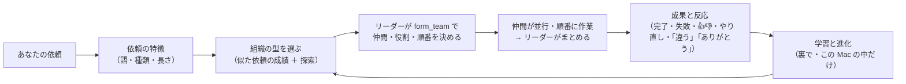

<p align="center">
  
</p>

<p align="center">
  <a href="https://github.com/Rhizobium-gits/OMOCHI-AI/releases/latest"></a>
  <a href="https://github.com/Rhizobium-gits/OMOCHI-AI/releases"></a>
  <a href="https://auralune.tech/"></a>
  
  <a href="LICENSE"></a>
  <a href="https://github.com/Rhizobium-gits/OMOCHI-AI/actions/workflows/ci.yml"></a>
</p>

<p align="center">
  <b>日本語</b> · <a href="README.en.md">English</a> · <a href="README.zh-CN.md">简体中文</a>
</p>

<p align="center">
  <a href="https://github.com/Rhizobium-gits/OMOCHI-AI/blob/stats/stats.json"></a>
</p>

<p align="center">
  <b>いろいろな AI エージェントをデスクトップで一元管理し、エージェント同士をつないでチームとして動かせる macOS アプリです。</b><br>
  <sub><i>All your AI agents in one place on your Mac — and linked together to work as one team.<br>Press ⌘L, type, and watch it think, work and finish.</i></sub>
</p>

<p align="center">
  <a href="https://github.com/Rhizobium-gits/OMOCHI-AI/releases/latest/download/OmochiAI.dmg"></a>
</p>

<p align="center">
  <a href="#主な機能">主な機能</a>
  &nbsp;·&nbsp; <a href="#お餅の性質で操る">🍡 お餅の性質で操る</a>
  &nbsp;·&nbsp; <a href="#ai-をまたいだチーム">AI をまたいだチーム</a>
  &nbsp;·&nbsp; <a href="#予約作業中に次の指示を積む">⏭ 予約</a>
  &nbsp;·&nbsp; <a href="#ダウンロードとインストール">インストール</a>
  &nbsp;·&nbsp; <a href="#はじめかた">はじめかた</a>
  &nbsp;·&nbsp; <a href="#使う-ai-とアカウント">使う AI</a>
  &nbsp;·&nbsp; <a href="#チーム分業">チーム</a>
  &nbsp;·&nbsp; <a href="#macos-の許可をまとめて設定取り消す">🔐 権限</a>
  &nbsp;·&nbsp; <a href="#コネクタカレンダーリマインダーメール">🔌 コネクタ</a>
  &nbsp;·&nbsp; <a href="#アップデート">アップデート</a>
</p>

<p align="center">
  
</p>

> [!NOTE]
> 個人が作った非公式のアプリです。Anthropic・OpenAI・Google とは関係ありません。Claude・Claude Code は Anthropic の、ChatGPT・Codex は OpenAI の、Gemini は Google のものです。

**クラゲからおもちへ**：OMOCHI AI は、Jellyfish AI という名前で、デスクトップをただようクラゲのエージェントとして始まりました。そこから、近づけるとつながり・離すと切れるチーム、AI をまたいだ分業、予約とつなぎ…と、エージェント同士が **くっついたり離れたり、のびたりまとまったり** する機能が中心になり、ただようクラゲより、のびて・ちぎれて・くっついて・ふくらむ **お餅** のほうが、このアプリでエージェントがしていることそのものになりました。前の絵は Claude Code のキャラクターに似ていたので、1.3 でオリジナルのお餅に替え、2.0 で名前も **OMOCHI AI** にそろえて、お餅の性質をそのまま操作にしました（[お餅の性質で操る](#お餅の性質で操る)）。Jellyfish AI から上げるときは [Jellyfish AI から上げる](#jellyfish-ai-から上げる) を見てください。

## 主な機能

| | |
|---|---|
| **⌘L で即エージェント** | どのアプリからでも ⌘L で新しいおもちが現れ、そのまま指示を打てる。おもちは動きで「考え中・作業中・完了・エラー」を見せ、タップすると結果と続きのチャットが開く |
| **AI を選べる** | Claude（Claude Code）・ChatGPT（Codex CLI）・Gemini（Gemini CLI）。おもちごとに AI・モデル・考える強さを選べる。ログインはそれぞれの公式の画面で、入っていない AI は許可すれば入れてそのままログインまで |
| **チームで分業** | おもちを近づけるとつながり、仲間に頼んだり新しい仲間を出したりして分担。**AI をまたいで** Claude のおもちが ChatGPT の仲間を、ChatGPT のおもちが Claude の仲間を出せる。依頼と結果が線の上を光って行き来する |
| **🍡 お餅の性質で操る** | **⌘ で引っぱってちぎる**（同じ会話の分身で別のやり方を試す）・**重ねてくっつく**（良いほうを残す・まとめる）・つながりは **のびるお餅の糸**・**串だんご**（順番に仕事を流す。レシピに保存）・**鏡餅**（頭に載せた方がリーダー）・会話がたまると **ふくらみ**、上限が近いと **焦げ**、放っておくと **硬く** なる（温め直す）・**餅まき**（1 つの指示を何体にもまいて比べる）・ファイルを落とすと **大福**（あんこ＝いつも参照する資料） |
| **自律組織モード** | 依頼ごとにエージェントがチームの形を自分で決めて組み、結果と 👍👎 から組織の選び方を学んで進化させる。組んだ形は串だんご・鏡餅の並びで見える |
| **チャット** | ChatGPT・Claude・Gemini のアプリのように、**表・数式・図とグラフ・色分けしたコード** をそのまま表示。画像・PDF はサムネイル、Web ページは表紙とタイトル。🎙 Mac の音声入力、🎧 システムの音の文字起こし、画面・ファイルの添付、↑↓ で前の指示 |
| **⏭ 予約とつなぎ** | 作業中でも次の指示を打って Enter で予約。送るまで書き換え・並べ替えでき、終わったらすぐ送る。行ごとに送り先のおもちを選ぶと、前の結果を渡して「調べる → まとめる → 確かめる」のようにつなげられる。**■ 止める（⌘.）** で中断 |
| **PC 操作** | 許可したおもちだけが画面を見てクリック・入力（Claude）。操作中は画面の縁が光り、Esc で止まる |
| **👀 見守り** | おもちが前面のウィンドウを **Mac の中だけで** 読み（トークン 0・どこにも送らない）、エラーっぽい表示に気づいたら「見る？」と聞く。押したときだけ、その 1 枚を送る（おもちごとに、既定はオフ） |
| **🔌 コネクタ** | この Mac の **カレンダー・リマインダー・メール**（Google・iCloud なども Mac のアプリ経由）を、どの AI・どのモデルのおもちに、どこまで使わせるかを決めて渡す。ボタン 1 つのワンタッチ設定、書き込みは毎回確認、メールは送らない |
| **🔐 権限** | macOS の許可（アクセシビリティ・画面収録・フルディスクアクセス・オートメーション）と、付けると何ができるかを一覧にし、まとめて許可・まとめて取り消し |
| **使用量が見える** | メニューバーに Claude の今週の枠、ChatGPT の 5 時間・今週の枠をバーで。AI ごと・モデルごと・アカウントごとの回数とトークンも |
| **勝手に課金しない** | API キーを扱わず、従量課金でログインしている AI は使わない（Claude も同じ） |
| **アップデート** | アプリから・ターミナルから・コマンド 1 つで。チェックサム・中身・署名を確かめてから入れ替える。新しい版の確認は **毎日・毎週・毎月・しない** から選べる（既定はしない） |
| **日本語・English・简体中文** | メニューもエージェントへの案内も、選んだ言語で |

## お餅の性質で操る

<p align="center">
  
</p>

おもちは、お餅の性質そのままに扱えます（2.0 から）。

| お餅の性質 | 操作 | 何が起きるか |
|---|---|---|
| **✂️ ちぎる** | **⌘ を押しながら引っぱる**（右クリック › ✂️ ちぎる） | お餅の糸がのびてくびれ、離すとぷちっとちぎれて **同じ会話を持った分身** ができる。分身に別のやり方を頼めば、2 通りを並行で試せる。分身の AI を変えることもできる（ChatGPT・Gemini には会話を渡して始める） |
| **🍡 くっつく** | おもちを別のおもちに **重ね、輪が白くなるまで少し（0.4 秒）待って離す**（右クリック › 🍡 くっつく） | 「まとめて 1 体に（相手の結果を取り込む）」「こっちを残す」「あっちを残す」から選ぶ。片方が溶けて、もう片方がむにっと受け止める。つながり・部下・あんこ・串の場所は残ったおもちが受け継ぐ |
| **のびる** | 体がふれるくらいまで寄せてつなぐ | つながりは引っぱったお餅の糸。離すほど細く、ひまなときはゆるく垂れ、仕事が流れている・詰まっているときは **ぴんと張る**。依頼と結果は、糸の中を **お餅の塊** が流れて届く |
| **🍡 串だんご** | メニューバー・右クリック › 🍡 串だんご | 段ごとに「どのおもちが・何をするか」を決めて串に刺すと、1 段目に渡したことの結果が順に次の段へ流れる（例：調べる → まとめる → 確かめる）。**名前を付けて保存するとレシピ** になり、何度でも新しいおもちで流せる（「みたらし」「三色だんご」は最初から入っている）。1 段目のチャットの「🍡 串に流す」でも流せる。串のおもちは、どれを動かしても串ごと動く（⌥ を押しながら離すと串から抜ける） |
| **🍊 鏡餅** | おもちを別のおもちの **頭の上に載せ、少し（0.4 秒）待って離す** | 上がリーダー（頭にだいだい）、下が部下になる。リーダーは部下に分けて頼み、部下は結果をリーダーに返す。リーダーを動かすと下の段も一緒に動く。自律組織モードの組織も、順番の形なら串だんご・ほかの形なら鏡餅に並ぶ |
| **🫓 ふくらむ・🔥 焦げる** | （自動） | 会話（文脈）がたまるほどふくらみ、上限に近づくと焦げ目が付く（Claude のおもち）。**🧽 焦げを落とす** で会話を要約して軽くする（Claude Code の `/compact`） |
| **🧊 硬くなる** | （自動） | 前の作業から 30 分で少し、1 時間で硬くなる（ひびが入り、息が浅くなる。プロンプトキャッシュが切れて、次は会話を読み直すため）。**♨️ 温め直す** で必要なファイルを読み直してもらい、やわらかく戻る（頭から湯気） |
| **🎊 餅まき** | メニューバー › 🎊 餅まき | 1 つの指示を、Claude・ChatGPT・Gemini の新しいおもちと今いるおもちに同時にまく。答えが横に並ぶので、いちばん良いものを **🙌 拾う**。まくために作ったほかのおもちは片付く |
| **🫘 大福** | ファイル・フォルダをおもちに **落とす** › あんこにする | おもちが大福になり（体にあんこが透ける）、資料が **そのおもちの専門分野** として毎回の案内に入り続ける。チャットの上の 🫘 から外せる（「次の指示に添付する」を選べば今回だけ） |

## AI をまたいだチーム

<p align="center">
  
</p>

Claude のおもちに「仲間を 2 人作って分担して。ChatGPT（Codex）の「Codex 実装係」が 1〜100 の素数の和を Python で計算し、Claude の「Claude レビュー係」がそのコードを確かめる」と頼むと、リーダーが **AI の違う仲間** を出して線でつなぎ、依頼と結果を線の上でやり取りしてまとめます（実際の録画。返事を待つ間だけ 3 倍速）。

- 仲間はそれぞれの AI の公式の CLI を、あなたのログインのまま動かします。チャットのタイトルと返答の見出しに、その仲間の AI（ここでは ChatGPT（Codex））が出ます
- 仲間ごとに AI・モデル・考える強さを選べます。詳しくは [AI ごとの得意なことで分担する](#ai-ごとの得意なことで分担する)

<p align="center">
  
</p>

## ダウンロードとインストール

**必要なもの**

- macOS 14 以降。Apple シリコン / Intel の両方で動く universal 版です（動作確認は Apple シリコンの macOS 26）。システムの音の文字起こしは macOS 26 以降
- 次の AI の CLI のどれか 1 つ以上（[使う AI とアカウント](#使う-ai-とアカウント)）。いちばん多くの機能が使えるのは Claude Code です。入っていなくても、アプリから許可して入れられます
  - [Claude Code](https://code.claude.com/docs/en/setup)（Claude のアカウント）。PATH・`~/.local/bin`・Homebrew・VS Code / Cursor 拡張に同梱の `claude` から最新版を自動で選びます
  - [Codex CLI](https://github.com/openai/codex)（ChatGPT のアカウント）。ChatGPT のデスクトップアプリに入っている Codex CLI も自動で見つけ、アプリで ChatGPT にログインしていればそのまま使えます
  - [Gemini CLI](https://github.com/google-gemini/gemini-cli)（有料の Gemini API キーなど。個人の Google アカウントは 2026-06-18 で提供が終わりました。[下の注意](#使う-ai-とアカウント)）

1. **ダウンロード**
   **[OmochiAI.dmg をダウンロード](https://github.com/Rhizobium-gits/OMOCHI-AI/releases/latest/download/OmochiAI.dmg)**（いつも最新版。[Releases の最新版](https://github.com/Rhizobium-gits/OMOCHI-AI/releases/latest) のページからも同じものを取れます。`.zip` もあり、中身は同じ）
2. **アプリケーションフォルダに入れる**
   .dmg を開き、**OMOCHI AI** を隣の **Applications** へドラッグします
3. **開く**
   アプリケーションフォルダの OMOCHI AI を開きます。Developer ID で署名し Apple の公証を受けているので、「インターネットからダウンロードされたアプリケーションです」と出たら「開く」を押すだけです（2.0.2 から。2.0.1 までの版は、初回だけ **システム設定 › プライバシーとセキュリティ** の「このまま開く」が必要でした）
4. **AI にログイン**
   初めて開くと「アカウントと AI」の画面が出ます。使う AI の「ログイン…」を押すと公式のログインがターミナルで始まるので、ブラウザでログインするだけです。入っていない AI は「入れてログイン…」で、実行するコマンドを見せて許可を求めてから入れます

ダウンロードしたファイルが壊れていないかは、同じリリースの `SHA256SUMS.txt` と `shasum -a 256 OmochiAI.dmg` の結果を見比べて確かめられます。

> [!IMPORTANT]
> エージェントは **確認なしで** ファイルの作成・編集・削除やコマンドの実行を行います（Claude Code の Auto モード、Codex のサンドボックス、Gemini の auto_edit。危ない操作はそれぞれの AI の安全の仕組みが止めます）。作業フォルダは既定でホームです。詳しくは [権限と安全](#権限と安全) と [SECURITY.md](SECURITY.md)。
>
> エージェントはあなたの AI のアカウント（Claude の Pro / Max、ChatGPT、Google のアカウント）で動き、その使用量を消費します。**OMOCHI AI は API キーを扱わず、勝手に課金しません**。Claude Code は 1 回の呼び出しの土台だけで数万トークンを使うので、たくさんのおもちを並列に動かすと使用量の上限に早く届きます。どれだけ使ったかはメニューバーのおもちで確かめられます。

## 起動のしかた

ターミナルは要りません。普通の Mac のアプリと同じように開けます。

| どこから | やり方 |
|---|---|
| **Spotlight** | ⌘Space で「OMOCHI AI」と打って Enter |
| **Launchpad / アプリ** | OMOCHI AI のアイコンをクリック |
| **Finder** | 「アプリケーション」フォルダの OMOCHI AI をダブルクリック |
| **Dock** | アプリケーションフォルダの OMOCHI AI を Dock へドラッグしておくと、次からはクリックだけ |
| **ログイン時に自動で** | メニューバーのおもち › **ログイン時に自動起動** をオン |

- 起動すると、メニューバーにおもちのドット絵のアイコンが出ます。常駐型のアプリなので、普段は Dock に出ません（チャットウィンドウを開いている間だけ Dock と ⌘Tab に出ます）
- 動いている最中にもう一度アイコンを開くと、隠していたおもちを出します。1 体もいなければ新しいおもちを出します
- 終了はメニューバーのおもち › **OMOCHI AI を終了**（⌘Q）。実行中のエージェントは中断されます

## はじめかた

1. どのアプリを使っていても **⌘L** を押すと、新しいおもちが現れて入力欄が開きます
2. やってほしいことを書いて **Enter**。入力欄が閉じ、おもちが動きで状態を見せながら作業します
3. 終わったおもちを **タップ** すると、チャットウィンドウで結果を読めます。そのまま続けて指示できます
4. 要らなくなったおもちは **長押し** で消せます

PC 操作や画面の添付を使うなら、メニューバーのおもち › **🔐 権限（Full Access）** の「まとめて許可する」で、macOS の許可をまとめて付けられます（[macOS の許可をまとめて設定・取り消す](#macos-の許可をまとめて設定取り消す)）。

<p align="center">
  
</p>

おもちは、床にぽてっと座った丸餅のドット絵「まるもち」です。待機中はゆっくり呼吸し、考え中は「ぷくー」とふくらんで「しゅん」としぼみ、作業中は「ぽよん」と跳ね、完了するとふくらんで ^^、エラー・キャンセルではしぼみます。つつくと跳ね、つまむと伸び、長押しでつぶれます。1 体目は灰色で、2 体目からは色違いです。メニューバーのおもち › 見た目 で **リアルなおもち** にもできます（Blender で描いた本物そっくりの丸餅に目が付いたもの。動きはドット絵と同じで、灰色のおもちは白いお餅、色違いは淡い色のお餅、エラーは赤みがかったお餅になります）。

## メニューバー

メニューバーのおもちをクリックすると、いちばん上に **アカウントと使用量** が出ます。

- **Claude**：ログインしているアカウントのメールとプラン（例：Claude Max 20x）、今週の使用量のバー（**全モデル** と **Fable**、それぞれのリセット日時。75% でオレンジ、90% で赤）。メニューを開いたときに、前に読んでから 1 分以上たっていれば `claude auth status` と `claude -p /usage` で読み直します（`/usage` は組み込みコマンドなので、モデルは呼ばずトークンも使いません）
- **ChatGPT（Codex）**：ログインしていれば、プラン（例：ChatGPT Plus）と **5 時間・今週の枠** のバー。Codex CLI が自分の記録に書いた、最後に使ったときの値を読むだけです
- **Gemini**：ログインしていれば、OMOCHI AI から動かした回数（今日・7 日）
- **📊 使用量（AI ごと・直近 7 日）**：AI ごと・モデルごと・アカウントごとの呼び出しの回数とトークン（OMOCHI AI が動かした分を、CLI が報告した数で。この Mac の中だけで数えます）

その下に、新しいおもち・全員を隠す / 表示・過去のセッション・エージェントの一覧と、次の設定があります。

| 項目 | 内容 |
|---|---|
| 見た目・大きさ | ドット絵（おもち）/ リアルなおもち、大きさ |
| 画面認識 | 「この画面」と言ったときに撮る画面（使っていたアプリのある画面 / すべて） |
| 🔑 アカウントと AI | ログインの状態・使う AI（既定）・ログイン・入れてログイン・API キーでの利用の許可 |
| 🍡 串だんご | 新しい串を作る・レシピで流す・いまの串 |
| 🎊 餅まき | 1 つの指示を何体ものおもちにまいて、答えを並べて比べる |
| 🔌 コネクタ | いまの決まり・ワンタッチ設定・コネクタの画面（AI・モデルごとに決める） |
| 🧠 モデル（既定） | AI ごとの既定のモデル |
| 実行ポリシー | 各 AI を確認なしで動かすときの決まりと、使っている CLI の場所・版 |
| PC 操作 | 許可しているエージェント・今すぐ止める |
| 🔐 権限（Full Access） | macOS の許可をまとめて設定・取り消す |
| チーム（分業）・🧬 自律組織 | 分業と自律組織のオン・オフ、学習のレポート・リセット |
| 外部ツール（MCP） | 呼んだときだけ / いつも / 使わない |
| チャットに Web ページのプレビューを出す | Web の表紙の画像とタイトル（オフでも画像・PDF は表示） |
| ログイン時に自動起動・🌐 言語 | |
| アップデートの自動確認 | 毎日・毎週・毎月・確認しない（既定） |
| OMOCHI AI について・アップデートを確認… | |

## チャット

おもちをタップすると開くチャットウィンドウは、普通の Mac のウィンドウです（しまう・フルスクリーン・自由にリサイズ）。開いている間は Dock・⌘Tab・メニューバーに出るので、⌘W（閉じる）・⌘M（しまう）・⌃⌘F（フルスクリーン）が効き、しまったチャットは Dock のアイコンかメニューバーの **ウインドウ** から戻せます。フルスクリーンのときに Esc を押すと、チャットはフルスクリーンのまま前のアプリに戻ります（フルスクリーンをやめるのは ⌃⌘F か緑のボタン）。

- **上の段**：AI（Claude / ChatGPT / Gemini）・モデル・考える強さ・名前・再実行
- **下の段**：画面の添付（自動判定 / 毎回 / しない）・📎 ファイル・🎙 音声入力・🖱 PC 操作・🎧 聞き取り・📁 作業フォルダ・「Claude Code で開く」（Claude。同じ会話をターミナルで）/「Gemini をこのフォルダで開く」（Gemini）

### 操作

| 操作 | 動作 |
|---|---|
| **⌘L**（どのアプリからでも） | 新しいおもちを出して、すぐ入力欄を開く |
| **タップ** | チャットウィンドウを開く（Enter 送信・作業中は予約 / ⇧Enter 改行 / ⌘. 作業を止める / Esc 閉じる） |
| **↑ / ↓**（入力欄） | そのセッションで前に送った指示を呼び出す（1 行目で ↑・最後の行で ↓。VS Code・ターミナルで打った指示も含む） |
| **長押し** | そのおもちを消す（作業中なら「作業は続ける / キャンセルして消す」を確認） |
| **ドラッグ** | 好きな場所へ移動（位置は保存）。別のおもちに体がふれる・重なるくらいまで寄せて離すとつながる（重なっていても、すぐ離せばつながる。離れたままではつながらない）・**重ねて少し待ってから離すとくっつく**・**頭の上で少し待ってから離すと鏡餅** |
| **⌘ ドラッグ** | 引っぱって **ちぎる**（同じ会話の分身ができる） |
| **ファイルを落とす** | **あんこにする**（大福：いつも参照する資料）か、次の指示に添付するかを選ぶ |
| **⇧ ドラッグ** | 線でつながったチームごと移動 |
| **⌥ を押しながら離す** | そのおもちのつながりと鏡餅の上下を全部切り、串から抜く |
| **右クリック** | チャット・名前・つなぐ / つながりを切る・✂️ ちぎる・🍡 くっつく・🍊 鏡餅・🍡 串だんご・🫘 あんこ・♨️ 温め直す・🧽 焦げを落とす・キャンセル・隠す・定位置に戻す・削除 |
| **⌥⌘L** / メニューバー | 全員を隠す・表示（隠しても作業は続く） |

### チャットでできること

- **どこで頼んだかが分かる**：自分の指示は右の吹き出し（おもちの色をうすく敷く）、返答は左に広く、仲間のおもちからの依頼は左の点線の枠で出ます
- **表・数式・図とグラフ**：返答の Markdown の表、数式（文中は `$…$`、別の行は `$$…$$`。KaTeX）、Mermaid の図とグラフ（フローチャート・シーケンス図・円グラフ・棒グラフと折れ線グラフ `xychart-beta` など）、言語名つきのコードの色分け（押すとコピーできるボタンつき）を、ChatGPT・Claude・Gemini のアプリのように表示します。どの AI にもこの書き方を伝えているので、「表にして」「グラフで見せて」と頼めばそのまま見えます。表示はアプリの中のライブラリだけで行い、ネットには取りに行きません（返答の中の HTML は文字として出し、Web の画像も読み込みません）
- **画像・PDF・Web ページを見る**：添付した画像・PDF や、会話に出てきた画像・PDF のファイルは Quick Look のサムネイルで、Web ページの URL は表紙の画像とタイトル（Mac の LinkPresentation）で、文の下に出ます。押すとプレビュー・ブラウザで開きます
  - 自動で読みに行くのは **自分が打った指示の URL だけ** です。エージェントの返答や仲間からの依頼に出てきたページは「表紙を見る」を押したときだけ読みに行きます（読み込んだページなどに仕込まれた指示で、秘密を入れた URL を書かされても、勝手に送らないように）
- **話して入力**：**🎙** か メニューの 編集 › **音声入力を開始** で、Mac の音声入力が入力欄で始まります。AI で聞き取るのではなく macOS の機能です（システム設定 › キーボード › 音声入力。そこで決めたショートカットでも始められます）
- **画面を見て作業**：「この画面」「表示されているエラー」「スクショ」のように画面をはっきり指すと、送信時の画面を撮って渡します（OMOCHI AI 自身のウィンドウは写さない。普通の指示では撮らない）。画像は長辺 1568px までに縮めるので、1 枚あたり約 1,800 トークン
- **ファイルを渡す**：チャットウィンドウにファイルをドロップすると添付になります（📎 ボタンでも可）。おもちに落とすと、添付にするか **あんこ**（大福：いつも参照する資料）にするかを選べます
- **会話の状態が分かる**：上の行に「🫓 会話 35k（4%）」（上限に近いと 🔥）、しばらく使っていなければ「🧊 硬くなっています」と出ます。ボタンの **♨️ 温め直す**・**🧽 焦げを落とす** でその場で直せます。串の 1 段目のおもちには **🍡 串に流す** が出ます
- **ファイルやページを開く**：「デスクトップの〇〇の資料を開いて」と頼むと、探して Mac の既定のアプリ（プレビュー・Finder・ブラウザなど）で開きます。「何て書いてある？」ならチャットで答えます
- **名前を付ける**：右クリック「名前を変える…」かチャットの「名前」。エージェント同士はこの名前で呼び合います。名前のないおもちは「Agent 番号」で、番号は空いている一番小さいものを使い回します
- **記録に残る**：Claude の会話は Claude Code 自身のセッション（`~/.claude/projects`）に保存されるので、VS Code やターミナルからも続きを開けます（「Claude Code で開く」で、ターミナルの `claude --resume`）。メニューバーの「過去のセッションを開く」で、VS Code・ターミナルで作ったセッションもおもちとして呼び出せます（⌥ を押しながら選ぶとアーカイブ）。ChatGPT・Gemini の会話は、それぞれの CLI の記録に残ります

## 予約（作業中に次の指示を積む）

<p align="center">
  
</p>

おもちが作業している間も入力欄に書けます。**Enter** で「いまの作業が終わったら送る指示」として **予約** に入り、入力欄の上に一覧で出ます。作業が完了したら、上から順にすぐ送ります。

- **送るまで書き換えられる**：予約の文はその場で直せます（打っている途中に前の作業が終わっても、打ち終わるまで待ちます）。↑↓ で並べ替え、✕ で消す、「すべて消す」
- **ほかのおもちへつなぐ**：行ごとに送り先のおもちを選べます。ほかのおもちにすると「前の結果を渡す」が付き、前の手順の結果（最後の返答）を添えて、そのおもちの会話で続きをします。「Aki が調べる → Mio が表にまとめる → Kai が確かめる」のように、成果物ができたら次、さらにその次とつなげられます（線でつないだりチームを組んだりしなくても使えます）
- **送り先が作業中なら待つ**：手が空いたらすぐ送ります。送り先のチャットには「🔗 〇〇 の予約が、この作業の後に控えています」と出ます
- **止める**：入力欄の横の **■ 止める**（**⌘.**）で、いまの作業を中断します。止めたとき・エラーで終わったときは続きを勝手に送らず、予約を一時停止します（**▶ 再開** で続きを送る）。**⏭ 止めて次へ** は、いまの作業を止めて、一時停止せずに次の予約へ進みます
- 予約はアプリを終了しても残ります（次に起動したときは一時停止の状態。▶ で続きを送ります）
- 作業中に「この画面」などと書いて予約すると、予約したときの画面を撮っておいて一緒に送ります。添付したファイルも同じです

## 使う AI とアカウント

エージェントを動かす AI は **Claude（Claude Code）・ChatGPT（Codex CLI）・Gemini（Gemini CLI）** から選べます。どれも、この Mac に入っている公式の CLI を、**あなたのアカウントのログインのまま** 動かします。

| AI | CLI | ログインに使うアカウント | 確認なしで動かすときの決まり | 使える機能 |
|---|---|---|---|---|
| Claude | Claude Code | Claude（Pro / Max など） | Auto モード（危ない操作は Claude Code の安全判定が止める） | すべて |
| ChatGPT | Codex CLI | ChatGPT（Plus / Pro など） | サンドボックス（作業フォルダの中だけ書ける・ネットワークなし） | PC 操作・外部ツール（MCP）・モデルの「自動」以外 |
| Gemini | Gemini CLI | 有料の Gemini API キー・Gemini Code Assist Standard / Enterprise（個人の Google アカウントは 2026-06-18 で終了） | auto_edit（作業フォルダの中の編集だけ自動で承認・コマンドは実行しない） | PC 操作・外部ツール（MCP）・モデルの「自動」以外 |

- **ログイン**：初めて起動したときの「アカウントと AI」の画面か、メニューバーのおもち › **🔑 アカウントと AI** から。それぞれの CLI の公式のログイン（`claude auth login --claudeai`・`codex login`・Gemini CLI のログイン）をターミナルで開き、ブラウザで本人が行います。**OMOCHI AI はパスワード・トークン・API キーを受け取らず、保存もしません**。別のアカウントでのログインし直しも同じ画面から
- **入っていない AI** は「入れてログイン…」で、実行するコマンドを見せて許可を求めます。許可すると、ターミナルで公式のパッケージを入れ、続けてログインを始めます（管理者のパスワード・sudo は使いません）
  - Claude：Anthropic の公式インストーラ（`curl -fsSL https://claude.ai/install.sh | bash`、`~/.local/bin` に入る）
  - ChatGPT（Codex）：`npm install -g @openai/codex`。npm が無いか、npm のグローバルの入れ先に書けないときは `brew install --cask codex`
  - Gemini：`npm install -g @google/gemini-cli`。同じく、だめなら `brew install gemini-cli`
  - npm も Homebrew も無いときは公式の案内を開きます（ChatGPT のデスクトップアプリを入れれば、その中の Codex CLI も使えます）
- **おもちごとに AI を選べます**：チャットの上の段の「AI」。変えると新しい会話になります。選んでいないおもちはメニューの「使う AI（既定）」に従い、既定を変えたときも前の AI の会話を新しい AI で続けようとはしません
- **どの AI でも使えるもの**：話す・作業する・続ける・チーム（仲間を作る・頼む）・自律組織・画面とファイルの添付・🎧 聞き取り・🎙 音声入力。ChatGPT には画像を `--image` で添え、Gemini には添付（画面の画像・文字起こし）の置き場所をワークスペースに足して渡します
- Gemini はフォルダの信頼を確かめます。信頼していないフォルダでは動かないので、チャットの「Gemini をこのフォルダで開く」から開き、信頼してよいフォルダのときだけ信頼してください（OMOCHI AI はこの確認を飛ばしません）
- **Gemini CLI は 2026-06-18 で、個人の Google アカウント（無料・Google AI Pro・Ultra）への提供を終えました**（[Google の発表](https://developers.googleblog.com/an-important-update-transitioning-gemini-cli-to-antigravity-cli/)）。いま Gemini を使えるのは、有料の Gemini API キー（メニューバーのおもち › 🔑 アカウントと AI ›「API キー（従量課金）での利用を許可」をオン。使った分だけ料金がかかります）か、Gemini Code Assist Standard / Enterprise の組織のアカウントでログインした Gemini CLI です。後継の Antigravity CLI（`agy`）は、個人向けプランのまま他のアプリから動かすことを Google が認めていないので、OMOCHI AI は対応していません

### モデルと考える強さ

- **Claude**：**🤖 自動**（依頼ごとに、短い・簡単なら Haiku、ふつうは Sonnet、重い依頼は Opus。いちばん重い依頼は、今週の Fable の使用量が 75% 未満のときだけ Fable）か、**Fable / Opus / Sonnet / Haiku**。考える強さは low〜max（`--effort`）。自動のときは状態欄に選んだモデルと理由が出ます
- **ChatGPT（Codex）**：CLI が出すモデルの一覧（`codex debug models`）から。考える強さは、そのモデルが対応しているもの（low〜ultra など）
- **Gemini**：CLI が出すモデルの一覧（`gemini models`）から。Gemini CLI には考える強さを指定するオプションが無いので、Gemini CLI の設定に任せます
- 一覧は CLI から読むだけで（名前を推測しない・モデルは呼ばない）、1 日覚えておきます。選んでいないおもちはメニューバーの **🧠 モデル（既定）** に従います（AI ごとに既定を決められる）

### 勝手に課金しない

- OMOCHI AI は **API キー（従量課金）での利用をしません**。これは Claude も同じです
  - シェルの設定に `ANTHROPIC_API_KEY`・`OPENAI_API_KEY`・`CODEX_API_KEY`・`GEMINI_API_KEY`・`GOOGLE_API_KEY` などがあっても、エージェントの CLI には渡しません
  - CLI が API キーやクラウド（Anthropic Console・Bedrock・Vertex AI など）でログインしているときは、そのおもちを動かさず、サブスクリプションのアカウントでログインし直すよう案内します
- どうしても API キーで使いたいときだけ、メニューバーのおもち › 🔑 アカウントと AI ›「API キー（従量課金）での利用を許可」をオンにします（確認が出ます。使った分だけ各 API の料金がかかります）
- サブスクリプションの使用量の上限を超えたときの追加の購入などは、それぞれのアカウントの設定のままです（OMOCHI AI は変えません）

## チーム（分業）

<p align="center">
  
</p>

1. おもちをドラッグして別のおもちに **体がふれるくらいまで寄せる** と、相手が点線の輪で光り「離すと 〇〇 とつながる」と出ます。離すとつながり、つながった塊が 1 つのチームです
   - 離れたおもちとは 右クリック › つなぐ でもつなげます。⇧ を押しながらドラッグするとチームごと動かせます
   - チャットウィンドウの上に「👥 〇〇 とチーム」と出て、誰に分担させられるかがわかります
2. どれかに「仲間を作って分担して」「レビュー係に添削してもらって」のように頼みます。エージェントは OMOCHI AI のツールで
   - `create_teammate`：新しい仲間を自分の隣に出して作業を任せる（AI・モデル・考える強さも選べる）
   - `assign_task`：チームの仲間に作業を頼む（相手が作業中なら順番待ち）
   - `wait_for_tasks`：頼んだ作業の結果を受け取る
   - `list_team`：仲間と状態、使える AI を見る
3. 頼まれた側のチャットには「📨 〇〇 からの依頼」として残ります。結果は依頼元に戻り、依頼元がまとめます。依頼（依頼元の色）と結果（依頼先の色）が線の上を光って行き来します
4. つながりは、線にポインタを置くと出る ✂︎、⌥ を押しながらドラッグして離す、または右クリック › つながり で切れます

1 チーム最大 8 体。エージェントが作った仲間がさらに作れるのは 1 段まで（ユーザーのおもちから数えて 2 段）。メニューバーの「チーム（分業）」で機能ごと止められます。

<p align="center">
  
</p>

### AI ごとの得意なことで分担する

**どの AI のおもちもリーダーになれます**。Claude のおもちが ChatGPT の仲間を、ChatGPT のおもちが Claude の仲間を出して、分担したり一緒に開発したりできます。自分で AI を選んでおいたおもちどうし（たとえば Claude と ChatGPT）をつなげば、お互いに頼み合い、結果を返し合います。

実際の様子は [AI をまたいだチーム](#ai-をまたいだチーム) のデモで見られます。

| AI | 向いている役割 | できないこと |
|---|---|---|
| Claude | リーダー・まとめ・レビュー、長い多段の作業、コマンドの実行、Web 検索、PC 操作（許可したとき）、外部ツール | — |
| ChatGPT（Codex） | コードの実装・修正、テストやビルドの実行 | ネットワーク（Web 検索・パッケージのダウンロード）、作業フォルダの外への書き込み |
| Gemini | Google 検索・Web ページでの調査、たくさんの資料やコードの要約・比較、文章 | シェルのコマンドの実行 |

- 「調査は Gemini、実装は Codex、まとめとレビューは Claude で分担して」のように頼むと、リーダーが `create_teammate` / `form_team` の `engine`・`model`・`effort` で仲間ごとに AI・モデル・考える強さを選んで作ります（自律組織モードでも同じ）。リーダーへの案内には、いまログインしていて使える AI と、得意なこと・できないこと・選べるモデルと強さが書かれます
- 使えない AI（入っていない・ログインしていない・API キーの従量課金のまま）を指定すると、リーダーに理由と使える AI が返り、別の AI で頼み直します
- **データの受け渡し**：リーダーの依頼ごとに、チームで共有する **受け渡し用のフォルダ**（データフォルダの `handoff/` の下、本人だけが開ける）を作り、どの AI の仲間にも読み書きを許します。大きなデータや途中の成果物はここにファイルで置き、依頼文と結果にはパスを書きます。空ならそのターンの終わりに、使ったものは 7 日で片付けます
- 返答の見出しは、その返答を書いた AI の名前（Claude・ChatGPT（Codex）・Gemini）です。仲間の画面の状態欄・タイトルにも、その仲間の AI とモデルが出ます
- 仲間からの依頼で動いているエージェントは、自分と違う AI の仲間を作ったり頼んだりしません（AI ごとに安全の仕組みが違うので、別の AI を通して自分にできないことをさせないため）。違う AI どうしで分担するのは、ユーザーが直接頼んだおもち（リーダー）からです

## 自律組織モード

メニューバーのおもち › **🧬 自律組織 › 自律組織モード** をオンにすると、依頼のたびにエージェントが **仕事に合った組織を自分で組んで** 進めます（既定はオフ。チーム（分業）も一緒にオンになります）。どの AI のおもちでも使えます。



**組織の型**（`form_team` の `formation`）

| 型 | 例 | 向いている依頼 |
|---|---|---|
| 一人で `solo` | | 小さい・分けにくい依頼 |
| 一人で ＋ レビュー係 `solo+r` | 書く → 添削 | 文章・コード・翻訳 |
| 分担して同時に `parallel2〜5` | 5 社をそれぞれ調べる | 独立した部分に分けられる依頼 |
| 順番に `pipeline2〜4` | 調べる → 書く → 確かめる | 前の結果を次が使う依頼 |
| 別々に試して選ぶ `ensemble2〜3` | 案を 3 つ出して選ぶ | アイデア・デザイン |
| 階層 `hierarchy2〜3` | サブリーダーがさらに分担 | 大きく広い依頼 |

型の後ろの `+r` は、最後に全員の結果を見るレビュー係を置くという意味です。

**どう動くか**

1. 依頼を受けると、OMOCHI AI が依頼の特徴（語・依頼の種類・長さ。日本語・英語・中国語）から、これまでの成績をもとにおすすめの型を選び、リーダー（依頼したおもち）に伝えます
2. リーダーは `form_team` で仲間の名前・役割・作業（と AI・モデル・強さ）を決めて組みます。`after` で順番を付けると、前の担当の結果が自動で次の担当の依頼に付きます。おすすめより合う型があれば、リーダーが変えられます
3. 仲間は隣に出て線でつながり、並行・順番に作業します。チャットの状態欄に 🧬 と組んでいる型が出ます
4. 次の依頼で使わなかった仲間は片付けます（同じ名前の仲間は続けて使います。ユーザーが自分で用意した仲間の AI・モデル・強さは変えません）。メニューの「今の組織を解散」でも片付けられます

**学習と進化**（バックグラウンド・端末内）

- 依頼ごとに、成果（完了・失敗・かかった時間・仲間の成否）とあなたの反応（チャットの 👍 / 👎、再実行・キャンセル、続けて送った「違う」「やり直して」「ありがとう」「完璧」など）から 0〜1 の点を付けます
- 型ごとの見込みを Beta 分布で持ち、**似た依頼ほど強く** 効かせて選びます（Thompson サンプリング）。よく効く型を使いつつ、ときどき別の型も試して学びます
- **未知の依頼**（似た依頼がまだない）は、依頼の種類からの見込みと全体の傾向で選び、その結果から学びます
- 成績のよい型を少し変えた型（人数・レビュー係の有無・形）が生まれ、明らかに悪い型は引退します（「一人で」は残します）。世代・型の数・依頼の種類ごとのいちばんの型はメニューに、詳しくは「学習のレポートを開く」に出ます
- 記録は `~/Library/Application Support/OmochiAI/org/` にだけ保存し、どこにも送りません。「学習をリセット…」で消せます。「成果と反応から学ぶ」をオフにすると記録しません

> [!NOTE]
> 仲間の分だけ使用量が増えます。小さな依頼では一人で進めるよう案内し、人数が多い型ほど少し割り引いて選びます。PC 操作のツールは仲間には渡りません（ユーザーが直接頼んだエージェントだけ）。

## PC 操作

チャットの **🖱 PC 操作** をオンにしたエージェントだけが、OMOCHI AI のツールでこの Mac を操作できます（既定はオフ・Claude のおもちだけ）。

- `screen_capture`（1 ピクセル = 1 ポイントで撮るので、画像の座標がそのままクリック座標になる）、`list_windows`、`ui_elements`（アクセシビリティでボタンや入力欄の位置を読む）、`open_app`、`mouse_click`、`mouse_drag`、`scroll`、`type_text`、`press_keys`
- 同時に操作できるのは 1 体だけ。操作中（画面を読むだけのときも）は画面の縁がそのエージェントの色で光り、**Esc で止まる**（メニューバーの「PC 操作」からも止められる）
- これらのツールは事前許可せず、毎回 Claude Code の Auto Mode の安全判定を通ります。パスワード入力・支払い・送信・公開の投稿などはユーザーが明示的に頼まない限りしないよう指示しています。仲間からの依頼では使いません
- **アクセシビリティ** と **画面収録** の許可が要ります。メニューバーのおもち › **🔐 権限（Full Access）** の「まとめて許可する」で、まとめて付けられます。`open_app` で開ける URL は http / https だけです
- macOS の許可はアプリ全体に付くので、スイッチがオフのエージェントでも、エージェントが実行するコマンド（`screencapture` など）は許可の範囲で動けます。使わなくなったら「まとめて取り消す」で外してください
- Blender は Claude Code に Blender の MCP を入れていれば、指示に「Blender」と書くとエージェントから使えます（[外部ツール（MCP）は呼んだときだけ](#外部ツールmcpは呼んだときだけ)）

## 見守り（エラーに気づいたら聞く）

チャットの **👀**（または右クリック ›「見守る」）でおもちごとにオンにすると（既定はオフ）、そのおもちが前面のウィンドウを見守ります。

- 見るのは **この Mac の中だけ** です：アプリ名・ウィンドウ名と、macOS 内蔵の文字認識（Vision）で読んだ文字。**見守っている間のトークンは 0** で、どこにも送りません。読んだ文字は覚えず、ログにも書きません
- 「error:」「failed」「Traceback」「エラー」「失敗しました」「見つかりません」「错误」のような表示に気づくと、おもちが **「エラーっぽいのが出たよ、見る？」** と吹き出しで聞きます（入力先は奪いません）
- **「見る」を押したときだけ**、そのウィンドウの 1 枚を添えておもちに聞きます（どの AI のおもちでも）。✕ を押すか 90 秒たつと、送らずに消します
- 同じ表示では何度も聞きません。聞いたあと、そのアプリでは 10 分（✕ なら 30 分）聞かず、「このアプリでは聞かない」で外せます（メニューバーの **👀 見守り** で戻せます）
- パスワードの管理（1Password・Bitwarden・パスワード・キーチェーンアクセスなど）、ロック画面、OMOCHI AI 自身は見ません。離席中（5 分入力がない）は見ません
- **負担**：4 秒ごとに小さく撮って変わったかだけを見て、**変わったあと落ち着いたときだけ** 文字を読みます（最短 8 秒おき。出力が流れ続けている間や、動画のように変わり続ける画面は読みません）。手元の計測（Apple シリコン、前面の画面がよく変わる状態）で 1 コアの約 2%（毎回読むと約 30%）。メニューバーの **👀 見守り** に、実際に測った直近 1 分の CPU が出ます。`OmochiAI --watch-bench 60` でも測れます
- 画面収録の許可が要ります（[macOS の許可をまとめて設定・取り消す](#macos-の許可をまとめて設定取り消す)）

## コネクタ（カレンダー・リマインダー・メール）

<p align="center">
  
</p>

メニューバーのおもち › **🔌 コネクタ** で、この Mac の **カレンダー・リマインダー・メール** をエージェントのツールにできます（既定はすべてオフ）。Google カレンダー・Gmail なども、システム設定 › インターネットアカウント に追加すれば Mac のアプリに出るので、そのまま使えます。OMOCHI AI は Google などのパスワード・トークン・API キーを扱いません。

- **できること**：📅 予定を見る・追加する、✅ リマインダーを見る・追加する・完了にする、✉️ メールを探す・読む・下書きを開く（`calendar_events`・`calendar_create_event`・`reminders_list`・`reminders_create`・`reminders_complete`・`mail_search`・`mail_read`・`mail_draft`）。Claude・ChatGPT（Codex）・Gemini のどのおもちにも、OMOCHI AI の MCP のツールとして渡します
- **コネクタごとに決める**：使わせる範囲（オフ / 見るだけ / 見る・書く）、使える AI（Claude・ChatGPT・Gemini）、その AI で使えるモデル（例：Claude は Fable・Opus だけ、Codex は決まったモデルだけ）。決まりに合わないおもちにはツールを見せず、呼ばれても OMOCHI AI が断ります（そのターンのモデルは CLI が知らせたもので確かめます）
- **ワンタッチ設定**：ボタン 1 つで、すべてのコネクタをまとめて切り替えます（メニューにも画面にもあります）

  | | |
  |---|---|
  | 🔒 すべてオフ | どの AI にも渡さない |
  | 👀 見るだけ | 3 つとも見るだけ（どの AI でも） |
  | ⭐️ おすすめ | カレンダー・リマインダーは見る・書く（どの AI でも）、メールは見るだけで Claude だけ |
  | 🛡 Claude の上位モデルだけ | すべて見る・書く。ただし Claude の Fable・Opus だけ |
  | 🔓 すべて許可 | すべて見る・書く（どの AI・どのモデルでも。書き込みは毎回確認） |

- **書き込みは本人の確認つき**：予定・リマインダーの追加と完了は、おもちの横に「📅 予定を追加していい？」と中身が出て、押したときだけ実行します（入力先は奪いません。5 分押さなければ実行しません）。**メールは送りません**：`mail_draft` はメールアプリに下書きの画面を開くだけで、確かめて送るのは本人です
- **メールの中身はデータ**：メールの本文・件名・差出人、予定やリマインダーのメモは「外から来たデータ」として渡し、中の指示に従わないようエージェントに伝えます。PC 操作を使っているおもちにはメールを渡しません
- おもちの右クリック（メニューバーのエージェントのメニュー）に、そのおもちがいま使えるコネクタが出ます
- 中身はそのおもちの AI（Anthropic・OpenAI・Google）に送られます。OMOCHI AI のログ（`app.log`）には、使ったツールの名前だけが残ります
- **macOS の許可**：カレンダー・リマインダーは、初めて使うとき（または 🔌 コネクタの「許可する…」）に macOS が確認します。メールは、オートメーションでメールアプリの操作を許可します。メールアプリが起動していなければ、前に出さずに起動します

## macOS の許可をまとめて設定・取り消す

メニューバーのおもち › **🔐 権限（Full Access）** に、OMOCHI AI に付いている macOS の許可と、付けると何ができるようになるか（Full Access の範囲）が並びます。

| 許可 | 付けるとできること |
|---|---|
| アクセシビリティ | PC 操作のクリック・キー入力 |
| 画面収録 | 画面の撮影（「この画面」の添付・PC 操作）と、🎧 システムの音の文字起こし |
| フルディスクアクセス | エージェントがデスクトップ・書類・ダウンロードなどを、そのたびに聞かれずに読み書きする |
| オートメーション | エージェントが AppleScript などでほかのアプリ（Finder・ブラウザなど）を操作する（アプリごとに macOS が確認） |

- **まとめて許可する**：いま効いていない許可だけを `tccutil reset` で消してから（OMOCHI AI の分だけ）、OMOCHI AI が許可を求め、システム設定の画面を開きます。オンにするのは本人です（macOS はアプリが許可を勝手に付けることを許さないので、OMOCHI AI もしません）
- **開き直す**：画面収録は、システム設定でオンにしたあと OMOCHI AI を開き直すまで効きません（macOS の決まり）。オンにしたらこのボタンで開き直してください
- **まとめて取り消す**：すべてのおもちの PC 操作をオフにし、🎧 の聞き取りを止めてから、OMOCHI AI の許可をすべて取り消します（`tccutil reset All ai.omochi.desktop`。ほかのアプリの許可には触りません）
- **固定の署名にする**（ソースから入れたとき）：OMOCHI AI 専用の署名用の証明書を作って署名し直し、次からの更新でも許可が続くようにします（[更新のたびに許可を求められないようにする](#更新のたびに許可を求められないようにする)）
- どれも、実行するコマンドを押す前の確認の画面に出し、ターミナルでそのとおりに実行します。同じことをコマンドでもできます：

```bash
"/Applications/OMOCHI AI.app/Contents/Resources/permissions.sh" grant    # 効いていない古い許可を消して、許可を求め直す
"/Applications/OMOCHI AI.app/Contents/Resources/permissions.sh" revoke   # OMOCHI AI の許可をすべて取り消す
"/Applications/OMOCHI AI.app/Contents/Resources/permissions.sh" status   # 署名の種類と、アプリの「🔐 権限」の画面
```

> [!NOTE]
> **システム設定のスイッチがオンなのに「許可してください」と出る・PC 操作が動かない・起動や更新のたびにフォルダの許可を聞かれる** のは、仮の署名（ad-hoc）の版（2.0.1 までの配布版や、固定の署名にしていないソースからのビルド）を入れ替えたためです。macOS は仮の署名の版を署名の中身（cdhash）で見分けるので、更新すると前の版に付いた許可が効かなくなります（スイッチはオンのまま残る）。「まとめて許可する」で消して許可し直してください。2.0.2 からの配布版は Developer ID で署名しているので、同じ署名の版への更新では許可が続きます（2.0.1 以前から上げたときだけ、一度許可し直します）。

## 聞き取り（文字起こし・翻訳・議事録）

チャットの **🎧** を押すと、Mac から流れている音（オンライン会議・動画など。OMOCHI AI 自身の音は除く）をその場で文字にします。文字起こしは macOS 26 の SpeechAnalyzer で端末内で処理し（初回だけ OS が言語モデルをダウンロード）、時刻つきでテキストファイルに残ります。

- 止めると文字起こしがチャットに添付されるので、「議事録にまとめて」「英語に翻訳して」「Word で報告書にして」と続けて頼めます（どの AI のおもちでも）
- エージェントは `read_transcript` で聞き取り中の文字起こしも読めるので、リアルタイムの翻訳・要約もできます（チームの仲間の文字起こしも読める）
- 報告書を書く係と添削する係をチームにすれば、「書く → 添削 → 直す」を最後まで回せます（.docx は pandoc や python-docx で作れる）
- 音の取り込みに **画面収録** の許可が必要です。macOS 26 以降

## 外部ツール（MCP）は呼んだときだけ

Claude Code に設定してある MCP サーバー（`~/.claude.json` やプロジェクトの `.mcp.json` にあるもの。Figma・Blender など）と claude.ai のコネクタは、毎回読み込むとそれだけで土台のトークンが増えます。そこで OMOCHI AI は普段、公式オプション `--strict-mcp-config` を付けて自分のツール（チーム・PC 操作）だけで動かします。

- 指示に「Blender」「ブレンダー」「Figma」「フィグマ」のようにサーバー名が入っていると、そのターンから読み込む。同じ会話の続き（「もう少し大きくして」など）は読み込んだまま
- 仲間からの依頼の文に名前があるだけでは読み込まない。依頼元がユーザーの指示で読み込んで動いているときだけ、仲間の側でも読み込む
- メニューバーの「外部ツール（MCP）」で「呼んだときだけ / いつも読み込む / 使わない」を切り替えられる。読み込んでいるときはチャットの状態欄に 🧩 と名前が出る

実測（Haiku 5.5、「OK とだけ返して」1 回）：読み込む 39,945 トークン・3.8 秒 → 読み込まない 35,139 トークン・2.9 秒。

## 言語

メニューバーのおもち › **🌐 言語 · Language · 语言** で、**日本語 / English / 简体中文 / 自動（システムに合わせる）** を選べます。

- メニュー・チャット・案内などの表示がすぐに切り替わります（開いているチャットは作り直します）
- エージェントに渡す案内（チーム・PC 操作・自律組織など）もその言語で渡すので、返答もその言語になりやすくなります
- 自動は macOS の「優先する言語」に合わせます（日本語・英語・中国語のどれでもなければ英語）
- 画面を指す言葉の判定（「この画面」「this screen」「这个屏幕」など）や、自律組織の依頼の種類・反応の読み取りは 3 つの言語に対応しています

## アップデート

### Jellyfish AI から上げる

前の名前（Jellyfish AI、1.3.2 まで）から上げるときは、アプリの中の「アップデートする」では上げられません（アプリの ID が変わったため）。[OmochiAI.dmg](https://github.com/Rhizobium-gits/OMOCHI-AI/releases/latest/download/OmochiAI.dmg) をダウンロードして、[インストール](#ダウンロードとインストール) と同じように入れてください。

- 初めて OMOCHI AI を開くと、Jellyfish AI のおもち・設定・会話を引き継ぎます（`~/Library/Application Support/JellyfishAI/` を `OmochiAI/` に写します。前のフォルダは消しません）。Jellyfish AI が動いていれば、終了してから引き継ぐかを聞きます
- 「ログイン時に自動起動」がオンなら、OMOCHI AI でもオンにします
- macOS の許可（アクセシビリティ・画面収録など）はアプリごとなので、引き継げません。メニューバーのおもち › **🔐 権限** の「まとめて許可する」で付け直してください
- 引き継いだあと、前の Jellyfish AI のアプリをゴミ箱に入れるかを聞きます（残すと、ログイン時に前のアプリも開きます）
- `jellyfish://` の URL は `omochi://` に、環境変数 `JELLYFISH_…` は `OMOCHI_…` に変わりました

### 新しい版にする

- メニューバーのおもち › **アップデートを確認…** で、新しい版があるか GitHub に確かめます
- **自動で確認する**：メニューバーのおもち › **アップデートの自動確認** で **毎日・毎週・毎月・確認しない** から選べます（既定は確認しない＝選ばなければ自動では通信しません）。選ぶと、その間隔ごとに GitHub の公開 API で最新リリースの版だけを読みます（Mac が眠っていた分は、起きてから 1 時間以内に）
  - 新しい版があると、見えているおもちが吹き出しで **「新しい版 … が出たよ」** と知らせます（入力先は奪いません）。「見る」で変わったところを確かめ、「アップデートする」を押したときだけ入れ替えます。「この版は知らせない」でその版だけ外せ、✕ なら次の確認でまた知らせます
  - 新しい版を見つけている間は、メニューの「アップデートを確認…」が「⬆︎ 新しい版 … があります…」になります。前に確かめた日時もこのメニューに出ます
- 新しい版があれば **「アップデートする」** を押すと、GitHub のリリースから新しい版（.zip）をダウンロードし、`SHA256SUMS.txt` のチェックサム・中身（OMOCHI AI のその版か）・コード署名を確かめてから入れ替え、開き直します（設定・おもち・会話は残ります）。押さなければ何もしません
  - **固定の署名**（[更新のたびに許可を求められないようにする](#更新のたびに許可を求められないようにする)）で入れているときは、新しい版をこの Mac の固定の署名で署名し直してから入れ替えるので、macOS の許可がそのまま続きます。途中で macOS が「codesign がキーを使おうとしています」と確かめるので「許可」を押してください。その鍵がキーチェーンに無いときは、配布版の署名のまま入れ替えます
  - 作業中のおもちがいるときは入れ替えません。アプリを書き換えられない場所（.dmg の中など）から開いているときや、macOS が入れ替えを止めたとき（システム設定 › プライバシーとセキュリティ › アプリ管理）は、ダウンロードページを案内します
- 同じ画面の **「ターミナルでアップデート」** は、実行するコマンド（画面に出ます）をターミナルで動かして上げます。ソースから `scripts/install.sh` で入れていれば、`git pull` → ビルド → 入れ替えになります（自分の署名のまま）
- 手で入れ替えるなら、.dmg をダウンロードして、[インストール](#ダウンロードとインストール) と同じようにアプリケーションフォルダへドラッグします
- 入れ替えたあと PC 操作・画面の添付が使えなくなったら、**🔐 権限** の「まとめて許可する」で許可し直してください

### コマンド 1 つでアップデート

ターミナルから、新しい版があるかを確かめて、そのまま上げられます。アプリの中に入っているので、ソースが無くても使えます。

```bash
# 新しい版があるかだけ見る（終了コード 0 = 最新、10 = 新しい版がある）
"/Applications/OMOCHI AI.app/Contents/Resources/update.sh" --check

# 新しい版があれば、ダウンロードして確かめてから入れ替え、開き直す（入れ替える前に聞きます。--yes で聞かない）
"/Applications/OMOCHI AI.app/Contents/Resources/update.sh"
```

- 確かめることはアプリの「アップデートする」と同じです：このリポジトリのそのリリースの `OmochiAI-<版>.zip` と `SHA256SUMS.txt` だけを取り、チェックサム・中身・コード署名を確かめます（いまの版が固定の署名なら、その鍵で署名し直してから入れ替えます。ほかの証明書で署名された版からは、同じ証明書の版にしか入れ替えません）。作業中のおもちがいるときは入れ替えません。sudo は使いません
- ソースのフォルダからなら `scripts/update.sh`。**ソースから入れている場合は `scripts/update.sh --source`**（コミットしていない変更が無いことを確かめ、`git pull --ff-only` → `scripts/install.sh`）
- `--app <場所>` で入れ替える .app、`--no-open` で入れ替えたあと開かない

### 更新のたびに許可を求められないようにする

ソースから入れているなら、**🔐 権限** の「固定の署名にする」か、ターミナルで次のコマンドを一度実行してください（ソースを置いたフォルダで。まだなら [ソースからビルド](#ソースからビルド) の `git clone` を先に）。

```bash
cd ~/OMOCHI-AI
scripts/signing.sh create
scripts/install.sh
```

> [!IMPORTANT]
> 署名の確認ダイアログでは、**「許可（Allow）」** を選んでください。「常に許可（Always Allow）」を選ぶと、ほかのプログラムも確認なしでこの証明書を使えるようになります。

- `scripts/signing.sh create` が OMOCHI AI 専用の署名用の証明書（自己署名）をログインキーチェーンに作り、`scripts/install.sh` がそれで署名して入れます。macOS は「同じ証明書で署名した OMOCHI AI」を同じアプリとみなすので、フォルダ・画面収録・アクセシビリティの許可が、次からの更新でもそのまま続きます
- 証明書に切り替えた最初の 1 回だけ、許可をもう一度求められます（「まとめて許可する」で）
- 次からの更新は `scripts/update.sh --source` で入れてください（.dmg・.zip の版は Developer ID の署名で、この Mac の固定の署名とは別の署名なので、入れ替えると許可を聞き直されます）
- 確かめるのは `scripts/signing.sh status`、やめるのは `scripts/signing.sh delete`

## 権限と安全

- **勝手に課金しない**：API キーを扱わず、API キー（従量課金）でログインしている AI は使わず、API キーの環境変数も渡しません（[勝手に課金しない](#勝手に課金しない)）
- **確認なしで動かすときの決まり**は AI ごとに公式のもの：Claude は Auto Mode（`--permission-mode auto`。認証情報の持ち出し・意図しない外部送信・取り返しのつかない操作などは Claude Code の安全判定が止める）、Codex はサンドボックス（作業フォルダの中だけ書ける・ネットワークなし）、Gemini は auto_edit（編集だけ自動で承認・コマンドは実行しない）。`bypassPermissions`・`--yolo` など安全の仕組みが外れるオプションは使わず、付けるオプションは各 CLI の `--help` で存在を確かめてから使います。今の決まりと CLI の場所・版はメニューバーの「実行ポリシー」で確認できます
- **PC 操作** は、そのエージェントのチャットで直接頼んだときだけ使います（仲間からの依頼では使わない）
- **コネクタ**（カレンダー・リマインダー・メール）は、🔌 コネクタで決めた AI・モデル・範囲のおもちにだけ渡し、呼ばれるたびに OMOCHI AI が確かめます。書き込みは本人が押したときだけで、メールは送りません
- **AI をまたいで権限を広げない**：仲間からの依頼で動いているエージェントは、自分と違う AI の仲間を作ったり頼んだりしません
- **macOS の許可**：OS のセキュリティ機能を無効にせず、許可を勝手に付けません。付いている許可と、その範囲は「🔐 権限」で確かめられ、まとめて取り消せます。Hardened Runtime を有効にして署名し（他のプログラムがアプリに入り込んで許可を使えないように）、例外は Apple Events の確認を出すための entitlement と、カレンダー・リマインダー（コネクタ）の許可の確認を出すための entitlement だけです
- **OMOCHI AI 自身の通信** は、「アップデートを確認…」と、アップデートの自動確認を選んだときのその間隔ごとの GitHub の公開 API（最新リリースの版を読むだけ）、「アップデートする」のときのリリースのファイル、チャットの Web のプレビュー（自分が打った URL と、「表紙を見る」を押したページだけ。メニューで止められる）だけです。利用状況の送信はしません。指示や添付は、それぞれの AI の CLI を通じてその会社に送られます
- `omochi://` URL での外からの操作は、表示の切り替えなど無害なものだけを受け付けます（指示の送信・PC 操作の許可などは受け付けない。続けざまの呼び出しは間引き、キーボードの入力先も奪わない）
- 自律組織の学習と使用量は端末内だけで計算し、本人だけが読める権限で保存します
- 詳しくは [SECURITY.md](SECURITY.md)（残るリスクも書いています）。脆弱性は Security タブから非公開で報告してください

## 知っておくこと

- ⌘L はグローバルに使うため、ブラウザのアドレスバー移動と競合します。`settings.json` の `hotKeyPassthroughApps` に bundle ID を入れたアプリが前面の間は ⌘L をそのアプリに返します。他のアプリが先に ⌘L を使っていれば ⌃⌥L に切り替えます
- アプリを終了すると、実行中のエージェントは中断されます（次回起動時に「中断」として残ります）
- 配布している .app は 2.0.2 から Developer ID で署名し、Apple の公証を受けています。2.0.1 以前（仮の署名）から上げたときだけ、macOS は別のアプリとみなして許可をもう一度求めるので、**🔐 権限** の「まとめて許可する」で古い許可を消して許可し直してください。2.0.2 からは、同じ署名の版への更新で許可が続きます
- ChatGPT・Gemini のおもちの作業フォルダが既定のホームのままだと、Codex のサンドボックスの書ける場所・Gemini の自動で承認する編集の範囲がホーム全体になります。チャットの 📁 で、作業するプロジェクトのフォルダを選んでください

## ソースからビルド

Xcode は不要で、Command Line Tools の Swift（5.10 以降、6.3 で確認）だけでビルドできます。

```bash
git clone https://github.com/Rhizobium-gits/OMOCHI-AI.git
cd OMOCHI-AI
scripts/install.sh          # ビルドしてアプリケーションフォルダに入れ、起動する
```

- `scripts/install.sh` で入れておくと、あとは普通のアプリと同じくターミナルなしで開けます。動いている OMOCHI AI は終えてから入れ替えます（作業中のエージェントがいるときは何もしません）
- 先に `scripts/signing.sh create` で署名用の証明書を作っておくと、入れ替えても macOS の許可が続きます（[更新のたびに許可を求められないようにする](#更新のたびに許可を求められないようにする)）
- 更新は `scripts/update.sh --source`。ビルドだけなら `scripts/build.sh`（→ `dist/OMOCHI AI.app`、この Mac の CPU 用）、テストは `scripts/test.sh`（swift test）
- アプリのアイコンは `Resources/AppIcon.png`（1024px の正方形）を macOS のアイコンの角丸の枠に収めて作ります
- 配布物は `scripts/release.sh` で `dist/release/` に作ります（universal の `OmochiAI.dmg`・`OmochiAI-<版>.zip`・`SHA256SUMS.txt`）。アプリは Developer ID で署名し直して Apple の公証を通し、staple します（`scripts/notarize.sh`。Xcode と、Apple Developer Program のアカウント、公証の認証 `OMOCHI_NOTARY_PROFILE` か `OMOCHI_ASC_KEY_ID`・`OMOCHI_ASC_ISSUER_ID`・`OMOCHI_ASC_KEY_PATH` が要ります。無いときは `--ad-hoc` で仮の署名のまま作れます）。`VERSION` と `CHANGELOG.md` を更新してコミット・push し、`scripts/release.sh --publish` で GitHub Releases に公開します
- **ダウンロード数**：`scripts/downloads.sh` で、リリースごとの数を GitHub から読みます（`.dmg` = ダウンロードして入れた回数、`.zip` = アプリの「アップデートする」と手での .zip。`--traffic` で直近 14 日の閲覧数・clone 数、`--json` で JSON）。README の上のグラフ（1 日ごとのダウンロード）は `scripts/download-chart.py` が作ります。git clone は GitHub が日ごとに数えた人数そのまま、.dmg・.zip は推定です（GitHub は累計しか出さないので、`stats.json` の日ごとの記録 `daily`（その時刻の累計）の間に増えた分と、記録を始める前の版ごとの数 `releases`（その版が最新だった間）を、時間に比例して日に分けます）。右上は累計（バッジと同じ数）です。グラフは同じ `stats` ブランチに `downloads-ja.svg`・`downloads-en.svg`・`downloads-zh.svg` として置きます。バッジは、`.dmg`・`.zip` のダウンロード数と git clone の数（GitHub が数えた、日ごとの clone した人数の合計。ボット・ミラーの clone も入ります。このリポジトリの CI はソースを git でなくアーカイブで取るので入りません）の合計です。`scripts/download-stats.sh` が数え直して `stats` ブランチの `stats.json` に書き（内訳もここに）、GitHub Actions（`.github/workflows/stats.yml`）が毎日動かします。GitHub は clone 数を直近 14 日しか残さないので、日ごとに貯めます。Actions で clone 数を読むには、シークレット `TRAFFIC_TOKEN`（このリポジトリだけ・Administration の読み取りだけの fine-grained のトークン）が要ります。無いときはリリースのダウンロード数だけ数え直し、clone は `scripts/release.sh --publish` か `scripts/download-stats.sh` を手元で動かしたときに足します。手元の Mac で毎日数え直すなら `scripts/download-stats-daily.sh install`（launchd で毎日 10:00 とログインしたとき。gh にログインしているアカウントで clone 数も読む。Mac が起きている日だけ。やめるのは `uninstall`、様子は `status`）。.dmg はどの版も同じ名前なので、`releases/latest/download/OmochiAI.dmg` がいつも最新版を指します。バッジの「via auralune.tech」とグラフ右上の金色の数は、[auralune.tech](https://auralune.tech/) のダウンロードのボタンが押された数（auralune.tech/dl/omochi を通って .dmg へ送った数）です。.dmg の数の内訳なので合計には足しません。`scripts/download-stats.sh` が同じ `stats.json` の `site` に書きます（Actions ではシークレット `AURALUNE_STATS_KEY` で読みます）

## データの保存場所

`~/Library/Application Support/OmochiAI/`（設定・おもち・エージェントごとの履歴と生イベント・文字起こし・受け渡し用のフォルダ・自律組織の学習・使用量・ログ。フォルダは本人だけが開ける権限）。メニューバーの「設定フォルダを開く」で開けます。エージェントに渡した画面の画像は 7 日で消え、おもちを消すとそのおもちの生イベントと画像も消えます。会話そのものは、それぞれの AI の CLI の記録（Claude は `~/.claude/projects/`、Codex は `~/.codex/`、Gemini は `~/.gemini/`）に残ります。環境変数 `OMOCHI_DATA_DIR` を付けて起動すると別の場所を使います（デモ録画・テスト用）。

### アンインストール

1. メニューバーのおもち › **🔐 権限** の「まとめて取り消す」で、macOS の許可を外す
2. 「ログイン時に自動起動」をオフにしてから「OMOCHI AI を終了」
3. アプリケーションフォルダの OMOCHI AI をゴミ箱へ
4. データも消すなら `~/Library/Application Support/OmochiAI/` を削除（ウインドウの位置などは `defaults delete ai.omochi.desktop`）。署名用の証明書を作っていれば `scripts/signing.sh delete`

各 AI の CLI とその記録はそれぞれのものなので、OMOCHI AI を消しても残ります。

## 開発

- 設計メモ：[docs/ARCHITECTURE.md](docs/ARCHITECTURE.md)、変更履歴：[CHANGELOG.md](CHANGELOG.md)
- `omochi://` URL スキームで外から操作できます
  - いつでも（ショートカット.app・Raycast など）：`new`, `open?agent=2`, `toggle`, `show`, `hide`, `arrange`, `style?v=pixel|realistic`, `scale?v=1.25`, `permissions`
  - 環境変数 `OMOCHI_AUTOMATION=1` を付けて起動し、データフォルダの `automation.token` の合言葉を `token=…` で付けたときだけ（自動テスト・デモ録画用。`scripts/demo/recorder.swift` が自動で付ける）：`renumber`, `prompt?agent=2&text=…`, `type?agent=2&text=…`, `new?cwd=…`, `folder?agent=2&path=…`, `pc?agent=2&on=1`, `rename?agent=2&name=…`, `link?a=2&b=3`, `unlink?a=2&b=3`, `move?agent=2&dx=…`, `press?agent=2`, `accounts`, `state?agent=2&s=working`, `remove?agent=2`, `login?on=1`, `debug`
- `.build/debug/OmochiAI --pixel-sheet out.png` でドット絵のコマ一覧、`--sheet out.png` でリアルなおもちのコマ一覧、`--account-menu out.png` でメニューのアカウント・使用量の欄を描き出す
- 表示の文字はソースに日本語で書いて `L("…")` で包み、訳は `l10n/en.json`・`l10n/zh.json` に置きます。`scripts/l10n.py missing en` で訳の抜け、`scripts/l10n.py gen` で Swift の表を作り、`scripts/l10n.py check` で抜けと `%@` の数を確かめます（CI でも確かめる）。環境変数 `OMOCHI_LANGUAGE=en` で言語を固定して起動できます
- README の GIF は `scripts/demo/record.sh` で撮り直せます（普段のデータには触れず、空のデモ用データで実際に Claude Code（`crossai` は Codex CLI も）を動かし、黒い背景で録画。画面に写ったホームのパス（`/Users/<名前>`）は macOS の文字認識で探してぼかします（`scripts/demo/redact.sh`。この Mac の中だけで処理）。Pillow と ffmpeg が必要）。`connectors` はコネクタの画面と確認の吹き出しだけを撮り、AI は動かさず、本物の予定やメールも写しません。`DEMO_KEEP_APP=1` を付けると、普段の OMOCHI AI を止めずに別の ID の写しで撮ります。録画の位置は 1920×1080 のメインディスプレイの右上が基準で、画面の大きさが違えば右上からの位置を保つようにずらして撮ります
- README の上のバナー（`docs/media/banner.gif`）は `scripts/banner/` で作り直せます。`/Applications/Blender.app/Contents/MacOS/Blender -b -P scripts/banner/mochi_scene.py -- <出力先>` でおもちを 80 コマ描画し（Cycles）、`python3 scripts/banner/compose.py <出力先> docs/media/banner.gif` で背景・星・湯気・文字を重ねて GIF にします（Pillow・numpy・ffmpeg と SF Pro のフォントが要ります）。アプリのアイコンとリアルなおもちの絵は、同じお餅のモデルで `Blender -b -P scripts/banner/mochi_assets.py -- <出力先>` → `python3 scripts/banner/sprites.py <出力先>` で作り直せます（`Resources/AppIcon.png`・`Resources/mochi/`）

## ライセンス

[MIT](LICENSE)。変更履歴は [CHANGELOG.md](CHANGELOG.md)。チャットの表示に使うライブラリ（marked・KaTeX・Mermaid・DOMPurify・highlight.js）のライセンスは [Resources/chat/vendor/licenses](Resources/chat/vendor/licenses)、版は [VERSIONS.txt](Resources/chat/vendor/VERSIONS.txt) にあります。

<p align="center">
  
</p>
