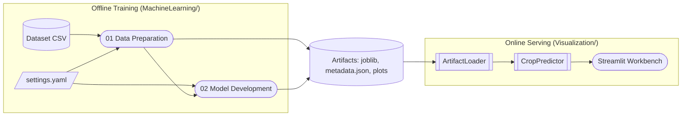

# SmartCropAdvisor

## Overview

SmartCropAdvisor adalah aplikasi rekomendasi tanaman berbasis machine learning untuk memprediksi 22 jenis tanaman dari 7 parameter tanah dan iklim (`N`, `P`, `K`, `ph`, `temperature`, `humidity`, `rainfall`).

Proyek ini terdiri dari alur pelatihan model (`GaussianNB` dengan `0.9955` test accuracy dan `0.9954` F1 macro) dan aplikasi web Streamlit untuk prediksi tunggal maupun batch CSV. Detail dataset tersedia di [MachineLearning/DATASET.md](MachineLearning/DATASET.md).

## Architecture



Pelatihan model dipisahkan dari aplikasi Streamlit melalui artefak di `MachineLearning/artifacts/`. Notebook pelatihan membaca konfigurasi YAML, melatih `sklearn.pipeline.Pipeline` (`StandardScaler` + estimator), lalu menyimpan model, metadata, dan grafik evaluasi.

Saat aplikasi dijalankan, `ArtifactLoader` memuat artefak tersebut dan `CropPredictor` memvalidasi input sebelum menghitung prediksi tanpa melatih ulang model.

### Struktur Repositori

```text
SmartCropAdvisor/
├── MachineLearning/   # Notebook EDA & modeling, config, data, artifacts
├── Visualization/     # Aplikasi Streamlit (main.py, src/, tests/)
├── LICENSE
└── README.md
```

## Machine Learning

Parameter eksperimen (`random_state: 42`, rasio split, jumlah fold, batas domain, dan hyperparameter model) diatur terpusat di [settings.yaml](MachineLearning/config/settings.yaml) sehingga eksperimen dapat direproduksi.

### Persiapan Data ([01_DataPreparation.ipynb](MachineLearning/notebooks/01_DataPreparation.ipynb))

- **Integritas Dataset**: Dataset terdiri dari `2.200` baris dan `8` kolom (`7` fitur numerik + `label`), tanpa missing value atau duplikat, dengan distribusi seimbang `100` sampel per kelas.
- **Temuan EDA**: Grafik eksplorasi memetakan distribusi tiap fitur, korelasi antarvariabel, keseimbangan kelas, serta sebaran rentang nutrisi tanah dan iklim untuk masing-masing tanaman.

### Pengembangan & Evaluasi Model ([02_ModelDevelopment.ipynb](MachineLearning/notebooks/02_ModelDevelopment.ipynb))

- **Strategi Validasi**: Stratified `80/20` train-test split (`1.760` train / `440` test) dan Stratified 5-Fold Cross-Validation dengan `f1_macro` sebagai metrik utama serta `accuracy` sebagai metrik sekunder.
- **Desain Pipeline**: Setiap kandidat menggabungkan `StandardScaler()` dan estimator ke dalam `sklearn.pipeline.Pipeline` agar preprocessing latih dan serving identik.

  | Kandidat Estimator | Hyperparameter Utama | CV F1 Macro (Mean +/- Std) | CV Accuracy | Status |
  | --- | --- | --- | --- | --- |
  | `GaussianNB` | Default | `0.9949` (+/- `0.0042`) | `0.9949` | Terpilih |
  | `RandomForestClassifier` | `n_estimators=100`, `random_state=42` | `0.9926` (+/- `0.0059`) | `0.9926` | Dievaluasi |
  | `MLPClassifier` | `hidden_layer_sizes=[100, 50]`, `max_iter=500`, `random_state=42` | `0.9846` (+/- `0.0054`) | `0.9847` | Dievaluasi |

- **Performa Test Set (`GaussianNB`, Artefak v`1.0.0`)**:
  - **Test Accuracy**: `0.9955` (`0.99545` di metadata)
  - **Test F1 Macro**: `0.9954` (`0.99544` di metadata)
- **Visualisasi Evaluasi**: Grafik perbandingan skor cross-validation antar kandidat dan confusion matrix pada data uji.

## Visualization

Aplikasi Streamlit ([main.py](Visualization/main.py)) memuat pipeline dan metadata sekali via `@st.cache_resource` dengan tiga tampilan utama di `st.segmented_control`.

### Fitur Aplikasi

- **Single sample**: Input 7 parameter (nutrisi/pH tanah dan iklim), peringkat Top-K (`1`-`5`) dengan grafik probabilitas Altair, latensi inferensi, peringatan jika input di luar rentang latih, dan perbandingan terhadap distribusi latih.
- **Batch CSV**: Template CSV UTF-8, validasi skema dan batas domain, ringkasan KPI, grafik distribusi prediksi Altair, serta ekspor hasil CSV.
- **Model & EDA**: Metrik CV dan test set terverifikasi serta tampilan plot evaluasi dan EDA.
- **Sidebar**: Menampilkan estimator aktif, versi artefak, tanggal latih (UTC), `CV F1 macro`, `Test accuracy`, dan 22 kelas tanaman yang didukung.

### Validasi, Keamanan, dan Konfigurasi

- **Kontrak Input**: Validasi skema Pydantic (`extra="forbid"`, menolak `NaN`/`Inf`) dengan batas domain pada tujuh fitur (`N`/`P`/`K` `0-500`, `temperature` `-10-60`, `humidity` `0-100`, `ph` `0-14`, `rainfall` `0-1000`).
- **Proteksi Batch & Ekspor**: Batas ukuran file (`SMARTCROP_MAX_CSV_BYTES`, default `5242880`), batas baris (`SMARTCROP_MAX_BATCH_ROWS`, default `10000`), serta sanitasi awalan formula injection (`=`, `+`, `-`, `@`, `\t`, `\r`) pada ekspor CSV.
- **Konfigurasi Environment**: Path artefak, batas batch, dan level logging dapat diatur via variabel environment ([.env.example](Visualization/.env.example)).
- **Pengujian Otomatis**: Pengujian `pytest` mencakup konfigurasi, logging, skema input, pemuatan artefak, inferensi, sanitasi CSV, dan `AppTest` Streamlit.

## Getting Started

### Machine Learning

1. Masuk ke direktori `MachineLearning/` (berjalan di CPU tanpa GPU):
   ```powershell
   cd MachineLearning
   ```

2. Pasang dependensi pelatihan dari [MachineLearning/requirements.txt](MachineLearning/requirements.txt):
   ```powershell
   python -m pip install -r requirements.txt
   ```

3. Jalankan `notebooks/01_DataPreparation.ipynb` lalu `notebooks/02_ModelDevelopment.ipynb` secara berurutan untuk menghasilkan artefak model dan grafik evaluasi.

### Visualization

1. Masuk ke direktori `Visualization/`:
   ```powershell
   cd Visualization
   ```

2. Pasang dependensi aplikasi dari [Visualization/requirements.txt](Visualization/requirements.txt):
   ```powershell
   python -m pip install -r requirements.txt
   ```

3. Salin konfigurasi environment opsional dari [Visualization/.env.example](Visualization/.env.example):
   ```powershell
   Copy-Item .env.example .env
   ```

4. Jalankan aplikasi Streamlit:
   ```powershell
   python -m streamlit run main.py
   ```

5. Jalankan pengujian `pytest`:
   ```powershell
   python -m pytest tests -v
   ```

## Notes

- Model dilatih pada `2.200` sampel (`22` jenis tanaman), sehingga hasilnya paling akurat untuk kondisi tanah dan iklim yang masih mirip dengan data latih.
- Input di luar rentang data latih tetap diprediksi, disertai peringatan di aplikasi karena probabilitasnya bisa kurang akurat.
- Aplikasi Streamlit hanya membaca artefak hasil pelatihan dan tidak melatih ulang model secara otomatis.

## License

Dirilis di bawah [MIT License](LICENSE).
