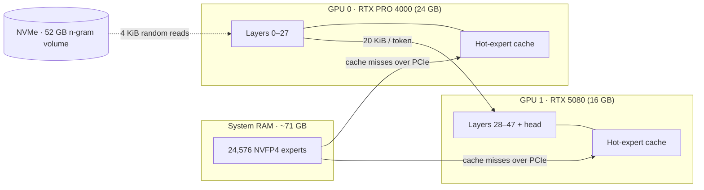

<div align="center">


# Lightning-Infer

**Run a 70 GB mixture-of-experts model on two ordinary NVIDIA GPUs — as fast as a small one.**

Local C++/CUDA inference engine for **Qwen3.8-Flash-Next** · up to **145 tok/s** · 512K context · images & video · Windows


<sub>Simulated playback of measured rates on the same PC: llama.cpp 10 tok/s decode vs Lightning-Infer 145 tok/s peak (80–90 sustained). The llama.cpp prompt-processing rate in the video is an estimate. Full video: <a href="assets/demo-wide.mp4">16:9</a> · <a href="assets/demo-linkedin-4x5.mp4">4:5</a>.</sub>

</div>

---

## ⚡ In 30 seconds

- **The problem.** Qwen3.8-Flash-Next is a mixture-of-experts model with **24,576 experts (~70 GB at NVFP4)**. It does not fit on any consumer GPU.
- **The trick.** Lightning-Infer splits the model **by layers across two different GPUs in the same PC**, keeps the experts in system RAM, caches the ones the model is actually using in VRAM, and updates that cache as the conversation changes topic.
- **The result.** **80–90 tok/s** sustained in conversation, **100+ tok/s** on coding work, peaks of **145 tok/s** — on an RTX PRO 4000 + RTX 5080 with **no NVLink and no P2P**. That's **8–14× llama.cpp's 10 tok/s** and about **2.5× Strata** on the same PC, with **bit-identical output**.

## ✨ Why it's different

| | |
|---|---|
| 🧩 **Any two GPUs, even different ones** | A big card and a small one, on different links (even one in a slow chipset slot), no NVLink, no P2P. Each card holds its own layers, its own slice of the context and its own expert cache; only **20 KiB per token** crosses between them. |
| 🎯 **No quality loss** | Output is **bit-identical** to a single-GPU run: same replies, same perplexity. Every optimization is checked this way before it lands. |
| 🤖 **Built for coding agents** | MTP and n-gram drafting (code an agent re-reads and rewrites accepts long drafted runs), a prompt cache that reuses what was already read, robust tool calls. |
| 📚 **Long prompts read fast** | 50K tokens of pasted code are read in **~21 s**. Context up to **512K tokens**. |
| 🖼️ **Images and video** | In any request, at no cost to text speed. |
| 🔌 **Drop-in APIs** | OpenAI Chat Completions & Responses, Anthropic Messages. Tested with Codex, opencode, pi and Claude Code-style requests. |

## 🧠 How it works



## 📊 Performance

Measured on an **RTX PRO 4000 Blackwell (24 GB, PCIe Gen3 x4) + RTX 5080 (16 GB, Gen4 x16)**, Ryzen 9 5900X, 128 GB DDR4-3200, Windows 11.
Workload: a 20-turn conversation with pasted code (~50K tokens), averaged over the second half.

| | Decode (tok/s) | Peaks | Reading 50K tokens |
|---|---:|---:|---:|
| **Lightning-Infer — conversation** | **80–90** | **120–145** | **~21 s** |
| **Lightning-Infer — coding agent** | **103–107** | | |
| Strata (Orca Q4_K_S), same two GPUs | 34 | 63 | 43–78 s |
| llama.cpp, same PC | 10 | | |

Long context, with a 512K window filled in 50K-token steps: **69 tok/s at 63K**, **62 at 257K**, **55 at 514K**.

Single-GPU numbers (RTX 5090) and the full agentic-replay benchmarks are in [README.infernix.md](README.infernix.md#benchmarks).

## 🖥️ Requirements

- **GPUs:** two NVIDIA Blackwell GPUs (RTX 50 series / RTX PRO Blackwell) — or just one.
- **RAM:** ~71 GB free for the experts (128 GB recommended).
- **Disk:** an NVMe SSD for the 52 GB n-gram volume.
- **OS:** Windows 11 with a recent NVIDIA driver.
- **Model:** the Qwen3.8-Flash-Next NVFP4 Dense8 artifact (`.infernix`) and its `.ngram` volume — see the [model guide](docs/qwen3_8-flash-next.md#convert).

## 🚀 Quick start

<details>
<summary><b>1. Build</b> (Visual Studio 2022 Build Tools · CUDA 13.3 · CMake + Ninja · vcpkg)</summary>

You need Visual Studio 2022 Build Tools (MSVC 14.44), CUDA 13.3, CMake + Ninja and vcpkg in
`C:\vcpkg` (ffmpeg and curl, triplet `x64-windows`).

```bat
call "C:\Program Files (x86)\Microsoft Visual Studio\2022\BuildTools\VC\Auxiliary\Build\vcvars64.bat"
set VCPKG_ROOT=C:\vcpkg
set VCPKG_TARGET_TRIPLET=x64-windows
set CUDA_PATH=C:\Program Files\NVIDIA GPU Computing Toolkit\CUDA\v13.3
cmake -S . -B build-windows -G Ninja -DCMAKE_BUILD_TYPE=Release -DCMAKE_CUDA_ARCHITECTURES=120a ^
      -DINFERNIX_BUILD_APPS=ON
cmake --build build-windows --parallel 8
```

The programs land in `build-windows\bin`: `infernix-serve.exe` (server) and `infernix.exe` (command line).

</details>

**2. Serve**

```bat
set CUDA_DEVICE_ORDER=PCI_BUS_ID
infernix-serve.exe <model>.infernix --ngram-volume <volume>.ngram ^
  --devices 0,1 --layer-split 28 --max-context 262144 ^
  --kv-dtype int8 --prefill-chunk 4096 --spec mtp --draft-tokens 4 --lm-head-draft ^
  --ngram-draft-tokens 7 --chat-template tools\chat_templates\qwen3_8.jinja ^
  --vision --tolerant-tool-calls --model-id qwen3.8-flash-next --host 127.0.0.1 --port 8891
```

**3. Connect** any OpenAI- or Anthropic-compatible client to `http://127.0.0.1:8891/v1` with model `qwen3.8-flash-next`.

<details>
<summary><b>Flag notes</b></summary>

- `--devices 0,1 --layer-split 28`: layers 0–27 on GPU 0, layers 28–47 and the head on GPU 1. Put
  more layers on the card with more VRAM; with `CUDA_DEVICE_ORDER=PCI_BUS_ID` the GPU numbers follow
  the slot order.
- `--device N` instead of `--devices` runs on a single GPU.
- 512K context: `--max-context 524288 --rope-yarn-factor 2`.
- `--chat-template` is needed for Codex (`developer` messages and `instructions`).

</details>

## 📖 Documentation

- [docs/serving.md](docs/serving.md) — server and APIs
- [docs/cli.md](docs/cli.md) — command line
- [docs/qwen3_8-flash-next.md](docs/qwen3_8-flash-next.md) — model guide, conversion and tuning
- [README.infernix.md](README.infernix.md) — the underlying Infernix engine, single-GPU benchmarks

## 🙏 Credits and license

Lightning-Infer is built on [Infernix](README.infernix.md), itself derived from
[NInfer](https://github.com/Neroued/ninfer) by Neroued. Licensed under **Apache 2.0** ([LICENSE](LICENSE)).
Lightning-Infer's code was written with AI assistance (Claude Opus 5.5).

The demo video is generated from code with [Remotion](https://www.remotion.dev/) — source in [`media/demo`](media/demo).
