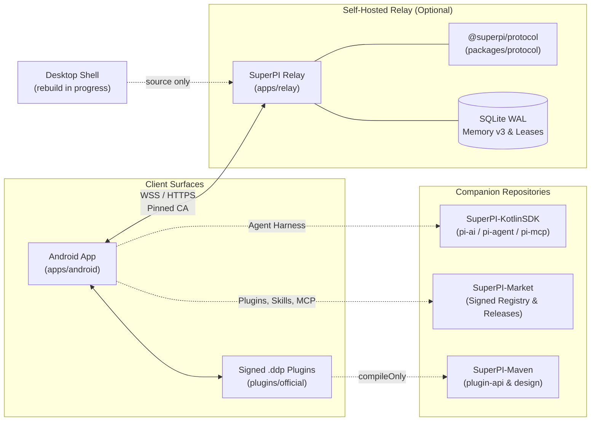

<div align="center">


# SuperPI

**Personal AI Agent Ecosystem — Android · Self-Hosted Relay · Plugin Platform**

<sub>Local-first assistant with Super Mode collaboration, long-term memory, optional self-hosted multi-device sync, and extensible `.ddp` plugins.</sub>

English · [简体中文](README.cn.md)

<a href="https://github.com/Sadami3066/SuperPI/releases/latest"></a>


<a href="https://github.com/Sadami3066/SuperPI/actions/workflows/ci-android.yml"></a>
<a href="https://github.com/Sadami3066/SuperPI/actions/workflows/ci-ts.yml"></a>
<a href="https://github.com/Sadami3066/SuperPI/actions/workflows/ci-plugins.yml"></a>


</div>

[Architecture](#architecture) · [Packages & Repositories](#packages--repositories) · [Quick Start](#quick-start) · [Development](#development) · [Documentation](#documentation) · [Contributing](#contributing)

---

## Overview

**SuperPI** is a local-first personal AI agent ecosystem:

- **Android (`apps/android`)**: On-device personal agent built with Jetpack Compose. Long-press the power button to speak or type, run Linux commands in bundled Alpine/proot (or Root), automate Android UI via wireless ADB / virtual screen, host mini-apps, and load signed `.ddp` plugins.
- **Super Mode**: turn one conversation into a coordinator that creates and drives persistent local workers and paired remote-device workers, streams their progress and cards into the chat, and accepts queued follow-ups while a worker is waiting.
- **Memory v3**: a structured long-term memory with four budgets — living profile, people and relations, recent events and to-dos, and a deep memory index — plus per-bot memory scope, activity history, manual editing and multi-device sync.
- **Relay (`apps/relay` + `packages/protocol`)**: Optional, self-hosted Node.js 24 HTTPS/WSS service for cross-device bot and worker routing, encrypted CA-pinned pairing, workspace file transfer, and **Memory v3** synchronization (`@superpi/relay 0.2.0`, `@superpi/protocol 0.2.0`).
- **Plugins (`plugins/`)**: 10 official `.ddp` modules (`feishu`, `wecom`, `micloud`, `mail`, `amap`, `rail`, `hotel`, `ride`, `themes`, `mcpui-demo`), a third-party Gradle template, and an end-to-end sample fixture.

The **2.0.3** release ships `PI-2.0.3.apk`, plugin contract `plugin-api 2.0.2` (API level 7), design SDK `design 1.1.0`, and the `0.2.0` relay/protocol pair. `apps/desktop/` is being rebuilt and is not part of this release.

All conversations, API keys, and sessions stay on your devices by default and talk directly only to the model providers or self-hosted relay you configure.

## Architecture



## Packages & Repositories

### Inside this Monorepo

| Path | Stack | Responsibility |
|---|---|---|
| [`apps/android/`](apps/android/) | Kotlin · Compose · Gradle | Android agent client, runtime, Super Mode, Memory v3, proot/ADB/Root shell, `:design` & `:plugin-api` SDKs |
| [`apps/relay/`](apps/relay/) | Node 24 · TypeScript · SQLite | Self-hosted device relay, pairing, presence, bot/worker routing, Memory v3 push/pull & consolidation lease |
| [`packages/protocol/`](packages/protocol/) | TypeScript · JSON Vectors | Canonical WebSocket frames, Memory v3 contracts, and JSON test vectors shared across TypeScript & Kotlin |
| [`plugins/official/`](plugins/official/) | Kotlin · `.ddp` | Ten official modules: `feishu`, `wecom`, `micloud`, `mail`, `amap`, `rail`, `hotel`, `ride`, `themes`, `mcpui-demo` |
| [`plugins/template/`](plugins/template/) | Kotlin · Gradle | Standalone starter project for third-party `.ddp` plugin authors |
| [`plugins/sample/`](plugins/sample/) | Kotlin · Gradle | Deterministic test fixture for host E2E and binary compatibility regression |
| [`apps/desktop/`](apps/desktop/) | Electron · React · Vite | Desktop shell source; undergoing a rewrite and not shipped in 2.0.3 |

### Ecosystem Repositories

| Repository | Purpose | Link |
|---|---|---|
| **SuperPI-KotlinSDK** | Reusable KMP (`Android` + `JVM`) agent runtime SDK (`pi-ai`, `pi-agent`, `pi-mcp`, `pi-coding-agent`) | [Sadami3066/SuperPI-KotlinSDK](https://github.com/Sadami3066/SuperPI-KotlinSDK) |
| **SuperPI-Market** | ECDSA-signed plugin, skill & remote MCP catalog served via GitHub Pages | [Sadami3066/SuperPI-Market](https://github.com/Sadami3066/SuperPI-Market) |
| **SuperPI-Maven** | Static GitHub Pages Maven host for SDK, `plugin-api`, and `design` artifacts | [Sadami3066/SuperPI-Maven](https://github.com/Sadami3066/SuperPI-Maven) |
| **SuperPI-Personal-Plugins** | Personal and campus plugins: `sysu`, `wechat`, `zanao` | [Sadami3066/SuperPI-Personal-Plugins](https://github.com/Sadami3066/SuperPI-Personal-Plugins) |

## Quick Start

### 1. Install on Android

1. Download `PI-2.0.3.apk` (or the latest `PI-X.Y.Z.apk`) from [GitHub Releases](https://github.com/Sadami3066/SuperPI/releases/latest) (requires Android 10+).
2. Follow onboarding to add a model provider (42 built-in providers or a custom endpoint) and initialize the on-device Alpine Linux environment.
3. Optionally enable Wireless Debugging or Root in **Settings → System access** to allow screen automation.

See [Getting Started](docs/user/getting-started.md) for Super Mode, Memory v3, relay pairing, and full usage instructions.

### 2. Self-Host the Relay (`apps/relay`)

Run with Docker (or Node.js ≥ 24):

```bash
# Container image published to GHCR on relay releases
docker run -d --name superpi-relay \
  -p 8443:8443 -v superpi-relay-data:/data \
  ghcr.io/sadami3066/superpi-relay:latest

# Or from source with automatic LAN self-signed TLS & QR pairing link
pnpm install
./apps/relay/scripts/dev-relay.sh
```

See [Self-Hosting Relay](docs/user/self-hosting-relay.md) for TLS certificates, systemd, and multi-device pairing.

### 3. Desktop Source

`apps/desktop/` is under active rework. Its Electron/Vite source remains in the monorepo for reference, but 2.0.3 publishes no desktop artifact and desktop behavior is not part of the release guarantee.

## Development

```bash
# TypeScript (Protocol + Relay)
pnpm typecheck
pnpm test

# Android App & Plugin SDK ABI (JDK 17 + Android SDK 36)
./apps/android/scripts/dev-setup.sh
./apps/android/scripts/check.sh --full
./apps/android/scripts/build.sh stop

# Official & Sample Plugins
(cd plugins/official && ./scripts/check.sh)
(cd plugins/sample && ./gradlew verifyPlugin --no-daemon)

# Everything sequentially
./scripts/check-all.sh
```

To build `apps/android` against a sibling checkout of `../SuperPI-KotlinSDK`, pass `-Psuperpi.localSdk=true` or set `SUPERPI_LOCAL_SDK=1`.

For release tagging conventions (`vX.Y.Z`, `relay-v*`, `plugin-api-v*`, `plugin-*-v*`), see [Release Engineering](docs/contributing/release.md).

## Documentation

- **Users**: [Documentation Index](docs/README.md) · [Getting Started](docs/user/getting-started.md) · [Self-Hosting Relay](docs/user/self-hosting-relay.md) · [Release Notes 2.0.3](release-notes/v2.0.3.md)
- **Plugin Authors**: [Plugin Overview](docs/plugins/README.md) · [Quick Start](docs/plugins/quickstart.md) · [Manifest & Packaging](docs/plugins/manifest-and-packaging.md) · [Runtime API](docs/plugins/runtime-api.md) · [UI Extensions](docs/plugins/ui-extensions.md) · [Market Policy](docs/plugins/market-policy.md)
- **Contributors**: [Architecture](docs/contributing/architecture.md) · [Developer Guide](docs/contributing/development.md) · [Release Engineering](docs/contributing/release.md) · [Changelog](CHANGELOG.md)

## Contributing & Security

Issues and PRs are welcome—read [CONTRIBUTING.md](CONTRIBUTING.md) first. Please report security vulnerabilities privately as described in [SECURITY.md](SECURITY.md).

## License

Code in this repository is licensed under [Apache-2.0](LICENSE). Third-party components, bundled Linux binaries, fonts, and brand assets are documented in [THIRD_PARTY_NOTICES.md](THIRD_PARTY_NOTICES.md).
