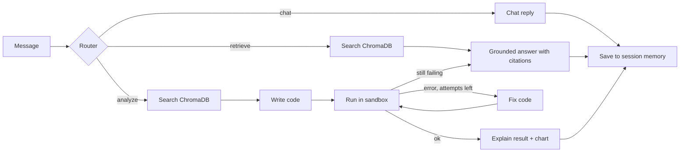

# Agentic Knowledge Retrieval System

A multi-agent RAG system built with **LangGraph**. It routes each message to the right tool: answer from documents with citations, run a safe Python analysis to calculate numbers or draw charts, or just chat. It remembers earlier messages in a session.

**Stack:** Python, LangGraph, ChromaDB, sentence-transformers (all-MiniLM-L6-v2), FastAPI, Pydantic, Chainlit, pandas/matplotlib, any OpenAI-compatible LLM API (Groq, OpenRouter)

## How it works

- **Router:** an LLM classifies the intent and returns JSON that is validated with Pydantic. Simple greetings skip the LLM, and invalid output falls back to keyword rules.
- **Retrieval:** documents are chunked across page breaks, embedded, and stored in ChromaDB. Answers cite passages like [1] and list file and page.
- **Code agent:** the LLM writes Python from the retrieved numbers, a restricted runner executes it, and errors are fed back for up to 3 attempts. If it still fails, the agent falls back to a text answer.
- **Sandbox:** AST allow-list (no file reading, `os`, `eval`), separate process in isolated mode, no API keys passed in, timeout. This is best-effort protection, not a perfect security boundary, so do not expose it publicly.
- **Memory:** LangGraph checkpointer keeps a separate history per session.

## Run locally (Python 3.11 or 3.12)
```bash
python -m venv venv
venv\Scripts\activate
pip install -r requirements.txt
copy .env.example .env        # add your provider settings
python ingest.py              # index the files in data/ (.pdf, .md, .txt)
uvicorn api:app --port 8000   # terminal 1: backend, docs at /docs
chainlit run ui.py --port 8001   # terminal 2: chat UI
```
Then open http://localhost:8001. The `data/` folder contains a made-up sample report; add your own files and run `python ingest.py` again.

## Run with Docker
```bash
copy .env.example .env                     # add your provider settings
docker compose build
docker compose run --rm api python ingest.py   # index the files in data/
docker compose up
```
Open http://localhost:8001 for the chat UI and http://localhost:8000/docs for the API. The LLM key is only given to the `api` container, and the container runs as a non-root user.

## Tests and evaluation
```bash
python -m pytest -q       # 17 fast tests, no API key needed (fake LLM)
python eval_agent.py      # 17 live test messages against your LLM
```

| Metric | Result |
|---|---|
| Router accuracy | _fill in from eval_agent.py_ |
| Answer correctness | _fill in_ |
| Code agent success (1st attempt / after fixes) | _fill in_ |
| Messages where the router skipped retrieval | _fill in_ |
| Average LLM calls per message | _fill in_ |
| Average latency (chat / retrieve / analyze) | _fill in_ |

## Known limitations
- Free LLM tiers have daily and per-minute limits, so a full evaluation run may need a provider with a higher allowance.
- The test set is small and written by the author, so treat the numbers as a rough guide.
- Generated code is only as good as the LLM; failed analyses fall back to a text answer.
