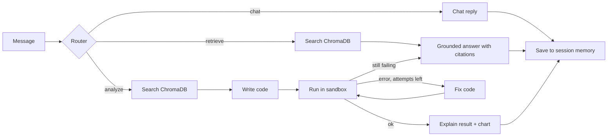

# Agentic Knowledge Retrieval System

A multi-agent RAG system built with **LangGraph**. It routes each message to the right tool: answer from documents with citations, run a safe Python analysis to calculate numbers or draw charts, or just chat. It remembers earlier messages in a session.

**Stack:** Python, LangGraph, ChromaDB, sentence-transformers (all-MiniLM-L6-v2), FastAPI, Pydantic, Chainlit, pandas/matplotlib, Docker Compose, any OpenAI-compatible LLM API (Groq, OpenRouter)

<!-- Add a screenshot or short GIF of the chat here: a cited answer and a chart -->

## How it works

- **Router:** an LLM classifies the intent and returns JSON that is validated with Pydantic. Simple greetings skip the LLM, any chart request is always treated as an analysis, and invalid output falls back to keyword rules.
- **Retrieval:** documents are chunked across page breaks, embedded, and stored in ChromaDB. Answers cite passages like [1] and list file and page.
- **Code agent:** the LLM writes Python from the retrieved numbers, a restricted runner executes it, and errors are fed back for up to 3 attempts. If it still fails, the agent falls back to a text answer.
- **Sandbox:** AST allow-list (no file reading, `os`, `eval`), separate process in isolated mode, no API keys passed in, timeout. This is best-effort protection, not a perfect security boundary, so do not expose it publicly.
- **Memory:** LangGraph checkpointer keeps a separate history per session.

## Run locally (Python 3.11 or 3.12)
```bash
python -m venv venv
venv\Scripts\activate
pip install -r requirements.txt
copy .env.example .env        # add your provider settings
python ingest.py              # index the files in data/ (.pdf, .md, .txt)
uvicorn api:app --port 8000   # terminal 1: backend, docs at /docs
chainlit run ui.py --port 8001   # terminal 2: chat UI
```
Then open http://localhost:8001. The `data/` folder contains a made-up sample report; add your own files and run `python ingest.py` again.

## Run with Docker
```bash
copy .env.example .env                     # add your provider settings
docker compose build
docker compose run --rm api python ingest.py   # index the files in data/
docker compose up
```
Open http://localhost:8001 for the chat UI and http://localhost:8000/docs for the API. The LLM key is only given to the `api` container, and the container runs as a non-root user.

## Tests and evaluation
```bash
python -m pytest -q       # fast tests, no API key needed (the LLM is replaced by a scripted fake)
python eval_agent.py      # 17 live test messages against your LLM
```

`eval_agent.py` sends 17 messages about the made-up sample report: 3 chat messages, 6 document questions (one of them out of scope, to check that the agent refuses), 6 analysis requests (4 calculations and 2 charts), and a 2-message memory test. It checks the route taken, whether the answer contains the expected facts or numbers, and whether charts are produced.

| Metric | Result |
|---|---|
| Router accuracy | 100% (17/17); it was 88% in the first run |
| Answer correctness | 94% (16/17) |
| Code agent success | 5 of 6 analysis tasks (4 on the first attempt) |
| Messages where the router skipped retrieval | 5 of 17 |
| Average LLM calls per message | 2.4 |
| Latency | chat and document questions about 9 s on average; analysis median about 37 s |

All 5 correct document answers included citations, and the out-of-scope question was refused.

**What changed between the two runs.** The first run scored 88% on routing and answers: two analysis requests ("total annual revenue" and a bar chart) were routed to document search, and the search then returned nothing. I added examples to the router prompt (different from the test questions), made every "plot / chart / graph" request an analysis, and lowered the retrieval similarity threshold. The second run used the same 17 messages, so the improvement is real but the test is not independent.

## Known limitations
- The test set is small (17 messages), written by the author, and the second run was tuned on the same messages, so treat the numbers as a rough guide.
- Generated code can run without errors and still return a wrong number. One calculation in the second run was answered wrongly this way.
- Free LLM tiers have daily and per-minute limits and rotate models, so results and latency vary between runs. The mean analysis latency (104 s) was distorted by one 430 s run caused by rate-limit waits.
- Failed analyses fall back to a text answer, which can be less precise.
- The code sandbox is best-effort protection, not a security guarantee.