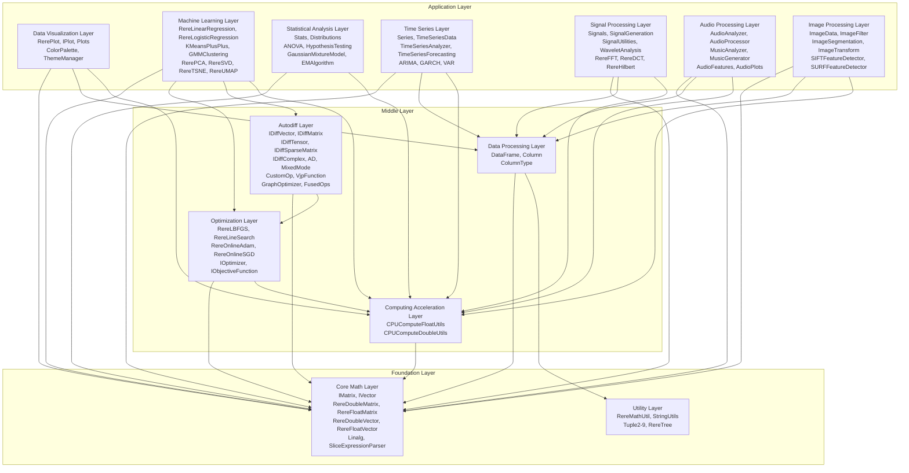

# YiShape-Math

[](https://www.oracle.com/java/)
[](LICENSE.txt)
[]()

**English** | [简体中文](README.zh-CN.md)

## Project Introduction

**YiShape-Math** is a Java-based mathematical computing library that provides core functionalities including vector & matrix operations, data visualization, statistics, optimization, distance metric learning, multi-criteria decision making, time series, signal processing, machine learning, and vector indexing. Its API design closely mirrors that of the Python NumPy and SciPy API. The library originated from optimization code accumulated during the founder's PhD research on distance metric learning algorithms, and has been used for experimental teaching of courses such as Business Statistics, Business Big Data, Data Analysis and Decision Making, Machine Learning and Data Mining at UESTC. The library has undergone performance optimization via SIMD, Rust native backend support, and BLAS3, and now achieves industrial-grade and leading performance in Java communities. It also serves as the underlying numerical computing engine for the [YiShape Vector DataBase](https://github.com/ScaleFree-Tech/YiShape-VecDB) and [YiShape DeepLearning](https://github.com/ScaleFree-Tech/yiShape-dl), and has been applied in scientific computing, business data analysis, operations research, and machine learning. For learning purposes, the [ModelZoo](model_zoo/) provides numerous application modeling examples, and a Chinese textbook is being written at [book/](book/), with an English version to follow.

### Core Modules


## Key Functions

### Core Mathematical Operations

- **Vector Operations**: Vector creation, mathematical operations, statistical operations, slicing and indexing
- **Matrix Operations**: Matrix creation, basic operations, linear algebra, matrix transformations, matrix decompositions
- **Math Utilities**: Type conversion, random number generation, mathematical functions

### DataFrame Operations

- **Structured Data Processing**: Complete DataFrame data processing functionality
- **CSV file read/write**: custom delimiters, headers, UTF-8 encoding
- **Flexible data slicing**: row, column, general slicing with negative indices and steps

### Statistical Methods

- **Probability Distributions**: 14 probability distributions (Normal, t, Chi-squared, F, Uniform, Exponential, Beta, Gamma, Bernoulli, Binomial, Poisson, Geometric, Negative Binomial, Discrete Uniform) and multivariate distributions
- **Probability Functions and Statistical Descriptions**: PDF, CDF, PPF, SF, ISF calculations, Mean, variance, standard deviation, median, mode, skewness, kurtosis and more
- **Hypothesis Testing**: t-tests, Chi-squared tests, F-tests, parameter estimation, confidence interval estimation
- **Analysis of Variance**: One-way ANOVA, Two-way ANOVA, Repeated Measures ANOVA
- **Statistical Models**: Gaussian Mixture Model (GMM), EM Algorithm

### Data Visualization

- **Basic Charts**: Line, scatter, pie, bar, histogram charts, boxplot, candlestick charts, violinplot, regplot, kde, pairplot, jointplot heatmap, funnel, sankey, sunburst, heatmap, radar charts.
- **Unified Style System**: matplotlib-style expressions, fluent API, theme management
- **Three plotting providers**: SVG (built-in), JavaFx, Echarts, three kinds of plotting providers for different applications

### Machine Learning Algorithms

- **Linear Regression**: Support for L1, L2, ElasticNet regularization with LBFGS optimization
- **Classification Algorithms**: Logistic Regression, XGBoost, RandomForest, EnsembleClassifier
- **Clustering Algorithms**: K-Means++ clustering, Gaussian Mixture Model clustering, clustering quality evaluation
- **Dimensionality Reduction**: PCA, SVD, t-SNE, UMAP dimensionality reduction methods
- **Model Evaluation**: Regression and classification result analysis

### Optimization Algorithms

- **Optimizers**: Quasi-Newton optimization algorithms
- **Online Optimizers**: Online stochastic optimization algorithms
- **Line Search**: One-dimensional search optimization methods
- **Linear Programming Solvers**: Simplex, interior point, Lagrange multiplier, integer programming
- **Constrained Optimization**: Lagrange multiplier method, ADMM

### Automatic Differentiation

- **Reverse-mode AD**: `AD.vector()` creates variables, `loss.backward()` auto-propagates gradients, 40+ ops (advanced activations: softmax/gelu/silu/mish/clamp/dropout/layerNorm + matmul)
- **Forward-mode AD**: `AD.jacobian()` for full Jacobian, `AD.tangent()` for JVP
- **Mixed-Mode AD**: `MixedMode.hvp()` for HVP, `MixedMode.hessian()` for full Hessian, forward-over-reverse architecture
- **Higher-order Differentiation**: `AD.grad()` tape-of-tape architecture supports arbitrary-order gradients
- **VJP & vmap**: `AD.vjp()` reusable VJP operator, `AD.vmap()` automatic batching, `AD.batchVjp()` batch VJP
- **Graph Tools**: Constant folding, JIT operator fusion (`AD.fuse()`), DOT visualization (`AD.render()`), JSON dump (`AD.dumpGraphJson()`)
- **Neural ODE**: `AD.odeint()` backpropagates through ODE solvers via adjoint method, includes RK4 integrator
- **Advanced Type Support**: Sparse autodiff, complex Wirtinger derivatives, differentiable tensors, mixed precision FP32
- **Custom Operations**: `CustomOp` / `TensorCustomOp` self-contained differentiable ops with backward embedded in graph nodes
- **ML Integration**: One-liner gradient-free optimization with L-BFGS/Adam/SGD

### Multi-Criteria Decision Making

- **Multi-Criteria Linear Programming**: Weighted sum, lexicographic, goal programming, Pareto optimal, AHP, TOPSIS, interactive STEM
- **Multi-Criteria Quadratic Programming**: Multi-objective optimization for quadratic objectives, bi-objective quick solve and full MCLP solver suite

### Distance Metric Learning (DML)

- **Proprietary DDML Algorithm**: Regularized diagonal distance metric learning published in INFORMS Journal on Computing (2024), with L1/L2/ElasticNet regularization and automatic feature selection
- **Classic DML Algorithms**: 14+ classic algorithms including NCA, LMNN, ITML, DML-eig, MMC, LDML, MCML, NCMML
- **Kernelized DML**: Kernel extensions: KLDA, KANMM, KDMLMJ, KODML

### Signal Processing

- **Signal Generation & Filtering**: Basic waveform generation, noise signals, moving average, median filtering, Butterworth filters
- **Spectral Analysis**: FFT transform, power spectral density, STFT, autocorrelation analysis
- **Wavelet Analysis**: Discrete Wavelet Transform (DWT), Continuous Wavelet Transform (CWT), wavelet denoising, wavelet compression

### Time Series Analysis

- **Data Management**: Univariate/multivariate time series, data slicing, resampling, timestamp handling
- **Forecasting Methods**: Moving average, exponential smoothing, ARIMA models, Holt-Winters, automatic model selection
- **Filtering & Decomposition**: Time/frequency domain filtering, trend/seasonal decomposition, STL decomposition, wavelet decomposition

### High Performance Computing

- **SIMD Support**: SIMD (Single Instruction, Multiple Data) parallel computing support based on Java Vector API
- **Rust Native Support**: Support calling Rust native numerical libraries via Java FFM, providing **3-12×** speedup for linear algebra, linear programming, approximate nearest neighbor search, and optimization. HPC mode shares the same API as pure Java SISD/SIMD — no code changes needed to switch.

## Quick Start

### Requirements

- Java 25 or higher
- Maven 3.6+

### Installation

#### Option 1: Maven Repository (Recommended)

Configure credentials for the registry you use in `~/.m2/settings.xml` — the `server` `id` must match the repository `id`. For GitHub Packages this is a Personal Access Token with `read:packages` scope.

**Core Library (Required):**

```xml
<repositories>
	<repository>
		<id>gitea</id>
		<url>http://git.yishape.com/api/packages/yishape-lab/maven</url>
	</repository>
</repositories>

<dependency>
  <groupId>com.yishape.lab</groupId>
  <artifactId>yishape-math</artifactId>
  <version>0.6.0</version>
</dependency>
```

**HPC Acceleration (Built-in):**

`yishape-math-hpc` — the Rust native acceleration layer giving **3–12×** speedup for linear algebra, linear programming, and more — is a **required dependency**. Maven resolves it automatically from the `gitea` repository above alongside the core library, so no extra `<dependency>` entry is needed. Its native libraries are bundled inside the HPC JAR; add `--enable-native-access=ALL-UNNAMED` at runtime (see JVM options below). If the native library cannot be loaded, the library logs a warning and falls back to SIMD → SISD.

**Plot Extensions (Optional):**

Add ECharts and JavaFX plotting backends (SVG backend is built-in, no extra dependency needed):

```xml
<repositories>
  <repository>
    <id>github-plot</id>
    <url>https://maven.pkg.github.com/ScaleFree-Tech/yishape-plot-ext</url>
  </repository>
</repositories>

<dependency>
  <groupId>com.yishape.lab</groupId>
  <artifactId>yishape-plot-ext</artifactId>
  <version>0.5.0</version>
</dependency>
```

> **Note**: `yishape-plot-ext` uses Java SPI auto-registration; after adding the dependency you can use `Plots.ofEcharts()` and `Plots.ofJavaFx()` directly, with no manual configuration.

#### Build from Source

No GitHub account required — just JDK 25 and Maven:

```bash
git clone https://github.com/ScaleFree-Tech/yishape-math.git
cd yishape-math
mvn install -DskipTests
```

Because `yishape-math-hpc` is required, build and install it first (or resolve it from the Maven repository shown above; `libs/` contains prebuilt native libraries for each platform — no Rust toolchain required):

```bash
git clone https://github.com/ScaleFree-Tech/yishape-math-hpc.git
cd yishape-math-hpc
mvn install -DskipTests -DskipNativeBuild=true
```

#### JAR Download

No Maven needed: the `libs/` directory in this repo contains prebuilt JARs for `yishape-math`, `yishape-math-hpc`, and all dependencies (batik, javafx, pdfbox, echarts-java, etc.). Download and add to your classpath directly. You can also get them from [Releases](https://github.com/ScaleFree-Tech/yishape-math/releases).

### JVM Runtime Options

**SIMD / Vector API (Optional):**

**Without** `--add-modules jdk.incubator.vector`, it still runs normally and vector ops use scalar (SISD) paths. **With** that flag, the runtime can load the Vector API and use SIMD (SIMD is tried by default; use `-Dyishape.math.use.simd=false` to force scalar).

**HPC native access (required for native acceleration):**

```
--enable-native-access=ALL-UNNAMED
```

### API Design Philosophy

This library follows the style of modern scientific computing libraries such as NumPy and SkLearn in its API design. Its main functions are encapsulated in facade classes, and most of its functionalities are exposed through a fluent API. The ten facade entry classes are shown in the following table. When using it, input like "ML." and the IDE will prompt the members under the class.

|Facade class |package |Functions |
|--------|--------|------|
| `Linalg` | `com.yishape.lab.math.linalg` |Linear Algebra: Matrix/Vector Creation, Decomposition, and Solution |
| `DataFrame` | `com.yishape.lab.math.data` |Data Frame Operations: Structured Data Processing, CSV file read/write, Flexible data slicing.|
| `Stats` | `com.yishape.lab.math.stats` |Statistics: Probability Distribution, Hypothesis Testing, Parameter Estimation |
| `ML` | `com.yishape.lab.math.ml` |Machine Learning: Classification, Regression, Dimensionality Reduction, Clustering, Metric Learning |
| `Opts` | `com.yishape.lab.math.optimize` |Optimization: Unconstrained optimization, linear programming, online optimization |
| `AD` | `com.yishape.lab.math.autodiff` |Automatic differentiation: reverse/forward/mixed mode, graph optimization, Neural ODE, sparse/complex/tensor |
| `Signals` | `com.yishape.lab.math.signal` |Signal processing: generation, filtering, transformation, analysis|
| `TSA` | `com.yishape.lab.math.timeseries` |Time series: Prediction, decomposition, filtering, cointegration analysis |
| `Plots` | `com.yishape.lab.math.plot` |Drawing: Static factory creates `IPlot`, supporting JavaFX/ECharts/SVG backends|
| `VI` | `com.yishape.lab.math.vecidx` |Vector Index: Nearest Neighbor Search (hnsw, LSH, KD-Tree, etc.) |

### Basic Usage Examples

#### Vector Operations

```java
// Create vectors
var v1 = Linalg.vector(new double[]{1, 2, 3, 4});
var v2 = Linalg.range(10);

// Basic operations
var sum = v1.add(v2.slice("1:10:2"));
double dotProduct = v1.dot(v2.slice(5, -1, 1));

// Statistical operations
double mean = v1.mean();
double std = v1.std(1);// sample std (ddof = 1)
```

#### Matrix Operations

```java
// Create matrices
var matrix1 = Linalg.ones(3, 3);
var matrix2 = Linalg.eye(3, 3);
var matrix3 = Linalg.rand(3, 3);

// Matrix operations
var result = matrix1.add(matrix2).mmul(2.0);
var transposed = matrix2.t();
// 2D matmul like np.dot(A,B) uses mmul; Frobenius inner product uses frobeniusInnerProduct
```

#### DataFrame Operations

```java
// Read data from CSV file
var df = DataFrame.readCsv("data.csv", ",", true);

// Data slicing
var sliced = df.slice("1:3", "0:2");  // rows 1-2, columns 0-1

// Convert to matrix
var matrix = df.toMatrix();

// Save data
df.toCsv("output.csv");
```

#### Statistical Distributions

```java
// Create distributions
var normal = Stats.norm(0, 1);  // Normal distribution
var tDist = Stats.t(10);  // t-distribution
var chi2Dist = Stats.chi2(5);  // Chi-squared distribution
var fDist = Stats.f(3, 7);  // F-distribution
var uniform = Stats.uniform(0, 1);  // Uniform distribution
var exp = Stats.exponential(2.0);  // Exponential distribution
var beta = Stats.beta(2, 3);  // Beta distribution
var gamma = Stats.gamma(2, 1);  // Gamma distribution
var bernoulli = Stats.bernoulli(0.3);  // Bernoulli distribution
var binomial = Stats.binomial(10, 0.5);  // Binomial distribution
var poisson = Stats.poisson(2.5);  // Poisson distribution

// Probability function calculations
double pdf = normal.pdf(1.0);  // PDF
double cdf = normal.cdf(1.0);  // CDF
double ppf = normal.ppf(0.95);  // PPF
double mean_val = normal.mean();  // Mean
double variance = normal.var();  // Variance
double[] samples = normal.sample(1000);  // Random sampling
```

#### Hypothesis Testing and Parameter Estimation

```java
// Create sample data
var sample = Linalg.vector(new double[]{1.2, 2.3, 1.8, 3.1, 2.7, 1.5, 2.9, 3.2, 2.1, 2.8});

// Parameter estimation
var meanInterval = Stats.estimator.estimateMeanIntevalWithT(sample, 0.95);  // Mean confidence interval

// Hypothesis testing
var meanTest = Stats.tester.testMeanEqualWithT(2.0, sample, 0.95);  // Mean test

// Analysis of Variance
var group1 = Linalg.vector(new double[]{1, 2, 3, 4, 5});
var group2 = Linalg.vector(new double[]{2, 3, 4, 5, 6});
var result = Stats.anova.performOneWayANOVA(group1, group2);  // One-way ANOVA

// Correlation analysis
var x = Linalg.vector(new double[]{1, 2, 3, 4, 5});
var y = Linalg.vector(new double[]{2, 4, 6, 8, 10});
double correlation = Stats.corr(x, y);  // Pearson correlation coefficient
```

#### Data Visualization

```java
// Backend selection
// SVG backend (built-in, no extra dependency)
Plots.ofSvg().line(x, y).show();

// ECharts backend (requires yishape-plot-ext)
Plots.ofEcharts().line(x, y).show();

// JavaFX backend (requires yishape-plot-ext)
Plots.ofJavaFx().line(x, y).show();

// Basic line chart
var x = Linalg.vector(new double[]{1, 2, 3, 4, 5});
var y = Linalg.vector(new double[]{10, 20, 15, 30, 25});
Plots.of(800, 600)
    .line(x, y)
    .title("销售趋势图", "2024年各月销售数据")
    .xlabel("月份")
    .ylabel("销售额（万元）")
    .show();

// matplotlib-style style expressions
Plots.of(800, 600)
    .line(x, y, "r-")        // solid red line
    .line(x, y, "b--o")      // blue dashed line with circle markers
    .scatter(x, y, "ko")     // black circle markers
    .title("样式表达式示例")
    .show();

// Advanced color operations
PlotStyle style = new PlotStyle()
    .color("#3498DB")
    .lineWidth(2.5)
    .opacity(0.8)
    .emphasis(new PlotStyle().color("#E74C3C").lineWidth(4.0))
    .blur(new PlotStyle().opacity(0.3));

Plots.of(800, 600)
    .line(x, y, style)
    .title("高级样式应用")
    .show();

// Theme management
Plots.of(800, 600, "dark")  // use the dark theme
    .line(x, y)
    .title("暗色主题图表")
    .show();

// Scatter chart, vector graphics
Plots.ofSvg().scatter(x, y)
    .title("身高体重关系图")
    .xlabel("身高（cm）")
    .ylabel("体重（kg）")
    .saveAsSvg("scatter_chart.svg");

// Pie chart
IVector<Double> data = Linalg.vector(new double[]{30, 25, 20, 15, 10});
Plots.pie(data)
    .title("市场份额分布")
    .saveAsPng("pie_chart.png");

// Bar chart
Plots.bar(data)
    .title("销售业绩对比")
    .xlabel("季度")
    .ylabel("销售额（万元）")
    .saveAsPng("bar_chart.png");

// Histogram
var histData = Linalg.vector(new double[]{1.2, 2.3, 1.8, 3.1, 2.7, 1.5, 2.9, 3.2, 2.1, 2.8});
Plots.hist(histData, true)  // true = show the fitted line
    .title("数据分布直方图")
    .xlabel("数值区间")
    .ylabel("频次")
    .saveAsPng("histogram_chart.png");

// Box plot
var boxData = Linalg.vector(new double[]{1, 2, 3, 4, 5, 6, 7, 8, 9, 10, 11, 12, 13, 14, 15});
List<String> labels = Arrays.asList("数据集");
Plots.boxplot(boxData, labels)
    .title("数据分布箱线图")
    .xlabel("指标")
    .ylabel("数值")
    .saveAsPng("boxplot_chart.png");

// Candlestick chart
double[][] candlestickArray = {{100, 110, 95, 115}, {110, 120, 105, 125}, {120, 115, 110, 130}};
var candlestickData = Linalg.matrix(candlestickArray);
var dates = Arrays.asList("2024-01-01", "2024-01-02", "2024-01-03");
Plots.ofEcharts().candlestick(candlestickData, dates)
    .title("股票价格K线图")
    .xlabel("日期")
    .ylabel("价格（元）")
    .saveAsHtml("candlestick_chart.html");

// Violin plot
var violinData = Linalg.vector(new double[]{1, 2, 3, 4, 5, 6, 7, 8, 9, 10, 11, 12, 13, 14, 15});
Plots.violinplot(violinData, labels)
    .title("数据分布小提琴图")
    .xlabel("指标")
    .ylabel("数值")
    .saveAsPng("violin_chart.png");

```

#### Optimization Algorithms

```java
// L-BFGS Optimizer Example
var optimizer = Opts.lbfgs();

// Define objective function (Rosenbrock function)
IObjectiveFunction objFun = (IVector x) -> {
            double x1 = x.get(0);
            double x2 = x.get(1);
            return (1 - x1) * (1 - x1) + 100 * (x2 - x1 * x1) * (x2 - x1 * x1);
        };

// Define gradient function
IGradientFunction grdFun = (IVector x) -> {
            double x1 = x.get(0);
            double x2 = x.get(1);
            double[] grad = new double[2];
            grad[0] = -2 * (1 - x1) - 400 * x1 * (x2 - x1 * x1);
            grad[1] = 200 * (x2 - x1 * x1);
            return Linalg.vector(grad);
        };

// Execute optimization
var initX = Linalg.ones(2);
var result = optimizer.optimize(initX, objFun, grdFun);
```

```java
// Online Adam Optimizer Example
var adamOptimizer = Opts.onlineAdam();

// Initialize optimizer
var initialParams = Linalg.zeros(2);
adamOptimizer.initialize(initialParams);

// Online learning loop
for (int i = 0; i < numIterations; i++) {
    IVector gradient = computeGradient(adamOptimizer.getCurrentParams());
    double loss = computeLoss(adamOptimizer.getCurrentParams());
    
    // Perform one optimization step
    IVector updatedParams = adamOptimizer.step(gradient, loss);
    
    if (loss < tolerance) break;
}
```

#### Linear Programming

```java
// Create simplex solver
var solver = Opts.simplexLinProgSolver();

// Define linear programming problem
// minimize 2x1 + 3x2
// subject to x1 + x2 = 5, x1 ≥ 0, x2 ≥ 0
var c = Linalg.vector(new double[]{2.0, 3.0});
var A_eq = Linalg.matrix(new double[][]{{1.0, 1.0}});
var b_eq = Linalg.vector(new double[]{5.0});

// Solve (use solveEq() for equal constraints, use solve() for less than or equal constraints)
var result = solver.solveEq(c, A_eq, b_eq);

double optimalValue = result.getOptimalValue();
var optimalSolution = result.getOptimalPoint();

System.out.println("最优解: " + optimalSolution);
System.out.println("最优值: " + optimalValue);

```

#### Integer Programming (0-1 Programming)

```java
// Create integer programming solver
var solver = Opts.intLinProgSolver();

// Define integer programming problem
// minimize x1 + x2
// subject to x1 + x2 = 3, x1 ≥ 0, x2 ≥ 0, x1,x2 ∈ Z
var c = Linalg.vector(new double[]{1.0, 1.0});
var A_eq = Linalg.matrix(new double[][]{{1.0, 1.0}});
var b_eq = Linalg.vector(new double[]{3.0});

// Set all variables as integer (if not all variable indexes, it is mixed integer programming)
solver.addIntegerVariables(0, 1);
// Another method to set all variables as integer variables
//solver.setAllVariablesInteger();
// set all variables as binary variables (0-1 variables)
//solver.setAllVariablesBinary();

// Solve (use solveEq() for equal constraints, use solve() for less than or equal constraints)
var result = solver.solveEq(c, A_eq, b_eq);

double optimalValue = result.getOptimalValue();
var optimalSolution = result.getOptimalPoint();

System.out.println("最优整数解 / Optimal solution: " + optimalSolution);
System.out.println("最优值 / Optimal value: " + optimalValue);

```

#### Multi-Criteria Linear Programming

```java
// Define 3 objective coefficients
IVector[] c = new IVector[]{
    Linalg.vector(new double[]{1.0, 2.0, 3.0}),
    Linalg.vector(new double[]{2.0, 1.0, 2.0}),
    Linalg.vector(new double[]{1.0, 1.0, 1.0})
};

// Inequality constraints
IMatrix A_ub = Linalg.matrix(new double[][]{
    {1.0, 1.0, 1.0},
    {2.0, 1.0, 0.0}
});
IVector b_ub = Linalg.vector(new double[]{10, 8});

// Weighted sum solver
var solver = Opts.mclp.weightedSumMclp(new double[]{0.5, 0.3, 0.2});
var result = solver.solve(c, A_ub, b_ub);

System.out.println(result.getSummary());
System.out.println("最优解 / Best solution: " + result.getSelectedSolution());
```

#### Multi-Criteria Quadratic Programming

```java
// Bi-objective QP: portfolio optimization
IMatrix Q1 = Linalg.matrix(new double[][]{{0.1, 0.02}, {0.02, 0.08}}); // Risk
IVector c1 = Linalg.vector(new double[]{-0.08, -0.06});                 // Return
IMatrix Q2 = Linalg.matrix(new double[][]{{0.05, 0.01}, {0.01, 0.04}});
IVector c2 = Linalg.vector(new double[]{-0.05, -0.07});

// Constraints: sum=1, non-negative
IMatrix A_ub = Linalg.matrix(new double[][]{{-1.0, -1.0}});
IVector b_ub = Linalg.vector(new double[]{-1.0});

// Quick bi-objective solve (weight 0.5)
var result = Opts.mcqp.solveBiObjective(Q1, c1, Q2, c2, A_ub, b_ub, 0.5);

System.out.println("最优配置 / Optimal allocation: " + result.getSelectedSolution());
System.out.println("目标值 / Objective values: " + Arrays.toString(result.getSelectedObjectiveValues()));
```

#### Automatic Differentiation

```java
// Reverse mode: define a loss function, gradients are computed automatically
var x = AD.vector(new double[]{3.0, 4.0});
var loss = x.pow(2).sum();         // f(x) = Σ x_i²
loss.backward();                     // auto-computed ∂f/∂x = 2x
var grad = x.getGradient();         // [6.0, 8.0]

// ML training: no hand-written gradient code needed
// Wrap the feature matrix with AD.matrix() and the label vector with AD.constant()
var Xm = AD.matrix((IDoubleMatrix) Xc);
var yConst = AD.constant((IDoubleVector) y);
var w0 = Linalg.zeros(nFeatures + 1);
var result = AD.optimize(w0,
    w -> Xm.matmul(w).sub(yConst).square().mean(),  // MSE loss
    Opts.lbfgs()
);

// Forward-mode Jacobian
var J = AD.jacobian(z -> z.mul(z).exp(), x);

// Neural ODE: gradients backpropagate through the ODE solver
var z1 = AD.odeint(
    z -> z.tanh(),  // dynamics: dz/dt = tanh(z)
    z0, 0.0, 2.0, 0.1
);
var lossOde = z1.square().sum();
lossOde.backward();  // backpropagate via the adjoint method
```

#### Linear Regression

```java
// Create linear regression model with L2 regularization, i.e., Ridge regression
// lambda1>0 → L1, lambda2>0 → L2, both >0 → ElasticNet
var lr = ML.reg.linear(0.0, 0.1);

// Train model
var result = lr.fit(featureMatrix, labelVector);

// Predict
double prediction = lr.predict(newFeatureVector);
```

#### Dimensionality Reduction

```java
// Create PCA reducer
var pca = ML.dr.pca(2);

// Perform dimensionality reduction
var reducedData = pca.fitTransform(originalData);
```

#### Logistic Regression Classification

```java
String path = "path of iris dataset/iris.csv";
try {
    // Read dataset
    var df = DataFrame.readCsv(path);
    // Extract features and labels
    var feature = df.sliceColumn(0, -1).toMatrix(); // get all the columns except the last one
    var labels = df.getColumn(-1).toStringArray(); // get the last column of the dataframe
    // Create logistic regression classifier (the two parameters are L1 and L2 regularization coefficients)
    var lr = ML.clf.logisticRegression(0.0,0.0);
    // Train model
    var res = lr.fit(feature, labels).getResult();
    System.out.println(res);
    // Predict classes
    var predicted = lr.predictBatch(feature);
    // Compute classification metrics
    var metrics = ML.clf.classificationMetrics(lr, feature, labels);
    System.out.println(metrics);
    // Cross validation
    var result = ML.clf.kFoldCrossValidation(lr, feature, labels, 3);
    System.out.println(result);
} catch (Exception e) {
    e.printStackTrace();
}
```

#### Distance Metric Learning

```java
// Learn diagonal metric (feature selection)
var metric = ML.dml.diagDml(0.1, 0.01).fit(features, labels);

// Transform data
var transformed = metric.transform(features);

// View feature weights
IMatrix<Double> diag = metric.transformMatrix();
for (int i = 0; i < diag.getRowNum(); i++) {
    System.out.printf("Feature %d weight: %.4f%n", i, Math.sqrt(diag.get(i, i)));
}
```

#### Signal Processing

```java
// Generate signals
var time = Signals.linspace(0, 1, 1000);
var signal = Signals.sin(2 * Math.PI * 5 * time);  // 5Hz sine wave

// Add noise
var noise = Signals.randn(1000).mul(0.1);
var noisySignal = signal.add(noise);

// Signal filtering
var filteredSignal = Signals.kalmanFilter(noisySignal, 0.1);

// Signal visualization
Plots.of(800, 400)
    .line(time, signal, "b-", "原始信号 / Original Signal")
    .line(time, noisySignal, "r-", "含噪声信号 / Noisy Signal")
    .line(time, filteredSignal, "g-", "滤波后信号 / Filtered Signal")
    .xlabel("时间 (秒) / Time (s)")
    .ylabel("幅度 / Amplitude")
    .title("信号处理示例 / Signal Processing Example")
    .legend()
    .show();
```

#### Time Series Analysis

```java
var values = Linalg.vector(new double[]{10, 12, 13, 15, 18, 20, 22, 25, 28, 30});
var ts = TSA.data(values, "sales");

// Decompose
var decomp = TSA.decompose.classical(values, 4, DecompositionModel.ADDITIVE);
System.out.println("Trend: " + decomp.getTrend());
System.out.println("Seasonal: " + decomp.getSeasonal());

// Forecast
var forecast = TSA.forecast.arima(values, 2, 1, 1, 3, 0.95);
System.out.println("Forecast: " + forecast.getForecast());
System.out.println("95% CI lower: " + forecast.getLowerBounds());
System.out.println("95% CI upper: " + forecast.getUpperBounds());
```

## Core Classes Documentation

- [API Design Philosophy](docs/en/API-DESIGN-PHILOSOPHY.md)
- [Vector Operations Documentation](docs/en/Vector-Operations.md)
- [Matrix Operations Documentation](docs/en/Matrix-Operations.md)
- [DataFrame Operations Documentation](docs/en/DataFrame-Operations.md)
- [Math Utilities Documentation](docs/en/Math-Utilities.md)
- [Complex Operations Documentation](docs/en/Complex-Operations.md)
- [Sparse Operations Documentation](docs/en/Sparse-Operations.md)
- [Statistics Operations Documentation](docs/en/Statistics-Operations.md)
- [Data Visualization Documentation](docs/en/Visualization-Plotting.md)
- [Machine-Learning Documentation](docs/en/Machine-Learning.md)
- [Distance Metric Learning Documentation](docs/en/DML-Operations.md)
- [Optimization Algorithms Documentation](docs/en/Optimization-Algorithms.md)
- [Automatic Differentiation Documentation](docs/en/Autodiff-Reference.md)
- [Multi-Criteria Linear Programming Documentation](docs/en/MCLP-Operations.md)
- [Multi-Criteria Quadratic Programming Documentation](docs/en/MCQP-Operations.md)
- [Signal Processing Documentation](docs/en/Signal-Processing.md)
- [Time Series Analysis Documentation](docs/en/Time-Series-Analysis.md)
- [HPC Performance Guide](docs/en/HPC-Performance.md)

## Usage Examples

- [Vector Operations Examples](docs/en/examples/Vector-Examples.md)
- [Matrix Operations Examples](docs/en/examples/Matrix-Examples.md)
- [DataFrame Examples](docs/en/examples/DataFrame-Examples.md)
- [Math Utilities Examples](docs/en/examples/Math-Utilities-Examples.md)
- [Statistics Operations Examples](docs/en/examples/Statistics-Examples.md)
- [Data Visualization Examples](docs/en/examples/Visualization-Plotting-Examples.md)
- [Machine Learning Examples](docs/en/examples/Machine-Learning-Examples.md)
- [Distance Metric Learning Examples](docs/en/examples/DML-Examples.md)
- [Optimization Algorithms Examples](docs/en/examples/Optimization-Examples.md)
- [Automatic Differentiation Examples](docs/en/examples/Autodiff-Examples.md)
- [Multi-Criteria Linear Programming Examples](docs/en/examples/MCLP-Examples.md)
- [Signal Processing Examples](docs/en/examples/Signal-Processing-Examples.md)

## Project Structure

### Overall Architecture



### File Structure

[File Structure](file_structure.md "Click to view file structure")

## High Performance Computing (HPC)

Over the past 40 years, high-performance numerical computing libraries have mainly been built using Fortran, C++ and Rust languages, such as BLAS, LAPACK, Highs, etc. Although we have made the maximum optimization in areas like SIMD and BLAS3, Java, as a virtual machine language mainly used for business systems, is unlikely to fully compensate for the accumulated experience in CPU-intensive numerical computing in the short term. In view of this, we have built an HPC (High Performance Computing) mode for this library, that is, by calling the libraries encapsulated in Rust language such as Faer and Highs through Java FFM, to achieve native high-performance computing. Therefore, this library mainly has three backend supports: SISD, SIMD, and HPC, as introduced in the following table.

The HPC backend ships as a **required dependency** (`yishape-math-hpc`), pulled in automatically with the core library — no extra entry in your Maven pom.xml is needed, as long as the Maven repository that hosts it is declared (see [Installation](#installation)). The prebuilt native libraries are packaged into the HPC JAR at `META-INF/native-libs/<platform>/`; applications need `--enable-native-access=ALL-UNNAMED` at runtime. When the native library is unavailable, the affected operations log a warning and fall back to SIMD → SISD.

**Three Execution Backends**:

|Backend |Description |Use Case |
|------|------|------|
| **YiShape SISD** |Pure Java scalar |Zero-dependency deployment |
| **YiShape SIMD** |Vector API vectorization |General acceleration |
| **YiShape HPC** |Rust native via Java FFM |Max performance at scale |

To validate the numerical computing performance of this library, we benchmarked common numerical computing scenarios — SVD, GEMM, linear programming, and more — against other well-known numerical computing libraries, namely Commons Math4 (CM4) and NumPy (Python wrappers around BLAS/LAPACK).

> Test env: Java 25, Intel Core i7-13700H, DDR5-5600.

**SVD Decomposition** (ms)

| Size | SISD | SIMD | HPC | CM4 | NumPy |
|------|-----:|-----:|----:|----:|------:|
| 200×200 | 54.7 | 91.9 | **15.2** | 87.4 | 90.8 |
| 500×500 | 775 | 876 | **131** | 1818 | 555 |
| 1000×1000 | 7131 | 6146 | **597** | 23551 | 1978 |

**GEMM Matrix Multiplication** (ms)

| Size | SISD | SIMD | HPC | CM4 | NumPy |
|------|-----:|-----:|----:|----:|------:|
| 500×500 | 16.1 | 20.2 | 6.3 | 176 | **3.1** |
| 1000×1000 | 136 | 146 | 33.5 | 1975 | **28.8** |
| 1500×1500 | 539 | 581 | 111 | 23879 | **101** |

**Cholesky Decomposition** (ms)

| Size | SISD | SIMD | HPC | CM4 | NumPy |
|------|-----:|-----:|----:|----:|------:|
| 200×200 | **0.46** | 4.1 | 4.9 | 1.5 | 4.0 |
| 500×500 | **5.0** | 5.2 | 24.0 | 13.7 | 11.3 |
| 1000×1000 | 78.1 | 63.3 | 50.8 | 106 | **33.8** |

**LU Decomposition** (ms)

| Size | SISD | SIMD | HPC | CM4 | NumPy |
|------|-----:|-----:|----:|----:|------:|
| 200×200 | 8.2 | 8.8 | 12.4 | 9.6 | **2.1** |
| 500×500 | 85.3 | **41.4** | 58.5 | 49.2 | 92.8 |
| 1000×1000 | 334 | 239 | 150 | 507 | **146** |

**QR Factorization** (ms)

| Size | SISD | SIMD | HPC | CM4 | NumPy |
|------|-----:|-----:|----:|----:|------:|
| 200×200 | 8.0 | 7.5 | 106 | **4.4** | 23.1 |
| 500×500 | 85.5 | 63.2 | 283 | 111 | **109** |
| 1000×1000 | 666 | 486 | 1039 | 802 | **345** |

**Linear System Ax=b** (ms)

| Size | SISD | SIMD | HPC| CM4 | NumPy |
|------|-----------|-----------|-----------------|----------|------------|
| 100 | 1.7 | **0.94** | 2.8 | 0.73 | 9.8 |
| 500 | 9.8 | **8.9** | 42.6 | 44.2 | 121 |
| 1000 | **83.9** | 97.0 | 101 | 574 | 154 |
| 1500 | 283 | 270 | 189 | 2919 | **165** |

**Linear Programming (LP)** (ms; the SISD column is this library's pure-Java implementation, RereSimplexLinProgSolver; HPC and SciPy both use the specialized LP solver library HiGHS; CM4 does not apply)

| Size (n×m) | SISD | SIMD | HPC | CM4 | SciPy |
|------------|-----:|-----:|----:|----:|------:|
| 500×500 | 27.9 | — | 12.6 | — | **8.5** |
| 500×1000 | 530 | — | **204** | — | 224 |
| 1000×1000 | 167 | — | 44.1 | — | **20.3** |
| 1000×2000 | 4991 | — | 844 | — | **774** |
| 2000×2000 | 783 | — | 223 | — | **62.8** |
| 2000×4000 | 41999 | — | **3577** | — | 3673 |
| 3500×3500 | 2721 | — | 706 | — | **185** |

**L-BFGS Optimization** (ms)

| Problem | SISD | SIMD | HPC | CM4 | SciPy |
|------|-----:|-----:|----:|----:|------:|
| Rosenbrock 2D | **0.37** | 0.68 | 0.39 | — | 4.8 |
| Extended Rosenbrock, d=100 | **0.35** | — | 1.2 | — | 64.9 |
| Extended Rosenbrock, d=500 | **3.1** | — | 2.2 | — | 69.3 |

> Full documentation: [HPC Performance Guide](docs/en/HPC-Performance.md)

The above test results indicate that in operations such as large-scale matrix multiplication, the pure Java implementation of this library has approximately **10** times higher performance compared to other Java numerical computing libraries (such as Common-Math4.jar). In terms of large-scale matrix decomposition (SVD/LU), the HPC version of this library is **3-12** times faster than the pure Java implementation.

## Extensions

To connect the Java communities to professional numerical computing capabilities, we've built a specialized middleware library, [Ju4Ja](https://github.com/lteb2002/ju4ja), [https://github.com/lteb2002/ju4ja](https://github.com/lteb2002/ju4ja), to bridge the gap with the mathematically specialized Julia language. If you have complex numerical computing needs, you can implement them in Julia and call Julia functionality from Java using the Ju4Ja library.

## Contributing

We welcome community contributions! Please follow these steps:

1. Fork this project
2. Create a feature branch (`git checkout -b feature/AmazingFeature`)
3. Commit your changes (`git commit -m 'Add some AmazingFeature'`)
4. Push to the branch (`git push origin feature/AmazingFeature`)
5. Open a Pull Request

### Contribution Guidelines

- Please ensure your code follows the project's coding standards
- Add appropriate test cases
- Update relevant documentation
- Ensure all tests pass

## License

This project is licensed under the Apache License, Version 2.0 - see the [LICENSE](LICENSE.txt) file for details.

### Apache 2.0 License Terms

The Apache 2.0 License is a permissive open-source license that allows you to freely use, modify, distribute, and sell the software, with explicit patent grant protection.

## Contact

- Project Maintainer: Big Data and Decision Analytics Research Center of UESTC, Big Data Research Institute of SWUFE, School of Artificial Intelligence and Big Data of HAUT, and Chengdu Scale-Free Tech Ltd.
- Project URL: [https://github.com/ScaleFree-Tech/yishape-math](https://github.com/ScaleFree-Tech/yishape-math), [https://gitee.com/scalefree-tech/yishape-math](https://gitee.com/scalefree-tech/yishape-math).
- Issues: [https://github.com/ScaleFree-Tech/yishape-math/issues](https://github.com/ScaleFree-Tech/yishape-math/issues)

### Getting Help

If you encounter any issues while using the library, you can get help through the following channels:

- Report bugs or request features
- Check detailed API documentation and examples
- Participate in discussions and share experiences

## Changelog

### v0.5.0 (2026-06)

- Automatic Differentiation
- Multi-Criteria Decision Making
- Distance Metric Learning
- Rust Native Support
- JDK switch to version 25 because the Java FFM API is needed

### v0.3.8 (2026-05)

- **Bug Fixes**: Bug fixes concerning matrix decomposition and dimension reduction
- Two new implementations of the plotting system: Added two new plotting implementations, JavaFx and SVG, which enhanced KDE curves, regression lines, scatter plots, joint plots, etc.
- New classifiers: Added linear SVM and decision tree, and the performance of XGBoost has been enhanced.

### v0.3.7 (2025-12)

- **Bug Fixes**: Bug fixes and error corrections
- **Optimization Performance Improvement**: The cache mechanism in optimization algorithms such as L-BFGS has been improved, leading to an enhanced optimization efficiency.

### v0.3.0 (2025-10)

- **SIMD Support**: SIMD (Single Instruction, Multiple Data) parallel computing support based on Java Vector API
- **Bug Fixes**: Bug fixes and error corrections

### v0.2.2 (2025-09)

- **New Audio Processing Features**: Audio feature extraction, pitch detection, audio enhancement, i-vector model training
- Signal processing: generation, filtering, spectral analysis, wavelet analysis
- Time series: data management, forecasting, filtering, visualization

### v0.2.0 (2025-08, initial open source)

- DataFrame: CSV I/O, data slicing, NumPy-style slicing
- Visualization: basic/statistical/special charts, ECharts integration
- Statistics: 14 distributions, statistical descriptions, hypothesis testing
- Statistical distributions: normal, t, chi-squared, F, uniform, exponential
- PDF and CDF functions
- Statistical descriptions: mean, variance, median, mode
- Initial release: core operations, ML algorithms, optimization, dimensionality reduction

---

**YiShape-Math** - Making mathematical computing simpler and more efficient for Java applications!
