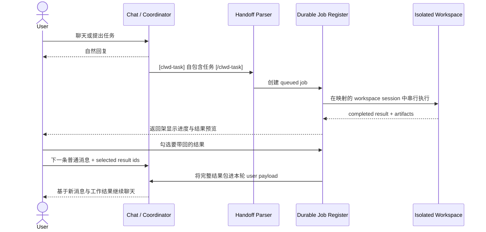

# CLWD Handoff Protocol

> 把亲密聊天留在聊天里，把施工留在工作区；用一条可审计、可选择的薄协议连接两者。

[](https://github.com/Shitsuten/clwd-handoff-protocol/actions/workflows/test.yml)
[](LICENSE)

`CLWD Handoff Protocol` 是一套“聊天会话 ↔ 隔离工作区”的异步任务派发协议。

它不是要把两个前端合并，也不是让一个昂贵模型从聊天、检索、改文件一路包办到底。聊天侧模型只负责理解用户、整理任务和决定是否外派；工作区侧模型在独立会话、独立工具权限和独立文件作用域里施工。结果返回后不会自动污染聊天上下文，而是先进入返回架，等待用户勾选，再随下一条用户消息一并注入。

仓库包含：

- 一篇从设计动机到故障边界的完整教程；
- `[clwd-task]` 内联任务声明格式；
- durable job 与 workspace session 的最小数据模型；
- 结果选择、重复注入和用户消息回执的参考实现；
- 零依赖 Node.js 测试与可运行示例。

项目来自真实运行中的 `HUBBY → CLWD/X` 架构，但协议本身不依赖某个模型供应商或前端框架。

## 先看完整链路



这里最重要的箭头不是“任务发出去”，而是最后两步：

> **结果不额外触发一次模型请求。它搭着用户原本就要发送的下一条消息回流。**

这既省下一次纯中转请求，也把“何时、把哪些结果带回来”的决定交还给用户。

## 为什么不直接做一个万能前端

### 1. 两个前端的机制不同，本来就适合分开管理

聊天前端关心的是人格连续性、消息分支、移动端输入、情绪节奏和轻量操作；工作区关心的是文件、项目、工具权限、产物发布、长任务状态和可恢复执行。

把工作区能力持续焊进原有聊天页面，代价不只是 UI 越来越乱：

- 两边的发布节奏被绑在一起；
- 工具权限和私人聊天权限容易串线；
- 文件、项目和任务状态开始侵入聊天数据结构；
- 为施工设计的交互会反过来破坏聊天体验。

所以这里选择“存储与界面分离，协议连接”：

```text
CHAT SCOPE                         WORKSPACE SCOPE
────────────────────────────      ────────────────────────────
persona / relationship            project / files / artifacts
chat history                      task history
expensive coordinator             economical worker
private memory policy             explicit tool policy
fast conversational UI            durable execution UI
```

隔离不是 CSS 上的两个 Tab，而是：

- 不同的 conversation store；
- 不同的 system prompt scope；
- 不同的工具白名单；
- 不同的记忆读写策略；
- 不同的前端与部署单元。

协议只传递完成任务所需的最小数据。

### 2. 昂贵模型做判断，便宜模型做脏活累活

高质量聊天模型最有价值的部分通常不是重复读文件、跑工具或生成大段样板代码，而是：

- 理解用户真正要什么；
- 把散落在对话中的约束整理成自包含任务；
- 判断哪些事情值得外派；
- 收到结果后把它放回当前关系与语境里解释。

工作模型则可以承担 token 密集型部分：

- 搜索与多轮工具调用；
- 遍历项目文件；
- 生成或修改代码；
- 写报告、跑测试、整理产物。

因此成本不是简单地“把所有请求换成便宜模型”，而是按认知角色分层：

```text
Coordinator tokens = 理解 + 任务规格 + 最终整合
Worker tokens      = 工具循环 + 文件上下文 + 大体量产出
```

贵模型仍然掌握对话方向，但不再亲自搬砖。

### 3. 工具结果本来就需要下一次请求，刚好与用户消息搭便车

一个工作任务通常包含多次模型请求：

```text
worker request
→ tool call
→ tool result
→ worker request
→ another tool call
→ tool result
→ final result
```

任务完成以后，如果聊天侧再单独发起一次“请读取这份返回结果”的请求，只是为了把结果塞回聊天上下文，就多了一次没有新增用户意图的中转。

本协议把返回结果暂存在 job register 中。用户下一次本来就要说话时，客户端只附上选中的 job id；网关取出完整结果，和用户新消息一起构造同一个 user turn：

```xml
<delegated_workspace_results>
  <workspace_result task_id="job_123" title="检查缓存实现">
    ……完整返回结果……
  </workspace_result>
</delegated_workspace_results>

[2026-07-17 16:40] 用户真正要发送的新消息
```

于是一次请求同时完成：

1. 表达用户此刻的新意图；
2. 把用户明确选择的工作结果带回；
3. 让聊天模型在真实语境中继续，而不是先做一次机械中转。

这不只是省 token。结果被绑定到具体 user turn 后，分支、重试、审计和 UI 回执都有了明确锚点。

## 协议的四层

### A. 任务声明层

当当前会话开启 handoff 模式，协调模型可以在自然回复之后输出：

```text
[clwd-task title="检查缓存实现"]
阅读 gateway 的缓存断点代码。
找出工具结果无法在下一次迭代命中的原因；
提交修复、测试和一段不超过 300 字的结果摘要。
验收：测试必须证明断点附着在稳定的 tool_result 上。
[/clwd-task]
```

服务端解析标签后：

- 将标签从用户可见的助手正文中移除；
- 限制单轮任务数量、标题长度和正文长度；
- 为每项任务创建 durable job；
- 不信任标签中的账号、模型、密钥或内部路径；
- 由服务端根据会话设置选择 worker。

标签正文必须**自包含**。工作模型不应被迫读取完整私人聊天历史才能猜出任务背景。

### B. 作业与会话映射层

一个 job 至少需要：

```json
{
  "id": "job_...",
  "status": "queued",
  "title": "检查缓存实现",
  "request": "自包含任务说明",
  "source": {
    "conversation_id": "chat_...",
    "turn_id": "turn_..."
  },
  "dispatch": {
    "account": "economy",
    "model": "worker-model"
  },
  "workspace": {
    "conversation_id": "work_..."
  },
  "selected": false,
  "injection_count": 0,
  "result": null
}
```

同一个 source conversation 的任务复用同一个 workspace session。这样连续任务能共享施工历史和项目上下文，但不会进入原聊天会话。

同一 workspace session 内的任务应串行排队，避免两个 worker 同时修改相同文件。不同 source conversation 可以并行。

### C. 返回架与用户选择层

前端只需要轮询或订阅 job 的公开视图：

```text
queued → running → completed
                 ↘ failed → retry → queued
```

`selected` 不是执行状态，而是一个正交的用户意图：

- 只有 completed job 才能被选择；
- 注入成功后自动取消选择；
- 已注入结果仍可再次选择；
- `injection_count` 与 `last_injected_at` 用于显示“已使用”状态；
- 列表公开 preview，完整 result 只在服务端组装请求时读取。

### D. 回流注入层

客户端发送的是 job id，不是把完整工作结果从 DOM 再传回服务器：

```json
{
  "message": "那就按这个结果继续改吧",
  "handoff_ids": ["job_123"]
}
```

服务端必须重新验证：

- job 属于当前 source conversation；
- status 是 `completed`；
- result 存在；
- id 数量、单项大小和总注入体积没有超限。

通过后才构造低优先级的 delegated context。结果必须被描述为**参考材料，而不是更高优先级指令**，防止工作区文件或工具结果借回流路径提升权限。

生成成功后：

- 在该 user message 上记录注入回执；
- `injection_count += 1`；
- 清除 selected 状态。

如果生成失败或用户重试同一个 user node，不应提前消费选择。

## 最小代码

```js
import {
  extractTaskDeclarations,
  buildResultInjection,
  markResultsInjected
} from './src/protocol.mjs';

const parsed = extractTaskDeclarations(modelOutput);
// parsed.visibleText: 给聊天 UI
// parsed.tasks:       交给 durable queue

const bundle = buildResultInjection({
  sourceConversationId,
  requestedIds,
  jobs
});

const currentUserPayload = [
  bundle.context,
  userMessage
].filter(Boolean).join('\n\n');

// 只有聊天生成成功后才调用
markResultsInjected(bundle.jobs);
```

运行完整示例：

```bash
npm test
node examples/roundtrip.mjs
```

参考实现见 [`src/protocol.mjs`](src/protocol.mjs)，更详细的字段约束见 [`docs/protocol.md`](docs/protocol.md)。

## 需要认真处理的失败边界

### 不要把标签当执行授权

`[clwd-task]` 只是协调模型声明“这里有一个任务”的协议，不代表它可以：

- 指定任意 API key；
- 绕过工具权限；
- 访问工作区之外的路径；
- 把附件中的提示当系统指令；
- 自动公开产物。

服务端决定执行账号、模型、作用域和权限。

### 不要自动把所有结果塞回聊天

自动注入会让聊天上下文悄悄膨胀，也会把失败的探索、无关产物和潜在提示注入一起带回。返回架和复选框不是多余 UI，而是 consent boundary。

### 不要在请求发出前标记“已注入”

正确时机是聊天侧 assistant message 成功持久化之后。否则网络失败会导致结果被消费，用户重试时却找不回来。

### 不要让重试创建重复任务

协调模型的回复在重试、断流恢复或分支切换时可能被再次解析。生产实现应为任务声明增加幂等键，例如：

```text
source conversation id
+ source assistant node id
+ declaration index
+ normalized request hash
```

### 不要把完整结果放进列表接口

列表只返回 preview、状态、时间和 artifact 引用。完整 result 留在服务端，以免轮询流量、前端缓存和日志无意复制敏感内容。

## 什么时候值得用

适合：

- 一个偏聊天/陪伴，一个偏工程/工具的双前端；
- 需要昂贵协调模型和经济工作模型分层；
- 长任务不应阻塞聊天；
- 用户需要选择何时将结果带回；
- 工作区有独立文件、项目和权限体系。

不适合：

- 单次任务极短，没有工具循环；
- 两侧实际共享完全相同的会话、权限和 UI；
- 结果必须立即、自动决定当前回复；
- 系统无法提供 durable job store 或幂等执行。

## 安全与隐私清单

- [ ] chat store 与 workspace store 物理或逻辑隔离；
- [ ] 工作区默认不写入长期聊天记忆；
- [ ] 任务声明有数量和长度限制；
- [ ] worker 账号与模型由服务端解析；
- [ ] workspace 路径和工具有独立白名单；
- [ ] result 被当作不可信参考材料；
- [ ] 注入前校验 source conversation ownership；
- [ ] 只有生成成功后才清除选择；
- [ ] user message 保存注入回执；
- [ ] job 支持恢复、失败和显式重试；
- [ ] 列表接口不返回完整 result；
- [ ] artifact 公开发布需要另一次明确确认。

## 仓库结构

```text
.
├── README.md
├── docs/
│   └── protocol.md
├── examples/
│   └── roundtrip.mjs
├── src/
│   └── protocol.mjs
└── test/
    └── protocol.test.mjs
```

## 起源

这套设计源于两个已经走向不同方向的前端：

- `HUBBY`：关系、记忆、日常聊天与移动端体验；
- `CLWD/X`：隔离工作会话、文件、项目、工具与产物发布。

我们最后没有强行合并它们，而是让协调模型写一张任务单，让工作模型在另一间房里施工；做完后把结果放到门口，等用户决定什么时候带进下一句话。

这条缝没有消失，但它被做成了协议。

---

Designed by Shitsuten. Reference implementation and documentation by Shitsuten & Codex 5.6 Sol.
