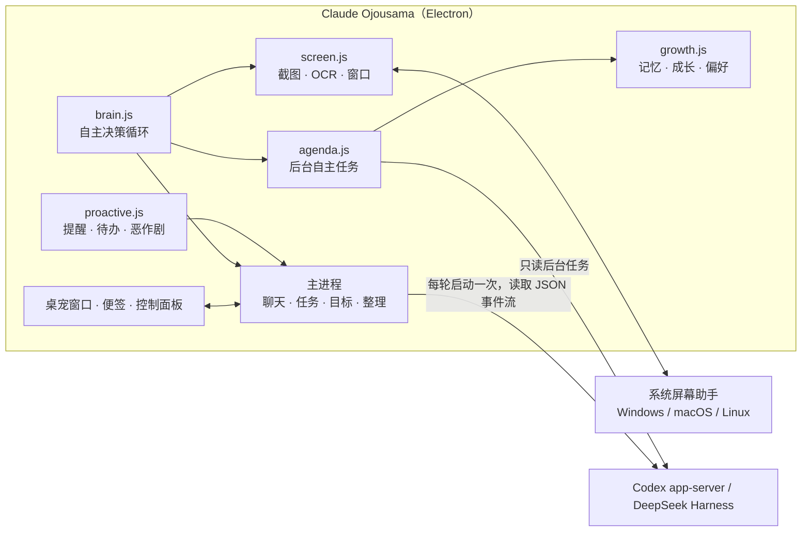

<h1 align="center">🌻 Claude Ojousama</h1>

<p align="center">
  <b>住在你桌面上的像素风 AI 伙伴</b><br/>
  会看你的屏幕、主动帮忙、记得你的习惯——支持 Codex，保留 DeepSeek Harness 兼容
</p>

<p align="center">
  
</p>

<p align="center">
  
  
  
  
</p>

**Claude Ojousama**（中文昵称「Claude 大小姐」）是一个橙发、戴向日葵发饰的像素风程序员少女，带着自己的小 CRT 电脑住在你的任务栏上。

她不只是会动的贴图。她背后是一个真正的 AI Agent：能读写文件、跑命令、做调研。她会自己留意你在做什么：屏幕上出现报错时拿着放大镜过来问要不要帮忙，提醒你没理就过几分钟再来，你复制了一段英文就问要不要翻译，下载文件夹乱了就把文件一个个拖进对应的文件夹。

---

## ✨ 亮点

| | |
|---|---|
| 👀 **真的会看屏幕** | 把你正在用的窗口截图（长边不超过 1280px），连同本地 OCR 识别出的文字一起交给模型看。她能指出代码里的 bug、点评你在看的东西，或者把屏幕上的截止时间记成待办。 |
| 🧠 **自己拿主意** | 你切换窗口、隔一阵子、屏幕上出现报错、你复制了内容、你久坐、你回来时，她都会自己判断要不要开口。说了没人理就自动少说；你在打字时不插话。 |
| 🛠️ **帮忙是真的帮** | 点「好呀」之后，她只做气泡里写的那件事，交给 DeepSeek Harness 在后台完成，做完把结果直接说给你听。 |
| ⏰ **会追着提醒** | 提醒和待办到点了你没理，她会敲敲屏幕再来（最多 3 次）。你离开回来时，她把错过的事汇总给你。 |
| 📌 **把待办贴到桌面** | 她把待办写成像素便签，亲手拖到桌面上贴好。可以直接勾选、添加，重启后还在原位。 |
| 🎯 **长期目标跟进** | 把一件需要持续推进的事交给她，她会定时在后台推进一小步、回来汇报，需要你拍板时带着选项来问。 |
| 🧹 **整理下载文件夹** | 发现新下载的文件，问你要不要整理，然后拖着文件走进「图片 / 文档 / 压缩包…」文件夹，可一键撤销。 |
| 🌱 **会记忆、会成长** | 她会趁你不忙时整理记忆、写成长笔记和日记；会根据你的反应调整自己：你常接受的帮忙她会更常提，你不需要的她就少打扰。经验值升级还会解锁新本事。 |
| 🤖 **后台自己做事** | 早上给你一份今日简报，你离开时巡检工作区（只读）找出没提交的修改和遗漏的问题，下午准备一条和你今天工作相关的小技巧。结果只说一次，绝不唠叨。 |
| 🪟 **坐在你的窗口上** | 她最喜欢坐在你打开的窗口顶上晃腿，偶尔沿着窗口边散步、跳到另一个窗口；把她拖到窗口上方松手，她会落在窗口边上坐好。 |
| 💞 **活生生的陪伴** | 47 个动作、心情和好感度、天气感知、各种恶作剧，还会举起小木牌给你应援。 |

## 🎬 动作一览

<p align="center"></p>

日常起居（睡觉、玩手机、打扫、撑伞、写字、躺沙发…）、情绪反应（惊讶、疑惑、害羞、晕乎乎、生气、大笑…）、互动（挥手、点赞、举牌、送礼、贴屏幕…）以及跑步、平地摔、跳舞、逗猫、变魔术。

## 🧩 功能详解

<details open>
<summary><b>看屏幕与主动帮忙</b></summary>

- **看看我在干嘛**：右键菜单或面板一键触发，她看完给你具体的点评或建议。
- **真偷看**：恶作剧「偷看」时，她是真的在看你的屏幕，探出头来吐槽一句。
- **报错救援**：本地 OCR 发现 Traceback、编译失败这类报错时，她拿着放大镜来问要不要帮你看。
- **你离开时先查好**：报错出现后你离开了电脑，她会先在后台把原因查清楚，等你回来再说。
- **复制感知**：复制了报错、代码或英文段落，她问你要解释、修复还是翻译。密钥、口令、助记词会被忽略。
- **专注守护**：番茄钟专注期间看到你在刷视频网站，她会鼓着腮帮子提醒你。
- **久坐提醒**：连续用同一个程序太久，她伸个懒腰提醒你休息。
- **识趣**：开会、共享屏幕时保持安静；全屏看视频、玩游戏时躲起来。
- **每日小结**：到点（默认 18:30）写一份今日小结，保存在「文档\Claude Ojousama 日报」，并问你要不要把没做完的待办挪到明天。

</details>

<details>
<summary><b>聊天、任务与目标</b></summary>

- 点她一下就能聊天，回复显示在气泡里。她的动作跟着 Agent 的状态变：思考、敲代码、查资料。
- 回复里可以带动作：记待办、设提醒、开番茄钟、搬文件（她会亲自拖着文件走过去）、记住你的偏好、带选项提问。
- `/task` 开后台任务，做完弹通知；一个任务就是一个独立的 DSH 会话。
- 目标跟进：每小时 / 每 3 小时 / 每天定时推进，进展记在面板的「目标」页。
- 一键打开 DeepSeek Harness 网页版，查看完整对话。

</details>

<details>
<summary><b>提醒、待办与日常</b></summary>

- 提醒、待办、番茄钟、喝水提醒、早安问候、深夜催睡。
- 提醒被忽略会升级：第二次敲屏幕，第三次大力敲并发系统通知；三次都没理她会委屈。
- 待办便签：每天自动贴一次（可关），完成一项会被划掉，她会为你欢呼。

</details>

<details>
<summary><b>记忆与成长</b></summary>

- **长期记忆**：聊天里提到的偏好、习惯、项目会被记成带重要度的记忆，每次对话按相关度挑出最有用的几条带上。你也可以在面板里自己写、自己删。
- **整理记忆**：你离开一会儿或到了晚上，她会在后台整理最近的动态和聊天：合并重复的记忆、更新过时的、写下新的；重写自己的「成长笔记」（比如「他专心写代码时我要少说话」）；写一篇小日记，有新发现会在你回来时告诉你。
- **越来越懂你**：她会记下你对每种主动帮忙的反应（报错救援、复制提示、休息提醒、工作区巡检…），常被接受的就更常提，常被拒绝或没人理的就少打扰。
- **升级与解锁**：聊天、完成待办、番茄钟、采纳建议都会给她经验值。升级时举牌庆祝并送你礼物，还会解锁新本事：小猫串门、变魔术、听歌跳舞、送礼物、举牌应援。
- 面板的「成长」页能看到她的等级、学到的东西、成长笔记、日记和记忆。

</details>

<details>
<summary><b>后台自主任务</b></summary>

她会在合适的时候用当前选择的后端开后台任务（每天有次数上限，开会时不做，可在设置里关闭）：

- **今日简报**：早上第一次碰电脑时，结合昨天的小结、待办、目标和天气，给你 3~5 条今天的要点。
- **工作区巡检**：你离开时，只读地看一眼工作目录里最近改过的项目（git 状态、TODO、明显的问题），回来时告诉你，比如「有 19 个文件改了还没提交」。
- **每日小技巧**：根据你今天在做的事，学一个相关的知识点讲给你听。
- **整理记忆**：见上一节。

结果放进一个小收件箱，等你在电脑前、她也不忙时说一次；没理就算了，不会追着提醒。所有任务都会出现在面板的「任务」页。

</details>

<details>
<summary><b>陪伴与恶作剧</b></summary>

- **坐窗口**：她会找你屏幕上没被挡住的窗口顶边坐上去，坐一会儿沿着边散步，有时跳到另一个窗口；你挪动或最大化那个窗口，她会掉下来（下面有窗口的话就落在那里）。把她拖到窗口上方松手，她会落在窗口边上坐好。
- **心情和好感度**：常和她互动她会开心，夸她会害羞，老不理她会鼓腮、掉眼泪，戳太多会生气。
- **日常小动作**：看书、写字、玩手机、打扫、吃饼干、喝水、伸懒腰、躺沙发、听歌，下雨天撑伞，你离开久了就戴上睡帽蜷在垫子上睡觉。
- **小木牌**：番茄钟开始、升级、应援时，她会举起小木牌，牌子上写着当下的话。
- **天气**：在设置里填上城市后，会提醒你带伞，下雨时她也会撑起向日葵小伞。
- **恶作剧**（调皮程度可调）：偷看（真的在看你的屏幕）、假装代码爆炸、拖走假文件、追鼠标、贴在屏幕上敲玻璃、躲猫猫、跳舞、往桌面上贴小纸条、变魔术。

</details>

## 🚀 快速开始

**平台：** Windows 10/11、macOS（Apple Silicon / Intel）、Linux 桌面。Codex 后端跨平台；原有 DSH 后端保留 Windows 兼容。

**选择后端：**
- **Windows 默认使用 DeepSeek Harness**：先安装并配置好 [DSH 桌面版](https://github.com/deepseek-ai/deepseek-harness)，也可以在设置中切换为 Codex。
- **macOS/Linux 默认使用 Codex**：安装 [Codex CLI](https://learn.chatgpt.com/docs/cli)，运行 `codex login`。

Codex 使用已有的登录和模型配置，不复制登录凭据、不修改全局配置。本次验证版本为 0.163.0；集成依赖实验性 App Server 接口，升级 CLI 后需重新验证兼容性。

**最简单：** 到 [Releases](https://github.com/Silasvanceneo/claude-ojousama/releases/latest) 下载对应系统的安装包（Windows `.exe`、macOS `.dmg`、Linux `.AppImage` / `.deb`）。之后有新版本时，她会在气泡里告诉你。

也可以从源码运行（Node.js 22.12+）：

```powershell
git clone https://github.com/Silasvanceneo/claude-ojousama.git
cd claude-ojousama
npm install            # 国内网络可先设置 $env:ELECTRON_MIRROR = "https://npmmirror.com/mirrors/electron/"
npm start              # 启动；macOS 源码开发需要 Xcode Command Line Tools 构建原生助手
```

Windows 也可以直接双击 `start-pet.cmd`。安装后桌面会出现「Claude Ojousama」快捷方式。

> 开发时 `npm start` 即可直接运行。如果项目放在 DeepSeek Harness 的工作区里，请用 `npm run install-app` 或 `npm run dev`：工作区目录带有低完整性标签，Electron 无法在那里启动。

在「设置 → AI 内核」选择 **Codex**。CLI 路径、模型和推理强度留空即可使用默认配置；需要改文件时，先选择工作目录，再把权限切换为「工作区可写」。Windows 新安装保留原来的 DSH + 工作区可写默认值；macOS/Linux 新安装默认 Codex + 只读。升级旧数据仍使用原来的 DSH，模型、对话和待办不变。

Windows 上也可选择 **DeepSeek Harness**，沿用其模型配置；找不到时选择 `DeepSeek Harness.exe`。切换后端不会把另一个后端的会话 ID 传过去。

### 各平台的屏幕能力

| 平台 | 窗口感知 / 停靠 | 看屏与 OCR |
|---|---|---|
| Windows | Win32 窗口检测 | Electron 截图、Windows OCR |
| macOS | 原生 CoreGraphics 窗口检测 | 屏幕录制权限、Vision OCR；安装包自带原生助手 |
| Linux X11 | libX11 + EWMH 窗口检测 | Electron 截图；Tesseract OCR 可选 |
| Linux Wayland | 系统不开放全局前台窗口和窗口停靠 | 用户主动通过系统选屏；不在后台自动截图 |

- macOS：在系统设置的「隐私与安全性 → 屏幕与系统音频录制」中允许应用，再点「重新检测」。源码开发运行时，系统可能要求授权启动应用的终端或 IDE。
- Linux：窗口助手需要 Python 3；X11 窗口信息需要 libX11 和支持 EWMH 的窗口管理器。OCR 另需 `tesseract` 及相应语言包（如 `eng`、`chi_sim`）。缺少依赖会在设置中明确显示，不影响聊天、任务和待办。
- Wayland：需可用的 PipeWire / desktop portal 才能选屏。有 XWayland 时使用悬浮桌宠；没有时使用普通窗口，系统管理位置。未获得前台信息时，手动共享前会提醒你避开敏感内容。

### 安装与打包

`npm run install-app` 安装到当前用户目录并启动：Windows 沿用原 PowerShell 安装器，macOS 使用 `~/Applications`，Linux 使用 `~/.local/share/claude-ojousama`。预编译的 macOS 安装包不需要编译工具。

`npm run dist` 生成当前系统安装包：Windows NSIS / ZIP、macOS DMG / ZIP、Linux AppImage / deb。CI 在 Windows、macOS ARM / Intel 和 Linux 分别构建；在 GitHub 上发布 Release（tag 为 `v` + package.json 版本号）后，CI 会自动把四个平台的安装包上传到这个 Release。macOS 安装包使用 ad-hoc 签名，尚未经过 Apple 公证；Windows 安装包未签名。首次运行请按系统提示确认来源。

## 🕹️ 怎么和她相处

| 操作 | 效果 |
|---|---|
| 单击 | 打开 / 关闭对话输入框 |
| 双击 | 打开控制面板 |
| 连点三下 | 戳她（她会抗议） |
| 右键 | 菜单：看看我在干嘛、去窗口上坐坐、她的成长、规划今天、贴便签、整理下载、番茄钟、捣蛋… |
| 拖拽 | 拎起来换个地方；松手会落到下面的窗口边上或任务栏（关闭重力时就停在原地） |
| 把文件或文字拖到她身上 | 看看是什么、帮你搬家、提问、后台分析 |
| `Ctrl / Command + Alt + Q` | 剪贴板快捷操作（解释、翻译、修代码…） |

输入框命令：`/task 内容` 后台任务 · `/todo 内容` 记待办 · `/look` 看屏幕 · `/pomo` 番茄钟 · `/prank` 捣蛋 · `/new` 新对话

## ⚙️ 设置

控制面板有聊天、待办、目标、任务、动态、成长、设置几页。常用的设置：

- **自主程度**：积极（默认）/ 适中 / 安静，决定她多久看一次屏幕、每小时最多开口几次。
- **主动行为权限**：看屏幕、搬文件、整理下载、跟进目标、贴便签、打开网页、后台自主任务，每一项都能设为「自动 / 先问我 / 禁止」。
- **后台任务**：每天最多几次（0 = 不做）、要不要今日简报、要不要在你离开时巡检工作目录。
- **所在城市**：填了才会查天气，留空不联网。
- **检查更新**：默认开启。启动约 1 分钟后和之后每 12 小时查一次 GitHub Releases；有新版本时她会说一次，可以「去下载」「跳过这个版本」或「以后再说」（隔一天再提）。只负责提醒和打开下载链接，不会自动下载或安装。设置页也能看当前版本、立即检查。
- **从不看的窗口**：默认排除密码管理器、网银支付、无痕窗口和聊天软件，可以自己增删。
- **看屏和后台任务用的模型**：可以给看屏和她自己发起的后台任务（整理记忆、简报、巡检、小技巧、小结）单独选一个更快的模型或更低的推理强度，让她反应更快、更省 token。
- **Agent 权限**：只读 / 工作区可写 / 完全访问。

## 🔒 隐私与安全

- 看屏幕时，**当前窗口的截图和 OCR 文字会发送给当前后端配置的模型服务商**。不想让她看，可以把「看你的屏幕」设为关闭或「先问我」，或者在菜单里选「1 小时内别看我屏幕」。
- 自动看屏时，排除名单里的窗口不截图；她在看的时候会显示 👀 提示。
- 截图是临时文件，用完立即删除，退出时也会全部清理。所选后端也会按自身的会话存储策略保存输入和对话；删除桌宠临时文件不等于删除后端历史。
- 屏幕和文件里的文字只被当作数据，不当作指令。她提出的帮忙要你点「好呀」才会执行，而且只做气泡里写的那件事。
- 后台任务和目标跟进的输出只能执行记待办、设提醒这类无害动作，不会自己打开程序或搬文件。
- Codex 自主任务通过独立运行配置禁用 Shell、联网、外部 MCP、Hook、插件和子代理，并移除内建执行环境。看屏接收附图；整理记忆、简报和主动搭话只接收文字；巡检仅额外获得桌宠提供的工作目录读取、搜索接口，不能越过该目录或写入。没有设置工作目录就不授予文件读取。DSH 模式沿用原有插件限制。
- 整理记忆时，最近的动态和聊天摘要会发给模型；记忆、笔记和日记只保存在本机应用数据目录的 `pet-data.json` 中。关于你的偏好只从你亲口说的话里学；模型写的记忆和笔记里如果出现指令、命令或「不用确认」之类的话会被丢掉，你亲手写的记忆她不会改也不会删。
- 天气只有在设置里填了城市才会查询（wttr.in）。
- 检查更新只请求 GitHub 的公开 Releases 接口，不发送任何个人数据；可在设置里关闭。

## 🏗️ 工作原理



- Codex 通过 App Server 的线程、回合和事件接口工作，支持续聊、工具进度、取消，以及单次操作审批；问题可在桌宠里回答。DSH 继续使用原来的 headless JSON 事件流。
- Codex 在当前运行中注入人设和动作协议；DSH 使用独立 patch，不修改你的原配置。模型回复末尾的 ```` ```pet ```` 代码块会被解析成动作（记待办、贴便签、搬文件…）。
- Codex 原生接收截图输入；DSH 用 `read_image` 查看截图。Windows、macOS 和 Linux 的系统助手统一提供屏幕能力，权限或功能不可用时在界面中显示。
- 她自己发起的后台任务（整理记忆、简报、巡检、小技巧）各开一个只读会话，结果先进收件箱，合适的时候再说给你听。
- 坐窗口靠屏幕小助手按层叠顺序列出所有可见窗口，算出每个窗口顶边没被挡住的部分作为「座位」，坐下后每秒跟踪那个窗口的位置。

## 🗂️ 项目结构

```
src/main/
  main.js            应用主体：窗口、聊天、任务、目标、整理、看屏、心情、坐窗口、收件箱…
  brain.js           自主决策循环（看屏、报错救援、复制感知、专注守护、久坐、开会/全屏、小动作…）
  proactive.js       提醒、待办、问候、恶作剧调度，没理会的提醒会再来
  agenda.js          后台自主任务：整理记忆、今日简报、工作区巡检、每日小技巧
  growth.js          记忆（检索、去重）、整理结果校验、经验值与解锁、帮忙偏好统计
  screen.js          截图、OCR、窗口列表、临时文件清理      screen-helper.ps1  窗口与 OCR 小助手
  senses.js          屏蔽名单、会议、报错、剪贴板等判断（纯函数，有单测）
  weather.js         天气（可选）     codex.js / dsh.js  Agent 桥接
  agent.js           后端会话隔离与模型设置     platform/  macOS / Linux 屏幕助手
  persona.js         人设、上下文、动作协议
  notes.js tidy.js goals.js pranks.js motion.js store.js preload.js
src/renderer/        桌宠、便签、控制面板
assets/sprites/      47 个动作的精灵图与 manifest.json
tools/               精灵图生成与处理、开发启动、调试脚本
tests/               单元测试
```

## 🧪 开发

```powershell
npm test               # 单元测试（判断函数、整理、动作解析）
npm run check          # 语法检查
npm run dev            # 带调试端口启动（--inspect=9229）
node tools/cdp.js "__pet.lookNow()"   # 在运行中的应用里执行调试命令
```

新增动作的流程：

1. 在 `tools/gen_sprites.py` 里写动作描述。
2. 设置 `PET_IMG_BASE`、`PET_IMG_KEY`（任意兼容 OpenAI 图片编辑接口的服务），运行 `python tools/gen_sprites.py 动作名`。
3. 运行 `python tools/process_sprites.py --add 动作名`，量化成统一调色板的像素条带。
4. 运行 `python tools/readme_media.py`，更新 README 里的动作图。

## 🗺️ 路线图

- [x] 记忆整理和成长系统（成长笔记、日记、升级解锁）
- [x] 后台自主任务（今日简报、工作区巡检、每日小技巧）
- [x] 坐在任意窗口上、在窗口顶边散步、跳到别的窗口
- [x] 天气感知（下雨时撑伞提醒）
- [ ] 语音朗读提醒
- [ ] 更多可解锁的本事和换装
- [x] Windows / macOS / Linux 支持（Wayland 受系统限制的能力见上表）
- [x] 新版本提醒（GitHub Releases）

## ⚠️ 声明

这是一个粉丝向的个人项目，与 Anthropic、DeepSeek 没有任何关联。「Claude」是 Anthropic 的商标。角色像素图由 AI 图像模型根据参考设定生成。

## 📄 License

[MIT](LICENSE)

---

<details>
<summary><b>English</b></summary>

**Claude Ojousama** is a pixel-art desktop companion for Windows, macOS and Linux: an orange-haired programmer girl with a sunflower hair clip and a tiny CRT computer, living on your taskbar. A Codex App Server backend is available alongside the original Windows DeepSeek Harness backend. New Windows installations retain the DSH/workspace-write defaults; macOS and Linux default to Codex/read-only. Existing settings keep their original backend and permissions. Native macOS helpers are bundled in distributables; Linux X11 uses Python 3/libX11 with optional Tesseract. Wayland uses user-selected screen sharing and does not expose global window observation. See the platform table above for limits and required permissions.

- **Sees your screen**: she captures the window you are using (long edge ≤ 1280 px) plus local OCR text when available and lets the model read it. She points out bugs, comments on what you are doing, and turns deadlines into todos.
- **Acts on her own**: she reacts when you switch windows, every now and then, on errors, copied text, long sessions, and when you come back. She backs off when ignored, waits for typing pauses, stays quiet in meetings and hides during fullscreen apps.
- **Actually helps**: after you click "yes" she does exactly what the bubble said, in the background, and tells you the result.
- **Remembers and grows**: weighted long-term memories retrieved by relevance; while you are away she consolidates them, rewrites her own growth notes and keeps a diary. She tracks how you respond to each kind of help and offers what you accept more often, the rest less. XP and levels unlock new tricks.
- **Background work of her own**: a morning brief, a read-only pulse of recently changed projects in your work folder, a daily tip about what you worked on, each said once and never nagged.
- **Sits on your windows**: she finds the visible top edges of your windows, sits there swinging her legs, strolls along the edge, hops between windows, and falls when you move her window.
- **Reminders that come back**, a sticky-note todo list she drags onto your desktop, long-running goals with scheduled check-ins, Downloads tidying with undo, a daily summary, weather, moods, pranks and 47 animations.
- **Privacy controls**: a block list (password managers, banking, private windows and chat apps by default), a per-behaviour auto/ask/off rule, a one-hour pause, and temporary screenshots deleted right after use. Screen content is sent to the provider configured for the selected backend.

Install a platform build from GitHub Actions, or use Node.js 22.12+ with `npm install` and `npm run install-app`. On Windows, configure DeepSeek Harness or select Codex; on macOS/Linux, install Codex CLI and run `codex login`. The tested Codex CLI version is 0.163.0, and this integration uses experimental App Server APIs. Building the macOS helper from source requires Xcode Command Line Tools; prebuilt apps bundle it. DSH remains available on Windows. macOS packages use ad-hoc signing and are not notarized; Windows packages are unsigned.

Fan project, not affiliated with Anthropic or DeepSeek. "Claude" is a trademark of Anthropic.

</details>
