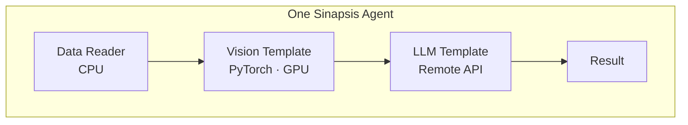

<h1 align="center">
<br>
<a href="https://sinapsis.tech/">
  
</a>
<br>
Sinapsis
<br>
</h1>

<h3 align="center">
A single contract for the AI ecosystem.
</h3>

<p align="center">
<strong>Build faster. Integrate less. Get to production sooner.</strong>
</p>

<p align="center">
Compose and build AI systems from reusable components. Combine models, frameworks, APIs, data, and custom code through a single contract, without forcing them into the same runtime.
</p>

<p align="center">
  <a href="https://docs.sinapsis.tech/">📚 Documentation</a> ·
  <a href="#-quickstart">⚡ Quickstart</a> ·
  <a href="#-why-sinapsis">🚀 Why Sinapsis?</a> ·
  <a href="https://platform.sinapsis.tech/">☁️ Sinapsis Cloud</a>
</p>

---
<p align="center">
  
</p>

---
## 😊 Community

Join us on our <a href="https://discord.gg/uuBqQqu2vS"> Discord Server </a> to chat live with our engineers. We would love feedback and active discussions which can help shape where Sinapsis goes.

---

## ⚡ Quickstart

Below are two quickstart examples of agents in Sinapsis.

<details>
<summary><strong>Receipt OCR:</strong> extract receipt fields from your CPU</summary>

### a. Install Sinapsis
Sinapsis requires Python 3.13 or later. We recommend [`uv`](https://docs.astral.sh/uv/).

```bash
uv venv --python 3.13
source .venv/bin/activate

uv pip install sinapsis-cli
```

### b. Install the capabilities you need

```bash
uv pip install sinapsis-doctr sinapsis-data-readers "sinapsis-data-visualization[all]" sinapsis-data-writers
```

Sinapsis discovers Templates exposed by installed packages.

### c. Define an Agent

Create `agent_config.yml`:

```yaml
agent:
  name: my_agent_test
  description: "Agent to read image from folder, perform DocTR-OCR prediction and save the inference image in file."
  attributes:
    agent_mode: generator

templates:
  - template_name: InputTemplate
    class_name: InputTemplate
    attributes: {}

  - template_name: FolderImageDatasetCV2
    class_name: FolderImageDatasetCV2
    template_input: InputTemplate
    attributes:
      root_dir: public/assets/quickstart
      data_dir: ocr-images
      batch_size: 1

  - template_name: DocTROCRPrediction
    class_name: DocTROCRPrediction
    template_input: FolderImageDatasetCV2
    attributes:
      recognized_characters_as_labels: True
      artefact_type_as_labels: False
      det_arch: "fast_base"
      reco_arch: "crnn_vgg16_bn"
      pretrained: True
      pretrained_backbone: True
      assume_straight_pages: True
      preserve_aspect_ratio: True
      symmetric_pad: True
      export_as_straight_boxes: False
      detect_orientation: False
      straighten_pages: False
      detect_language: False

  - template_name: BBoxDrawer
    class_name: BBoxDrawer
    template_input: DocTROCRPrediction
    attributes:
      draw_confidence: True
      draw_extra_labels: True
      randomized_color: False

  - template_name: ImageSaver
    class_name: ImageSaver
    template_input: BBoxDrawer
    attributes:
      save_dir: output
      root_dir: .
```

### d. Run your Agent

```bash
sinx-venv jobs run agent_config.yml
```
See outputs in the directory `output/`. In the agent config you can change the directories to suit your needs.

<!-- Show the expected output here. -->

</details>

<details>
<summary><strong>Using ChatGPT</strong></summary>

### a. Prerequisites

Replace `<YOUR_KEY>` with your OpenAI key
```bash
export OPENAI_API_KEY=<YOUR KEY>
```

### b. Install Sinapsis
Sinapsis requires Python 3.13 or later. We recommend [`uv`](https://docs.astral.sh/uv/).

```bash
uv venv --python 3.13
source .venv/bin/activate

uv pip install sinapsis-cli
```

### c. Install the capabilities you need
```bash
uv pip install sinapsis-openai
```

### d. Define Agent Config
```yaml
agent:
  name: my_test_agent
  description: "OpenAI chat creation"

templates:
  - template_name: InputTemplate
    class_name: InputTemplate
    attributes: {}

  - template_name: TextInput
    class_name: TextInput
    template_input: InputTemplate
    attributes:
      text : find the weather forecast for London tomorrow

  - template_name: OpenAIChat
    class_name: OpenAIChatWrapper
    template_input: InputTemplate
    attributes:
      model : gpt-5.4-mini-2026-03-17
      openai_init: {}
      create: {}
```

### e. Run your Agent
```bash
sinx-venv jobs run agent_config.yml
```

</details>


## 🚀 Installation

Sinapsis requires Python 3.13 or later. We recommend [`uv`](https://docs.astral.sh/uv/).

### a. Install Sinapsis

```bash
uv venv --python 3.13
source .venv/bin/activate

uv pip install sinapsis-cli
```

### b. Install the capabilities you need only

```bash
uv pip install sinapsis-anthropic
uv pip install sinapsis-doctr
uv pip install sinapsis-ultralytics
```

Sinapsis discovers Templates exposed by installed packages.

### c. Define an Agent

Create `agent_config.yml`:

```yaml
agent:
  name: hello_world

templates:
  - template_name: Input
    class_name: InputTemplate
    attributes: {}

  - template_name: HelloWorld
    class_name: HelloWorld
    template_input: Input
    attributes:
      display_text: "Hello from Sinapsis!"
```

### d. Run your Agent

```bash
sinx-venv jobs run agent_config.yml
```

### e. Explore available Templates

```bash
sinx-venv jobs  templates show-all
sinx-venv jobs  templates docstring TemplateName
sinx-venv jobs  templates example-config TemplateName
```

The same Agent model is accessible through Python, the CLI, Sinapsis UI, VS Code, and the API.

**[Explore the documentation →](https://docs.sinapsis.tech/)**

---

## What can you build?

Sinapsis supports AI development beyond LLMs and agentic workflows. Combine reusable Templates to build everything from individual AI capabilities to complete production systems.

- AI agents and workflows — Compose models, APIs and custom Python logic into real-time or event-driven applications
- Computer vision — Build image processing, object detection, classification and video analysis pipelines
- LLM and NLP applications — Combine language models, retrieval, text processing and document intelligence
- Speech and audio AI — Build transcription, diarization and audio processing workflows
- Model training and inference — Train, optimise and execute models locally or across different compute environments
- Data processing and integrations — Connect databases, APIs and data pipelines through reusable components
- Realtime processing - Systes which require realtime processing and streaming with native datatypes

---

## ⚡ Why Sinapsis?

AI projects rarely stay simple. One model becomes three, followed by data processing, APIs, databases, incompatible dependencies, deployment, and scaling.

**Integration hell. Dependency hell. Infrastructure hell.**

Sinapsis brings different technologies together through a common computational contract, reducing the need to repeatedly rebuild integrations and application architecture.

### Single contract

Combine models, libraries, APIs, and custom Python code through consistent component interfaces and a shared data model.
Use different frameworks, dependency stacks, and execution environments within the same computational system.

**Choose technologies for their capabilities, not their compatibility**

### Build once and reuse everywhere

Package capabilities as reusable **Templates**. Combine them into **Agents**, reuse them across applications, and compose complete Agents into larger systems. Build on what you've already created instead of starting from scratch.

### Separate computation from execution.

Define what your application does independently of where and how it runs. Develop locally, then use different execution strategies for concurrent, multi-process, remote, or distributed workloads.

**Change how your system runs without redesigning what it does.**

### Your models, your infrastructure, your choice

Use commercial APIs, open-source models, or models you've trained yourself. Train and run models locally, use your own infrastructure, or deploy through managed cloud services.

**No forced model provider. No single required runtime.**

---

## 🧩 The idea

In Sinapsis, capabilities become **Templates**.

A Template can run a model, call an API, train a network, process an image, query a database, wrap an existing library, or execute arbitrary computation.

Templates compose into **Agents** — computational systems that combine different technologies through a common interface and data model.



**One computational system. Different technologies. Different dependencies. Different execution environments.**

Agents define what the system does, independently of where its parts run or how data moves between them.

Start small, compose capabilities, and grow into complete applications.

---

## 📦 One ecosystem, 100+ packages

Sinapsis brings together independently developed packages spanning AI, computer vision, speech, data processing, training, and more.

```text
sinapsis
sinapsis-anthropic
sinapsis-langchain
sinapsis-doctr
sinapsis-ultralytics
sinapsis-elevenlabs
sinapsis-anomalib
...
```

Each package can have its own dependencies, optional features, version, and release lifecycle.

Install only what you need and combine capabilities through the same computational contract.

**[Explore the ecosystem →](https://docs.sinapsis.tech/)**

---

## 🖥️ Sinapsis UI -- coming soon

**Build, run, and manage Agents visually.**
<details>
<summary><strong>Explore Sinapsis UI capabilities ▾</strong></summary>

Sinapsis UI provides a graphical interface to the same underlying Agent and Template model.

Drag and connect Templates, configure Agents, execute workflows, stream results, manage secrets and integrations, and interact with deployments.

Prefer working in your editor? The Sinapsis VS Code integration brings the same visual experience into your development environment.
</details>

## ☁️ Sinapsis Cloud

Take your Agents beyond local execution with managed infrastructure built around the same Sinapsis model.

<details>
<summary><strong>Explore Sinapsis Cloud capabilities ▾</strong></summary>

<br>

The open framework can run locally or on self-managed infrastructure.

**Sinapsis Cloud** extends it with managed capabilities for:

- 🔒 **Isolated environments** — Run Templates with independent dependency stacks.
- 📈 **Independent scaling** — Scale compute-heavy components without scaling the entire Agent.
- ⚡ **Distributed execution** — Execute workloads in parallel and across multiple machines.
- 📡 **Real-time streaming** — Stream execution results as they become available.
- 🔑 **Secrets management** — Manage credentials and API keys securely.
- 🔗 **Integrations and webhooks** — Connect Agents with external services.
- 🚀 **Hosted deployments** — Expose and manage applications through hosted APIs.

A Template requiring one dependency stack can run independently of another using an incompatible one.

**Your application remains one system.**

**[Explore Sinapsis Cloud →](https://platform.sinapsis.tech/)**

</details>

**[Explore Sinapsis Cloud →](https://platform.sinapsis.tech/)**

---

## 📚 Go deeper

This README only scratches the surface.

The [Sinapsis documentation](https://docs.sinapsis.tech/) covers everything from your first Agent to the framework's internal architecture.

| Explore | What's inside |
|---|---|
| 🚀 **Getting started** | Installation, configuration, and your first Agents |
| 🧩 **Concepts & architecture** | Templates, Agents, data models, execution, and communication |
| 📦 **Packages & Templates** | Discover capabilities across the ecosystem |
| 🛠️ **Tutorials & use cases** | Build practical AI applications |
| ☁️ **Platform & deployment** | Local execution, infrastructure, and Sinapsis Cloud |
---

## 🗂️ Repository

Sinapsis Hub brings together the framework, its package ecosystem, production applications, and platform components.

```text
sinapsis-hub/
├── packages/        # Reusable, independently built capabilities
├── applications/    # End-to-end applications
├── platform/        # Backend services, deployment, and UI
├── docs/            # Documentation
├── scripts/         # Repository utilities
└── tools/           # Developer tooling
```

The monorepo is an organizational structure, not a single Python project or deployment unit.

Packages and applications are independently built, with their own dependencies and release lifecycles.

Package-specific examples live alongside their respective packages. Platform-wide tutorials and use cases are available through the [documentation](https://docs.sinapsis.tech/).

## 🔗 Resources

- 🌐 [Website](https://sinapsis.tech/)
- 📚 [Documentation](https://docs.sinapsis.tech/)
- ☁️ [Sinapsis Cloud](https://platform.sinapsis.tech/)
- 🏗️ [Architecture](https://docs.sinapsis.tech/docs/latest/architecture)

[//]: # (- 🤝 [Contributing]&#40;CONTRIBUTING.md&#41;)
[//]: # (- 🔒 [Security]&#40;SECURITY.md&#41;)

## 🤝 Contributing
If you have found a bug or you would like to contribute because you have an idea for a feature, check out our <a href="https://github.com/SinapsisHub/sinapsis-hub/CONTRIBUTING.md">contributing guide.</a>

## 🔒 Security
If you need to report a security issue, please report it at **[security@sinapsis.tech](mailto:security@sinapsis.tech)**

## 📄 License

Unless otherwise noted, the open-source components in this repository are available under your choice of:

- The [MIT License](LICENSE-MIT); or
- The [Apache License 2.0](LICENSE-APACHE).

---

<p align="center">
  <strong>Build faster. Integrate less. Get to production sooner.</strong>
</p>

<p align="center">
  <a href="https://sinapsis.tech/">🌐 Website</a> ·
  <a href="https://docs.sinapsis.tech/">📚Documentation</a> ·
  <a href="https://github.com/SinapsisHub">📁 GitHub</a>
</p>
