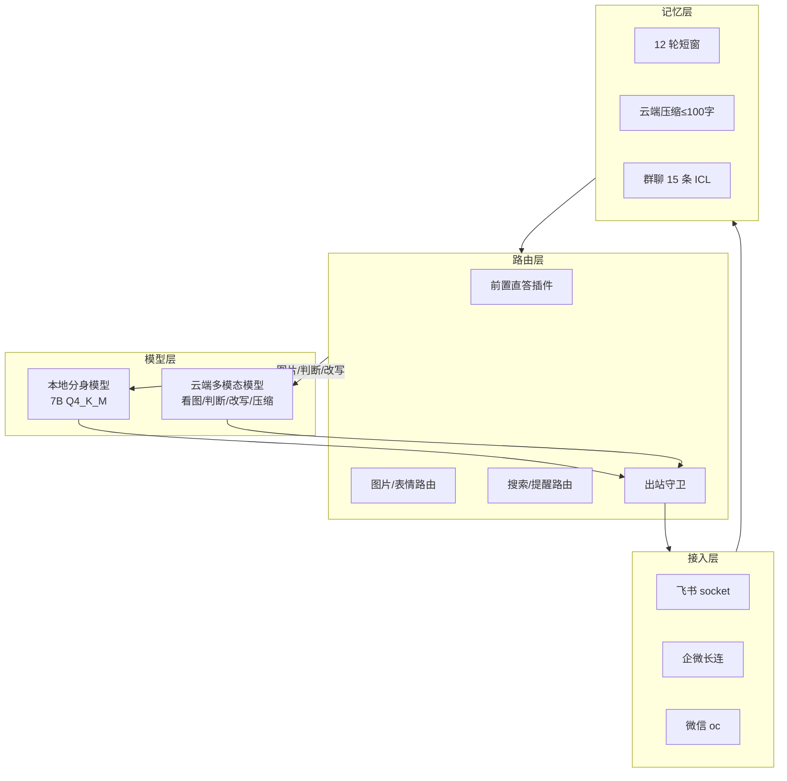

<p align="center">
  
</p>

<h3 align="center">Your chat history in. A persona agent out.</h3>

<p align="center">把聊天记录交给它，换回一个会说话、看得见、查得到、记得住的分身。</p>

<div align="center">


</div>

一个自托管的个人 AI 分身智能体。模型负责说话，插件负责看、查、记、拦。从原始聊天记录到能聊天的人，整条链路都在这里。

大多数人做到"微调出一个模型"就停下了。这个项目往下走完整条链：本地 7B 只管出本人的文字，看图、表情包、联网、提醒、压缩、出站过滤交给 11 个插件编排，最后以常驻服务接进聊天平台。

---

## ✨ 核心能力

- 🎭 **说话像本人**：9,815 条真实对话 QLoRA 微调 Qwen2.5-7B，回复中位 11 字，人工盲测 78% 判为"像本人"。
- 👁 **看得见图**：图片回合切多模态模型直答，不依赖图片转述文本。
- 🎨 **会发表情**：图库自动多维打标，按对话情绪语义挑图，支持斗图、主动发图、多源导入。
- 🌐 **查得到实时信息**：指令直搜 + 判断是否需要搜，Tavily 取资料后用本人口吻改写。
- ⏰ **记得住提醒**：代码解析时间，本地定时 + 飞书日历双保险，重启不丢。
- 🧠 **接得住上下文**：12 轮窗口 + 100 字摘要压缩 + 群聊 15 条 ICL。
- 🛡 **发得出去**：出站双层守卫，违禁词拦截，流式也不漏。
- ⚡ **跑得动**：Q4_K_M 4.7GB，10GB 显存全量加载，4GB 显存降级可用。

## 📊 一览

| 项 | 值 |
|---|---|
| 基座模型 | Qwen2.5-7B-Instruct |
| 微调方式 | QLoRA，rank 64 / alpha 128 / dropout 0.1 / all-linear，nf4 + double quant |
| 训练数据 | 9,815 条，真人记录 7,551 + 合成 2,264 |
| 训练 | 单卡 4090，1,228 步，1,927 秒，final train loss 2.6136 |
| 量化 | bf16 合并 → f16 GGUF → Q4_K_M，4,683,073,632 字节 |
| 部署 | RTX 3080 10GB 全量显存，Ollama 托管，AstrBot 4.29.4 常驻 |
| 风格 | 回复中位 11 字，p90 31 字，超 80 字占 0.7% |
| 盲测 | 不出错 91%，精准像人 78% |
| 频道 | 飞书（线上）／企微／微信 oc（通道已接，默认关闭） |

**目录**

[效果样例](#-效果样例) ｜ [系统构成](#-系统构成) ｜ [能力全景](#-能力全景) ｜ [架构](#-架构) ｜ [处理路径](#-处理路径) ｜ [模型层](#-模型层) ｜ [智能体层](#-智能体层) ｜ [部署](#-部署) ｜ [仓库结构](#-仓库结构) ｜ [快速开始](#-快速开始) ｜ [踩坑](#-踩坑结论) ｜ [短板](#-短板) ｜ [数据边界](#-数据边界)

---

## ✨ 效果样例

线上真实对话，头像与昵称已脱敏：

<p align="center">
  
</p>

左：日常闲聊，两个表情包按对话语义自动挑，回复长短和换行都是原样。
中：一句"提醒我明天 8:00 上班"被解析成 11 月 26 日 08:00，落本地定时。
右：只发一张照片，模型自己看出外皮和夹心，还能顺着袋子猜摊位。

下面是从语料里抽的风格样例，覆盖顶嘴、接情绪、接好消息和常识题：

**日常**

> 在干嘛呢
> 躺着看看天花板
> 有点烦
> 你最近忙什么

**被调侃时顶回去**

> 就你这分数还想着上岸呢
> ？
> 不是说考得好的人少嘛
> 那为什么不能是我
> 而且我还有卷子
> 我能背
> 我就有戏

**情绪低落**

> 今天好烦啊，一堆破事
> 烦就先停一分钟
> 你先告诉我哪件最急
> 其他人放一边

**接好消息**

> 实习转正啦
> 稳了
> 这步走对了
> 工资变样没

**常识不被风格吃掉**

> 中国的首都是哪里
> 北京

> 1+1 等于几
> 2

完整样例见 [`samples/demo_dialog.md`](samples/demo_dialog.md)，9 类场景共 18 组问答。

## 🏛 系统构成

三层，各管一段，靠消息链路串起来。

**模型层**：本人聊天记录做小数据 SFT，让 7B 学本人口吻——短句、分行、口语、会怼人。量化到 4.7GB，10GB 显卡全量放显存推理。

**智能体层**：模型只负责写字。看图、挑表情包、联网、算日期、定时提醒、压缩记忆、过滤出站内容，由 11 个插件在消息链路上编排。微调后模型不会调工具，工具全部走代码路由。

**部署层**：Ollama 托管模型，AstrBot 接平台、分发消息，systemd 常驻，崩溃 5 秒后自动重启。

## 🎯 能力全景

| 能力 | 实现方式 | 层 |
|---|---|---|
| 风格化文字回复 | QLoRA 微调模型，本地 Ollama 推理 | 模型 |
| 候选重排 | 同一输入采 4 条，规则打分择优 | 模型 |
| 看图接话 | 图片回合切多模态视觉模型直答 | 智能体 |
| 群聊图文合并 | 图文事件分离时缓存图片引用，文字回合补进请求 | 智能体 |
| 表情包检索 | 模型读对话情绪，按语义从图库挑图 | 智能体 |
| 智能斗图 | 图库自动多维打标，语义匹配连发，支持队形与团战 | 智能体 |
| 主动发图 | 按语境概率主动挂表情 | 智能体 |
| 实时联网 | 指令直搜 + 判断是否需要搜，Tavily 取资料后改写 | 智能体 |
| 定时提醒 | 代码解析时间，本地定时兜底，同步写飞书日历 | 智能体 |
| 时间日期直答 | 命中即读系统时钟，含明天/后天/N 天后运算 | 智能体 |
| 基本资料直答 | 年龄/身高/体重按配置回答，不过模型 | 智能体 |
| 零信息消息兜底 | "在吗""你好""你是谁"回固定短句 | 智能体 |
| 预设结论 | 特定比较题锁定结论，措辞交模型改写 | 智能体 |
| 短期记忆 | 12 轮窗口，超 8 轮截断，保留最近 30% | 智能体 |
| 长对话压缩 | 云端模型压成不超过 100 字摘要 | 智能体 |
| 群聊上下文 | 取最近 15 条群消息，图片先转描述 | 智能体 |
| 主动回复 | 群聊按 0.4 概率主动接话 | 智能体 |
| 出站违禁词过滤 | 违禁词替换／删句／整条替换三档 | 智能体 |
| 出站守卫 | 违禁词、markdown 残留、超长、重复行双层拦截 | 智能体 |
| 小图卡片 | 飞书表情图转小图，不撑成大图 | 智能体 |
| 多平台 | 飞书 socket／企微长连／微信 oc，同一套逻辑 | 部署 |

## 🏗 架构



## 🔄 处理路径

1. 消息进来，按平台解析成事件。群聊里图片和文字常是两条独立事件，图片那条先按会话缓存引用，base64 自带数据，带 TTL，不等临时链接。
2. 前置直答层先扫一遍。"现在几点""明天几号""你多高""在吗""你是谁"命中就直接回，不唤醒模型。
3. 图片回合切到多模态视觉模型，把图看明白，按人设接一句。本地 7B 是纯文本模型，看不见图。
4. 文字回合判断要不要联网。用户说"帮我查"直接搜；其余交云端模型判一次是否依赖外部事实或实时信息，判是才搜。
5. 搜索命中后，结果交云端模型用本人口吻改写，不直甩原文。
6. 提醒请求走正则解析时间和内容，挂本地定时任务，同时以本人身份写飞书日历。写日历需要 OAuth 用户令牌，日程带 reminders 字段才会响。
7. 常规回合交本地分身模型生成。同一输入采 4 条，按规则打分择优。
8. 出站过守卫：先查违禁词，再查 markdown 残留、超长、重复行，两层拦截防流式绕过。
9. 表情包插件读对话情绪，从图库挑一张贴合的，挂到这条回复后面一起发。
10. 发出。本地模型连续失败 5 次，落云端模型兜底。

## 🧠 模型层

### 数据

原始素材是四段会话（私聊与群聊），导出后 27 万条消息。最终训练集 9,815 条，真人记录 7,551 条，合成 2,264 条。

合成部分补三类真实语料里稀缺的场景：接好消息、接倾诉、低频生活琐事。这三处样本少，模型会掉回客服腔。

维度分布（多标签，合计超 100%）：

| 维度 | 占比 | 主样本 |
|---|---|---|
| 日常 | 41.6% | 4,078 |
| 互怼 | 17.9% | 1,753 |
| 玩梗 | 14.3% | 1,402 |
| 询问 | 13.3% | 1,304 |
| 活泼 | 12.9% | 1,262 |
| 情感-正面 | 9.4% | 918 |
| 关心 | 8.0% | 785 |
| 情感-负面 | 3.9% | 383 |

风格统计用来定标：本人回复中位 11 字，p90 31 字，超 80 字占 0.7%，约 70% 带换行，约 15% 会反问。这组数字是所有长度类判定的基准。

### 清洗

十轮。

1. 全量逐条复读，删病情线，修敏感摘要。
2. 补 550 条情感-正面样本。
3. 真名清洗，姓氏扫描出 504 个候选，两批替换 80 余个真实姓名。
4. 敏感 token 终检，命中 0。
5. 补造接倾诉 103 条、低频场景 87 条、生活琐事 73 条。
6. 全量 1 万余条语义再复读，删 62 条（敏感、同文异答、专业答疑、陌生人事务），改 200 处文本。
7. 84 条模板化回复改成有热度的说法，合并相邻同角色轮，删 116 条"只剩孤立上文、回复接不上"的行。
8. 第 28 轮冲突审计：同锚点异回复全库扫描，770 组候选逐组人工裁决，删 173 条（纯重复 2、截断短版 161、语义冲突 10）。
9. 定稿 9,815 条，保留行字节级零改动，双文件备份。
10. 结构校验：0 违例，双文件逐行对齐。

三个结构性问题：

**会话分片**。微信把会话拆在多个库里，89 张表名重复。按表分别建轮次，同一段对话被切成几条独立时间线，上下文从中段硬切。改按时间戳合并成一条时间线后，定位率从 40% 升到 99%。

**发送者 ID 是分片内编号**。各分片里本人的 rowid 不同（2/8/4/5/1），用全局 ID 会让四个分片角色整体颠倒，"我的回复"被标成对方。逐分片解析本人 ID，再按时间、角色、文本去重合并。

**随机窗口跨话题**。旧逻辑随机回退 1 到 6 轮，不看时间间隔，把两个话题甚至两天的内容拼成一个上下文。这是串味的来源。改成在 30 分钟断点切断、向前补到本次对话起点（≤10 分钟、≤8 轮），内部断点归零。

答非所问全部由人逐条判。字面重合规则精确率 6%，外部模型判 0 的里面六成是误杀。17,906 条逐条读"对方末句 → 我的回复"，判出 113 条真错，占 0.63%。

### 训练

```yaml
base: Qwen/Qwen2.5-7B-Instruct
stage: sft
finetuning_type: lora
quantization_bit: 4          # nf4 + double quant
lora_rank: 64
lora_alpha: 128
lora_dropout: 0.1
lora_target: all
template: qwen
cutoff_len: 2048
num_train_epochs: 2.0
per_device_train_batch_size: 4
gradient_accumulation_steps: 4
learning_rate: 1.0e-4
lr_scheduler_type: cosine
warmup_ratio: 0.1
bf16: true
gradient_checkpointing: true
```

单卡 4090，1,228 步，1,927 秒，final train loss 2.6136。超参全部落在 yaml，由 LLaMA-Factory CLI 执行，没写手写 Trainer。

7B 与 3B 的选择按显存和效果定：10GB 显存加 80GB 内存放得下 7B QLoRA；7B 的 Q4 权重约 4.4GB 能整块进显存；3B 在长句、指令遵循、多轮承接上明显弱。

### 量化

正确路径：

```
bf16 merged (15.5GB)
  → convert_hf_to_gguf.py --outtype f16
  → llama-quantize Q4_K_M
```

另一条路径是 bf16 → q8_0 → Q4_K_M，二次压缩。模型嘴上还像本人，但完全不答问题。问"1+1"，答"大于 2 / 可能等于 2 / 看那两个人"。

排查用排除法：同机跑别的模型正常，排除环境；删掉手写模板，排除模板；补上 system，排除分布外；清显存强制 CPU，排除性能；直测云端 bf16 合并模型五句全对，锁定 GGUF 文件本身。

根因是 `llama-quantize` 从 q8_0 再压到 Q4_K_M 会破坏权重。工具默认禁止 requantize，要加 `--allow-requantize` 才放行。

量化完跑两句验收：`1+1` 答 2，`首都在哪` 答北京。答得含糊是文件坏了。

### 评测

风格化对话不能按知识问答测。完整记录见 [`docs/evaluation.md`](docs/evaluation.md)。

**第一版：贪心解码。** `do_sample=False` 跑 312 条，17 条重复退化，一条把"算了"重复 47 次。改成采样（temperature 0.7 / top_p 0.9 / rep 1.15 / no_repeat_ngram 3）重跑同一批：

| 指标 | 贪心 | 采样 |
|---|---|---|
| 重复退化 | 17 | 0 |
| 超 80 字 | 19 | 5 |
| 长度中位 | 16 字 | 13 字 |

重复 collapse 是贪心在长句里进了 n-gram 循环。风格化对话同一句话有很多种说法，取最高概率容易掉进循环。

**第二版：相同输出。** 贪心版 31 组、72 条输出完全相同，最初判为背题。查下去是测试集里"好！""好呀""我去"这类 prompt 本身重复，相同输入给相同输出是必然。采样版降到 6 组 16 条。

背题判据改用照搬率：生成结果比对训练集全部回复，统计 8-gram 命中。12 / 312 = 3.8%，命中内容全是"是的""当然""好好好"这种 7 字以内习惯用语，整段照搬 0 条。

**第三版：拆两个口径。**

- 不出错：不答非所问、不串味、不退化、不角色错位。90 条人工抽样，真错 8 条，**91%**。
- 精准像人：在上面基础上要求切题、风格到位、长度像本人，**78%**。

两个数差 13 个点，分别对应"能不能用"和"有多好"。

**维度盲测**：720 条，9 个维度各 80 条，每维度抽 10 条人工判。

| 维度 | 通过 | 维度 | 通过 |
|---|---|---|---|
| 日常 | 10/10 | 活泼 | 8/10 |
| 情感-负面 | 10/10 | 冷淡 | 7/10 |
| 情感-正面 | 9/10 | 互怼 | 5/10 |
| 询问 | 9/10 | 玩梗 | 4/10 |
| 图片 | 8/10 | | |

这张表指出该补什么：玩梗 4/10、互怼 5/10，样本量最少，玩梗还依赖具体语境。

**过采样实验。** 互怼玩梗 2 倍升采样，训练集 9,815 → 13,472，1.5 epoch。train loss 更低（2.318 vs 2.614），效果全面变差：碎片开头 14.3% → 18.5%，"稳了"在 720 条里出现 30 条，图片维度 9/10 → 5/10，出现 `'url'` 异常 token，人工抽样 61%。模型学的是"不管问啥先甩一句口头禅"的开头模板。

### 候选重排

同一输入采 4 条候选，规则打分选最高：

```
长度 5-40 字 +2；<5 或 >60 字 -1
开头是 666/我的发/我去/稳了/哈哈/？/。。 -2
含 url 或单引号 -6
分条 1-4 行 +1，>6 行 -1
与 prompt 有中文 2-gram 重叠 +3
prompt ≥10 字且零重叠 -4
长度 ≤3 且 prompt ≥12 字 -2
含 砍死/我恨/去死/杀/打死 -3
```

规则从训练分布反推：长度区间对应中位 11、p90 31；开头黑名单是采样高频且通常没接住话；2-gram 重叠判断是否真的回应了对方。720 条上比单次采样提升约 3 个点。

## 🤖 智能体层

### 双模型分工

| 角色 | 模型 | 职责 |
|---|---|---|
| 主模型 | 本地 7B 分身（Q4_K_M） | 出本人风格的文字回复 |
| 副模型 | 云端多模态 | 看图、判断是否联网、搜索改写、压缩记忆、改写预设结论、主模型失败兜底 |

微调后 `tool_calls` 恒为 null，工具全部由插件在钩子里代码路由。

### 插件分工（11 个）

| 插件 | 职责 | 关键机制 |
|---|---|---|
| 时间日期直答 | 几点、几号、星期几、明天/后天/N 天后 | 读系统时钟，含相对日期运算 |
| 基本资料直答 | 年龄、身高、体重 | 按配置回答，不进模型 |
| 短问候兜底 | 在吗、你好、你是谁 | 固定短句，命中即终止事件 |
| 预设结论 | 特定比较题 | 生成前注入约束，措辞交模型改写 |
| 图片路由 | 图片回合 | 切视觉模型，附人设提示 |
| 群聊图片缓存 | 群聊图文分离 | base64 缓存 + TTL，文字回合补图并预选视觉模型 |
| 图片对话中枢 | 图库管理与斗图 | 自动多维打标、语义检索、连发、WebUI 管理、多源导入 |
| 表情选择 | 主动发表情 | 模型判情绪，语义挑图，挂到回复后 |
| 飞书小图卡片 | 表情图显示 | 转小图卡片 |
| 搜索与提醒 | 联网 + 定时提醒 | 两级路由、Tavily、飞书日历 OAuth、按发送者隔离 |
| 违禁词过滤 | 出站文字 | 替换/删句/整条替换三档，词表在配置里 |
| 回复守卫 | 出站兜底 | 违禁词、markdown 残留、超长、重复行，双层拦截 |

上面 12 行对应 11 个插件，"搜索与提醒"一个插件承担联网与提醒两项。

### 搜索路由

两级：

1. 明确指令——"搜一下""帮我查""百度一下"——正则命中，跳过判断直接搜，零延迟。
2. 其余消息交云端模型判一次"是否依赖外部事实或实时信息才答得准"，判是才搜，判否退回分身模型。

判断超时从 2.5 秒放宽到 10 秒。中转接口常态 4.9–5.4 秒，2.5 秒会把闲聊全判成超时，表现是时好时坏。

早期按类目白名单准入，只搜天气、美食、新闻，概念、人物、公司、技术类问题搜不到。删掉白名单改成按"是否需要外部事实"判断后覆盖面正常。回答模板按话题分流：天气走关心话术，其余走通用模板。

搜索结果不直甩原文，交云端模型用本人口吻改写。另有一层正则清理，防 `<tool_calls>` 调用语法被当文字发出。

### 提醒链路

提醒不依赖模型理解，走正则解析："提醒我""记得叫我""到点喊我"等触发词命中，剥掉时间词与指令词，剩下是内容。时间解析支持"3 分钟后""明天早上 8 点""下午五点"。

三处落点：

- 本地账本 `reminders.json`，重启后按未到点重新挂定时任务。
- 本地异步定时，到点私聊推送。拼不出私聊会话就拒绝创建，提醒不进群聊。
- 飞书日历，以本人身份（OAuth user_access_token）写本人主日历。应用身份只能写应用私有日历，用户在自己 App 里看不见，需要先授权一次。日程带 `reminders: [{minutes: 0}]` 才会响，缺这个字段就是一条只在日历里看得见的死日程。

写操作按发送者隔离，每人上限 5 条。取消提醒时本地账本与日历日程一起删。

### 记忆与上下文

- 短期窗口 12 轮，超 8 轮截断，保留最近 30%。
- 旧对话交云端模型压成不超过 100 字摘要。指令：只记未解决的事、关键事实、态度倾向；不记已聊完的话题，不引原话，不写"之前聊过"。
- 群聊 ICL 取最近 15 条，图片先转文字描述再进上下文。
- 群聊主动回复按 0.4 概率接话。

窗口给到 24 轮时模型开始复读旧话题，缩到 8 轮又丢上下文。最终 12 轮加精简摘要，复读消失且承接不断。

### 出站守卫

两层，防流式绕过第一层：

1. `on_llm_response`：模型刚生成完，改结果。
2. `on_decorating_result`：发送前最后一步，再洗一次。

命中违禁词，整条换成兜底短句。删行在整句违规时会留下空消息，流式下第一层也走不到。命中 markdown、todo、英文占位残留，删掉那一行。超过行数上限截断。连续重复或包含关系的行去重。

敏感提示词长度有讲究：每轮注入 112 字负面清单，模型变呆变机械。缩到 18 字后自然度回来。

### 平台适配

飞书线上主力，socket 长连。企微和微信 oc 通道已接好，默认关闭。换平台只换适配层。

飞书两个坑：群聊把图片和文字拆成两条事件，纯文本模型只能看到 `[Image]` 占位；表情图默认渲染成大图。前者用群聊图片缓存插件补，后者用小图卡片插件转。

## 🚀 部署

### 模型服务

Ollama 托管，systemd 自启。`Modelfile`：

```
TEMPLATE "{{ if .System }}<|im_start|>system\n{{ .System }}<|im_end|>\n{{ end }}<|im_start|>user\n{{ .Prompt }}<|im_end|>\n<|im_start|>assistant\n"
PARAMETER temperature 0.7
PARAMETER top_p 0.9
PARAMETER repeat_penalty 1.15
PARAMETER num_predict 64
PARAMETER num_ctx 16384
PARAMETER stop <|im_end|>
```

推理侧窗口开到 16384。训练 cutoff_len 是 2048，只管模型见过的对话长度；部署端单独把 num_ctx 与 AstrBot 的 max_context_tokens 一起提到 16384，多轮长会话不会中途被截断。16K 的 KV 缓存约 0.9GB，加上 4.7GB 权重，10GB 卡还剩余量。

TEMPLATE 显式声明对话格式。某些路径会把 `<|im_start|>` 当普通文字塞进 prompt，模型看到变形的对话结构，输出成"?????"或乱码。问一句常识，答对说明格式走通。

训练数据里没有 system 字段，Ollama 对无 system 的对话会注入"You are Qwen, created by Alibaba Cloud..."，训练时从未见过，属于分布外。模板判空不注入，或显式给一句短 system，选一种。

### 常驻

AstrBot 由 systemd 托管，崩溃 5 秒后重启。工作目录、Python 环境、日志固定。面板端口默认对外，可改成只监听本地。

客户端 system 留空或只留一句。客户端传了 system，模型文件里的 SYSTEM 会被忽略，框架自带的几百字人设提示是训练分布外的强干扰。温度、top_p、max_tokens 与模型侧一致。客户端窗口与新机 provider 的 max_context_tokens 都设 16384，和模型侧 num_ctx 对齐。

### 硬件

| 环境 | 显存 | 策略 | 表现 |
|---|---|---|---|
| RTX 3080 | 10GB | 权重 4.7GB 全量进显存，num_ctx 16384 | 主力部署，16K KV 约 0.9GB，仍有富余 |
| RTX 3050 Ti Laptop | 4GB | 部分层卸载到 CPU | 约 16 tok/s |

4GB 环境用于验证显存下限，16K 上下文在这类卡上放不下，需要压回 4096。

## 📦 仓库结构

开源部分是模型层与评测方法。

```
ai-persona-clone/
├── README.md
├── requirements.txt              # 训练与评测依赖
├── LICENSE                       # MIT
├── Modelfile                     # 本地推理参数
├── configs/
│   ├── train_qlora.yaml          # LLaMA-Factory 训练配置
│   └── dataset_info.json         # 数据集注册表
├── src/
│   ├── build_dataset.py          # ShareGPT 构造（脱敏骨架）
│   ├── eval_sampled.py           # 采样评测：退化/超长/照搬率
│   └── best_of_n.py              # 候选重排打分器
├── scripts/
│   ├── train.sh                  # 训练入口
│   ├── merge_lora.sh             # 合并 adapter
│   └── convert_quantize.sh       # f16 → Q4_K_M
├── samples/
│   ├── sample_train.json         # 10 条最小格式示例
│   ├── demo_train.json           # 51 条合成对话，可跑通全流程
│   └── demo_dialog.md            # 9 类场景 18 组脱敏样例
└── docs/
    ├── assets/
    │   ├── banner.jpg            # 顶部横幅
    │   ├── chat-demo-1.jpg       # 日常对话（脱敏）
    │   ├── chat-demo-2.jpg       # 提醒解析（脱敏）
    │   └── chat-demo-3.jpg       # 图片理解（脱敏）
    ├── evaluation.md             # 评测方法论
    └── troubleshooting.md        # 量化/模板/system 踩坑
```

- `build_dataset.py` 是骨架示例，姓名映射字典留空。真实清洗链（分片合并、轮次对齐、逐条语义审计、冲突裁决）不在仓库里。
- `demo_train.json` 51 条合成对话，覆盖 9 个维度，用于验证代码链路。
- 11 个插件的代码、图库、平台配置、真实数据、模型权重不在本仓库。智能体层一节是设计说明。
- 自建流程：导出聊天记录 → 清洗 → 打标 → QLoRA → 合并量化 → Ollama → 按智能体层补插件。数据量 8,000 条以上效果稳定，少于 3,000 条容易过拟合到具体事件。

## ⚡ 快速开始

```bash
# 0. 环境
pip install -r requirements.txt

# 1. 训练（一张 24GB 以上显卡，7B + 4bit）
bash scripts/train.sh
# 等价于 llamafactory-cli train configs/train_qlora.yaml

# 2. 合并
BASE_MODEL=Qwen/Qwen2.5-7B-Instruct ADAPTER=saves/qwen25-7b-lora bash scripts/merge_lora.sh

# 3. 量化（f16 直转，不经 q8）
bash scripts/convert_quantize.sh

# 4. 本地跑
ollama create mypersona -f Modelfile
ollama run mypersona
```

评测与重排：

```bash
python src/eval_sampled.py --adapter saves/qwen25-7b-lora \
    --input data/eval.jsonl --train samples/demo_train.json --output out/eval.json

python src/best_of_n.py --adapter saves/qwen25-7b-lora \
    --input data/eval.jsonl --output out/best4.json --n 4
```

`configs/dataset_info.json` 把 `demo_train.json` 注册成 `persona_train`，yaml 里的 `dataset: persona_train` 才能解析。`train.sh` 会把注册表复制到数据集目录。

## 🐞 踩坑结论

详见 [`docs/troubleshooting.md`](docs/troubleshooting.md)。

1. q8_0 二次压到 Q4_K_M 会毁权重，用 f16 直转。
2. 本地工具不认 `<|im_start|>` 为特殊 token，显式写 TEMPLATE。
3. 训练无 system、推理被自动注入，属于分布外，固定一侧。
4. 客户端长 system 压过模型侧 SYSTEM，微调结果失效。
5. 过采样升维度让模型学会模板化开头，loss 更低不等于更好。
6. 贪心解码测风格化对话会误判，用采样。
7. 背题用 8-gram 命中测，不用"两条输出一样"。
8. 微调后 function calling 归零，工具走代码路由。
9. 大文件跨机传输不开并发，单流 + 断点续传 + MD5 校验。
10. 改配置先停服务，运行中改会被内存配置覆盖。

## 📉 短板

已跑通：风格模型、量化部署、飞书接入、看图、表情包、联网、提醒、记忆、出站守卫，线上常驻。

- 玩梗 4/10、互怼 5/10。样本量少，玩梗依赖具体语境。
- 模型先验偏忍让，"被骂直接回怼"提示词压不住。
- 训练 cutoff_len 2048，训练样本超长时按尾部截断。
- 搜索判断依赖云端中转接口，单次约 5 秒，闲聊回合有几秒延迟。

## 🔒 数据边界

仓库不含真实聊天记录、模型权重、插件源码、平台凭据。

- `sample_train.json` 10 条、`demo_train.json` 51 条，全部虚构，人名事件场景不对应任何真人。
- `docs/assets/chat-demo-*.jpg` 截自线上对话，头像、昵称、引用标识已抹除，只留消息文本。
- 真实数据 9,815 条涉及他人隐私，不公开、不分享、不上传。
- `.gitignore` 排除模型权重、原始数据库、密钥、身份令牌、平台配置。

## 🙏 致谢

基座 [Qwen2.5-7B-Instruct](https://huggingface.co/Qwen/Qwen2.5-7B-Instruct)，训练用 [LLaMA-Factory](https://github.com/hiyouga/LLaMA-Factory)，量化用 [llama.cpp](https://github.com/ggml-org/llama.cpp)，推理用 [Ollama](https://ollama.com)，机器人框架用 [AstrBot](https://github.com/AstrBotDevs/AstrBot)。

---

<p align="center">如果这个项目对你有帮助，点个 ⭐ Star。</p>

## License

MIT
