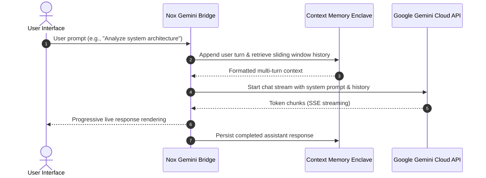

<div align="center">

# Project Nox Core: Gemini LLM Integration
### Cloud-Connected Conversational Engine & Multi-Turn Cognitive Bridge
*Milestone 2 in the Nox Intelligence Evolution (2024 - 2025)*

[](https://www.python.org/)
[](https://ai.google.dev/)
[](LICENSE)
[](https://github.com/SkMasud18)

</div>

---

## 📜 Architectural Overview

**Nox Core** represents the second major chapter in the evolution toward sovereign cognitive intelligence. Following the deterministic limitations of **[Project Jarvis](https://github.com/SkMasud18/Jarvis-Voice-Automation)**, Nox Core embraced modern Large Language Models by integrating Google's Gemini multimodal family.

This project solved the core challenge of **stateful conversational memory** and **real-time token streaming**, transforming isolated single-turn prompts into a fluid, context-aware digital companion.



---

## 🚀 Key Innovations

* **Dynamic Sliding Context Window**: Manages turn limits dynamically to avoid token truncation while maintaining long-range cognitive continuity.
* **Low-Latency Token Streaming**: Progressively renders output tokens as they arrive, eliminating cold-start perception.
* **Strict Persona & Governance**: Injected system instructions enforce concise, executive technical answers with typed code blocks.
* **Zero-Leakage Configuration**: Environment isolation ensures API keys never enter repository traces.

---

## 💻 Quick Start

### 1. Installation
```bash
git clone https://github.com/SkMasud18/Nox-Core-Gemini.git
cd Nox-Core-Gemini
pip install -r requirements.txt
```

### 2. Configure Environment
```bash
cp .env.example .env
# Edit .env and insert your Google Gemini API key:
# GEMINI_API_KEY=your_key_here
```

### 3. Run Nox Core
```bash
python main.py
```

---

## 🔄 Evolutionary Next Step: The Need for Sovereign Infrastructure

While Nox Core delivered remarkable language fluency, relying entirely on external consumer cloud APIs highlighted new engineering challenges:
1. **API Rate Limits & Latency Spikes**
2. **Third-Party Data Sovereignty Concerns**
3. **Lack of Native Sub-Second Voice (CUDA STT) and File Storage Sync**

These findings sparked the creation of **[Project 3: Nox Alpha](https://github.com/SkMasud18/Nox-Alpha-Server)** — building our own dedicated server infrastructure, CUDA Whisper pipeline, and distributed multi-tier AI router.

---

<div align="center">
  <sub>Part of the <b>Nox Intelligence</b> Evolution • Designed by <b>Sk Masud Rahaman</b></sub>
</div>
