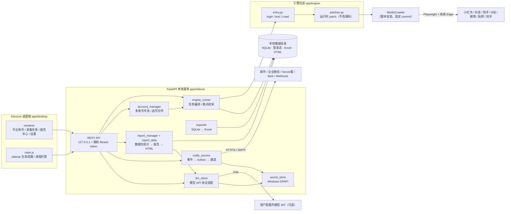

<div align="center">


# 舆见 OpinionLens

**社媒舆情采集 + AI 报告 · Windows 桌面端**

扫码登录 → 关键词采集（内容 + 评论）→ Excel 数据交付 → AI 舆情报告，一站式完成。

[](#快速开始)
[](https://github.com/SolitudeZY/OpinionLens/actions/workflows/ci.yml)
[](app/desktop/package.json)
[](app/sidecar/README.md)
[](CHANGELOG.md)
[](LICENSE)

</div>

---

## 项目定位

**舆见 OpinionLens** 是一款面向个人研究者、品牌运营与中小团队的 Windows 桌面舆情工具：
不写代码、不改配置文件，在图形界面里完成「**扫码登录 → 按关键词采集内容与评论 → 导出 Excel → 生成 AI 舆情报告**」的完整闭环。

采集层基于开源项目 [MediaCrawler](https://github.com/NanmiCoder/MediaCrawler)，通过**运行时 patch** 集成（不改上游源码），
覆盖 **7 个主流社媒平台**（平台标识：小红书、抖音、快手、B站、微博、百度贴吧、知乎）。
桌面端在采集之上补齐了登录态管理、断点续采、任务编排与实时日志、数据清洗与导出、AI 报告与版本修订、
本地模板兜底等工程化能力。

> 本项目仅用于**个人学习与研究**：请遵守各平台用户协议与 robots/频率限制，不要用于侵犯他人隐私、
> 商业数据倒卖或其他违法用途。详见 [开源协议与合规](#开源协议与合规)。

## 核心能力

### 一、多平台采集

| 能力 | 说明 |
|---|---|
| 多平台扫码登录 | 平台账号卡片一键「测试连接 / 扫码登录 / 清除登录态」；应用内显示**真实二维码** |
| 安全验证人工接管 | 平台要求短信/滑块/拼图验证时，自动弹出可见浏览器窗口，用户完成后**自动继续**，无需重复扫码 |
| 批量检测 | 「一键全部检测」并发检测 7 个平台（客户端并发上限 3），汇总已登录/未登录/失败 |
| 关键词采集 | 多关键词、多平台；默认每平台每关键词 15 条内容 + 每条内容最多 20 条评论；分平台进度 + **采集动态（实时帖子/评论内容流）**；可随时停止 |
| 断点续采 | 任务中断后可按任务续跑未完成平台，复用同一任务与原始时间窗口；内容按 ID 去重 |
| 数据清洗 | 非法控制字符清洗、防公式注入、超长文本截断；导出与预览同口径 |
| 相关性标记 | 关键词未命中内容标记 `off_brand`（只标记不删除，报告阶段可排除），提升数据质量 |

### 二、数据交付

- **Excel 导出**：`概览` + 分平台内容表/评论表，字段保留原始 `user_id` / `nickname`（可在导出后自行脱敏）；
- **导出口径**：按「本次运行实际写入/更新」统计，与界面「已采集 N 条」一致；
- **本地 SQLite**：采集数据本地落库，可被报告中心、二次分析直接复用。

### 三、AI 报告

| 能力 | 说明 |
|---|---|
| 数据包统计 | 按时间窗口从本地库生成结构化数据包（声量、平台分布、情感、热词、重点内容） |
| AI 叙述 + 本地渲染 | 数据包交给用户配置的模型 API 生成叙述，桌面端本地渲染 HTML 报告并落盘 |
| 本地模板兜底 | AI 服务未配置/未连接/失败时自动降级为本地模板报告（状态 `degraded`），**永不空手而归** |
| 版本修订 | 自然语言指令修订（v1 → v2 …），保留全部历史版本与生成方式 |
| 历史报告管理 | 报告标题、窗口、关键词、平台、版本、文件路径完整留档，一键在浏览器打开 |
| 趋势图交互 | 声量趋势支持滚轮缩放、拖动平移、双击重置；长周期自动抽稀 |

### 四、工程化能力

- **一键开发启动**：`app/scripts/dev.ps1` 拉起 Electron，Electron 自动托管 Python sidecar；
- **版本号单一来源 + 一键升版**：`app/desktop/package.json` 是唯一来源（主进程经 `FS_APP_VERSION` 注入 sidecar），
  `scripts/bump_version.ps1 -Version x.y.z` 一次同步 lock/version.py/README 徽章/CHANGELOG，自测里有「版本号一致性」断言；
- **应用内更新检查**：主进程代查 GitHub Release（`app/desktop/update.js` 负责版本比较与资产挑选，可离线单测），
  支持打开发布页或下载安装包后运行，未签名构建同样可用；
- **Windows 安装包**：electron-builder 生成 NSIS 安装包（per-user 安装、免管理员、内置便携 Python 运行时）；
- **离线自测**：engine / exporter / report / sidecar / Electron 截图多组断言，跑 `selftest.ps1` 即可回归；
- **持续集成**：GitHub Actions 在 Windows 上跑 `compileall` + JS 语法检查 + 6 个离线测试套件 + selftest（[CI 状态](https://github.com/SolitudeZY/OpinionLens/actions/workflows/ci.yml)）；
- **可观测性**：结构化事件协议、任务日志落盘、离线自测可复现；
- **兼容模式**：受限网络/远程桌面/EDR 环境拦截 Chromium 沙箱时自动降级启动。

## 设置中心（通知 / 多账号 / 模型 API）

开源版在 0.2.0 中新增「设置」页与三项能力：

| 能力 | 说明 |
|---|---|
| 通知提醒 | 采集完成/失败/部分完成、报告生成/失败/降级、账号登录失效、需要人工验证等事件触发通知；支持 **SMTP 邮件、企业微信机器人、Server酱、Bark、通用 Webhook**；outbox 落库、去重、重试退避、静默时段（默认 22:00–08:00）、隐私模式（默认最小化）、发送记录 |
| 多账号号池 | 同一平台维护多个账号，每个账号独立 Chromium profile（一进程一账号）；账号级扫码登录/检测/启停/默认/软删、健康度/冷却/日配额、选号策略（LRU / 健康度 / 轮询 / 手动）、采集失败自动切号；旧单账号数据自动兼容。**新装默认账号就是独立目录（v2）**，同平台可并存多个账号，无需任何「迁移」操作 |
| 多 LLM 模型 API | 在应用内配置 **OpenAI 兼容（含 DeepSeek/Ollama/vLLM/中转站）、DeepSeek、Anthropic** 等模型 API，用于 AI 报告叙述；可多套配置、指定默认、测试连接；API Key 使用 Windows DPAPI 加密，界面只显示脱敏值 |
| 软件更新 | 「设置 → 关于 → 软件更新」里**检查更新**：对比 GitHub Release 的 tag 与本地版本，显示新版本说明，可**打开发布页**或**直接下载安装包（带进度）并运行**；匿名 API 限流时自动退回解析跳转地址 |
| 数据目录可迁移 | 「设置 → 关于 → 数据存储」里**更改数据目录**：把 SQLite/导出/报告/登录态整体搬到其他盘（旧目录保留），解决「C 盘被采集数据占满」；也可一键恢复默认目录 |
| 通用设置 | 数据目录、模型、通知、账号池策略集中管理；未配置模型时报告自动回退本地模板 |

> 实现位于 `app/sidecar/`（`notify_service.py`、`notify_channels.py`、`llm_client.py`、`account_manager.py`、
> `api_*.py`、`secret_store.py`、`state.py`）与 `app/desktop/renderer/settings.js`；接口契约见 `app/CONTRACT.md` §7。

### 界面截图

| 模型 API 设置 | 通知推送设置 |
|---|---|
|  |  |

| 多账号号池 | 任务账号策略 |
|---|---|
|  |  |

| 真实应用 · 平台账号（真实 sidecar） | 真实应用 · 设置（真实 sidecar） |
|---|---|
|  |  |

| 真实应用 · 通知推送 | 真实应用 · 账号池 |
|---|---|
|  |  |

> 前两行为本地预览模式联调截图（数据均模拟）；后两行为 Electron 真实应用 + 本地 sidecar 截图
> （使用本机既有测试数据）。截图不含真实账号、Cookie 与密钥。

## 系统架构



**技术要点**

- **引擎零侵入**：系统 Edge 通道、二维码事件、数据不脱敏、平台适配全部在 `app/engine/patches.py` 运行时注入，
  升级上游无需改源码；
- **进程安全**：sidecar 只绑 `127.0.0.1`，每次启动随机端口 + 随机 token，token 不出 Electron 主进程；
- **降级设计**：AI 报告不可用时自动走本地模板；采集单平台失败不影响其他平台；
- **可恢复**：任务中断可续采，报告中断标记失败但历史版本仍可打开。

## 项目结构

```text
.
├─ app/                      # 桌面端产品主体
│  ├─ desktop/               #   Electron 壳：main / preload / renderer（界面）+ 打包配置
│  ├─ sidecar/               #   FastAPI 本地服务：API、任务编排、导出、报告、通知、模型接入
│  ├─ engine/                #   MediaCrawler 包装：事件协议、运行时 patch
│  ├─ report_pipeline/       #   报告统计与 HTML 模板管线（数据包统计 / 本地模板渲染）
│  ├─ scripts/               #   dev / selftest / build_installer / build_pack_resources
│  ├─ CONTRACT.md            #   开发契约（事件 / API / 字段）
│  └─ README.md              #   应用级使用与接口说明
├─ tests/                    # 测试/替身/工具脚本（不进安装包）
│  ├─ python/                #   8 个离线测试 + sidecar 全链路 selftest.py
│  ├─ fixtures/              #   _fake_engine / _fake_exporter / _fake_llm_server 等替身
│  ├─ tools/                 #   真实网络探针（_real_login_check / probe_platform_qr / diagnose_ks_*）
│  └─ js/                    #   test_update_logic.js（更新逻辑单测）
├─ docs/                     # 构建/命令文档 + 界面截图 + 品牌资源
├─ scripts/
│  └─ setup_mediacrawler.ps1 #   克隆并安装固定 commit 的采集引擎
├─ .github/workflows/ci.yml  #   GitHub Actions 离线 CI（compileall / JS 语法 / 测试套件 / selftest）
├─ requirements-dev.txt      #   离线测试与 CI 的 Python 依赖
├─ THIRD_PARTY_NOTICES.md    # 第三方组件与许可证说明
├─ CHANGELOG.md              # 版本变更记录
├─ AGENTS.md                 # 仓库级 AI Agent 协作约定
└─ LICENSE                   # MIT
```

> 仓库**不包含**：MediaCrawler 源码（由脚本安装）、运行期数据（登录态/数据库/导出/日志）、真实采集样例、
> 依赖与构建产物。

## 快速开始

**前置要求（Windows 10/11）**

| 依赖 | 版本 | 说明 |
|---|---|---|
| Node.js | 20+ | 安装 Electron 依赖 |
| [uv](https://docs.astral.sh/uv/) | 最新 | 安装采集引擎的 Python 环境（自动准备 Python 3.11+） |
| Git | 任意 | 克隆采集引擎 |
| Edge / Chrome | 系统自带 | Playwright 复用系统浏览器，**无需**下载 Chromium |

```powershell
# 1. 获取代码
git clone https://github.com/SolitudeZY/OpinionLens.git
cd OpinionLens

# 2. 安装采集引擎（克隆 MediaCrawler 固定 commit 到 .\MediaCrawler 并 uv sync）
.\scripts\setup_mediacrawler.ps1

# 3. 安装界面依赖
cd app\desktop
npm install
cd ..\..

# 4. 启动（Electron 自动拉起 Python sidecar）
.\app\scripts\dev.ps1
```

启动后窗口右上角出现「服务在线」即就绪（首次启动 sidecar 约 2–4 秒）。
AI 报告为可选能力：未配置模型/AI 服务时报告自动使用本地模板生成（状态 `degraded`）。

> **采集引擎装在哪：仓库根目录的 `MediaCrawler\`，名字和位置都不能改。**
> `app/scripts/dev.ps1`、`app/scripts/run_sidecar.ps1`、`app/desktop/main.js` 三处硬编码了
> `MediaCrawler\.venv\Scripts\python.exe`——**这个 venv 同时是 sidecar 的 Python 运行时**，
> 装到别处、改目录名、或在别的环境单独 `pip install` 都跑不通（可用 `MC_PYTHON` / `MC_ROOT`
> 环境变量覆盖，但默认路径必须存在）。仓库不随附其源码（非商业学习许可）。

### 安装三个已知坑（实测）

| 现象 | 原因 | 处理 |
|---|---|---|
| `setup_mediacrawler.ps1` 报 `uv sync 失败`，日志含 `403 Forbidden`（`pygments` / `fonttools` 等） | 上游 `pyproject.toml` 把默认索引钉成清华源，部分 wheel 返回 403 | 脚本已自动切换备用索引重试；仍失败时手动 `cd MediaCrawler; uv sync --default-index https://mirrors.aliyun.com/pypi/simple` |
| `npm install` 成功，但启动报 `Electron failed to install correctly` | Electron 本体（`node_modules\electron\dist\electron.exe`）未随 postinstall 下载 | `cd app\desktop; $env:ELECTRON_MIRROR='https://npmmirror.com/mirrors/electron/'; node .\node_modules\electron\install.js` |
| 窗口一闪而过 | 多为**已有实例在跑**（Electron 单实例锁），或 sidecar 起不来 | 先 `Get-Process electron,OpinionLens \| Stop-Process -Force`；再看 `app\data\logs\main.log` 与 `sidecar.log` |

完整的手把手步骤（每步验证命令、selftest 已知差异、排查清单）见
[`docs/安装与启动_从零开始.md`](docs/安装与启动_从零开始.md)。

### 常用命令

```powershell
# 离线自测（不联网）
.\app\scripts\selftest.ps1

# 只启动本地 sidecar（调试，固定 token）
.\app\scripts\run_sidecar.ps1

# 仅打开界面（不启动 sidecar，调试 UI）
cd app\desktop; npm run start:no-sidecar

# 生成安装包资源 + 打包 NSIS 安装包（输出到 build\installer\output）
.\app\scripts\build_pack_resources.ps1
.\app\scripts\build_installer.ps1 -SkipResources
```

产物：`build\installer\output\OpinionLens-Setup-<version>.exe`（per-user 安装、免管理员、内置 Python 运行时）。
更完整的命令与验证清单见 [`docs/常用命令_构建运行自测.md`](docs/常用命令_构建运行自测.md)、
[`docs/打包与安装包_构建说明.md`](docs/打包与安装包_构建说明.md)。

## 数据与隐私

- **本地优先**：采集数据、登录态（浏览器 profile）、导出 Excel、报告 HTML 与日志均保存在本机，
  不上传云端；AI 报告只发送**统计后的数据包**，不发原始账号信息。
- **数据目录**：
  - 开发/源码运行：`app/data/`（登录态、`media_crawler.db`、`exports/`、`reports/`、`logs/`）；
  - 安装版：`%APPDATA%\OpinionLens\`（与安装路径无关，卸载默认保留）。
- **密钥保护**：通知通道密钥与模型 API Key 计划使用 **Windows DPAPI** 加密后落库
  （绑定「当前 Windows 用户 + 本机」，换用户/换机需重新填写；明文不写日志、不回显）。
- **通知最小化**：通知内容只包含事件摘要与必要统计（不含平台账号密码、Cookie 与模型 API Key）；
  通知默认关闭，需用户显式配置通道并开启。
- **本地优先**：数据默认全部保存在本机数据目录；除用户主动配置的通知通道与用户自行接入的模型 API 外，不上传任何数据。
- **数据用途自负**：导出数据可能包含平台用户昵称/ID 等个人信息，请按所在地法律法规自行脱敏与合规使用。

## 开源协议与合规

- **本仓库代码**：MIT License，见 [`LICENSE`](LICENSE)；Copyright (c) 2026 OpinionLens Contributors。
- **采集引擎 MediaCrawler**：采用**非商业学习许可**（Non-Commercial Learning License）。
  **本仓库不随附其源码**，由用户通过 `scripts/setup_mediacrawler.ps1` 从上游仓库自行获取；
  本项目仅将其作为学习研究用途的运行时依赖。**不得**将本工具及其采集结果用于商业售卖、
  数据倒卖或违反平台规则的用途；如需商业使用，请自行联系上游作者取得授权或替换为合规采集层。
- **平台合规**：仅采集公开内容；请遵守各平台用户协议、robots/频率限制与所在地法律法规
  （包括但不限于个人信息保护、数据安全相关法规）。因使用本工具产生的合规责任由使用者承担。
- **第三方名称与商标**：README 与界面中出现的平台名称（小红书、抖音、快手、B站、微博、百度贴吧、知乎等）
  **仅用于说明本工具支持采集哪些站点**，属事实性指称；**不代表与上述平台存在任何隶属、合作、授权、
  认证或背书关系**，相关商标、标识与内容版权归各自所有者。本项目不使用任何平台的官方 Logo 作为标识，
  也不以平台名义分发或推广。
- **不做的事**：本项目不提供绕过登录/验证码/风控的能力，不提供平台数据的批量转卖或代采服务；
  如平台侧要求停止使用，请立即停止并删除本地数据。
- **第三方组件**：Electron、FastAPI、uvicorn、Playwright 等组件的许可证与声明见
  [`THIRD_PARTY_NOTICES.md`](THIRD_PARTY_NOTICES.md)。

## 支持这个项目

如果它帮你省了时间，可以请我喝杯咖啡 —— **完全自愿，不影响任何功能，也不提供额外权益**。

<p align="center">
  
</p>

<p align="center"><sub>微信扫码即可 · 赞赏仅用于补贴开发与测试时间</sub></p>

> 本项目以 **MIT** 协议开源，采集能力来自 [MediaCrawler](https://github.com/NanmiCoder/MediaCrawler)（非商业学习许可）。
> **不做付费版本、不接商业采集订单、不投放广告**；代码可自由使用与修改，赞赏与任何功能、授权、技术支持均不挂钩。

## 友链

<a href="https://linux.do"></a>

- **[linux.do](https://linux.do)** —— 中文技术社区。本项目的发布信息与使用讨论主要在这里，欢迎佬友交流与反馈。

## 贡献

欢迎 issue / PR：

1. 先开 issue 描述问题或方案，避免大改方向不一致；
2. 不提交任何真实平台账号、Cookie、API Key、采集数据与带个人信息的截图；
3. 改动后至少跑通 `.\app\scripts\selftest.ps1`（离线）；涉及打包的改动请附构建结果；
4. 遵循 [`AGENTS.md`](AGENTS.md) 中的协作约定（图片相对路径、产物不入库等）。

## 文档索引

| 文档 | 内容 |
|---|---|
| [`app/README.md`](app/README.md) | 应用级使用说明：启动、登录矩阵、采集稳定性、报告中心 API、FAQ |
| [`app/CONTRACT.md`](app/CONTRACT.md) | 开发契约：Engine 事件协议、Sidecar API、Exporter 契约 |
| [`app/sidecar/README.md`](app/sidecar/README.md) | 本地服务（FastAPI）接口、环境变量、自测 |
| [`docs/常用命令_构建运行自测.md`](docs/常用命令_构建运行自测.md) | 开发、自测、构建常用命令清单 |
| [`docs/安装与启动_从零开始.md`](docs/安装与启动_从零开始.md) | 从零安装到「服务在线」的手把手步骤、已知坑与排查 |
| [`docs/发布与自动更新.md`](docs/发布与自动更新.md) | 版本号怎么升（`bump_version.ps1`）、发版流程、应用内检查更新与数据目录迁移的机制 |
| [`docs/打包与安装包_构建说明.md`](docs/打包与安装包_构建说明.md) | 安装包产物、构建步骤、验证清单与已知限制 |
| [`CHANGELOG.md`](CHANGELOG.md) | 版本变更记录 |
| [`THIRD_PARTY_NOTICES.md`](THIRD_PARTY_NOTICES.md) | 第三方组件与许可证 |

## FAQ

**Q：为什么仓库里没有 `MediaCrawler/` 目录？**
A：MediaCrawler 为第三方开源项目（非商业学习许可），本仓库不随附其源码。运行 `scripts/setup_mediacrawler.ps1`
会**克隆固定 commit 到仓库根目录的 `MediaCrawler\`** 并执行 `uv sync` 生成 `.venv`；该路径被启动脚本与主进程
硬编码引用（同时是 sidecar 的 Python 运行时），因此**不能改名或挪位置**。升级/重装按脚本提示操作
（重装前先删除该目录，注意其中可能有登录态）。

**Q：AI 报告需要什么？需要付费吗？**
A：报告统计与本地模板渲染完全离线可用，不需要任何外部服务。若需要 AI 叙述，可在「设置 → 模型 API」
配置自己的模型服务（OpenAI 兼容 / DeepSeek / Anthropic），费用由所接入模型服务商收取；未配置或模型
调用失败时自动回退本地模板。

**Q：扫码登录失败/需要短信验证怎么办？**
A：平台风控要求时会自动弹出可见 Edge 窗口，请在窗口中完成短信/滑块/拼图验证，App 会自动继续；
反复失败时先「清除登录态」再重试。平台风控策略变化可能导致某平台暂时不可用。

**Q：数据保存在哪里？会不会上传？**
A：全部保存在本机（源码运行为 `app/data/`，安装版为 `%APPDATA%\OpinionLens\`）。除 AI 报告所需的统计
数据包与用户主动配置的通知通道外，不上传任何数据。**不想放 C 盘**：设置 → 关于 → 数据存储 →「更改数据目录…」，
应用会停服务、整目录复制到新位置（旧目录保留）并自动重启，配置记在 `%APPDATA%\OpinionLens\user-config.json`。

**Q：怎么更新到新版本？版本号是怎么定的？**
A：设置 → 关于 → 软件更新 →「检查更新」，对比的是 GitHub Release 的 tag 与本地 `package.json` 的 version：
有新版本可就地下载安装包（带进度）或打开发布页手动下载。发布侧用 `scripts/bump_version.ps1 -Version x.y.z`
一次改全版本号，再打 `v<version>` tag 发 Release；完整流程见 [`docs/发布与自动更新.md`](docs/发布与自动更新.md)。

**Q：支持 macOS / Linux 吗？**
A：暂不支持。当前仅面向 Windows 10/11（依赖系统 Edge 与 Windows 打包链路）。

**Q：安装包提示 SmartScreen / 未签名？**
A：当前版本未做代码签名，属预期拦截；可自行构建安装包或选择「更多信息 → 仍要运行」。

**Q：可以商用吗？**
A：本仓库代码为 MIT，但采集依赖 MediaCrawler 为非商业学习许可，且采集行为需遵守平台协议与法律法规；
请勿将本工具直接用于商业数据服务。详见 [开源协议与合规](#开源协议与合规)。
