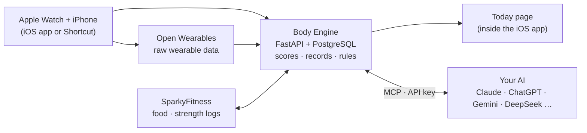

<!-- The full repository address appears only in the stars badge and the clone command (the privacy scan allows it in
     the two READMEs only: tools/export_public.py PRIVATE_WORD_ALLOW). Other links to releases / issues / actions are
     relative (../../…) on purpose: GitHub resolves them to this repository, also in forks. -->
<h1 align="center">Watch2Whoop</h1>

<p align="center">
  <b>WHOOP-style recovery, strain and sleep analysis from the Apple Watch you already wear.</b><br>
  No subscription, no extra band. Your data lives on your own server, and any AI can read and write it through MCP.
</p>

<p align="center">
  <a href="../../actions/workflows/ci.yml"></a>
  <a href="https://github.com/SongyuQi-Francisco/Watch2Whoop/stargazers"></a>
  <a href="LICENSE"></a>
  <a href="../../releases"></a>
  <a href="#ai-and-mcp"></a>
  <a href="apps/watch2whoop/README.md"></a>
</p>

<p align="center">
  <a href="#quick-start"><b>Quick Start</b></a> ·
  <a href="docs/README.md">Docs</a> ·
  <a href="docs/tester-handbook.en.md">User handbook</a> ·
  <a href="#roadmap">Roadmap</a> ·
  <a href="../../releases">Releases</a> ·
  <a href="apps/watch2whoop/CHANGELOG.md">Changelog</a> ·
  <a href="CONTRIBUTING.md">Contributing</a> ·
  <a href="README.zh-CN.md">简体中文</a>
</p>

<p align="center"></p>

> [!IMPORTANT]
> Not affiliated with WHOOP, Inc. or Apple Inc.; their names are trademarks, used only to say what this works with or resembles.
> Not a medical device and not medical advice. Status: **alpha**, Apple Watch first. All screenshots use synthetic data.

## Why
Your Apple Watch already records heart rate, HRV, sleep stages, SpO₂ and workouts, but turns little of it into daily
guidance. Subscription bands do, but the analysis stays in their app. Watch2Whoop is the missing part, and it is yours:

- **WHOOP-style numbers from raw watch data** — recovery, strain, sleep need and debt, stress, body age, each against
  your own baseline. Formulas are built from published research literature, and every parameter is documented.
- **Any AI, through MCP** — Claude, ChatGPT / Codex, Gemini, DeepSeek, a local Ollama … connect over MCP or an API key.
  Tools, memory and history live in your database, so switching models loses nothing.
- **No forms** — you log food, workouts, weight, labs or how you slept by telling your AI, in text, a photo or by voice.
- **Self-hosted and multi-user** — one server for your family, an account per person, sharing only when someone opts in.

## Quick Start
Try it in about 5 minutes with **60 days of synthetic data**, no watch or account needed. You need Docker (Compose v2)
and `python3` ≥ 3.9.

```bash
git clone https://github.com/SongyuQi-Francisco/Watch2Whoop.git
cd Watch2Whoop
./quickstart.sh                                         # prints a login link for the Today page
```

It starts Body Engine, Open Wearables and SparkyFitness on `127.0.0.1`, imports the synthetic data through the real Apple
Health importer and computes every score. Ports, options and `status / logs / down / reset`: [quickstart/README.md](quickstart/README.md).
There is no hosted demo.

## Features
| | |
|---|---|
| **Recovery** | Daily 0–100 score from overnight HRV, sleeping heart rate, sleep performance and respiratory rate vs. your 60-day baseline; illness flags |
| **Strain** | Day strain 0–21 (Edwards TRIMP from raw heart rate), training load (CTL / ATL / TSB) and a daily target from the Strain Coach |
| **Sleep** | Sleep score, stages, need and debt, consistency, efficiency; a Sleep Coach and a gradual bedtime-goal planner |
| **Health monitor & stress** | Resting HR, HRV, respiratory rate, SpO₂ and wrist temperature vs. your normal range; daytime stress score |
| **Body age** | Body age and pace of aging from 8 markers (steps, active minutes, strength training, VO₂max, resting HR, body composition, sleep duration and regularity) |
| **Training** | Calendar that merges watch workouts (HR zones, calories) with strength sets; exercise library, 3 / 4 / 5-day splits and weekly plans adjusted by recovery; muscle-load map |
| **Nutrition & records** | Meal templates, recipes with per-serving nutrition, lab results with reference ranges and trends, supplements, symptoms, a behaviour journal with next-day impact |
| **Reports** | Weekly and monthly reports; rule-based reminders (load progression, calorie adjustment from the weight trend, pre-workout fueling) |
| **Family** | Accounts per person, per-user tokens, opt-in sharing, friend circles |

How every score is computed, with references and known limits: [scoring methodology](packages/openbodyscore/METHODOLOGY.md).
The scoring code is also split out as a standalone library, [`packages/openbodyscore`](packages/openbodyscore/README.md) (Apache-2.0).
The UI is in Chinese and English. Newer features ship behind feature flags that are off on a fresh install
(`body-engine flags list`, see [docs/rollout.md](docs/rollout.md)).

<p align="center">
  
  &nbsp;
  
</p>

## AI and MCP
Watch2Whoop is a **data layer for your AI**, not another chatbot. The AI is swappable; the data stays.

- **Remote MCP** at `/mcp` (Streamable HTTP, a per-user AI token) for Claude, ChatGPT / Codex, Gemini / Antigravity and any
  other MCP client, plus a **stdio** MCP server for local use. Setup commands: [body_engine/README.md](body_engine/README.md).
- **100+ tools** to read scores, sleep, training, nutrition, labs and memory, and to log food, workouts, weight and more.
  Every tool call is authorized per user and audited. A compact `get_briefing` (~1.5k tokens) opens each conversation.
- **Prompts** for common jobs: `butler` (the coach persona), `weekly_review`, `plan_training_week`, `plan_shopping`, `log_meal_from_photo`.
- **In-app chat with your own API key**: Anthropic, OpenAI, Gemini or any OpenAI-compatible endpoint (DeepSeek, Qwen,
  Ollama). Keys are encrypted per user; deletes ask first; photos, video and push-to-talk (speech recognition runs on your server).
- **Long-term memory** in your own database: profile, observations, a status card the AI keeps up to date.

<p align="center"></p>

## Getting your data in
| Source | How |
|---|---|
| **iOS app** | Background HealthKit sync from iPhone + Apple Watch, with the Today page inside the app ([apps/watch2whoop](apps/watch2whoop/README.md), Flutter). Build it yourself; a TestFlight beta runs for invited testers |
| **Apple Health export** | Upload `export.zip` from the Health app in the app (chunked, resumable) to import years of history; admins can also run `body-engine import-apple-zip` |
| **Hevy** | Upload Hevy's workout CSV export; exercise names are matched to the exercise library and muscle load is recomputed |
| **iOS Shortcut** | No app needed: a Shortcut uploads Health samples on a schedule ([shortcuts/](shortcuts/README.md), format spec [docs/shortcut-sync-spec.md](docs/shortcut-sync-spec.md)) |
| **Your AI** | Everything you tell it: meals, workouts, weight, labs, supplements, symptoms, journal |

## How it works

Built on open source: [Open Wearables](https://github.com/the-momentum/open-wearables) for wearable sync,
[SparkyFitness](https://github.com/CodeWithCJ/SparkyFitness) (run unmodified as a separate service) for food and
strength logs, PostgreSQL, FastAPI, Flutter, and optionally [Grafana](https://github.com/grafana/grafana).
Services bind to `127.0.0.1` and are reached through Tailscale by default.

**Self-hosting** on a Mac mini or a Linux VPS: [docs/README.md#self-hosting](docs/README.md#self-hosting) · Admin guide (Chinese): [docs/admin-guide.md](docs/admin-guide.md)

## Roadmap
Planned work and discussions live in [issues](../../issues); app builds and notes in [releases](../../releases) and the [app changelog](apps/watch2whoop/CHANGELOG.md).

- [x] Apple Watch: recovery, strain, sleep, body age, stress, coaches, reports
- [x] One-command local Quick Start with synthetic data
- [x] Remote MCP + API-key chat for any AI, per-user AI isolation
- [x] Training module v2: exercise library, splits, weekly plans, recovery-based adjustments ([design](docs/training-v2-plan.md))
- [x] Hevy CSV import, Apple Health history import
- [x] Self-service sign-up with invite codes ([design](docs/self-signup-plan.md))
- [x] Chinese and English UI (remaining gaps: [#64](../../issues/64))
- [ ] *In progress*: friends page and circles ([design](docs/friends-social-plan.md))
- [ ] *In progress*: own Apple Health sync engine to replace Open Wearables on iOS ([#219](../../issues/219))
- [ ] RMSSD-based recovery ([#117](../../issues/117))
- [ ] Publish the scoring library `openbodyscore`
- [ ] One-command Linux VPS installer
- [ ] **Other watches**: Garmin, Oura, Polar, Android Health Connect … (help wanted)

## Contributing
Contributions are welcome. Every change is a pull request from your own branch or fork; CI must pass and a maintainer
reviews. Read [CONTRIBUTING.md](CONTRIBUTING.md) first (new UI text is always bilingual, Chinese + English).

Good places to start:
- **Bring your watch** — Garmin, Oura, Polar or Health Connect data into the same scores ([roadmap](#roadmap)).
- **Scoring** — review the [methodology](packages/openbodyscore/METHODOLOGY.md) and the [validation plan](docs/scoring-validation.md).
- **Docs** — most design documents in [`docs/`](docs/README.md) are Chinese; English versions help a lot.
- Issues labelled [`good first issue`](../../issues?q=is%3Aopen+label%3A%22good+first+issue%22) and [`help wanted`](../../issues?q=is%3Aopen+label%3A%22help+wanted%22).

Try changes locally with `./quickstart.sh`; tests: `cd body_engine && uv run pytest`, `cd apps/watch2whoop && flutter test`.

## Repository
| Path | What |
|---|---|
| [`body_engine/`](body_engine/README.md) | Server: scores, records, rules, AI tools, MCP, Today page |
| [`apps/watch2whoop/`](apps/watch2whoop/README.md) | iOS app (Flutter) |
| [`packages/openbodyscore/`](packages/openbodyscore/README.md) | Standalone scoring library |
| [`shortcuts/`](shortcuts/README.md) | iOS Shortcut sync (no app needed) |
| [`quickstart/`](quickstart/README.md) | One-command local demo |
| `deploy/`, `assistant/` | Deployment, ops, AI coach workspace |
| [`docs/`](docs/README.md) | Design documents (mostly Chinese) |

## License
| Part | Licence |
|---|---|
| Server and everything else | [AGPL-3.0](LICENSE) |
| iOS app `apps/watch2whoop/` | [MIT](apps/watch2whoop/LICENSE) |
| iOS Shortcut `shortcuts/` | [MIT](shortcuts/LICENSE) |
| Scoring library `packages/openbodyscore/` | [Apache-2.0](packages/openbodyscore/LICENSE) |

Third-party services (Open Wearables, SparkyFitness, Grafana) keep their own licences: [docs/LICENSES.md](docs/LICENSES.md).

Watch2Whoop is not affiliated with, endorsed by or connected to WHOOP, Inc. or Apple Inc. "WHOOP-style" only describes
the kind of analysis; the scores are independent implementations. The numbers are for personal insight and do not
constitute medical advice, diagnosis or treatment.
