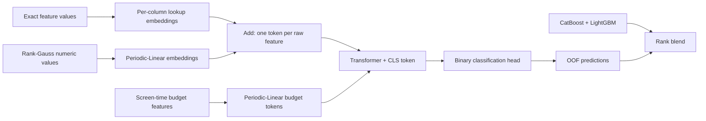

# Lookup-Transformer
### Exact-value embeddings meet dataset-driven feature engineering

**My Kaggle S6E8 solution achieved a public leaderboard ROC AUC of 0.97041. I designed its Lookup-Transformer architecture, which was also adopted in a 14th-place solution.**

[](https://www.kaggle.com/code/tamerlanomralinov/s6e8-lookup-transformer-insights-lb-0-97041)
[](#results)
[](#community-recognition)
[](docs/community-recognition.md)
[](https://github.com/Spydonny/s6e8-lookup-transformer/actions/workflows/validate.yml)

I developed Lookup-Transformer for [Predicting Smartphone Addiction — Kaggle Playground S6E8](https://www.kaggle.com/competitions/playground-series-s6e8). I started by investigating the dataset's structure, identified repeated exact-value signal and a screen-time budget constraint, and designed an architecture around those findings.

[Explore the notebook](notebooks/lookup_transformer.ipynb) · [Read the recognition record](docs/community-recognition.md) · [Reproduce the pipeline](docs/reproducibility.md)

## Community recognition

My work is referenced across **11 verified Kaggle pages**, covering architecture reuse, independent feature measurements, prediction reuse, and analytical citations. Other competitors built on my findings, retrained my architecture, and measured its contribution to their ensembles.

- **Adopted in the 14th-place solution.** Taemyung Heo credits my notebook as the basis for his four strongest own members. His write-up also identifies derivatives of my architecture in the shared libraries of @szymonkapiski and @paiky1995. [Read the write-up](https://www.kaggle.com/competitions/playground-series-s6e8/writeups/14th-place-278-shared-oof-sets-36-own-models).
- **Largest single gain in a public OOF blend.** Szymon Kłapiński retrains my architecture on his own folds and reports **+0.000109 OOF AUC** added to his blend, explicitly crediting my work. [Read the notebook](https://www.kaggle.com/code/szymonkapiski/s6e8-honest-oof-blend).
- **Measured in a controlled ensemble study.** Praneeth Paikray ports and retrains my architecture, reporting **+0.000577 OOF AUC** over his XGBoost + LightGBM blend, about **44×** the contribution of his encoded-MLP control. [Read the study](https://www.kaggle.com/code/paiky1995/s6e8-correlation-does-not-predict-contribution).
- **Independently reproduced across four model families.** YKuma reports improvements from my budget features in LightGBM, XGBoost, CatBoost, and an embedding neural network. Rebuilding his neural model following my notebook improved its OOF AUC from 0.96607 to 0.96719; it then received the largest weight in his blend. [Read the discussion](https://www.kaggle.com/competitions/playground-series-s6e8/discussion/735861#3514347).
- **Features independently validated on five folds.** Georgy Mamarin credits my `slack` and observed-component count features and reports **+0.00071 OOF AUC** in LightGBM, with a positive effect on all five folds. [Read the measurement](https://www.kaggle.com/competitions/playground-series-s6e8/discussion/733730#3510375).
- **Cited in follow-up research.** kito_pl credits my per-value residual analysis when studying how exact-value encoding interacts with LightGBM binning. [Read the analysis](https://www.kaggle.com/competitions/playground-series-s6e8/discussion/737422).

I've collected the links and measurements in the [full recognition record](docs/community-recognition.md), including Omid's credited fork (**private leaderboard AUC 0.97003**), direct reuse of my predictions, acknowledgment in a public stack, an ensemble input, and a Japanese analytical citation.

## The two findings

### 1. Exact values carry signal beyond their magnitude

I found that a feature can have almost no monotone predictive power and still contain a reproducible lookup pattern. For `notifications_per_day`, I measured univariate AUC **0.492**, while its per-value residual means correlated at approximately **0.72** across independent held-out subsets.

I interpreted this pattern as the synthetic generator retaining value-to-label associations. To capture it, I gave each column **a learned embedding table over its exact values**, combined with a smooth numeric branch.

### 2. Screen time has a budget structure

My screen-time diagnostic found the following relation in **859,029 train + test rows**, with **546 rows on the boundary**:

```text
daily_screen_time_hours ≥ social_media_hours + gaming_hours + work_study_hours
```

I turned the remainder into `other_screen` and added totals and fractions as explicit feature tokens. These features give both my neural network and its tree companions direct access to the screen-time budget structure.

## Architecture

I combine exact-value lookup embeddings with Periodic-Linear numeric embeddings, then use attention to model interactions between raw features and the derived budget tokens.



- **Lookup + smooth encoding:** exact-value embeddings plus learned Fourier numeric embeddings.
- **Learned missingness:** a dedicated missing-value embedding per raw column; missing numerics suppress the smooth branch.
- **Interactions:** four Transformer layers, width 128, eight heads, and a CLS readout.
- **Training:** AdamW, stronger embedding weight decay, OneCycle scheduling, EMA weights, and random value masking.
- **Ensembling:** optional CatBoost and LightGBM companions, inner-fold target encoding for LightGBM, and rank blending.

## Results

**My Kaggle solution achieved 0.97041 ROC AUC on the public leaderboard.**

I evaluated the individual models using out-of-fold predictions and combined the Lookup-Transformer with CatBoost and LightGBM in a rank blend:

| Model | OOF ROC AUC |
| :--- | ---: |
| Raw LightGBM reference (3 folds) | 0.96432 |
| LightGBM + value-level target encoding + constraint | 0.96824 |
| CatBoost + constraint | 0.96832 |
| **Lookup-Transformer** | **0.96872** |
| **Three-model blend** | **0.96940** |

Lookup-Transformer was my strongest individual model in this comparison. Combining it with the tree models raised OOF AUC to **0.96940**. Its complementary predictions made it valuable in my blend and in other competitors' ensembles.

## Run it

### On Kaggle

Open [my Kaggle notebook](https://www.kaggle.com/code/tamerlanomralinov/s6e8-lookup-transformer-insights-lb-0-97041), attach the competition data, enable a GPU, and run all cells.

### Locally

Use Python 3.10 or 3.11. A CUDA GPU is recommended for the full run.

```bash
git clone https://github.com/Spydonny/s6e8-lookup-transformer.git
cd s6e8-lookup-transformer
python -m venv .venv
# Activate the environment, then:
python -m pip install -r requirements.txt
kaggle competitions download -c playground-series-s6e8 -p data
# Extract the downloaded archive into data/.
python scripts/train.py --data-dir data --output-dir outputs --quick --no-gbdt
```

The download command requires the separately installed Kaggle CLI, authentication, and acceptance of the competition rules. Remove `--quick --no-gbdt` for the full pipeline. Use `--folds 10` for a ten-fold run and `--proof` to reproduce my residual diagnostic. The repository edition also supports CPU execution; I recommend a GPU for training.

Each model writes OOF predictions, test predictions, and its own submission; the final blend writes `submission.csv`. See [all run controls and outputs](docs/reproducibility.md).

## Repository

| Path | Purpose |
| :--- | :--- |
| `notebooks/original_kaggle_v4.ipynb` | Unmodified source exported from Kaggle version 4 |
| `notebooks/lookup_transformer.ipynb` | Repository edition with configurable paths and CPU-safe autocast |
| `src/lookup_transformer.py` | Reusable neural architecture |
| `scripts/train.py` | Command-line runner for the repository notebook |
| `docs/community-recognition.md` | Linked evidence of citations and downstream adoption |
| `docs/reproducibility.md` | Configuration, validation scope, and provenance |

## Author and citation

**Tamerlan Omralinov** · [Kaggle](https://www.kaggle.com/tamerlanomralinov) · [GitHub](https://github.com/Spydonny)

If you build on my architecture, diagnostics, or budget features, please cite [my Kaggle notebook](https://www.kaggle.com/code/tamerlanomralinov/s6e8-lookup-transformer-insights-lb-0-97041) and this repository. GitHub's **Cite this repository** menu provides citation metadata.

Code is released under the [MIT License](LICENSE). Competition data and linked third-party work retain their own terms.
