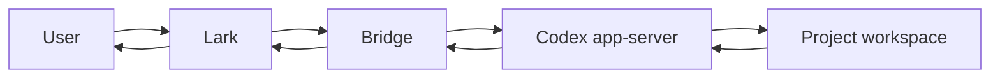

<!-- docmeta
role: entry
layer: 1
parent: null
children:
  - README.zh-CN.md
summary: English product and installation entry point
read_when:
  - first entry into the repository
  - choosing an authorized installation or update path
source_of_truth:
  - README.md
  - README.zh-CN.md
  - docs/INDEX.md
  - AGENTS.md
-->

English | [简体中文](README.zh-CN.md)

# Codex CLI Bridge for Lark (Feishu)

Codex CLI Bridge for Lark (Feishu) brings core Codex CLI workflows into Lark. Designed for always-on self-hosted deployment on cloud servers and VPS environments, it lets you start and continue tasks, follow live progress, respond to prompts and approvals, interrupt runs, and receive final results through native Lark messages and interactive cards. Local-host deployment is also supported.

## Why this project exists

Codex CLI is most useful on a stable cloud server, VPS, or development host that keeps project tools and credentials available. Its user is not always at that host: a question may arrive during a commute, a test may need one more constraint, or a long answer may be easier to read in chat than in a terminal.

SSH, remote desktop, and terminal multiplexers help in emergencies, but they make frequent small decisions cumbersome. Forwarding chat messages into a terminal only moves text. It cannot reliably identify the active task, attach clarification to the right running turn, present a scoped approval, or recover delivery after a restart.

Moving an entire workbench into chat causes the opposite problem. Per-task dashboards, repeated progress messages, and permanent old state make a conversation unreadable. Users need a place to ask for work and receive an answer, not a control room in every direct message.

Codex CLI Bridge for Lark (Feishu) is neither a terminal copied into Lark nor a replacement for Codex. It is a lightweight, state-aware, recoverable native interaction layer between Codex CLI/app-server and Lark. It lets a normally remote task remain reachable without turning ordinary chat into a workbench.

## Product design: chat first, controls when needed

The default experience is plain: send a request, add context, and receive a response. Rich cards appear only where visible structure makes an action safer or clearer.

While a task runs, a new message uses Codex's `turn/steer` semantics to reach that task, without creating a competing task or guessing the relationship from message text.

Status, settings, approvals, and interruption use native cards and callbacks. Where possible, a card updates in place instead of adding success receipts or replacements.

`/new` creates a clean session when context is too long or work needs separation; advanced history and session controls are not the center of ordinary chat.

Lightweight is a choice about what appears by default. The service retains coordination and recovery boundaries for richer controls without making them permanent clutter.

## Why Lark should not become the entire Agent workbench

This engineering decision follows platform boundaries, not a claim that Lark is slow or unsuitable for development. Messages are not a transparent host file system: before a bot sends an image, audio item, video, or file, it uploads it and uses the returned resource key. Message-file uploads are limited to 30 MB, images to 10 MB; media adds format, encoding, or resolution constraints. Text bodies are limited to 150 KB, cards and rich-text messages to 30 KB.

So build artifacts, complete log bundles, directory trees, databases, model files, and large tool output are not lossless ordinary chat content. Splitting, compression, summaries, and external downloads are transfer strategies, not a native workspace. General files use the generic upload path; every resource still has size, upload, and ownership rules, while media adds format constraints.

Lark also adds a platform relay to the interaction path. A direct terminal is normally a conversation between the user and the execution host. Through the bridge, the path is:

```text
User client -> Lark services -> Bridge -> Codex app-server
Codex app-server -> Bridge -> Lark send API -> User client
```

Resource delivery adds upload, key acquisition, message send, and client rendering. Each step can add round trips, rate limits, timeouts, retries, or temporary unavailability. Long tasks are usually dominated by Codex, its model, and its tools, but platform relay still adds API hops and tail-latency risk over direct host access.

Cards suit bounded forms, buttons, approvals, and status summaries. Agent work can instead involve streaming output, arbitrary tools, long logs, complex diffs, file trees, parallel subtasks, changing permissions, and open-ended intermediate states. A callback must receive a response within three seconds, so expensive work needs a quick acknowledgement and asynchronous update. That fits allow/deny, saving settings, or interruption, not a full terminal, IDE, file manager, or multipane Agent console.

The timeline scrolls and can bury a card; it has no stable panes, resizable regions, persistent log viewport, complex navigation, or dense control surface. Lark is not presented as a terminal replacement.

Lark is a lightweight remote control plane: start work, add active-task input, inspect status, handle approval, adjust a few preferences, interrupt, and receive summaries, results, and modest attachments. Continuous monitoring, very large files/logs, involved review, deep file work, and complete session management belong in a terminal, IDE, or future web/desktop surface. **Lark is well suited to small, explicit decisions away from a terminal, not every detail of Agent work.**

This limits the default presentation, not the architecture. State, sessions, command coordination, the interaction broker, platform packs, renderers, and transport boundaries remain available for history, complete status, file browsing, operations, or an independent web console. High-density interfaces belong on a better-suited surface, not in an ever-denser chat card.

The platform facts in this section are based on Lark's official documentation for [sending messages](https://open.feishu.cn/document/uAjLw4CM/ukTMukTMukTM/reference/im-v1/message/create), [card callbacks](https://open.feishu.cn/document/uAjLw4CM/ukzMukzMukzM/feishu-cards/card-callback-communication), [file upload](https://open.feishu.cn/document/uAjLw4CM/ukTMukTMukTM/reference/im-v1/file/create), and [image upload](https://open.feishu.cn/document/server-docs/im-v1/image/create?lang=zh-CN).

## Interaction preview

The following images are interaction previews, not tenant screenshots or performance evidence.

### Task status and approvals when needed


Ordinary conversation does not automatically create a status card. Structured controls enter the chat only when a user asks for status or a task needs approval; cards present a summary and explicit actions instead of reproducing the complete execution log.

### Compact task settings


Model, reasoning effort, speed, and permissions are collected on one saveable settings card. Full access is marked with 🔴 in the permission dropdown; saving stores it atomically with the other fields, without a second confirmation page or an extra success message.

### Native Lark emoji


The bridge recognizes native Lark emoji in user messages and translates entries from its known emoji catalog into semantics Codex can understand. Matching emoji markers in Codex replies can be rendered back as native Lark emoji. This is deliberately bounded by the in-project catalog and semantic mappings; it does not claim arbitrary emoji support, a complete emoji API, or unverified lossless round trips.

## What you can do

**Start Codex work from Lark and receive the result where the request began.** Send a text request; the bridge associates it with an allowed project and sends the reasoning and tool work to Codex. Results return as native messages with readable prose and code.

**Refine a task while it is still running.** A new constraint, test case, or review focus is attached to the active turn through `turn/steer`, rather than becoming a second task or a best-effort paste into a shell.

**Check status and interrupt when you need to.** Native controls expose work that needs attention. Cancellation remains an asynchronous request, so the bridge does not present it as proof that remote work has already stopped.

**Adjust task preferences without losing the conversation.** Model, reasoning effort, speed, and permissions apply to later work. Full access is marked with 🔴 in the permission dropdown and saves atomically with the other fields, without a second confirmation page or an extra success message.

**Resolve questions, selections, and approvals in the chat where they matter.** When Codex is waiting, a native card returns the selected or typed answer to that interaction and keeps unrelated text from being mistaken for a reply.

**Use images as input and receive ordinary image results.** Lark image messages and pasted images can be supported Codex inputs; existing general delivery can return an image. This is distinct from a dedicated image-creation progress interface, which lacks reliable upstream event correlation.

**Keep the meaning of known Lark emoji in the conversation.** Known native emoji are translated into semantics Codex can act on, and matching reply markers render as native Lark emoji again, so familiar reactions and conventions do not collapse into opaque text labels at the bridge boundary.

**Recover the useful parts of a conversation after a service restart.** SQLite persists bindings, session/project associations, message references, pending interactions, and delivery evidence. Recovery repairs known state without automatically replaying uncertain external effects.

**Use the same native interaction model on desktop and mobile Lark.** The primary workflow stays in Lark messages and cards, while specialized operator surfaces can evolve separately.

## A typical use case

Imagine a developer travelling home while a project remains on a server. They ask the bot to inspect a recent change and run checks; a few minutes later, they add one restriction: a configuration file may be read but not changed.

The bridge supplies that clarification to the active task instead of starting another one. If Codex needs a choice or approval, Lark presents a scoped card and associates the mobile response with that interaction.

While waiting, they open `/status`; a compact card offers interruption only when it is meaningful. The final answer returns to the original conversation, leaving the request, necessary follow-up, approval, and result rather than a stack of per-turn dashboards.

## Why it is more reliable than simple message forwarding

The bridge uses Lark long connections, avoiding a public webhook solely for chat ingress. It renders rich content and structured operations through native posts and JSON 2.0 cards.

On the Codex side, active input follows app-server task semantics instead of concatenating text to a terminal stream. Task-state writes have one authority, UI projection is repairable, and final-answer delivery has its own idempotent path.

Each callback is checked against the conversation, active-task version, card instance, source message/chat, and authorized operator. Stale, mismatched, or expired controls fail closed. Incoming messages are deduplicated and final-answer delivery is idempotent.

SQLite keeps those checks and recovery decisions durable: owner binding, conversation mapping, pending interactions, message references, delivery evidence, and recovery facts. It does not make every external effect replayable.

High-risk full access is marked with 🔴 in the permission dropdown. Saving applies it atomically with the selected model, reasoning effort, and speed, without a second confirmation page or an extra success message.

## Architecture and data flow



Lark carries messages, cards, callbacks, and rendered replies. The Bridge adapts those platform events to the Codex-facing workflow, coordinates durable state, validates callbacks, and repairs delivery after known interruptions. Codex remains the reasoning and task-execution engine. The project workspace remains in the user's own runtime environment, where its tools, files, and permissions are administered.

Those boundaries matter for data handling. Bridge runtime files, SQLite state, logs, and project workspaces are deployed in an environment the operator manages. Messages and bot replies pass through Lark. Prompts, selected project context, and model output are handled by Codex and by the model provider configured for that Codex environment. Operators should assess all three paths for their own policies; this project does not claim that all data remains local.

## Built to stay lightweight, designed to remain extensible

The lightweight Lark experience is a product presentation, not a deletion of underlying capabilities. The repository retains platform packs and presentation contracts, command/session/project and active-turn coordination, an interaction broker, card rendering, and transport adapters.

At those boundaries, a contributor can build a richer status view, session management, history browser, administration page, or another surface while keeping business state separate from platform metadata.

Callback fencing, one authoritative task-state writer, and idempotent final-answer delivery are foundations that extensions must preserve. These are code-structure extension points, not a promise that every internal module is a stable public API or that untested plugin compatibility works.

Lightweight is the default experience, not the architectural ceiling: a quiet conversation for an individual user and clear boundaries for a fuller future control surface.

## Feature status

| Status | Scope |
|---|---|
| **Available** | Long-connection Lark ingress, native rich replies and cards, active-turn follow-up input, structured approvals and selections, image input, ordinary image delivery, durable session and delivery state, restart recovery, and explicit high-risk access marking. |
| **In progress** | The lightweight conversation controls now present in source: no automatic status card for ordinary turns, on-demand `/status`, a single save-oriented settings form with atomic saves including 🔴 full access, and a simplified `/new` path. These changes are not released or tenant-accepted. |
| **Not available** | Voice input, a dedicated image-creation progress card, and a complete multi-user workbench are not product capabilities. |

Items move to **Available** only after the corresponding source has passed release checks, been deployed, and completed the appropriate tenant validation. A source candidate is not a statement about the running service.

## Installation, configuration, and running

Prerequisites:

- authenticated Codex CLI
- Node.js `>=24.0.0`
- credentials for the Lark app

For a public release, clone the repository with Git and build locally:

```bash
git clone https://github.com/Sunne927/Codex-CLI-Bridge-for-Lark-Feishu.git
cd Codex-CLI-Bridge-for-Lark-Feishu
npm ci
npm run build
node dist/cli.js install \
  --pack feishu \
  --pack-option app-id="<FEISHU_APP_ID>" \
  --pack-option app-secret="<FEISHU_APP_SECRET>" \
  --project-scan-roots "$HOME/projects:$HOME/work"
```

The public-clone route above is the intended default for an open release. The existing installer skills and `ctb update` path still contain private-repository authentication assumptions and must be aligned before changing repository visibility. Authentication may still be appropriate for a private fork or another restricted dependency, but it should not be a prerequisite for cloning a public repository. Never place access tokens in commands, configuration files, examples, or logs.

### Configure the Lark app

1. Create a self-built Lark app and enable its bot capability.
2. Configure event delivery through a long connection.
3. Subscribe the app to receive messages and to receive card-interaction callbacks.
4. Grant only the message, media, card, and reaction permissions needed by the enabled bridge paths.
5. Publish a new app version when the Lark console requires publication after changing permissions, events, or callbacks.

Keep `FEISHU_APP_ID` and `FEISHU_APP_SECRET` out of source control and logs. The quick path intentionally stays short; the current [installation and administration guide](docs/operations/install-and-admin.md) is the detailed operational reference. Before an open release, that guide and the installer scripts must be updated to use the same public source address and public-clone assumptions as this README.

### Run and administer

Use `ctb status` to inspect resolved install, state, log, and service paths; use `ctb doctor` to rerun readiness checks; and use `ctb service run` when an external supervisor starts the bridge in the foreground. `ctb update` refreshes an installed release, but its repository-resolution behavior is part of the public-release alignment work described above. The operational checklist is in [docs/operations/install-and-admin.md](docs/operations/install-and-admin.md). Before changing Lark fields, permissions, events, or release steps, verify the local official-document mirror referenced by [AGENTS.md](AGENTS.md).

## Daily operation, security, and limitations

The service follows a single-operator, high-trust model. The first prospective operator is confirmed locally, and other input is rejected before it reaches project or Codex execution. That makes the bridge suitable for a personally administered bot, not a general-purpose shared team workspace with independent tenant administration.

Protect app credentials, GitHub credentials, logs, and project paths. Logs and diagnostics are useful for operating the service, but they may contain operational context and must be handled accordingly. Project content stays in the environment chosen by the operator, while Lark and the configured Codex/model path remain separate data processors as described above.

The current limitations are intentional as well as technical: no voice input is claimed, no dedicated image-creation progress card is available, and no complete multi-user workbench is provided. The lightweight source candidate remains unreleased until its CI, deployment, and tenant validation requirements are complete.

## Contributing and license

```bash
npm ci
npm run check
npm run test
npm run build
```

Read [CONTRIBUTING.md](CONTRIBUTING.md) before proposing changes. It explains evidence expectations for platform changes and asks contributors to keep secrets and private paths out of reports. [AGENTS.md](AGENTS.md) and [docs/INDEX.md](docs/INDEX.md) route development, product, and operations material.

There is not yet a `SECURITY.md` vulnerability-reporting policy. Before an open release, maintainers should publish a private reporting channel and response expectations. This repository retains the MIT license and required upstream copyright attribution. See [LICENSE](LICENSE).
