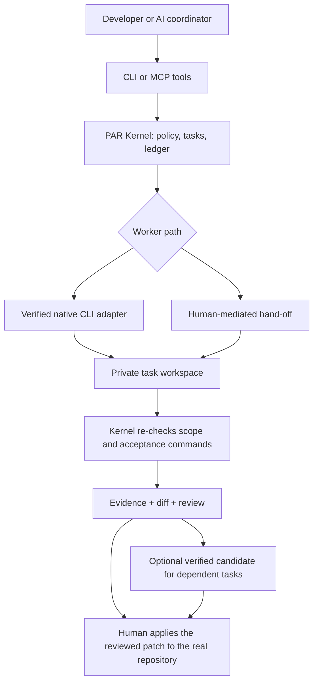

# Personal Agent Runtime (PAR)

### **Your agents. Your workflow. No single vendor in charge.**

**Bring your own AI coding agents. Give them one shared workflow. Keep the evidence when the conversation ends.**

PAR is an open-source, local collaboration runtime for AI coding tools. It connects a coordinator, workers and your existing apps through **native CLI execution, MCP coordination or structured human hand-off**. A persistent Kernel owns task state, scoped permissions, workspaces and verification, so no single model or chat session has to own the entire job.

**Think beyond a model picker.** PAR is about getting independent AI *tools* to cooperate, even when they come from different vendors and do not expose the same API.

[English](README.md) | [简体中文](README.zh-CN.md) · [Quickstart](docs/en/GETTING_STARTED.md) · [How integrations work](docs/en/INTEGRATIONS.md) · [Verified compatibility](docs/en/COMPATIBILITY.md)

[](LICENSE)
[](pyproject.toml)
[-success.svg)](docs/en/COMPATIBILITY.md)
[](https://github.com/Sweetienite/personal-agent-runtime/actions/workflows/tests.yml)

> **Current release: `1.1.1`** ([`v1.1.1`](https://github.com/Sweetienite/personal-agent-runtime/releases/tag/v1.1.1), 2026-11-10). **The workflow is tool-agnostic; automatic integrations are not universal.** Codex is the only formally verified automatic worker today. WorkBuddy has a verified **manual** hand-off; other tools participate conditionally through MCP or human hand-off. macOS is the verified host. [Exact evidence and limits](docs/en/COMPATIBILITY.md).

## One project. The agents you already have.

Picture this:

```text
You → Codex (coordinator): "Plan the change and define what passes."
         │
         ▼
       PAR: task contract + scoped workspace + persistent state
         │
         ▼
       WorkBuddy (manual worker): implement it using an existing plan/quota
         │
         ▼
       PAR: import files → inspect diff → independently run checks
         │
         ▼
       You: review the evidence and apply the patch if you choose
```

That is a **realistic cross-tool workflow**, not a claim that PAR remotely controls WorkBuddy. You open the exported workspace and bring the result back. The same task/evidence model also serves supported native CLI workers.

### **Have unused AI credits? Put them to work.**

Already paying for several subscriptions, or holding free, trial or included credits across AI coding tools? Your best model does not have to execute every bounded edit.

Use a preferred coordinator for the decisions that matter. Delegate compatible tasks through PAR within the quotas you legitimately hold. Then let the Kernel check the result instead of paying another model just to believe the first one.

**No promise of free execution or guaranteed savings.** Each provider's prices, quotas, account rules and terms still apply. PAR neither bypasses limits nor invents an API for a GUI-only product; manual hand-off remains manual.

### **“Any agent” is a workflow promise, not a fake compatibility badge.**

PAR has **no fixed whitelist for human-mediated participation**. In principle, a coding tool can join if you can give it the task and bring back an **edited workspace or valid patch**; a text-only chat can contribute to non-writing tasks. This includes tools and brands not named anywhere in this README.

Automatic execution is narrower and requires a tested, permitted native adapter. An MCP-capable application may act as a **coordinator**; MCP alone does not turn it into an automatic worker. See [Integrations](docs/en/INTEGRATIONS.md) and the [evidence matrix](docs/en/COMPATIBILITY.md) before assuming a specific combination works.

## Why PAR?

- **Orchestrate tools, not just model endpoints.** A native CLI, a desktop coding agent and a text-only assistant need not speak the same API to participate in a structured workflow.
- **Keep your progress when agents change.** A SQLite ledger preserves tasks, approvals, attempts, diffs, results and hand-off state beyond any individual session.
- **The Kernel measures. The worker reports.** PAR independently re-runs `acceptance.checks` in its own workspace; an agent's “tests passed” claim is not evidence. Automated acceptance of write tasks without checks is blocked.
- **Delegate without surrendering control.** Task contracts scope allowed paths; permissions, coordinator leases and append-only events make decisions inspectable.
- **Keep useful work moving.** Verified, accepted patches can be assembled into a candidate and re-checked for dependent tasks. PAR does not silently edit your real repository.
- **Stay small and local.** A Python standard-library runtime, CLI and a 21-tool MCP coordinator bridge. No PAR account, hosted control plane or additional model subscription is required just to run the runtime.

**PAR is not another IDE, model marketplace or magical fully autonomous team.** It is the layer that keeps independent tools on the same task, with state and evidence you can actually inspect.

## 60-second view



MCP means **coordinator access**. It does not turn an arbitrary MCP server into a worker. `Human applies` is always your action; PAR has no path that writes your repository.

## Choose how you connect

| Route | What it is | Who does the work | Evidence status |
|---|---|---|---|
| **Native worker** | A built-in adapter starts a CLI agent non-interactively and collects structured events. | Codex CLI (verified version/OS/account); Antigravity and Copilot are experimental and disabled by default. Copilot answers text questions only. | `VERIFIED_AUTO` for Codex only |
| **Protocol coordinator** | An MCP-capable client calls PAR's 21 tools over stdio to submit, follow and review tasks. | The client you already chat with. | `VERIFIED_COORDINATOR` for Claude Desktop and Codex on the recorded 2026-10-16 read-only sample; other clients are unverified |
| **Manual hand-off** | PAR exports a private workspace and `PROMPT.md`; a person runs any GUI/web/mobile tool and imports the result. | You plus the external tool. | `VERIFIED_MANUAL` for WorkBuddy (2026-11-07); other brands are a conditional generic path |

You can also work entirely from the terminal as the coordinator. No AI account is required for the demo below.

## Try it in a few minutes (no account)

```bash
git clone https://github.com/Sweetienite/personal-agent-runtime.git
cd personal-agent-runtime
python3 -m venv .venv && .venv/bin/pip install -e .
export PAR_DATA_DIR="$(mktemp -d)"          # keep this demo away from any existing PAR data
.venv/bin/par init
.venv/bin/par doctor                        # expect PASS, every provider disabled
.venv/bin/python -B tests/tools/smoke_codex.py --self-test
```

The smoke script runs the real adapter code against a **fake `codex`** and a throw-away fixture project: submit → approve → run → Kernel re-check → accept. It makes no model call, needs no login and touches no real project. The `agy` variant is `tests/tools/smoke_agy.py --self-test`. Neither script is a substitute for a real-provider test.

Set `PAR_DATA_DIR` before the first command whenever you want an isolated run. `par doctor` otherwise reads your real data directory. To clean up: `rm -rf "$PAR_DATA_DIR"` and delete the checkout.

## Your first safe task (after a worker is configured)

This section assumes an active profile with a worker. For a zero-account `manual_handoff` profile
and the export → human edit → import path, follow
[GETTING_STARTED §4](docs/en/GETTING_STARTED.md#4-a-complete-manual-hand-off-with-no-account) and
use `par task handoff` instead of `par task run`; no provider or subscription is needed there.

Use a small, disposable Git repository (or `par fixture create`), not a sensitive project:

```bash
.venv/bin/par fixture create demo            # a throw-away writable project with one deliberate bug
.venv/bin/par project list
.venv/bin/par project show demo               # facts, write readiness, context manifest

cat > draft.json <<'JSON'
{
  "project_id": "demo",
  "title": "Fix add()",
  "description": "Make add() return the sum of its two arguments.",
  "risk": "R2",
  "allowed_paths": ["app/"],
  "acceptance": {
    "criteria": ["the fixture's unit test passes"],
    "checks": [{"name": "unit", "argv": ["python3", "-m", "unittest", "-q"], "timeout": 60}]
  }
}
JSON
.venv/bin/par task draft --draft draft.json > draft.out
tail -1 draft.out > task.json                 # the compiler prints notes, then the contract as the last line
.venv/bin/par task submit --contract task.json
```

A write task stops at `PERMISSION_WAIT`. Approve the pending item, run one attempt, then read the result and diff:

```bash
.venv/bin/par task status demo-0001
.venv/bin/par task approve demo-0001
.venv/bin/par task run demo-0001
.venv/bin/par task result demo-0001
.venv/bin/par task diff demo-0001
.venv/bin/par task accept demo-0001          # records the result; applies nothing
```

The Kernel runs the task's `acceptance.checks` in a private clone. `REVIEW_REQUIRED` becomes `ACCEPTED` only after those checks pass (and, for a coordinator, only when the approval policy allows it). The real repository is unchanged; applying the patch is your separate, explicit `git apply`.

Full walkthrough, including a plain Git repository and a manual hand-off: [docs/en/GETTING_STARTED.md](docs/en/GETTING_STARTED.md).

## What the Kernel actually guarantees

- Private per-attempt clone; the Kernel never runs git inside the worker's own `.git`.
- One explicit state machine, enforced again by database triggers; events are append-only.
- Path policy: `allowed_paths`, protected names (`.git/`, `.ai/`, `AGENTS.md`, `CLAUDE.md`, credential-shaped paths), symlink and traversal checks.
- Per-item approvals, each with a recorded decision mode, coordinator and grant; MCP decisions require a reason, while the CLI's `--note` is optional.
- Coordinator lease: after `par coordinator use`, the old bridge can no longer decide, start, resume, retry, build a candidate or rebase.
- Resumable evidence: attempts, check logs, patches, diffs and a crash-recovery path.
- Candidate integration: accepted R2 patches on one clean baseline, re-checked there; dependent tasks can use a `VERIFIED` candidate.
- Manual hand-off with marker/base/workspace checks; stale or forged imports are refused by name.

The default profile's `approval_mode` is `coordinator_autonomous`: a coordinator may decide inside the current lease. Set it to `coordinator_scoped` or `human_only` to keep or bound that authority. `par init` prints this at first use.

## Compatibility and limitations

Broad interoperability comes from native, protocol and human-mediated workflows, with
integration-specific automation and verification levels — not from claiming that every tool or OS is
supported.

**AI tools (separate from the host OS).**

| Tool / class | Native worker | MCP coordinator | Manual hand-off | Status |
|---|---|---|---|---|
| Codex CLI | yes | yes | — | `VERIFIED_AUTO` (`codex-cli 0.166.0-alpha.6`, macOS, ChatGPT login) |
| Claude Desktop | no | yes | — | `VERIFIED_COORDINATOR` (read-only `list_tasks` sample, 2026-10-16) |
| Antigravity (`agy`) | code exists | no | — | `EXPERIMENTAL`, disabled by default, vendor terms prohibit third-party wrapping |
| WorkBuddy | no | no | yes | `VERIFIED_MANUAL` (5.9.3, macOS, 2026-11-07) |
| TRAE / Cursor / Windsurf / Cline / Aider | no | no | conditional | `GENERIC_MANUAL`, not verified |
| Web / mobile chat | no | no | text only | `GENERIC_TEXT`, R0/R1 only |
| Other MCP clients | no | protocol-compatible | — | `GENERIC_MCP`, not verified per brand |
| ACP | no | no | — | `RESEARCH_ONLY` |

**Host OS.**

| Host | Install | CLI core | Fake smoke | Real provider | Cancel/timeout |
|---|---|---|---|---|---|
| macOS 15.6.1 arm64 | verified | verified | verified | Codex verified | verified |
| Linux (`ubuntu-latest` CI) | CI install | core-experimental | not run | not supported | CI job `linux_process_control` |
| Windows WSL2 | not tested | not tested | not run | not run | not tested |
| Windows native | `NOT_SUPPORTED` | static gap | not run | not supported | not supported |

PAR is **not** an OS sandbox. A private clone limits where the worker may write, not what it may read; workers and check commands run with your user permissions and may read other files or use the network depending on the provider. Do not run untrusted repositories' check commands without stronger isolation. The `human_only` approval mode is a PAR-protocol restriction, not unforgeable human authentication: any process with your shell access can call the CLI directly.

Detailed evidence and exact dates: [docs/en/COMPATIBILITY.md](docs/en/COMPATIBILITY.md). Machine-readable source: [docs/product-capabilities.json](docs/product-capabilities.json).

## Documentation

| Start here | What it covers |
|---|---|
| [Getting Started](docs/en/GETTING_STARTED.md) | Zero-account demo, first real task, manual hand-off, clean uninstall |
| [User Guide](docs/en/USER_GUIDE.md) | Daily flow, approvals, results, candidates, retries, failure recovery |
| [Integrations](docs/en/INTEGRATIONS.md) | Native / MCP / manual paths, coordinator and worker roles, per-tool prerequisites |
| [Compatibility](docs/en/COMPATIBILITY.md) | Evidence levels, version/OS/account matrix, what is not claimed |
| [Security](docs/en/SECURITY.md) | Threat model, approvals, lease, check execution, privacy limits |
| [Architecture](docs/en/ARCHITECTURE.md) | Components, one-attempt sequence, states, extension points |
| [Troubleshooting](docs/en/TROUBLESHOOTING.md) | Symptom → diagnosis → recovery, without weakening permissions |
| [Docs index](docs/INDEX.md) | All English pages and the Chinese reference set |

The Chinese reference set starts at [README.zh-CN.md](README.zh-CN.md) and [docs/INDEX.zh-CN.md](docs/INDEX.zh-CN.md). Older [README.en.md](README.en.md) is kept as a compatibility pointer.

## Contributing, support and license

- [CONTRIBUTING.md](CONTRIBUTING.md): development setup, tests, mutation checks, PR expectations.
- [SUPPORT.md](SUPPORT.md): where to ask and what to include.
- [.github/SECURITY.md](.github/SECURITY.md): private vulnerability reporting.
- [CODE_OF_CONDUCT.md](CODE_OF_CONDUCT.md).

MIT — see [LICENSE](LICENSE). This is a solo-maintained project; the compatibility matrix is deliberately narrower than the workflow protocol.
