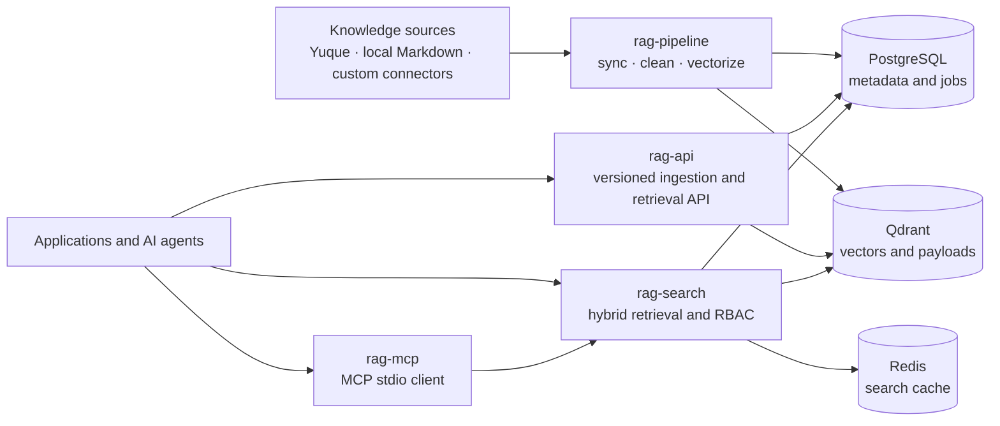

# RAG Platform

[](https://github.com/Today-Hbw/rag-platform/actions/workflows/ci.yml)
[](https://github.com/Today-Hbw/rag-platform/actions/workflows/docker.yml)
[](https://www.python.org/)
[](LICENSE)

An open-source retrieval-augmented generation platform for ingesting knowledge from multiple sources, indexing multimodal content, and serving secure, citation-ready retrieval to applications and AI agents.

RAG Platform separates ingestion, indexing, retrieval, lifecycle management, and agent integration into independently deployable services. It supports dense and lexical retrieval, tenant and knowledge-base isolation, role-based filtering, asynchronous document ingestion, and an MCP client for model-facing tool use.

> [!IMPORTANT]
> The project is under active development and its packages are currently versioned `0.1.0`. Public APIs may evolve before the first stable release.

## Why RAG Platform?

- **Pluggable ingestion** — source connectors feed a shared download, clean, chunk, and vectorize pipeline. Yuque and local Markdown connectors are included.
- **Hybrid retrieval** — combines vector similarity, BM25, and title relevance with reciprocal rank fusion.
- **Agent-ready API** — provides versioned, tenant-isolated document ingestion, search, update, deletion, and ingestion-job endpoints.
- **Stable citations** — returns document IDs, chunk IDs, source URLs, scores, metadata, and real character locations when available.
- **Recoverable writes** — persists ingestion jobs and request snapshots before processing, with idempotency checks and stale-job recovery.
- **Access control** — supports knowledge-base and document-level RBAC, public collections, user-token introspection, and service-token protection.
- **MCP integration** — exposes remote retrieval and health checks as MCP tools without coupling the client to the platform internals.
- **Evaluation tooling** — includes offline hit rate, recall, precision, MRR, and NDCG evaluation with baseline comparison.
- **Deployment flexibility** — each runtime component has its own container image and can be deployed independently.

## Architecture



The ingestion and query paths intentionally share embedding and Qdrant payload contracts through `rag-core`. They may run on different hosts, but they must use the same embedding model, vector dimension, collection, and payload schema.

## Demo

Running the offline pipeline end-to-end:

```bash
# Stage 1 — Download & ingest
$ uv run rag-pipeline sync --source yuque --output-dir output/20260904
2026-09-04 08:12:43,844 INFO  PDF OCR extracted 57 chars from output/20260904/a8f3b2c1.pdf
2026-09-04 08:12:45,115 INFO  PDF OCR extracted 529 chars from output/20260904/a8f3b2c1.pdf
[yuque] 2 scope: 已下载 3818, 跳过 0, 删除 0, 图片 386, 附件 674, 失败 0

# Stage 2 — Clean & chunk
2026-09-04 08:31:55,832 INFO  [7744567] cleaned → 20260904/
2026-09-04 08:31:55,838 INFO  [7744564] cleaned → 20260904/
2026-09-04 08:31:55,841 INFO  [7744561] cleaned → 20260904/
2026-09-04 08:31:55,845 INFO  [7744558] cleaned → 20260904/

# Stage 3 — Vectorize & index
2026-09-04 08:34:04,193 INFO  HTTP Request: PUT .../collections/knowledge_documents/points?wait=true "HTTP/1.1 200 OK"
2026-09-04 08:34:05,799 INFO  HTTP Request: PUT .../collections/knowledge_documents/points?wait=true "HTTP/1.1 200 OK"
2026-09-04 08:34:06,417 INFO  HTTP Request: PUT .../collections/knowledge_documents/points?wait=true "HTTP/1.1 200 OK"
2026-09-04 08:34:07,415 INFO  HTTP Request: PUT .../collections/knowledge_documents/points?wait=true "HTTP/1.1 200 OK"
```

All three stages — download, clean, and vectorize — run against `output/20260904/` with Qdrant returning `200 OK` for every indexed point.

## Repository layout

This repository is a [uv workspace](https://docs.astral.sh/uv/concepts/projects/workspaces/) containing five packages:

| Path | Purpose | Deployable |
| --- | --- | :---: |
| [`packages/rag-core`](packages/rag-core) | Shared configuration, database access, embeddings, vector storage, cleaning, chunking, payload contracts, and RBAC data access | No |
| [`packages/rag-pipeline`](packages/rag-pipeline) | Source connectors and the offline sync, clean, and vectorize pipeline | Yes |
| [`packages/rag-search`](packages/rag-search) | FastAPI hybrid-search service with Redis caching and RBAC filtering | Yes |
| [`packages/rag-api`](packages/rag-api) | Versioned API for isolated ingestion, retrieval, updates, deletion, and job recovery | Yes |
| [`packages/rag-mcp`](packages/rag-mcp) | Standalone MCP client for `rag-search` | Yes |

Additional directories:

- [`eval`](eval) — retrieval datasets, runners, metrics, reports, and regression comparison.
- [`deploy`](deploy) — SQL migrations, Docker Compose, systemd units, cron examples, and operational scripts.
- [`config/connectors`](config/connectors) — connector configuration examples.

## Requirements

- Python 3.10 or newer
- [uv](https://docs.astral.sh/uv/getting-started/installation/)
- PostgreSQL 14 or newer
- Qdrant
- Redis for `rag-search`
- Access to a compatible embedding endpoint
- Docker and Docker Compose, if using the container workflow

PDF, Office, OCR, and legacy document extraction may additionally require system tools such as Poppler, Tesseract, LibreOffice, and Antiword.

## Quick start

### 1. Clone and install

```bash
git clone https://github.com/Today-Hbw/rag-platform.git
cd rag-platform
uv sync --all-extras --dev
cp .env.example .env
```

On Windows PowerShell, use `Copy-Item .env.example .env` instead of `cp`.

Edit `.env` with your PostgreSQL, Qdrant, Redis, embedding, and API credentials. The file is ignored by Git and must never be committed.

### 2. Start local infrastructure

The Compose file includes PostgreSQL, Qdrant, and Redis. The embedding provider remains an external dependency.

```bash
docker compose -f deploy/docker-compose.yml --env-file .env up -d postgres qdrant redis
```

### 3. Apply database migrations

The Compose PostgreSQL service applies these files automatically when it initializes a new `postgres_data` volume. When using an external PostgreSQL instance, apply them manually in order:

1. [`0001_init.sql`](deploy/migrations/0001_init.sql)
2. [`0003_rag_collection.sql`](deploy/migrations/0003_rag_collection.sql)
3. [`0004_p0_api_tables.sql`](deploy/migrations/0004_p0_api_tables.sql)

The initialization scripts only run when the PostgreSQL data directory is empty.

### 4. Run a service

Start the versioned API:

```bash
rag-api serve
```

Start the hybrid-search service in another terminal:

```bash
rag-search serve --host 0.0.0.0 --port 8090
```

Default URLs:

- Agent-facing API: `http://localhost:8001`
- Hybrid-search API: `http://localhost:8090`
- API documentation: `http://localhost:8001/docs`

## Ingest and index content

The pipeline is split into explicit stages so each step can be retried and operated independently.

```bash
# Preview source changes without writing files or updating the database
rag-pipeline sync --source yuque --dry-run

# Download changed source documents
rag-pipeline sync --source yuque

# Convert downloaded content into normalized Markdown
rag-pipeline clean

# Chunk, embed, and index cleaned documents
rag-pipeline vectorize
```

Useful options:

```bash
rag-pipeline sync --source yuque --scope <scope-id> --full
# After setting RAG_LOCAL__ROOT to a directory containing Markdown files
rag-pipeline sync --source local
rag-pipeline reset-stuck --statuses vec_failed --to-status cleaned
```

`rag-pipeline vectorize --recreate` deletes and recreates the configured Qdrant collection. Use it only when a full rebuild is intentional.

To add a source, implement the connector contract in [`packages/rag-pipeline/src/rag_pipeline/connectors`](packages/rag-pipeline/src/rag_pipeline/connectors) and register it with the connector registry. The downstream pipeline does not need source-specific changes.

## Versioned API

`rag-api` is designed for applications and AI agents that need isolated document lifecycle operations and citation-ready vector retrieval.

### Authentication

All endpoints except health and API documentation require a bearer API key. Configure either a multi-tenant mapping:

```dotenv
RAG_API__TENANT_KEYS={"replace-me":"tenant-a"}
```

or a single-tenant key:

```dotenv
RAG_API__SINGLE_TENANT_KEY=replace-me
RAG_API__SINGLE_TENANT_ID=tenant-a
```

The server resolves the tenant from the key. Clients cannot override the tenant in request bodies or search filters.

### Endpoints

| Method | Path | Description |
| --- | --- | --- |
| `GET` | `/api/v1/health` | Check PostgreSQL and Qdrant availability |
| `GET` | `/api/v1/knowledge-bases` | List knowledge bases authorized to the bearer-key tenant |
| `POST` | `/api/v1/knowledge-bases/{kb_id}/documents` | Submit an asynchronous text or Markdown ingestion job |
| `GET` | `/api/v1/knowledge-bases/{kb_id}/documents/{doc_id}` | Read document metadata and status |
| `GET` | `/api/v1/ingestion-jobs/{job_id}` | Read ingestion or update job status |
| `POST` | `/api/v1/knowledge-bases/{kb_id}/search` | Search within the authenticated tenant and selected knowledge base |
| `PUT` | `/api/v1/knowledge-bases/{kb_id}/documents/{doc_id}` | Submit an idempotent asynchronous replacement update |
| `DELETE` | `/api/v1/knowledge-bases/{kb_id}/documents/{doc_id}` | Idempotently delete a document using `Idempotency-Key` |

Example search:

```bash
curl --request POST "http://localhost:8001/api/v1/knowledge-bases/demo/search" \
  --header "Authorization: Bearer ${RAG_API_KEY}" \
  --header "Content-Type: application/json" \
  --data '{
    "query": "How does tenant isolation work?",
    "top_k": 5,
    "score_threshold": 0.6,
    "include_content": true
  }'
```

Agents can discover IDs before searching:

```bash
curl "http://localhost:8001/api/v1/knowledge-bases" \
  --header "Authorization: Bearer ${RAG_API_KEY}"
```

Every knowledge-base route first verifies the `tenant_id → knowledge_base_id` grant in
PostgreSQL. Retrieval then applies both `namespace=tenant_id` and
`collection_id=knowledge_base_id` in Qdrant. Pipeline/Yuque results use reversible IDs such as
`yuque:1117288:12345678`; passing one of these IDs to a different KB returns `403`, while malformed
IDs return `422` without running a broader search.

Register grants idempotently from the private connector configuration before starting the API:

```bash
rag-api register-kb \
  --tenant-id default \
  --yuque-config config/connectors/yuque.json
```

The command writes book titles to `rag_api_knowledge_base.name`, falling back to
`yuque-{book_id}`. A single API-managed KB can be registered with
`--knowledge-base-id <id> --name <name>`. Production IDs belong in deployment configuration, not
schema migrations. `deploy/scripts/register-yuque-kbs.sh` wraps the config-based command and reads
`RAG_API_TENANT_ID` and `RAG_YUQUE_CONFIG` when supplied.

Yuque documents are source-managed: metadata can be read through `GET .../documents/yuque:*`, but
`PUT` and `DELETE` return `409 SOURCE_MANAGED_DOCUMENT`. Update the document in Yuque and run the
normal sync instead. API-managed `doc_*` documents retain the existing lifecycle behavior.

For deployment, register the grants, build the new `rag-api` image, restart only the `api` service,
then verify KB discovery, successful search, `401`, `403`, cross-KB IDs, and filtered
`document_ids`. No Qdrant migration, resync, cleaning, vectorization, or Embedding API call is
required; rollback only needs the previous API image.

Write operations use idempotency keys. Reusing a key with a different request returns `409 Conflict`; safe retries of the same request return the original job or result.

## Hybrid search service

`rag-search` provides the existing hybrid retrieval surface:

- `POST /search` — text retrieval
- `POST /image` — image-oriented retrieval
- `POST /multimodal` — combined text and image retrieval
- `GET /health` — service health

It combines vector, BM25, and title scores using reciprocal rank fusion and caches results in Redis.

### RBAC

RBAC is disabled by default for backward compatibility:

```dotenv
RAG_RBAC__ENABLED=false
```

When enabled, visible results are computed from role-to-resource assignments, public collections, and optional document exceptions. Production deployments should configure `RAG_RBAC__INTROSPECT_URL` so user tokens are resolved by a trusted identity service.

If the introspection URL is empty, the service trusts the configured role header directly. This mode is intended for local development and must not be exposed as a production authorization boundary.

## MCP client

`rag-mcp` wraps the remote hybrid-search service as two MCP tools: `search_knowledge_base` and `check_service_health`.

```bash
# Optional out-of-band login; the token is stored locally and never passed through a model
rag-mcp login --login-url https://example.com/api/login --server http://localhost:8090

# Start the MCP stdio server
rag-mcp --server http://localhost:8090
```

The client is intentionally independent of `rag-core`, so it can be installed and distributed separately.

## Retrieval evaluation

The top-level `eval` package evaluates retrieval using document-anchored hit rate, recall, precision, MRR, and NDCG.

```bash
# Evaluate the configured services with the example dataset
python -m eval run --dataset eval/datasets/smoke.example.jsonl --out runs/baseline.json

# Compare two runs and fail on regressions
python -m eval compare \
  --before runs/baseline.json \
  --after runs/candidate.json \
  --fail-on-regress
```

See [`eval/datasets/README.md`](eval/datasets/README.md) for dataset and annotation conventions.

## Containers and operations

Build or start the deployable services with Compose:

```bash
docker compose -f deploy/docker-compose.yml --env-file .env build
docker compose -f deploy/docker-compose.yml --env-file .env up -d api search
docker compose -f deploy/docker-compose.yml --env-file .env run --rm pipeline sync --source yuque
```

Container images are published by GitHub Actions to:

- `ghcr.io/today-hbw/rag-api`
- `ghcr.io/today-hbw/rag-search`
- `ghcr.io/today-hbw/rag-pipeline`
- `ghcr.io/today-hbw/rag-mcp`

Examples for scheduled synchronization are available under [`deploy/systemd`](deploy/systemd) and [`deploy/cron`](deploy/cron). Synchronization locks support file, Redis, PostgreSQL advisory locks, and disabled backends through configuration.

## Configuration

Runtime configuration uses environment variables with the `RAG_` prefix and `__` for nesting. For example, `RAG_POSTGRESQL__PASSWORD` maps to `settings.postgresql.password`.

| Prefix | Purpose |
| --- | --- |
| `RAG_POSTGRESQL__*` | Metadata, state, job, and permission database |
| `RAG_QDRANT__*` | Vector store URL and collection |
| `RAG_REDIS__*` | Hybrid-search cache |
| `RAG_EMBEDDING__*` | Embedding endpoint, model, credentials, and vector dimension |
| `RAG_PIPELINE__*` | Chunking and synchronization locking |
| `RAG_PATHS__*` | Pipeline data directory |
| `RAG_YUQUE__*` / `RAG_LOCAL__*` | Connector settings |
| `RAG_SEARCH__*` | Recall and fusion parameters |
| `RAG_API__*` | Versioned API authentication and worker behavior |
| `RAG_RBAC__*` | Role resolution, introspection, caching, and service tokens |

See [`.env.example`](.env.example) for the complete reference. Secrets are represented with Pydantic `SecretStr`, redacted from application logs, and scanned with Gitleaks in CI and pre-commit hooks.

## Development

Install all workspace packages and development tools:

```bash
uv sync --all-extras --dev
```

Run the checks used by CI:

```bash
uv run ruff check .
uv run mypy packages/rag-core/src packages/rag-pipeline/src packages/rag-search/src packages/rag-api/src
uv run pytest
gitleaks detect --source . --config .gitleaks.toml --redact --no-banner
```

Tests use in-memory or mocked Qdrant, Redis, HTTP, and PostgreSQL dependencies where possible. Real-provider evaluation and deployment validation require appropriately configured external services.

## Contributing

The project underwent a **major version update on September 1, 2026** — landing the P0 versioned API layer, migrating the database from SQLite to PostgreSQL, adding Qdrant API-key authentication, and publishing an English README under the MIT license. Within two weeks it has reached **99 clones** from **24 unique cloners** *(data as of September 3, 2026)*.


Issues, pull requests, and discussions are all welcome. A typical contribution flow is:

1. Fork the repository and create a focused branch.
2. Add or update tests for the behavior you are changing.
3. Run linting, type checking, tests, and Gitleaks locally.
4. Update documentation when configuration or public behavior changes.
5. Open a pull request describing the problem, approach, compatibility impact, and verification performed.

Please keep connectors source-specific and keep shared payload, embedding, and database behavior in `rag-core`. Avoid introducing credentials, private endpoints, proprietary datasets, or organization-specific assumptions into examples and tests. For substantial API or architecture changes, open an issue before investing in a large implementation so the design can be discussed first.

If you find this project useful, a ⭐ Star is greatly appreciated!

## Security

- Never commit API keys, database credentials, cookies, user tokens, or populated `.env` files.
- Revoke a credential immediately if it may have been exposed; removing it from the latest commit is not sufficient.
- Use least-privilege database accounts and scoped service tokens in production.
- Keep tenant and knowledge-base filters server-controlled.
- Do not expose RBAC's header-trusting development mode to untrusted callers.
- Report suspected vulnerabilities privately through GitHub's security reporting features when available instead of opening a public issue.

## Project history

RAG Platform evolved from [`Today-Hbw/dgr_yuque_qrant`](https://github.com/Today-Hbw/dgr_yuque_qrant) and was redesigned as a source-agnostic, modular workspace with independently deployable services.

## License

RAG Platform is licensed under the [MIT License](LICENSE).
