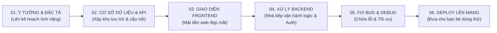

# 🚀 Kho Prompt Thực Chiến Làm Web Fullstack & Co-work Với AI

  <b>Tự tay làm Website Fullstack từ số 0 cùng Claude, Gemini, ChatGPT và Cursor</b> 
  <i>Được biên soạn siêu dễ hiểu — Dành cho cả học sinh cấp 3, sinh viên và người mới chuyển ngành!</i>

[✨ Xem Cẩm Nang Cho Người Mới](GUIDE-FOR-BEGINNERS.md) • [📋 Tờ Phao Cứu Sinh (Cheat Sheet)](templates/project-prompt-cheat-sheet.md) • [🛠️ Dự Án Thực Hành 15 Phút](templates/sample-project-todo-app/README.md) • [🤝 Đóng Góp Prompt](CONTRIBUTING.md)

---

### ⭐ ỦNG HỘ DỰ ÁN ⭐
Nếu bạn thấy bộ prompt này hữu ích, hãy ủng hộ tác giả bằng cách:
1. Nhấp **⭐ Star** góc trên bên phải của repo này!
2. Nhấp **🔔 Follow** tác giả tại 👉 [**@Tranvanthuan1805**](https://github.com/Tranvanthuan1805) để nhận thông báo về các bộ công cụ tiếp theo.

---

## 📖 Giới thiệu

Nhiều người nghĩ rằng: *"Muốn làm website thì phải học code 3 - 4 năm, phải nhớ hàng ngàn dòng lệnh phức tạp"*. **Nhưng vào thời đại AI hiện nay, điều đó không còn đúng nữa!**

Khi bạn biết cách **Co-work (làm việc cộng tác)** với các mô hình ngôn ngữ lớn như **Claude 3.7 / 3.5 Sonnet**, **Gemini 2.5 / 1.5 Pro**, **ChatGPT** hoặc **Cursor AI**, bạn chính là **Tổng công trình sư (Product Owner / Architect)**, còn AI là **Lập trình viên cấp dưới thần tốc của bạn**.

Kho lưu trữ này được xây dựng với mục tiêu:
- 💡 **Đơn giản hóa tuyệt đối**: Ngôn từ gần gũi, học sinh lớp 10, 11, 12 hay bất kỳ ai chưa từng học công nghệ thông tin đều có thể đọc hiểu và thực hành.
- 🎯 **Thực chiến 100%**: Đi thẳng vào giải quyết vấn đề từ ý tưởng $\rightarrow$ thiết kế $\rightarrow$ giao diện $\rightarrow$ xử lý dữ liệu $\rightarrow$ đưa website lên mạng chạy thật.
- 🤖 **Công thức Prompt chuẩn quốc tế**: Giúp AI không trả lời chung chung, không sinh code rác, hạn chế tối đa ảo giác (hallucination).

---

## 🗺️ Bản đồ Lộ trình Xây dựng Website cùng AI

Quy trình 6 bước chuẩn chỉnh để biến 1 ý tưởng trong đầu thành website thực tế trên Internet:

---

## 📂 Danh mục Bộ Prompt Tuyển Chọn

Dưới đây là liên kết trực tiếp đến từng prompt thực chiến. Bạn chỉ cần bấm vào, sao chép (copy) và điền thông tin dự án của mình vào chỗ `[NGOẶC VUÔNG]` rồi dán cho AI:

### 🌟 00. Khởi động cho người mới
* [👉 **GUIDE-FOR-BEGINNERS.md**](GUIDE-FOR-BEGINNERS.md): Giải thích Frontend, Backend, Database bằng hình tượng quán trà sữa / nhà hàng siêu dễ nhớ.
* [👉 **Cheat Sheet Prompt Thần Thánh**](templates/project-prompt-cheat-sheet.md): Bảng tóm tắt các câu lệnh thần chú mỗi khi làm việc với AI.

---

### 1️⃣ Giai đoạn 1: Lên ý tưởng & Thiết kế kiến trúc
* [Prompt 1.1: Biến ý tưởng sơ khai thành bản thiết kế tính năng (PRD)](prompts/01-ideation-and-specs/01-idea-to-prd.md)
* [Prompt 1.2: Thiết kế luồng người dùng (User Flow) & Phân rã tính năng](prompts/01-ideation-and-specs/02-user-flow-features.md)
* [Prompt 1.3: Cố vấn công nghệ (Tư vấn chọn Tech Stack dễ nhất cho người mới)](prompts/01-ideation-and-specs/03-tech-stack-advisor.md)

---

### 2️⃣ Giai đoạn 2: Thiết kế Cơ sở dữ liệu (Database) & API
* [Prompt 2.1: Thiết kế bảng dữ liệu chuẩn (PostgreSQL, Supabase, MySQL)](prompts/02-database-and-api/01-database-schema-design.md)
* [Prompt 2.2: Thiết kế chuẩn giao tiếp API (RESTful Endpoints & JSON format)](prompts/02-database-and-api/02-rest-api-contract.md)
* [Prompt 2.3: Tự động sinh dữ liệu mẫu (Mock Data) tiếng Việt sống động](prompts/02-database-and-api/03-mock-data-generator.md)

---

### 3️⃣ Giai đoạn 3: Lập trình Giao diện (Frontend UI/UX)
* [Prompt 3.1: Tạo Landing Page hiện đại với HTML + Tailwind CSS (Mobile-First)](prompts/03-frontend-development/01-landing-page-generator.md)
* [Prompt 3.2: Tạo Component UI chuẩn (Navbar, Modal, Form nhập liệu)](prompts/03-frontend-development/02-responsive-component.md)
* [Prompt 3.3: Dựng Dashboard quản trị có thống kê số liệu và biểu đồ](prompts/03-frontend-development/03-modern-dashboard-ui.md)

---

### 4️⃣ Giai đoạn 4: Lập trình Xử lý nghiệp vụ (Backend & Database)
* [Prompt 4.1: Khởi tạo Server Node.js / Express hoặc Next.js nhanh gọn](prompts/04-backend-development/01-nodejs-express-starter.md)
* [Prompt 4.2: Tích hợp Đăng ký, Đăng nhập, Bảo mật phân quyền](prompts/04-backend-development/02-auth-jwt-supabase.md)
* [Prompt 4.3: Viết trọn bộ hàm Thêm - Sửa - Xóa - Lấy dữ liệu (CRUD)](prompts/04-backend-development/03-crud-endpoints.md)

---

### 5️⃣ Giai đoạn 5: Tìm lỗi, Sửa Bug & Học hỏi (Debugging & Testing)
* [Prompt 5.1: Cứu hộ khẩn cấp khi gặp màn hình báo lỗi đỏ lòm](prompts/05-debugging-and-testing/01-smart-error-debugger.md)
* [Prompt 5.2: Bắt AI giảng giải từng dòng code như dạy học sinh cấp 3](prompts/05-debugging-and-testing/02-code-explain-for-kids.md)
* [Prompt 5.3: Viết kiểm thử tự động (Unit Test) phòng tránh phát sinh lỗi](prompts/05-debugging-and-testing/03-unit-test-generator.md)

---

### 6️⃣ Giai đoạn 6: Triển khai website lên Internet miễn phí (Deploy)
* [Prompt 6.1: Đưa website lên mạng qua Vercel + GitHub trong 3 phút](prompts/06-deployment-and-devops/01-deploy-vercel-github.md)
* [Prompt 6.2: Cẩm nang cấu hình biến môi trường an toàn (Tránh lộ mật khẩu)](prompts/06-deployment-and-devops/02-environment-variables-guide.md)

---

## 🎯 Công thức viết Prompt vàng: "Mô hình 5 Khối C-P-G-C-O"

Để AI viết code chính xác nhất và không bị "chém gió", hãy áp dụng công thức 5 bước này:

| Thành phần | Ý nghĩa | Ví dụ thực tế |
| :--- | :--- | :--- |
| **C - Context (Bối cảnh)** | Bạn đang làm dự án gì? Dành cho ai? | *"Tôi đang xây web ghi chú bài tập cho học sinh lớp 12..."* |
| **P - Persona (Đóng vai)** | Bạn muốn AI là ai? | *"Hãy đóng vai Chuyên gia Lập trình Fullstack & Giáo viên nhiệt tình..."* |
| **G - Goal (Mục tiêu)** | Bạn muốn AI làm gì cụ thể? | *"Hãy viết 1 file HTML duy nhất chứa giao diện bảng danh sách bài tập..."* |
| **C - Constraints (Ràng buộc)** | Những điều cấm hoặc bắt buộc phải tuân thủ | *"Dùng Tailwind CSS qua CDN, có chế độ sáng/tối, không dùng thư viện ngoài nặng nề..."* |
| **O - Output (Đầu ra)** | Định dạng kết quả mong muốn | *"Trả về mã nguồn hoàn chỉnh có chú thích tiếng Việt từng dòng, không viết tắt code."* |

---

## 🚀 Dự án mẫu thực hành: "App Quản Lý Bài Tập Về Nhà Trong 15 Phút"

Bạn muốn xem kết quả ngay lập tức? 
👉 Hãy vào thư mục [**templates/sample-project-todo-app**](templates/sample-project-todo-app/README.md) và làm theo hướng dẫn 3 bước để có ngay một ứng dụng web hoạt động thực sự trên máy tính của bạn!

---

## 👨‍💻 Về tác giả

Dự án được xây dựng và chia sẻ cộng đồng bởi **Trần Văn Thuần (Felix)**.
- 🎓 Sinh viên Kỹ thuật Phần mềm tại Đại học FPT.
- 🏢 Founder & CEO tại **DUOTECH TECHNOLOGY**.
- 🌐 GitHub: [@Tranvanthuan1805](https://github.com/Tranvanthuan1805)
- 📺 YouTube: [Trần Văn Thuần Channel](https://www.youtube.com/@Tran_Van_Thuan)
- 💬 Facebook: [Trần Văn Thuần](https://www.facebook.com/tran.van.thuan.499718)
- ✉️ Email công việc: [tranvanthuan.forwork@gmail.com](mailto:tranvanthuan.forwork@gmail.com)

---

## 🤝 Đóng góp & Bản quyền

Dự án được phát hành theo giấy phép [MIT License](LICENSE) — bạn hoàn toàn tự do sử dụng, chỉnh sửa và chia sẻ cho mục đích cá nhân lẫn thương mại.

Nếu bạn có prompt hay muốn đóng góp, hãy mở một **Pull Request** hoặc gửi ý kiến qua mục **Issues** nhé!

  <b>⭐ Đừng quên bấm STAR cho repo và FOLLOW tác giả nhé! Cảm ơn bạn rất nhiều! ⭐</b>

