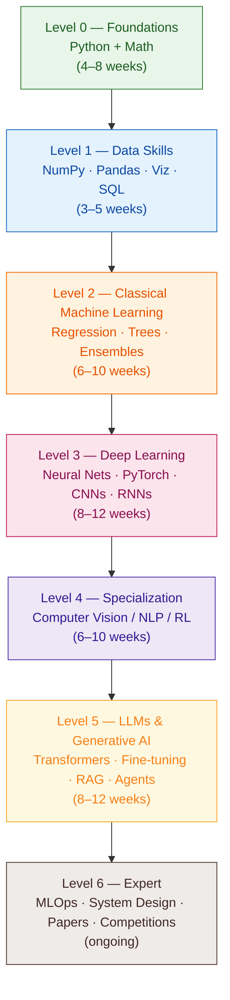

# 🧠 The Complete AI Roadmap — Zero to Expert

> A step-by-step, **100% free** roadmap to go from absolute beginner to AI expert.
> Every level has: 🎓 courses · 📺 videos · 📄 articles · 🛠️ real projects (Kaggle & GitHub) · ✅ a checkpoint before you move on.

   

---

## 🗺️ The Journey at a Glance

**Total time:** ~9–14 months at 10–15 hrs/week. Faster if you have a CS background, slower is fine too — **finishing beats rushing**.

---

## 📖 Table of Contents

- [How to Use This Roadmap](#-how-to-use-this-roadmap)
- [Level 0 — Foundations: Python & Math](#-level-0--foundations-python--math)
- [Level 1 — Data Skills](#-level-1--data-skills)
- [Level 2 — Classical Machine Learning](#-level-2--classical-machine-learning)
- [Level 3 — Deep Learning](#-level-3--deep-learning)
- [Level 4 — Specialization Tracks (CV / NLP / RL)](#-level-4--specialization-tracks)
- [Level 5 — LLMs & Generative AI](#-level-5--llms--generative-ai)
- [Level 6 — Expert: MLOps, System Design & Research](#-level-6--expert-mlops-system-design--research)
- [Bonus: Books, Cheat Sheets, Newsletters & Communities](#-bonus-resources)
- [FAQ](#-faq)

---

## 🧭 How to Use This Roadmap

1. **Go in order.** Each level assumes the previous one. Don't jump to LLMs before you can train a logistic regression by hand.
2. **One primary course per level.** Multiple options are listed — pick **one** as your main course and use the others as backup when something doesn't click.
3. **Projects are not optional.** The Kaggle/GitHub projects listed at each level are the real learning. Watching videos ≠ knowing.
4. **Read other people's code.** Every level links to notebooks/repos by top practitioners — study them line by line, then rebuild them yourself without looking.
5. **Pass the checkpoint** (✅) before moving on. Be honest with yourself.
6. **Build in public.** Push every project to GitHub. Your portfolio *is* your resume.

> 💡 **Rule of thumb:** spend ~30% of your time on courses and ~70% writing code.

---

## 🟢 Level 0 — Foundations: Python & Math

> **Goal:** Write clean Python confidently and understand the math notation used everywhere in ML.
> **Time:** 4–8 weeks · **Prerequisites:** none.

### Step 0.1 — Learn Python

| Type | Resource | Why |
|------|----------|-----|
| 🎓 Course | [Harvard CS50P — Intro to Programming with Python](https://cs50.harvard.edu/python/) | The best structured free Python course. Problem sets included. |
| 📺 Video | [freeCodeCamp — Python Full Course (4.5 hrs)](https://www.youtube.com/watch?v=rfscVS0vtbw) | Fastest complete walkthrough if CS50P feels too slow. |
| 📺 Video | [Corey Schafer — Python Tutorials (playlist)](https://www.youtube.com/playlist?list=PL-osiE80TeTt2d9bfVyTiXJA-UTHn6WwU) | Best per-topic deep dives (functions, OOP, generators…). |
| 🎓 Course | [Kaggle Learn — Python](https://www.kaggle.com/learn/python) | Short, hands-on, in-browser. Great as a fast review. |
| 📚 Book (free) | [Automate the Boring Stuff with Python](https://automatetheboringstuff.com/) | Free online. Makes Python click through practical mini-projects. |

**Cover:** variables, loops, functions, lists/dicts/sets, list comprehensions, OOP basics, file I/O, error handling, `pip` + virtual environments.

### Step 0.2 — Learn the Math (only what ML actually needs)

| Type | Resource | Covers |
|------|----------|--------|
| 📺 Video | [3Blue1Brown — Essence of Linear Algebra](https://www.youtube.com/playlist?list=PLZHQObOWTQDPD3MizzM2xVFitgF8hE_ab) | Vectors, matrices, transformations — **visually**. The single best math series on YouTube. |
| 📺 Video | [3Blue1Brown — Essence of Calculus](https://www.youtube.com/playlist?list=PLZHQObOWTQDMsr9K-rj53DwVRMYO3t5Yr) | Derivatives & gradients intuition (needed for backpropagation later). |
| 📺 Video | [StatQuest — Statistics Fundamentals](https://www.youtube.com/playlist?list=PLblh5JKOoLUK0FLuzwntyYI10UQFUhsY9) | Mean, variance, distributions, p-values — explained absurdly clearly. |
| 🎓 Course | [Khan Academy — Probability & Statistics](https://www.khanacademy.org/math/statistics-probability) | Practice problems for probability, conditional probability, Bayes. |
| 📚 Book (free) | [Mathematics for Machine Learning (free PDF)](https://mml-book.github.io/) | The reference book. Don't read cover-to-cover — use it when a course mentions math you don't know. |

**Cover:** matrix multiplication, dot products, derivatives & the chain rule, probability basics, Bayes' theorem, mean/variance/std, normal distribution.

### 🛠️ Projects to clear this level

| Project | Source |
|---------|--------|
| Build a **command-line to-do app** (add/delete/save to file) | Your own — pure Python, no libraries |
| Build a **number-guessing game** + a **password generator** | [CS50P problem sets](https://cs50.harvard.edu/python/psets/) |
| Solve **20+ easy problems** | [LeetCode (easy)](https://leetcode.com/problemset/) or [HackerRank Python](https://www.hackerrank.com/domains/python) |

### ✅ Checkpoint — you're ready for Level 1 when you can:
- [ ] Write a Python class with methods and use it, without googling syntax
- [ ] Explain what a matrix multiplication *does* geometrically
- [ ] Explain what a derivative measures, in one sentence
- [ ] Read a `for` loop with a list comprehension and predict its output

---

## 🔵 Level 1 — Data Skills

> **Goal:** Load, clean, transform, and visualize any dataset — the daily bread of every ML engineer.
> **Time:** 3–5 weeks.

### Step 1.1 — NumPy & Pandas

| Type | Resource | Why |
|------|----------|-----|
| 🎓 Course | [Kaggle Learn — Pandas](https://www.kaggle.com/learn/pandas) | Hands-on, short, and free GPU-backed notebooks. |
| 📺 Video | [freeCodeCamp — Data Analysis with Python (10 hrs)](https://www.youtube.com/watch?v=r-uOLxNrNk8) | NumPy + Pandas + Matplotlib in one certification course. |
| 📺 Video | [Corey Schafer — Pandas Tutorials](https://www.youtube.com/playlist?list=PL-osiE80TeTsWmV9i9c58mdDCSskIFdDS) | Deeper per-topic explanations (groupby, merging, time series). |
| 📄 Article | [10 Minutes to Pandas (official)](https://pandas.pydata.org/docs/user_guide/10min.html) | The official quick reference — keep it open while you work. |
| 📄 Article | [NumPy: the absolute basics for beginners (official)](https://numpy.org/doc/stable/user/absolute_beginners.html) | Arrays, broadcasting, vectorization. |

### Step 1.2 — Data Visualization

| Type | Resource |
|------|----------|
| 🎓 Course | [Kaggle Learn — Data Visualization](https://www.kaggle.com/learn/data-visualization) (Seaborn) |
| 📄 Article | [From Data to Viz](https://www.data-to-viz.com/) — decision tree for picking the right chart |
| 📺 Video | [Corey Schafer — Matplotlib Tutorials](https://www.youtube.com/playlist?list=PL-osiE80TeTvipOqomVEeZ1HRrcEvtZB_) |

### Step 1.3 — SQL + Data Cleaning

| Type | Resource |
|------|----------|
| 🎓 Course | [Kaggle Learn — Intro to SQL](https://www.kaggle.com/learn/intro-to-sql) |
| 🎓 Course | [SQLBolt — Interactive SQL exercises](https://sqlbolt.com/) |
| 🎓 Course | [Kaggle Learn — Data Cleaning](https://www.kaggle.com/learn/data-cleaning) (missing values, scaling, dates, encodings) |

### 🛠️ Projects to clear this level

| Project | Study this first (other people's work) |
|---------|----------------------------------------|
| **Titanic EDA** — explore survival patterns with plots | [Titanic Data Science Solutions — Manav Sehgal](https://www.kaggle.com/code/startupsci/titanic-data-science-solutions) (61k+ upvoted classic) |
| **House Prices EDA** — distributions, correlations, outliers | [Comprehensive Data Exploration with Python — Pedro Marcelino](https://www.kaggle.com/code/pmarcelino/comprehensive-data-exploration-with-python) (the most famous EDA notebook on Kaggle) |
| **Netflix / IMDB dataset analysis** — your own questions, your own charts | [Netflix Movies & TV Shows dataset](https://www.kaggle.com/datasets/shivamb/netflix-shows) |

> 🎯 **Deliverable:** publish at least one polished EDA notebook on Kaggle with markdown storytelling, not just code cells.

### ✅ Checkpoint — you're ready for Level 2 when you can:
- [ ] Take a raw CSV and produce a cleaned DataFrame (missing values, types, duplicates) in under 30 minutes
- [ ] Use `groupby` + `merge` without looking anything up
- [ ] Pick the right chart for a question and explain *why*
- [ ] Write a SQL query with `JOIN` + `GROUP BY` + `HAVING`

---

## 🟠 Level 2 — Classical Machine Learning

> **Goal:** Understand how ML actually works — not just call `.fit()`. This level separates practitioners from tutorial-followers.
> **Time:** 6–10 weeks.

### Step 2.1 — Core Theory (pick ONE primary course)

| Type | Resource | Why |
|------|----------|-----|
| 🎓 Course ⭐ | [Andrew Ng — Machine Learning Specialization](https://www.coursera.org/specializations/machine-learning-introduction) (audit each course free) | **The** classic starting point. Intuition-first, Python labs. |
| 📺 Video ⭐ | [StatQuest — Machine Learning playlist](https://www.youtube.com/playlist?list=PLblh5JKOoLUICTaGLRoHQDuF_7q2GfuJF) | Every algorithm (trees, boosting, SVM, regularization) explained simply. Watch alongside ANY course. |
| 🎓 Course | [Google — Machine Learning Crash Course](https://developers.google.com/machine-learning/crash-course) | Fast, practical, interactive visualizations. |
| 📺 Video (advanced) | [Stanford CS229 — Machine Learning (Andrew Ng, full lectures)](https://www.youtube.com/playlist?list=PLoROMvodv4rMiGQp3WXShtMGgzqpfVfbU) | The math-heavy university version. Do this *after* the specialization if you want depth. |

### Step 2.2 — Practical ML with scikit-learn

| Type | Resource |
|------|----------|
| 🎓 Course | [Kaggle Learn — Intro to Machine Learning](https://www.kaggle.com/learn/intro-to-machine-learning) → [Intermediate ML](https://www.kaggle.com/learn/intermediate-machine-learning) (pipelines, XGBoost, leakage) |
| 📚 Notebooks (free) | [Hands-On ML (Aurélien Géron) — official notebooks](https://github.com/ageron/handson-ml3) — the companion code of the best-selling ML book, free on GitHub |
| 📄 Article | [scikit-learn — Choosing the right estimator](https://scikit-learn.org/stable/machine_learning_map.html) |
| 🎓 Course | [Kaggle Learn — Feature Engineering](https://www.kaggle.com/learn/feature-engineering) |

**Cover:** linear/logistic regression, decision trees, random forests, gradient boosting (XGBoost/LightGBM), k-means, PCA, train/val/test splits, cross-validation, overfitting & regularization, metrics (precision/recall/F1/ROC-AUC), data leakage.

### 🛠️ Projects to clear this level

| Project | Study this first (other people's work) |
|---------|----------------------------------------|
| **Titanic — full ML pipeline** (your first Kaggle submission) | [Titanic Data Science Solutions — Manav Sehgal](https://www.kaggle.com/code/startupsci/titanic-data-science-solutions) · [A Data Science Framework: To Achieve 99% Accuracy — LD Freeman](https://www.kaggle.com/code/ldfreeman3/a-data-science-framework-to-achieve-99-accuracy) |
| **House Prices — regression + feature engineering** | [Stacked Regressions (top 4%) — Serigne](https://www.kaggle.com/code/serigne/stacked-regressions-top-4-on-leaderboard) — legendary stacking/ensembling walkthrough |
| **Credit Card Fraud — imbalanced classification** | [Credit Fraud: Dealing with Imbalanced Datasets — Janio Bachmann](https://www.kaggle.com/code/janiobachmann/credit-fraud-dealing-with-imbalanced-datasets) |
| **Rebuild 3 algorithms from scratch** (linear regression, k-NN, decision tree — pure NumPy) | [ML-From-Scratch — Erik Linder-Norén](https://github.com/eriklindernoren/ML-From-Scratch) (24k⭐) — compare your code with his |

> 🎯 **Deliverable:** two Kaggle competition submissions + one "from scratch" repo on your GitHub.

### ✅ Checkpoint — you're ready for Level 3 when you can:
- [ ] Explain bias vs. variance and how to diagnose each from learning curves
- [ ] Explain why accuracy is a bad metric for imbalanced data, and what to use instead
- [ ] Implement linear regression with gradient descent in pure NumPy
- [ ] Explain what data leakage is and name two ways it sneaks in
- [ ] Beat the baseline in a Kaggle "Getting Started" competition

---

## 🔴 Level 3 — Deep Learning

> **Goal:** Understand and train neural networks from first principles, and be fluent in PyTorch.
> **Time:** 8–12 weeks.

### Step 3.1 — Neural Network Intuition (do BOTH, they're short)

| Type | Resource | Why |
|------|----------|-----|
| 📺 Video ⭐ | [3Blue1Brown — Neural Networks series](https://www.youtube.com/playlist?list=PLZHQObOWTQDNU6R1_67000Dx_ZCJB-3pi) | What a neural net *is*, gradient descent, backpropagation — visually. |
| 📺 Video ⭐⭐ | [Andrej Karpathy — Neural Networks: Zero to Hero](https://karpathy.ai/zero-to-hero.html) | **The best deep learning content on the internet.** Build backprop, then a language model, from scratch in code. Ex-Director of AI at Tesla. |

### Step 3.2 — Structured Course (pick ONE primary)

| Type | Resource | Why |
|------|----------|-----|
| 🎓 Course ⭐ | [fast.ai — Practical Deep Learning for Coders](https://course.fast.ai/) | Top-down: train state-of-the-art models on day 1, understand internals later. Completely free. |
| 🎓 Course | [DeepLearning.AI — Deep Learning Specialization](https://www.coursera.org/specializations/deep-learning) (audit free) + [free lecture videos](https://www.youtube.com/@Deeplearningai/playlists) | Bottom-up: math and theory first. Andrew Ng again. |
| 🎓 Course | [MIT 6.S191 — Introduction to Deep Learning](http://introtodeeplearning.com/) | Compact university course, updated yearly, all lectures on YouTube. |

### Step 3.3 — PyTorch

| Type | Resource |
|------|----------|
| 📺 Video ⭐ | [Daniel Bourke — PyTorch for Deep Learning (25 hrs)](https://www.youtube.com/watch?v=Z_ikDlimN6A) + companion site [learnpytorch.io](https://www.learnpytorch.io/) |
| 📄 Article | [PyTorch — Official 60-Minute Blitz](https://pytorch.org/tutorials/beginner/deep_learning_60min_blitz.html) |
| 📚 Book (free) | [Neural Networks and Deep Learning — Michael Nielsen](http://neuralnetworksanddeeplearning.com/) — free online book, beautiful backprop chapter |
| 📚 Repo | [pytorch/examples](https://github.com/pytorch/examples) — official reference implementations (MNIST, ImageNet, word LM…) |

**Cover:** tensors & autograd, training loops, backpropagation, activation functions, batch norm, dropout, CNNs, RNNs/LSTMs, transfer learning, learning-rate schedules, GPU training.

### 🛠️ Projects to clear this level

| Project | Study this first (other people's work) |
|---------|----------------------------------------|
| **MNIST Digit Recognizer** — your first CNN (Kaggle competition) | [Introduction to CNN Keras (top 6%) — Yassine Ghouzam](https://www.kaggle.com/code/yassineghouzam/introduction-to-cnn-keras-0-997-top-6) |
| **Build micrograd + makemore yourself** (follow Karpathy, then redo alone) | [karpathy/micrograd](https://github.com/karpathy/micrograd) · [karpathy/makemore](https://github.com/karpathy/makemore) |
| **Transfer learning image classifier** — fine-tune ResNet on your own dataset (pets, plants, food…) | [fast.ai lesson 1–2](https://course.fast.ai/) + [PyTorch transfer learning tutorial](https://pytorch.org/tutorials/beginner/transfer_learning_tutorial.html) |
| **Deploy one model** as a small web demo | [Gradio — Quickstart](https://www.gradio.app/guides/quickstart) + free hosting on [Hugging Face Spaces](https://huggingface.co/spaces) |

> 🎯 **Deliverable:** a live Hugging Face Space anyone can click, plus your from-scratch micrograd repo.

### ✅ Checkpoint — you're ready for Level 4 when you can:
- [ ] Explain backpropagation on a whiteboard (chain rule through a 2-layer net)
- [ ] Write a full PyTorch training loop (data → model → loss → optimizer → loop) from memory
- [ ] Diagnose overfitting from loss curves and name 3 fixes
- [ ] Explain what a convolution does and why it beats dense layers for images
- [ ] Fine-tune a pretrained model on a custom dataset

---

## 🟣 Level 4 — Specialization Tracks

> **Goal:** Go deep in ONE domain (you can return for the others later). Pick the track that excites you — excitement is fuel.
> **Time:** 6–10 weeks per track.

### 🖼️ Track A — Computer Vision

| Type | Resource |
|------|----------|
| 🎓 Course ⭐ | [Stanford CS231n — Deep Learning for Computer Vision](https://cs231n.stanford.edu/) + [lecture videos](https://www.youtube.com/playlist?list=PL3FW7Lu3i5JvHM8ljYj-zLfQRF3EO8sYv) |
| 📄 Article | [CS231n course notes](https://cs231n.github.io/) — the written notes are gold on their own |
| 📚 Repo | [Ultralytics YOLO](https://github.com/ultralytics/ultralytics) — modern object detection in a few lines |
| 🛠️ Projects | Kaggle: [Dogs vs. Cats](https://www.kaggle.com/c/dogs-vs-cats) · [Plant Pathology](https://www.kaggle.com/c/plant-pathology-2020-fgvc7) · Build a custom object detector (your webcam + YOLO) |

### 📝 Track B — Natural Language Processing

| Type | Resource |
|------|----------|
| 🎓 Course ⭐ | [Stanford CS224n — NLP with Deep Learning](https://web.stanford.edu/class/cs224n/) + [lecture videos](https://www.youtube.com/playlist?list=PLoROMvodv4rMFqRtEuo6SGjY4XbRIVRd4) |
| 🎓 Course ⭐ | [Hugging Face — NLP Course](https://huggingface.co/learn/nlp-course) — free, hands-on, the industry-standard library |
| 📄 Article | [The Illustrated Word2vec — Jay Alammar](https://jalammar.github.io/illustrated-word2vec/) |
| 🛠️ Projects | Kaggle: [NLP with Disaster Tweets](https://www.kaggle.com/competitions/nlp-getting-started) (study [top notebooks](https://www.kaggle.com/competitions/nlp-getting-started/code)) · Fine-tune BERT for sentiment on [IMDB reviews](https://huggingface.co/datasets/stanfordnlp/imdb) |

### 🎮 Track C — Reinforcement Learning

| Type | Resource |
|------|----------|
| 📺 Video ⭐ | [David Silver (DeepMind) — RL Course](https://www.youtube.com/playlist?list=PLqYmG7hTraZDM-OYHWgPebj2MfCFzFObQ) |
| 🎓 Course | [Hugging Face — Deep RL Course](https://huggingface.co/learn/deep-rl-course) — train agents that play games, free |
| 📄 Article | [OpenAI — Spinning Up in Deep RL](https://spinningup.openai.com/) — the canonical written intro |
| 🛠️ Projects | Train an agent on [Gymnasium](https://gymnasium.farama.org/) environments (CartPole → LunarLander → Atari) |

### ✅ Checkpoint — you're ready for Level 5 when you can:
- [ ] Complete one full track including its projects
- [ ] Read a recent paper in your track and explain its core idea to a friend
- [ ] Enter one live Kaggle competition in your domain and finish with a submission you understand fully

---

## 🟡 Level 5 — LLMs & Generative AI

> **Goal:** Understand transformers deeply, then build with and customize large language models — the hottest skill set in the industry.
> **Time:** 8–12 weeks.

### Step 5.1 — Understand Transformers (the foundation of everything)

| Type | Resource | Why |
|------|----------|-----|
| 📄 Article ⭐ | [The Illustrated Transformer — Jay Alammar](https://jalammar.github.io/illustrated-transformer/) | The most famous ML blog post ever. Read it twice. |
| 📺 Video ⭐⭐ | [Karpathy — Let's build GPT: from scratch, in code](https://www.youtube.com/watch?v=kCc8FmEb1nY) | Build a working GPT in ~2 hours. Life-changing video, genuinely. |
| 📺 Video | [3Blue1Brown — But what is a GPT?](https://www.youtube.com/watch?v=wjZofJX0v4M) + [Attention, visualized](https://www.youtube.com/watch?v=eMlx5fFNoYc) | Visual intuition for attention. |
| 📺 Video | [Karpathy — Deep Dive into LLMs like ChatGPT](https://www.youtube.com/watch?v=7xTGNNLPyMI) | Full picture: pretraining → SFT → RLHF. |
| 📄 Paper | [Attention Is All You Need (2017)](https://arxiv.org/abs/1706.03762) | Read it *after* the above — it will actually make sense. |
| 📚 Repo | [karpathy/nanoGPT](https://github.com/karpathy/nanoGPT) | Minimal GPT training code. Read every line. |

### Step 5.2 — The Full LLM Curriculum (pick ONE primary)

| Type | Resource | Why |
|------|----------|-----|
| 🎓 Course ⭐ | [LLM Course — Maxime Labonne](https://github.com/mlabonne/llm-course) (50k+ ⭐) | The most complete free LLM roadmap on GitHub: scientist + engineer tracks, with Colab notebooks. |
| 🎓 Course | [Hugging Face — LLM Course](https://huggingface.co/learn/llm-course) | Hands-on with the `transformers` ecosystem. |
| 📺 Video | [Stanford CS25 — Transformers United](https://www.youtube.com/playlist?list=PLoROMvodv4rNiJRchCzutFw5ItR_Z27CM) | Guest lectures from the researchers who built this field. |

### Step 5.3 — Build with LLMs: RAG, Fine-tuning, Agents

| Type | Resource |
|------|----------|
| 🎓 Courses | [DeepLearning.AI — Short Courses](https://www.deeplearning.ai/short-courses/) — dozens of free 1-hour courses (RAG, LangChain, agents, prompt engineering, evals) |
| 🎓 Course | [Hugging Face — AI Agents Course](https://huggingface.co/learn/agents-course) |
| 📄 Article | [Prompt Engineering Guide](https://www.promptingguide.ai/) |
| 📄 Article | [Anthropic — Building Effective Agents](https://www.anthropic.com/research/building-effective-agents) |
| 📚 Repo | [Unsloth notebooks](https://github.com/unslothai/unsloth) — fine-tune Llama/Qwen/Gemma free on Colab GPUs |

### 🛠️ Projects to clear this level

| Project | Study this first (other people's work) |
|---------|----------------------------------------|
| **Train nanoGPT on your own text corpus** (song lyrics, books, your chat exports) | [karpathy/nanoGPT](https://github.com/karpathy/nanoGPT) |
| **RAG chatbot over your own documents** (PDFs → embeddings → retrieval → answers, with citations) | [LangChain RAG tutorial](https://python.langchain.com/docs/tutorials/rag/) · [LlamaIndex starter](https://docs.llamaindex.ai/en/stable/getting_started/starter_example/) |
| **Fine-tune a small open model (LoRA/QLoRA)** on a task you care about | [Unsloth free Colab notebooks](https://github.com/unslothai/unsloth?tab=readme-ov-file#-finetune-for-free) · [mlabonne's fine-tuning notebooks](https://github.com/mlabonne/llm-course#the-llm-engineer) |
| **An AI agent** that uses tools (search, calculator, your API) to complete tasks | [Hugging Face Agents Course final project](https://huggingface.co/learn/agents-course) |

> 🎯 **Deliverable:** a deployed RAG app + a fine-tuned model on the Hugging Face Hub under your name.

### ✅ Checkpoint — you're ready for Level 6 when you can:
- [ ] Draw the transformer architecture from memory and explain self-attention
- [ ] Explain pretraining vs. SFT vs. RLHF/DPO
- [ ] Explain when to use RAG vs. fine-tuning vs. prompting (and costs of each)
- [ ] Ship an LLM app that real users can try
- [ ] Read an LLM paper (e.g. LoRA) and implement its core idea

---

## ⚫ Level 6 — Expert: MLOps, System Design & Research

> **Goal:** Operate like a senior ML/AI engineer — ship reliable systems, design at scale, read research fluently, and win competitions.
> **Time:** ongoing — this level never really ends. 🙂

### Step 6.1 — MLOps: from notebook to production

| Type | Resource | Why |
|------|----------|-----|
| 🎓 Course ⭐ | [Made With ML — Goku Mohandas](https://madewithml.com/) (40k+ ⭐ [repo](https://github.com/GokuMohandas/Made-With-ML)) | Design → develop → deploy → iterate. The best free MLOps curriculum. |
| 🎓 Course ⭐ | [MLOps Zoomcamp — DataTalksClub](https://github.com/DataTalksClub/mlops-zoomcamp) | Free cohort-based course: experiment tracking (MLflow), orchestration, deployment, monitoring. |
| 🎓 Course | [Full Stack Deep Learning](https://fullstackdeeplearning.com/course/) | ML product engineering from UC Berkeley instructors. |
| 📄 Article | [Google — Rules of ML](https://developers.google.com/machine-learning/guides/rules-of-ml) | 43 battle-tested rules from Google engineers. |

**Cover:** Docker, FastAPI serving, experiment tracking, CI/CD for ML, data/model versioning, monitoring & drift, cost optimization.

### Step 6.2 — ML System Design

| Type | Resource |
|------|----------|
| 📚 Repo | [chiphuyen/machine-learning-systems-design](https://github.com/chiphuyen/machine-learning-systems-design) — free booklet + interview cases |
| 📄 Blog | [Chip Huyen's blog](https://huyenchip.com/blog/) — real-time ML, LLM engineering, platform design |
| 📚 Repo | [System Design Primer](https://github.com/donnemartin/system-design-primer) — general system design foundations (300k+ ⭐) |
| 📄 Blog | [Eugene Yan's blog](https://eugeneyan.com/) — applied ML patterns at scale (RecSys, LLM systems) |

### Step 6.3 — Reading Research & Staying Current

| Type | Resource |
|------|----------|
| 📄 Article | [How to Read a Paper — S. Keshav (PDF)](https://web.stanford.edu/class/ee384m/Handouts/HowtoReadPaper.pdf) — the three-pass method |
| 📺 Video | [Yannic Kilcher — paper explainers](https://www.youtube.com/@YannicKilcher) · [Umar Jamil — paper implementations from scratch](https://www.youtube.com/@umarjamilai) |
| 🌐 Site | [Papers with Code](https://paperswithcode.com/) — SOTA + code for every task · [alphaXiv](https://www.alphaxiv.org/) — trending arXiv papers |
| 📄 Repo | [labml.ai — Annotated PyTorch paper implementations](https://github.com/labmlai/annotated_deep_learning_paper_implementations) (60k+ ⭐) |

### Step 6.4 — Compete & Contribute

| Activity | Where |
|----------|-------|
| **Kaggle competitions** — aim for a medal; read winners' write-ups religiously | [Kaggle Competitions](https://www.kaggle.com/competitions) · [Winning solutions archive](https://farid.one/kaggle-solutions/) |
| **Open source** — contribute to a library you use | [scikit-learn good-first-issues](https://github.com/scikit-learn/scikit-learn/labels/good%20first%20issue) · [Hugging Face transformers](https://github.com/huggingface/transformers/contribute) |
| **Reproduce a paper** — the single best expert-level exercise | Pick from [Papers with Code](https://paperswithcode.com/), reproduce results, publish your repo |

### 🛠️ Capstone projects to clear this level

| Project | Reference |
|---------|-----------|
| **End-to-end ML service**: train → containerize (Docker) → serve (FastAPI) → CI/CD → monitor | [MLOps Zoomcamp final project](https://github.com/DataTalksClub/mlops-zoomcamp) · [Made With ML](https://madewithml.com/) |
| **Kaggle medal** in a live (non-Getting-Started) competition | Study past winners in your domain first |
| **Paper reproduction repo** with results table matching the paper | [labml.ai annotated implementations](https://github.com/labmlai/annotated_deep_learning_paper_implementations) as style guide |

### ✅ You've reached expert territory when you can:
- [ ] Design an ML system end-to-end (data → training → serving → monitoring) on a whiteboard
- [ ] Ship a model behind an API with tests, CI, and monitoring
- [ ] Read a new paper and implement its core contribution in a weekend
- [ ] Earn a Kaggle competition medal or merge a PR into a major ML library
- [ ] Teach any topic in this roadmap to a beginner — clearly

---

## 🎁 Bonus Resources

### 📚 Free Books
| Book | Level |
|------|-------|
| [Python Data Science Handbook — Jake VanderPlas](https://jakevdp.github.io/PythonDataScienceHandbook/) | Levels 1–2 |
| [An Introduction to Statistical Learning (ISL)](https://www.statlearning.com/) — free PDF, with Python labs | Level 2 |
| [Mathematics for Machine Learning](https://mml-book.github.io/) | Levels 0–3 |
| [Neural Networks and Deep Learning — Nielsen](http://neuralnetworksanddeeplearning.com/) | Level 3 |
| [Dive into Deep Learning (d2l.ai)](https://d2l.ai/) — interactive, code-first | Levels 3–5 |
| [Understanding Deep Learning — Simon Prince](https://udlbook.github.io/udlbook/) — free PDF | Levels 3–5 |

### 📇 Cheat Sheets
- [Stanford CS229 Machine Learning cheatsheets — Shervine Amidi](https://stanford.edu/~shervine/teaching/cs-229/)
- [Stanford CS230 Deep Learning cheatsheets](https://stanford.edu/~shervine/teaching/cs-230/)
- [Pandas official cheat sheet (PDF)](https://pandas.pydata.org/Pandas_Cheat_Sheet.pdf)

### 📰 Newsletters & Staying Current
- [The Batch — DeepLearning.AI](https://www.deeplearning.ai/the-batch/) (weekly AI news)
- [Ahead of AI — Sebastian Raschka](https://magazine.sebastianraschka.com/) (LLM research digests)
- [Import AI — Jack Clark](https://importai.substack.com/)

### 👥 Communities
- [Kaggle Discussions](https://www.kaggle.com/discussions) · [Hugging Face Discord](https://huggingface.co/join/discord) · [r/MachineLearning](https://www.reddit.com/r/MachineLearning/) · [fast.ai Forums](https://forums.fast.ai/)

### 🗺️ Other Roadmaps Worth Comparing
- [roadmap.sh — AI & Data Scientist](https://roadmap.sh/ai-data-scientist) · [roadmap.sh — AI Engineer](https://roadmap.sh/ai-engineer)
- [mlabonne/llm-course](https://github.com/mlabonne/llm-course) — LLM-specific deep dive

---

## ❓ FAQ

**Do I need a degree?** No. You need a portfolio of projects you can defend line-by-line. Every resource above is what universities teach anyway — often taught by the same professors.

**Do I need a GPU?** Not until Level 3, and even then [Google Colab](https://colab.research.google.com/) and [Kaggle Notebooks](https://www.kaggle.com/code) give you free GPUs. Fine-tuning at Level 5 works on free Colab with [Unsloth](https://github.com/unslothai/unsloth).

**Math is scaring me.** Do Level 0 math *just-in-time*: start ML, and when you hit something you don't get, go watch the 3Blue1Brown/StatQuest video for it. Don't stall for months "finishing math first."

**Can I skip to LLMs?** You *can* build LLM apps with just Python (Levels 0–1 + Step 5.3), and that's a valid "AI Engineer" fast-track. But to fine-tune, debug, or do anything novel, you need Levels 2–3. Skipping them puts a ceiling on you.

**How do I not give up?** Ship something tiny every week and post it (GitHub, Kaggle, X/LinkedIn). Streaks beat sprints.

---

## 🤝 Contributing

Found a dead link or a better free resource? PRs welcome — one resource per PR, with a sentence on why it earns its spot.

## ⭐ If this helped you

Star the repo so others find it, and share your progress — tag your projects with `#ai-roadmap`.

---

*Built with ❤️ — last updated July 2026.*
