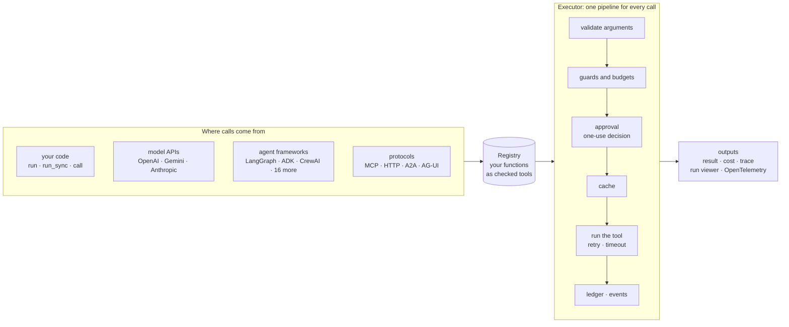
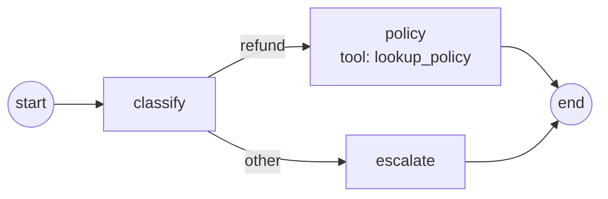

<p align="center">
  <picture>
    <source media="(prefers-color-scheme: dark)" srcset="docs/assets/logo-dark-outlined.svg">
    
  </picture>
</p>

<h3 align="center">The agentic framework that runs your tools anywhere, safely.</h3>

<p align="center">
  Write a tool once, as a plain Python function. Use it in any agent framework, any backend or on its own, with approvals, budgets, cost and traces built in.
</p>

<p align="center"><a href="https://agent-adapter.veloceai.in/assets/video/agent-adapter-reel.mp4"></a><br><sub>Watch it in 29 seconds · <a href="https://agent-adapter.veloceai.in/reel/">share it</a></sub></p>

<p align="center">Version 1.1.1 · Python 3.11+ · Apache-2.0 · 21 frameworks and engines · Coverage gate 90%</p>

<p align="center"><a href="https://www.producthunt.com/posts/agent-adapter?utm_source=badge-featured&utm_medium=badge&utm_campaign=agent-adapter" target="_blank"><picture><source media="(prefers-color-scheme: dark)" srcset="https://api.producthunt.com/widgets/embed-image/v1/featured.svg?post_id=1310997&theme=dark"></picture></a></p>

<p align="center">
  <a href="#quickstart">Quickstart</a> · <a href="#why-agent-adapter">Why</a> · <a href="#how-it-works">How it works</a> · <a href="#a-tour-in-code">Tour</a> ·
  <a href="#see-your-runs-and-chat-with-your-agent">Viewer and chat</a> · <a href="#install">Install</a> · <a href="https://agent-adapter.veloceai.in/">Docs</a> ·
  <a href="docs/use-cases.md">Use cases</a> · <a href="docs/skill.md">Agent skill</a> · <a href="docs/get-started/ai-prompt.md">Prompt for any AI</a>
</p>

Agent Adapter is an agentic framework built around your tools: write each tool once, run it in
LangChain, CrewAI, ADK or 18 more, from any backend or language, safe, priced and traced.

It is an open-source, framework-independent Python SDK. It turns your functions into LLM
tools, checks their schemas once at startup, and runs every call through one
executor that applies approval, budgets, guards, caching and cost tracking. The core
depends only on pydantic. Every framework is an optional extra, imported lazily.

No agent framework is needed: a FastAPI service calling an LLM gets tools, approvals,
budgets, cost, cache and context compression directly. The adapter can also be your
framework: `run_tool_loop` with your own model is the agent loop, and `Flow` is the graph.

> **Let your AI set it up.** Add the [agent skill](docs/skill.md) to Codex, Cursor, Copilot, Gemini CLI or 60+ more agents with
> `npx skills add VeloceAI/agent-adapter --skill agent-adapter -a <agent>` (e.g. `-a codex`), or in Claude Code `/plugin marketplace add VeloceAI/agent-adapter`.

## Quickstart

```python
import agent_adapter as aa


@aa.tool
def add(a: int, b: int) -> int:
    """Add two numbers."""
    return a + b


print(aa.call(add, a=1, b=2))  # 3: validated and guarded by the default executor
```

This is `examples/hello.py`, which the test suite runs. `@aa.tool` registers the function
on the default registry; `aa.call` runs it through the default executor. From async code
(FastAPI, ...) use `await aa.acall(add, a=1, b=2)`. The full walk-through is the
[Quickstart](docs/get-started/quickstart.md).

## Why Agent Adapter

Each framework has its own tool format, its own idea of approval and no shared view of cost.
Change framework, or run two, and the rules are rewritten. Agent Adapter keeps them in one place.

| You need | Without it | With Agent Adapter |
|---|---|---|
| A person to approve risky actions | each framework's own flag, easy to bypass | a one-use approval the executor checks on every call, from any source; it survives a restart |
| Spending limits | prices added up by hand | `BudgetHook` per run, user or team, per day or month; every call priced in a ledger |
| Rules you can prove | settings spread across code | one policy file for access, approvals, guards and budgets; a signed, hash-chained audit log |
| To change framework | rewrite the tools | keep them: one module per framework, the same tools everywhere |

## How it works

Every call, from any source, goes through the same executor. Frameworks, protocols and
model APIs are thin adapters around it, so the safety rules hold everywhere.



| Layer | Package | Does |
|---|---|---|
| Tools | `core`, `schema` | functions become `ToolSpec`s; schemas are checked once and rendered per provider |
| Execution | `exec`, `hooks`, `approval`, `cache`, `cost` | the pipeline above: validation, hooks, approval, cache, retries, ledger |
| Orchestration | `flow`, `exec.tool_loop` | portable graph flows and the built-in agent loop |
| Models | `models`, `embeddings`, `context` | model ports, fallbacks, usage, context compression |
| Edges | `integrations`, `server`, `handlers` | frameworks, MCP, HTTP, A2A, AG-UI, queues and serverless |
| Insight | `tracing`, `viewer`, `optimiser` | events, OpenTelemetry, the local run viewer and chat, offline tuning |

## A tour in code

### Human approval that survives a restart

A `confirm=True` tool runs only after a one-use approval. Park the call in SQLite and
resume it later, in any process (`examples/hello_approval.py`):

```python
@aa.tool(confirm=True)
def refund(order_id: str, amount: float) -> str:
    """Refund an order."""
    return f"refunded {amount} on {order_id}"


executor = aa.configure(approval=aa.DeferredApproval.sqlite(folder / "approvals.db"))
try:
    aa.call(refund, order_id="o-7", amount=500)
except aa.ApprovalPending as pending:
    approval_id = pending.approval_id  # store it, show it to a reviewer
# ... later, in any process that opens the same file:
result = executor.resume_sync(approval_id, True, decided_by="ana")
print(result.value)  # runs once; a second resume is refused
```

### Budgets, limits, cost and logs

```python
executor = aa.Executor(
    registry,
    hooks=[aa.LoggingHook(), aa.BudgetHook(0.50)],  # stop a run past $0.50
    ledger=aa.Ledger(),  # priced per call, per run
    limits=aa.RunLimits(max_calls=20),  # at most 20 tool calls a run
)
```

### A flow: decide, fan out, join, pause

A `Flow` is a validated graph over one pydantic state. The local `FlowRunner` runs it; the
same graph compiles to LangGraph and ADK (`examples/first_flow.py`):

```python
flow = (
    Flow("support", state=Ticket)
    .node("classify", classify)
    .node("policy", Call("lookup_policy", args=lambda t: {"category": t.category}, into="reply"))
    .node("escalate", escalate)
    .route(
        "classify",
        Route(
            lambda t: "policy" if t.category == "refund" else "escalate",
            targets=["policy", "escalate"],
        ),
    )
    .end("policy", "escalate")
)
result = run_sync(FlowRunner(Executor(registry)).run(flow, {"text": "I want a refund"}))
```



`Map` fans one node out over a list, `Join` merges the branches, `Merge` rules say how
parallel writes combine, and `pause=True` on a node waits for a person. See
[Flows](docs/concepts/flows.md) and [Chat flows by example](docs/how-to/chat-flows.md).

### Your own agent loop

`run_tool_loop` drives any model port through tool calls until it answers. Every call goes
through the executor, so approval, cache, budgets and cost apply (`examples/tool_loop.py`):

```python
model = CallableModel(my_llm, provider="host", model="router-v2")  # or OpenAIModel, ...
result = await run_tool_loop(model, registry, question, executor=executor)
print(result.finish, result.steps, result.final.text)
```

### The same tools over MCP and HTTP

```python
from agent_adapter.integrations.mcp import mcp_server
from agent_adapter.server import bearer_auth, create_app

server = mcp_server(registry, name="shop-tools")  # MCP, stdio or HTTP
app = create_app(registry, authenticate=bearer_auth(TOKENS))  # REST + SSE + OpenAPI, MCP at /mcp
```

The TypeScript client, A2A and AG-UI are in [Connect anywhere](docs/connect/index.md).

## See your runs and chat with your agent

Record runs with `agent_adapter.viewer.record(executor)`, then open the local viewer:
a run list, a navigable flow graph, a timeline, events with filters, state and cost. Start
it with an agent and the same page becomes a chat, like a playground for any framework:

<p align="center">
  
</p>

```bash
agent-adapter ui                                         # browse recorded runs
agent-adapter ui --agent app:chat                        # chat with any agent
agent-adapter ui --model app:model --tools app:registry  # the built-in tool loop
```

It binds 127.0.0.1 only and opens with a private token link. Try both live, nothing to
install: the [run viewer demo](https://agent-adapter.veloceai.in/assets/demo/sample-run.html#run=run_00000000000000000000000000000001)
(graph, replay, timeline, compare) and the [chat demo](https://agent-adapter.veloceai.in/assets/demo/chat-demo.html).

## Attach anywhere

| You have | Use |
|---|---|
| a script, a service, a notebook | `await executor.run(...)`; `run_sync(...)` from sync code (Flask, Django WSGI, Celery) |
| code you cannot edit | `registry.wrap(obj.method)`, unchanged |
| a raw model API | `chat_tools`, `function_declarations`, `anthropic_tools`, then `executor.run_call` per tool call; or `run_tool_loop` |
| an agent framework | one module and one extra per framework (LangGraph, ADK, LangChain, MCP, OpenAI Agents SDK, Pydantic AI, LlamaIndex, CrewAI, Agent Framework, Agno, Strands, Haystack, Claude Agent SDK, Semantic Kernel, DSPy, smolagents, AutoGen, CAMEL-AI, AG2) |
| another agent or a UI | A2A (server and client), AG-UI (event stream) |
| another language | MCP or HTTP, tested end to end from TypeScript, Python, C#, Go, Rust, Ruby, Java, Kotlin, Swift and PHP ([clients](examples/clients), [Connect anywhere](docs/connect/index.md)) |
| a queue, a Lambda, a pipeline | the [backend guides](docs/backends/scripts.md) |

## Safe by default

| Rule | What it means |
|---|---|
| One-use approval | A `confirm` tool runs only after the executor's `ApprovalPort` approves. A decision is used once, by the call it answers: same run, call id, tool and argument digest. No port: denied. One opt-in exception: an MCP server built with `client_approval=True` makes the MCP client's user the approver ([MCP approval](docs/integrations/mcp.md#approval)) |
| Framework approval never counts alone | A framework's own "approved" signal only adds a gate. A bridge passes approval only as a one-use token the adapter issued after its own port approved |
| HTTP server security model | No authenticator is a startup error unless anonymous mode is chosen. Ids are scoped to the caller; only the invoker or an approver sees an approval; hooks fail closed. See the [security model](docs/cross-language/http-server.md#security-model) |
| Local viewer and chat | 127.0.0.1 only, a private token link, Origin and CSRF checks, a strict content security policy; chat is off unless you pass an agent |
| Budgets and guards | `BudgetHook(max_usd)`, `once_per_run`, `RunLimits`, per-kind caps, rate limits, timeouts, retries |
| No secrets in logs | `LoggingHook` redacts secret-looking keys and never logs `confirm` tool arguments; foreign exceptions reach the model without their text |

## Features

| Area | What you get |
|---|---|
| Tools | `@registry.tool`, `registry.wrap()`; shaping (`fixed=`, `hide=`, `rename=`); portable-schema check; typed errors under `AdapterError` |
| Schemas | OpenAI (Chat, Responses, strict), Gemini and Anthropic renderers; strict-mode `null` means "use the default" |
| Execution | `run`, `run_many`, `run_plan` waves, `parallel`, `as_completed`; retry, timeout, hooks, run guards |
| Multi-agent | agents as tools (`agent_tool`, `LoopAgent`) and handoffs (`handoff`, `HandoffModel`) in one run, with a depth guard |
| Guardrails | `PIIGuard` (emails, phones, cards, IBANs, secrets; no model), `CallableGuard`, Presidio, NeMo; block, redact or approve |
| Policy file | access, approvals, guards, budgets and limits per tool, team and environment in one YAML, TOML or JSON file; `agent-adapter policy check` ([Policy file](docs/concepts/policy.md)) |
| Audit log | a signed, hash-chained log of approvals, guard blocks, budget stops and memory erases; `agent-adapter audit verify` and export to CSV ([Audit log](docs/concepts/audit.md)) |
| Flows | a portable `Flow` (route, map, join, loop, pause, sub-flows, node cache) with a local runner; compiles to LangGraph and ADK |
| Approval | ports (`AutoApprove`, `CallbackApproval`, `DeferredApproval`), stores (SQLite, Redis, SQLAlchemy, DynamoDB), batch approval, framework bridges |
| Cost and cache | priced ledger with context windows, usage normalisers; tool-result, LLM-response and provider prefix caches |
| Models | `OpenAIModel`, `GeminiModel`, `AnthropicModel`, `CallableModel`, `FallbackModel`, `run_tool_loop`; recipes for Bedrock, Azure OpenAI, Mistral, Groq, OpenRouter |
| Context compression | a `CompressionPolicy` (trim, cut, shrink tool results, de-duplicate, rank, summarise) with your own models; `compress_for` keeps every framework's own message type |
| Cross-language | MCP server and importer, HTTP tool server (ASGI and WSGI), TypeScript client, A2A, AG-UI |
| Observability | standard `logging`, an event catalogue, sinks, OpenTelemetry GenAI spans (Langfuse, Phoenix, OpenLLMetry); the local run viewer and chat page |
| Durability | crash-safe flows and tool loops (checkpoint stores, `recover`); Temporal or DBOS as the engine |
| Sandboxed code | `code_tool` over Docker or a hosted sandbox; every run needs approval |
| Memory and RAG | per-user memory (`SQLiteMemory`, Mem0, Zep, Graphiti) through `memory_tools`; `retriever_tool` with citations and host-set scope filters |
| Evals | `run_eval` on any agent with graders (exact, regex, JSON schema, tools, cost, latency, LLM judge); JUnit, Markdown and JSON reports; `agent-adapter eval`; a pytest plugin; an Evals tab in the viewer |
| Evals from production and cost advisor | recorded runs become eval cases ([Evals from production](docs/how-to/evals-from-production.md)); a cheaper model per flow node or stage that keeps the score ([Cut model costs per step](docs/how-to/cut-model-costs.md)) |
| Optimiser | offline Propose → Probe → Compose loop over your eval cases that writes a reviewable diff |

The full list, with a guide for each feature: [Features](docs/features.md). Next: the [Roadmap](docs/roadmap.md).

## Install

Requires Python 3.11 or later.

```bash
pip install agent-adapter                 # core (pydantic only)
pip install "agent-adapter[openai]"       # + the extras you need
```

| Extra | Adds |
|---|---|
| `openai`, `gemini`, `anthropic` | the provider SDK, for the model ports |
| `langgraph`, `langchain`, `mcp`, `openai-agents`, `pydantic-ai`, `llamaindex`, `agent-framework`, `agno`, `haystack`, `claude-agent`, `smolagents`, `autogen`, `ag2` | that framework |
| `crewai`, `strands`, `semantic-kernel`, `adk`, `camel`, `dspy` | that framework, in its own environment ([why](docs/integrations/index.md#install-several)) |
| `a2a`, `ag-ui` | that protocol |
| `openapi` | `import_openapi` (httpx, PyYAML) |
| `server`, `server-wsgi` | the HTTP tool server (Starlette + uvicorn; a2wsgi) |
| `redis`, `otel` | Redis cache and stores; OpenTelemetry sink |
| `sqlalchemy`, `dynamodb` | database approval stores |
| `presidio`, `nemo` | the Presidio and NeMo Guardrails guards (not in `all`) |
| `mem0`, `zep`, `graphiti` | memory backends (not in `all`) |
| `temporal`, `dbos` | flows on Temporal or DBOS (not in `all`) |
| `all` | every extra that co-installs; not `crewai`, `strands`, `semantic-kernel`, `adk`, `camel`, `dspy`, `presidio`, `nemo`, `mem0`, `zep`, `graphiti`, `temporal`, `dbos` |
| `dev`, `docs` | tests, linters, nox; the docs site |

Pins per extra: [Install](docs/get-started/install.md#extras), [Support matrix](docs/support-matrix.md).

## Command line

| Command | Does |
|---|---|
| `agent-adapter init fastapi my-service` | writes a starter project from a tested template (`script`, `fastapi`, `flask`, `celery`, `langgraph`, `openai-agents`, `mcp-server`, `pydantic-ai`, `adk`, `agno`, `strands`, `crewai`) |
| `agent-adapter policy check policy.yaml --env prod` | checks a policy file and prints the effective rules per tool |
| `agent-adapter audit verify .agent_adapter/audit` | checks the audit log's signatures and chain; `audit export` writes JSONL or CSV |
| `agent-adapter migrate src/ --diff` | finds framework tools and prints a suggested patch to registry tools (read-only) |
| `agent-adapter doctor` | checks Python, installed extras, optional backends (guards, OTel exporters), integrations and the pip index |
| `agent-adapter ui` | the local run viewer; with `--agent` or `--model`, the chat page |
| `agent-adapter eval app:agent cases.jsonl --min-score 0.9` | grades an agent on eval cases; exits 1 below the score or on a regression |
| `agent-adapter guide` | prints the guide for AI coding agents (`AGENTS.md`); `--full` adds every signature |

## Project layout

```text
agent_adapter/   the package: one sub-package per layer (see "How it works")
examples/        runnable examples; the test suite runs them, the docs include them
docs/            the MkDocs site: get started, how-to, concepts, reference, demos
tests/           pytest suite mirroring the package, plus docs, example and JS tests
clients/         the TypeScript client for the HTTP tool server
scripts/         check.py (every gate) and the generators for docs and guides
```

Working on the code itself? [`CODEBASE.md`](CODEBASE.md) is the map: architecture, where
everything lives, the rules, the gates and the generated files.

## Documentation

The site is [agent-adapter.veloceai.in](https://agent-adapter.veloceai.in/); its source is
`docs/` (MkDocs Material, `mkdocs build --strict`). Start with **How-to → Attach anywhere**, or
build a whole app with the [golden path tutorial](docs/tutorials/golden-path.md). Before
production, read the [threat model](docs/guides/threat-model.md) and the
[API stability policy](docs/contributing/stability.md).

## Development

```bash
pip install -e ".[dev,docs,openapi]"   # openapi brings httpx, which mypy checks against
python scripts/check.py
```

`scripts/check.py` runs every gate in order and stops at the first failure: pytest with
coverage (≥ 90 %, warnings are errors), `ruff check`, `ruff format --check`, `mypy --strict`
and `mkdocs build --strict`. The nox sessions in `noxfile.py` run the same suite per Python
version and per integration. Releases follow [`docs/contributing/release.md`](docs/contributing/release.md);
changes are listed in [`CHANGELOG.md`](CHANGELOG.md).

## Licence

Apache License 2.0. See [`LICENSE`](LICENSE) and [`NOTICE`](NOTICE). Copyright 2026 Veloce AI.
