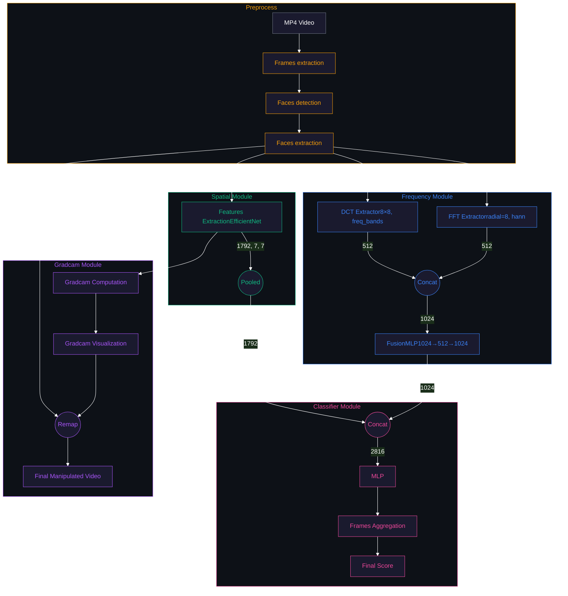
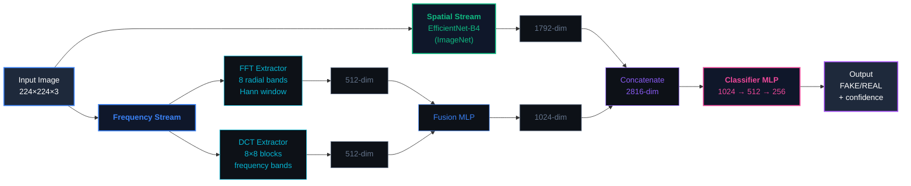

# VeridisQuo


<table>
<tr>
<td width="60%" >
    
### *Where is the truth?*
    
#### **What is Veridis Quo?**

A state-of-the-art neural network designed to **detect deepfake videos** and **highlight the altered areas** in each frame using explainable AI.

---

#### **Try it online!**
<p align="center">
  <a href="https://huggingface.co/spaces/Gazeux33/veridisquo-deepfake-detection" target="_blank">
    
  </a>
</p>

</td>
<td width="40%" valign="middle" align="center">

</td>
</tr>
<tr>
<td colspan="2" align="center">

### **Result**

</td>
</tr>
</table>


# Pipeline



---

## Model Architecture

### Hybrid Detection System


### Model Specifications
| Specification | Value |
|:--------------|:------|
| **Total Parameters** | 25.05M params |
| **Input Size** | 224×224 RGB |
| **Output** | Binary (FAKE/REAL) + confidence |
| **Backbone** | EfficientNet-B4 (19.34M params) |
| **Frequency Module** | 2.16M params |
| **Classifier** | 3.54M params |


---


## Training
<table>
<tr>
<td width="60%" valign="top">

### Infrastructure
We trained the model on an **RTX 3090** (with CUDA) for approximately **4 hours**.
We used the GPU provider <a href="https://vast.ai/" target="_blank">vast.ai</a>

The training file is located in the `training/trainer.py` module

</td>
<td width="40%" valign="middle">

| Specs | |
|:---------|:---|
| **GPU** |  |
| **Framework** |  |
| **Duration** |  |

</td>
</tr>
</table>

---

## Dataset
<table>
<tr>
<td width="50%" valign="top">

### Source
We started from an existing dataset found on Kaggle:  
**<a href="https://www.kaggle.com/datasets/xdxd003/ff-c23" target="_blank">FaceForensics++ Dataset (C23)</a>**

Containing **7000 videos** with numerous deepfake techniques:
<p>
  
  
  
  
</p>

We extracted the frames and faces from these videos to create our dataset:
**<a href="https://www.kaggle.com/datasets/gazeux330000/deepfake-dataset/settings" target="_blank">VeridisQuo Preprocessed Dataset</a>**

### Preprocessing Pipeline
The dataset was built using the following pipeline:
1. **Frame Extraction**: 1 FPS from videos (PyAV GPU-accelerated)
2. **Face Detection**: [YOLOv11n-face-detection](https://huggingface.co/AdamCodd/YOLOv11n-face-detection) (confidence ≥ 0.7)
3. **Face Extraction**: 224×224 crops with 20px padding
4. **Dataset Split**: Stratified 70/15/15 split
5. **Class Balancing**: Oversample minority class


</td>
<td width="50%" valign="top">

### Distribution
| Split | Samples | Ratio |
|:-----:|--------:|:-----:|
| **Train** | 499,965 | 70% |
| **Test** | 107,620 | 15% |
| **Eval** | 108,853 | 15% |

<p><strong>Total: 716,438 images</strong></p>

</td>
</tr>
</table>

---

## Configuration & Results
<table>
<tr>
<td width="30%" valign="top">

### Configuration
| Parameter | Value |
|:----------|:------:|
| `batch_size` | 64 |
| `learning_rate` | 0.0001 |
| `min_learning_rate` | 0.000001 |
| `num_epochs` | 7 |
| `weight_decay` | 0.0001 |
| `optimizer` | AdamW |
| `scheduler` | Warmup + Cosine Annealing |
| `warmup_epochs` | 2 |
| `use_automixed_precision` | false |
| `loss_func` | CrossEntropyLoss |

<br>
<p align="center">
  <a href="https://huggingface.co/Gazeux33/VeridisQuo/tree/main" target="_blank">
    
  </a>
</p>

</td>
<td width="70%" valign="top">

### Results

**Training Accuracy**
<br>


**Training Loss**
<br>


<!--**Validation Accuracy**
<br>


**Validation Loss**
<br>
-->


</td>
</tr>
</table>

## API Reference

### Endpoints

| Method | Endpoint | Description |
|:-------|:---------|:------------|
| `GET` | `/api/v1/health` | Health check and model status |
| `POST` | `/api/v1/analyze` | Analyze video for deepfakes |
| `GET` | `/api/v1/outputs/{filename}` | Download GradCAM visualization |
| `DELETE` | `/api/v1/outputs/{filename}` | Delete output file |

### Request Format (POST /api/v1/analyze)

```bash
curl -X POST http://localhost:8000/api/v1/analyze \
  -F "file=@video.mp4" \
  -F "fps=1" \
  -F "aggregation_method=majority" \
  -F "generate_gradcam=true"
```

**Parameters**:
- `file`: Video file (MP4, AVI, MOV, MKV, WEBM)
- `fps`: Frames per second to extract (default: 1)
- `aggregation_method`: Score aggregation (default: majority)
- `generate_gradcam`: Generate visualization video (default: false)

### Response Format

```json
{
  "prediction": "FAKE",
  "confidence": 0.8734,
  "aggregation_method": "majority",
  "total_frames": 120,
  "gradcam_video_path": "/api/v1/outputs/gradcam_video_20250102.mp4"
}
```

---


## Quick Start

### Prerequisites
- Python 3.12 or 3.13
- [uv](https://docs.astral.sh/uv/) package manager
- Node.js 18+ and npm (optional, for frontend)
- CUDA 11.8+ (optional, for GPU acceleration)

### Clone project

```bash
# Clone repository
git clone https://github.com/VeridisQuo-orga/VeridisQuo.git
cd VeridisQuo
```

### Launch backend

```bash
chmod +x ./scripts/launch_api.sh
./scripts/launch_api.sh

```

server runs on `http://localhost:8000` | Docs at `/docs`

### Launch frontend

```bash
chmod +x ./scripts/launch_frontend.sh
./scripts/launch_frontend.sh
```
Development server on `http://localhost:3000`

<p align="center">

<p/>

---


## Citation

If you use VeridisQuo in your research, please cite:

```bibtex
@software{veridisquo2025,
  title = {VeridisQuo: Hybrid Deepfake Detection with Explainable AI},
  author = {Castillo, Theo and Barriere, Clement},
  year = {2025},
  url = {https://github.com/VeridisQuo-orga/VeridisQuo},
  note = {Model: \url{https://huggingface.co/Gazeux33/VeridisQuo}}
}
```


