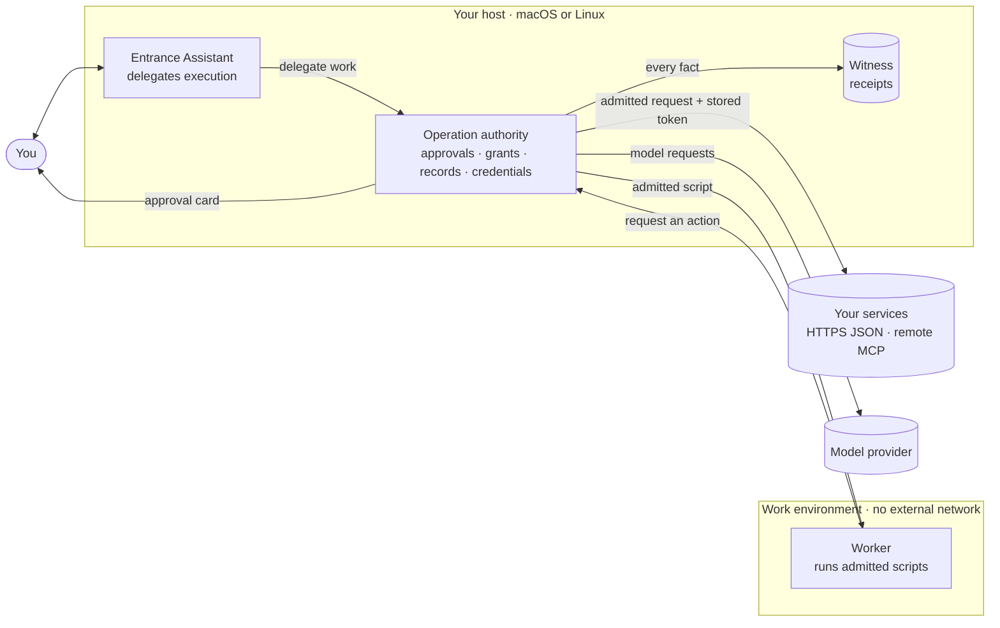

# Vardock

<p align="center">
  <picture>
    <source media="(prefers-color-scheme: dark)" srcset="packages/client/ui-brand-official/src/client/assets/vardock-logo.png">
    
  </picture>
</p>

<p align="center">
  <strong>An open-source harness for delegating work to autonomous AI agents through conversation and keeping them running end to end under strict rules.</strong>
</p>

<p align="center">
  <a href="#start-on-macos">macOS</a> · <a href="#start-on-linux">Linux</a> · <a href="#how-it-works">How it works</a> · <a href="SAFETY.md">Safety</a> · <a href="packages/experimental/assistant/vardock/README.md">Setup guide</a> · <a href="CONTRIBUTING.md">Contributing</a> · <a href="CHANGELOG.md">Changelog</a>
</p>

<p align="center">
  <a href="LICENSE"></a>
  <a href="#status"></a>
  <a href="packages/experimental/assistant/vardock/README.md"></a>
  <a href="packages/experimental/assistant/vardock/README.md#choose-a-model-provider"></a>
</p>

<div align="center">

English | [日本語](README.ja.md) | [中文](README.zh.md)

</div>

Vardock works with a range of foundation models through their APIs or a local Codex, and runs the multiple jobs delegated from a single conversation in the background, including approved scheduled tasks.

Because it runs autonomously without assuming you are watching, Vardock does not rely on model alignment or prompt engineering to decide when approval is needed. A separate operation authority process, outside the model, makes that decision deterministically from fixed rules. Code generated by the agents runs in an isolated environment with no external network access. Communication with external services passes without confirmation only when it matches a rule, and otherwise waits for human approval of the exact content. Every operation is also recorded by a separate witness process, so the records can be checked for consistency afterwards.


*Try sample → automatic scripts and a returned report → a reviewed practice-inventory update with a confirmed outcome. Waiting intervals are cut; retained footage plays at normal speed.*


Vardock is built on [DeepSeek Harness (DSH)](https://github.com/deepseek-ai/deepseek-harness) and keeps its Cordis plugin architecture. It is an independent derivative project, not an official DeepSeek product or an endorsement by DeepSeek.

<a id="why-vardock"></a>

## Why Vardock

When a local agent holds service tokens and has direct network access, the process reading untrusted text can also decide what gets sent. Vardock separates those roles.

By default, external business requests wait for your approval of the exact saved request unless an owner rule admits them. Notes and schedules always ask for approval. Routine scripts run without an approval card.

| | A local agent with direct tool access | Vardock |
|---|---|---|
| Who talks to you | The agent that also runs the tools | One entrance Assistant that delegates execution |
| Where code runs | Your shell, your network | macOS: an Apple Container Linux VM. Linux: a Docker container with the selected runtime. Only loopback networking. |
| Who holds service tokens | The agent process or its environment | Stored by the authority; kept out of model inputs and worker environments |
| What you approve | A tool call as the agent describes it | The exact saved content: external requests your rules do not admit; notes and schedules always; scripts when per-script review is enabled |
| Who decides whether to ask you | The model’s own judgment, which can vary and be steered by the text it reads | Rules you wrote, evaluated by the authority; the same request under the same rules and authority state gets the same decision |
| What is left afterwards | A chat transcript alone | An operation record plus a receipt from a separate witness process, comparable with `pnpm vardock verify` |
| When a result is unknown | The agent may retry | An unresolved external request is not automatically resent; later requests to the same action wait for your decision, and the work shows an unknown outcome |

These properties hold for the paths Vardock configures. [Safety](SAFETY.md) lists what is and is not guaranteed.

On macOS, the work environment is an Apple Container Linux VM. On Linux, it is a Docker container with no network device other than loopback; its isolation depends on the selected runtime. runc is an ordinary container sharing the host kernel, not a VM boundary. runsc (gVisor) uses a user-space kernel; its PID limit counts sandbox host tasks and does not bound guest processes. Kata provides a VM boundary in kind, but this project has not verified it.

<a id="how-it-works"></a>

## How it works



| Step | What happens | What you see |
|---|---|---|
| 1. Ask | You talk to the entrance. It cannot run scripts or reach services; it delegates work with the permissions that work needs. | The work appears with its status, remaining reservations, and expiry. |
| 2. Run | A worker writes a script. The authority stores and admits it for automatic execution in the work environment under the work’s grant. | Execution output and witness evidence, with no script approval card by default. With `--review-scripts`, the exact script waits for **Allow once**. |
| 3. Reach out | A script asks the authority to perform a configured *action*. The worker has no network and no service token. | An approval card with the destination and exact body, unless one of your rules admits it. |
| 4. Record | The authority reports each admission, decision, and outcome to the witness and keeps the receipt. | **Business records** lists every outside request, including those sent by a rule. |
| 5. Verify | While Vardock is running, `pnpm vardock verify` compares witnessed operation events and the current configuration record with the authority's receipts. | `OK  Every compared event matches.` or one line per mismatch. |


<a id="what-you-can-do"></a>

## What you can do

| You want to | Vardock gives you |
|---|---|
| Hand off a task | One conversation that delegates to workers and reports results, waits, and unresolved outcomes |
| Let agents run code | Automatic shell, Node.js, and file processing in the isolated work environment, with recorded and witnessed execution |
| Connect your own systems | Actions over HTTPS JSON routes or tools of remote MCP servers; tokens are saved under **Connections** and stay in the authority |
| Skip routine approvals | Owner rules evaluated by the authority, with optional top-level field conditions and limits on other fields a request may carry |
| Keep work going | Scheduled tasks and entrance notes that always require your approval of their exact content; no unattended rule skips that decision |
| Move files | Selected attachments in, retained artifacts out, under the work's transfer and disclosure permissions |
| Check afterwards | Operation records and witness receipts that survive restarts, and a lookup for outcomes a service can confirm |

The default setup permits no actions and no general external destinations. [Rule limits](SAFETY.md#approval-recovery-and-completion) · [Guarantees and limits](SAFETY.md#threat-model)

Try the [six-stage inventory practice](examples/practice/README.md) to approve an exact request, inspect witness receipts, and confirm its outcome without a service account. Then enable the read rule and see reads proceed while updates still wait.

<a id="reads-automatic-sends-reviewed"></a>

### Reads automatic, sends reviewed

After you configure the actions and grant work permission to use them, you can choose this pattern. Action names do not decide approval; your rules do. [Configure this pattern](packages/experimental/assistant/vardock/README.md#connect-a-service).

| Operation | Rule | What happens |
|---|---|---|
| Search or read | An owner rule admits the action | Sent and recorded with witness evidence, without asking you |
| Send a message | No owner rule admits the action | Approval card with the destination and exact saved body; sending waits for you |
| Run a script | Default automatic-script setting | Runs in the isolated work environment without asking; execution is recorded and witnessed |

Unresolved requests to an action still require a decision before another request to that action can proceed. [Recovery rules](SAFETY.md#approval-recovery-and-completion).

<a id="run"></a>

<a id="run-from-source"></a>

<a id="start-on-macos"></a>

## Start on macOS

Vardock runs on Apple silicon Macs with macOS 26 or later and a native arm64 Node.js 24.9 or later. Setup also needs Xcode Command Line Tools, Apple Container, and the repository's pinned pnpm.

```sh
pnpm install
pnpm vardock setup --model-provider openai --model "<model-id>"
pnpm vardock start
```

Replace `openai` and `<model-id>` with your provider route and model ID, then save the API key under **Connections** on the Plugins page. To use Local Codex instead, sign in with the Codex CLI and pass `--model-provider codex-local --model default`. [Choose a model provider](packages/experimental/assistant/vardock/README.md#choose-a-model-provider)

<a id="start-on-linux"></a>

## Start on Linux

Install Node.js 24.9 or newer with development headers and a C compiler, the pinned pnpm, `lsof`, systemd user services with lingering enabled, and Docker Engine with cgroup v2 and a local Unix socket. Install and register the selected runtime first. The deployment's user service manager needs access to Docker. [Linux prerequisites](packages/experimental/assistant/vardock/README.md#linux)

```sh
pnpm install
pnpm vardock setup --model-provider openai --model "<model-id>" --runtime runsc
pnpm vardock start
```

Choose the model provider and save its key as above. `--runtime runc` uses ordinary container isolation; `--runtime runsc` uses gVisor; `--runtime kata` selects Kata, which is unverified by this project and needs working KVM. `pnpm vardock doctor` checks daemon capabilities, runtime registration and service listeners; it does not verify runtime boot or isolation. Linux start prints an owner-token URL: keep it private and use SSH port forwarding for remote access. [Runtime and access limits](packages/experimental/assistant/vardock/README.md#linux)

The following options and commands apply on both platforms:

- `--review-scripts`: add to setup to require approval of every script. [Script review](packages/experimental/assistant/vardock/README.md#try-a-first-work-request).
- `--authority-patch <file>`: add to setup to apply your authority configuration patch. [Authority patches](packages/experimental/assistant/vardock/README.md#connect-a-service).

| Command | What it does |
|---|---|
| `pnpm vardock start` | Start the witness, authority, and Web Host; macOS opens the entrance, Linux prints its URL |
| `pnpm vardock doctor` | Check prerequisites and running services without changing them |
| `pnpm vardock verify` | While services are running, compare witnessed operation events and the current configuration record with the authority's receipts |
| `pnpm vardock stop` | Stop the services and keep their data |

The [setup guide](packages/experimental/assistant/vardock/README.md) covers prerequisites, options, connecting services, recovery, and removal.

<a id="developer-preview"></a>

<a id="status"></a>

## Status

Vardock is a developer preview for local evaluation from a source checkout.

| | |
|---|---|
| New setups | Scripts run automatically; external business requests wait unless an owner rule admits them; notes and schedules always ask. Existing deployments keep their settings. |
| Supported | Single-owner deployments on Apple silicon macOS and Linux |
| Linux verification | One arm64 Ubuntu VM with Docker 29.9, runc and runsc |
| Linux not verified | Kata, x86_64, other distributions and rootless Docker |
| Not provided | A published npm package or desktop installer; Windows hosts; multiple users |
| Not claimed | Complete mediation of everything a host can do, an independent security audit, or enterprise isolation |
| May change | APIs and saved state, incompatibly; [upgrade guides](docs/upgrade-guide/v0.2.2-rc.2-vardock/) record each break |

`npx @deepseek-ai/dsh web` installs upstream DSH, not this Vardock configuration. Read [Safety](SAFETY.md) before running the project.

<a id="terms"></a>

<details>
<summary><strong>Terms used in the documents</strong></summary>

| Term | Meaning |
|---|---|
| Entrance | The one Assistant conversation you talk to. It delegates work and reports results; it does not run scripts. |
| Worker | An Agent in its own Session that performs one delegated request and runs its scripts in the work environment. |
| Authority | The operation authority process. It admits, reserves, and records every operation and holds the model and service credentials. |
| Witness | A separate process that stores each fact the authority reports and returns a receipt for it. |
| Broker | A provider inside the authority that sends an admitted request to a configured HTTPS endpoint or remote MCP tool with the stored token. |
| Action | The ID of one configured broker route or MCP tool. Work can request only the actions its grant lists. |
| Grant | The permissions, reservation limit, and expiry the authority enforces. Each delegation receives a grant inside it. |
| Reservation | One unit of the grant's limit, taken by each model request, script, broker request, file transfer, delegation, and entrance response. |
| Unattended rule | An owner or operator rule that admits matching operations without a decision. The authority still records and witnesses them. |

</details>

<a id="composition-and-development"></a>

<a id="documentation"></a>

## Documentation

| Read | For |
|---|---|
| [Safety](SAFETY.md) | The threat model, what each guarantee covers, and its limits |
| [Setup guide](packages/experimental/assistant/vardock/README.md) | Installing, connecting services, recovery, removal |
| [Assistant](packages/experimental/assistant/README.md) | The entrance, delegation, schedules, notes, and the `pnpm vardock` commands |
| [Operation control](packages/experimental/operation-control/README.md) · [evidence](packages/experimental/operation-evidence/README.md) · [broker](packages/experimental/operation-broker/README.md) | The authority, the witness, and the routes to your services |
| [Execution container](packages/experimental/execution-container/README.md) | The work environment and its limits |
| [Contributing](CONTRIBUTING.md) · [DSH architecture](docs/architecture.md) · [Development](docs/development.md) | Changing Vardock |
| [Security](SECURITY.md) · [Code of conduct](CODE_OF_CONDUCT.md) · [Changelog](CHANGELOG.md) | Reporting a vulnerability, conduct, and releases |

<a id="relation-to-deepseek-harness"></a>

<a id="built-on-deepseek-harness"></a>

## Built on DeepSeek Harness

DeepSeek Harness supplies the agent runtime, plugin system, Sessions, tools, approval UI, and much of this repository. Vardock's own packages are `assistant`, `operation-control`, `operation-evidence`, `operation-broker`, `execution-container`, and [`llm-codex`](packages/experimental/llm-codex/README.md) under `packages/experimental/`. They remain Cordis components: replace a provider through its declared service and profile configuration; the Agent loop is DSH's. Inherited documents can describe profiles, tools, and features that the Vardock deployment does not mount, and existing `dsh` commands and `@deepseek-ai/dsh-*` package names remain technical identifiers.

The upstream CI automation (GitHub Actions workflows, the GitLab pipeline, release and publication workflows, issue and review routing, and Dependabot configuration) is not part of Vardock, and the repository uses no hosted CI. When merging upstream changes, drop changes to that automation and to the scripts and tests that only served it. The inherited `pnpm run release:*` scripts and `@deepseek-ai` package namespaces are DSH infrastructure, not a Vardock release channel. Do not use them to publish Vardock packages or bundled binaries without configuring destinations and reviewing redistribution requirements.

Vardock was created at VirtualHatch Inc.

<a id="get-in-touch"></a>

## Get in touch

- Questions and ideas: [GitHub Discussions](https://github.com/VirtualHatch-Inc/Vardock/discussions).
- Contact VirtualHatch: [contact form](https://vhatch.co.jp/contact/).
- Security reports: follow [Security](SECURITY.md).

The team behind Vardock is looking for people who want to build it with us. If that interests you, please reach out through the channels above.

<a id="upstream-attribution-and-license"></a>

<a id="license"></a>

## License

DeepSeek Harness's original copyright and [MIT License](LICENSE) are retained, and Vardock's source modifications are distributed under the same MIT terms. [Third-party notices](THIRD_PARTY_NOTICES.md) document dependencies with their own licenses; the MIT license does not replace those terms.

The Vardock name and logo identify this project and are not licensed under the MIT terms; a derivative needs its own name and artwork. The logo artwork was created with ChatGPT and supplied by the project owner, who confirmed permission to redistribute it with this project. It does not imply DeepSeek endorsement. Upstream DeepSeek names and artwork remain subject to the [upstream brand guidelines](BRAND_GUIDELINES.md).
