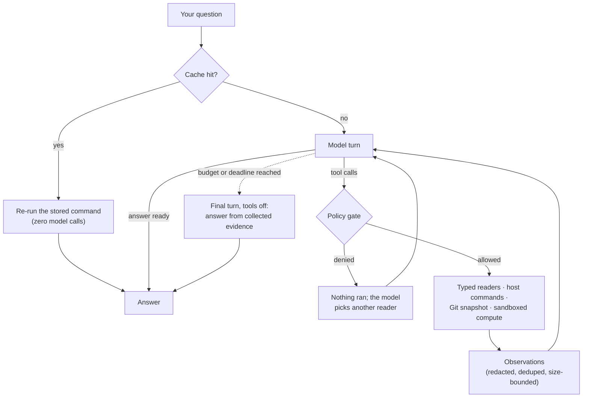

# get — get anything from your computer

[](https://github.com/Water-Run/get/actions/workflows/windows-ci.yml)
[](https://github.com/Water-Run/get/releases)
[](LICENSE)


**[中文](README-zh.md)** · English

Ask your computer a question in plain language. `get` looks around the machine, gathers evidence with typed readers and known query commands, and answers from what it actually found.

```bash
get "IP address of this device"
get "code structure in the current directory"
get "current git branch and uncommitted files"
```

It is a **query tool**: designed to read your system, never to change it. Every proposed command passes a mandatory read-only policy before it runs — a denied command simply doesn't execute. Free-form computation, where it exists at all, runs inside a locked-down Linux sandbox with no network.

**At a glance**

- **Natural language in, plain answers out** — no flags to memorize for everyday questions.
- **Bring your own model** — any OpenAI-compatible Chat Completions endpoint works.
- **Read-only by design** — allowlist policy, fail closed; optional confirmation and a second model review on top.
- **Local evidence** — environment, files, search, processes, Git status/diff, sandboxed scripts.
- **Zero runtime dependencies** — one self-contained program per platform; the Markdown renderer, cache, and logs are built in.

## Requirements

| System | Build | Notes |
|---|---|---|
| Linux | x86-64 | kernel 6.0+ recommended; sandboxing uses bubblewrap when present |
| Windows | x64 | Windows 10 or newer; OpenSSL and zlib DLLs ship in the package |
| macOS | Apple Silicon | macOS 13 or newer |

You also need an API key for some OpenAI-compatible provider. Python is optional — only the interactive installer uses it.

## Install

Download a package from [GitHub Releases](https://github.com/Water-Run/get/releases) and keep its files in one directory. Both methods below leave an existing configuration untouched.

### With the installer

If you have Python, the installer copies the program, updates your `PATH`, and offers to configure a model:

```bash
python get_ready.py
get version        # prints 4.0.0 when everything is in place
```

The installer is bilingual (English/中文, auto-detected) and interactive. It installs per-user only — no system directories, no admin rights:

| System | Install target |
|---|---|
| Linux | `~/.local/bin/get` (+ optional man page in `~/.local/share/man/man1/`) |
| macOS | `~/.local/bin/get` |
| Windows | `%LOCALAPPDATA%\Programs\get\get.exe` (+ the three runtime DLLs) |

On Linux it appends a marked block to `~/.profile`, `~/.bashrc`, or `~/.zshrc`; on Windows it updates the per-user `Path` in the registry. Re-running it on an upgrade preserves your configuration, key, cache, and logs.

### Manually

Copy the binary for your system onto your `PATH`:

| System | From the package | Install as |
|---|---|---|
| Linux | `get-linux-x64` | `~/.local/bin/get` |
| macOS | `get-macos-arm64` | `~/.local/bin/get` |
| Windows | `get-windows-x64.exe` | `%LOCALAPPDATA%\Programs\get\get.exe` |

On Linux and macOS, `chmod +x` the installed file. The manual page is optional: copy `get.1` to `~/.local/share/man/man1/get.1`.

> [!IMPORTANT]
> On macOS, remove the quarantine attribute before the first run:
>
> ```bash
> xattr -d com.apple.quarantine ~/.local/bin/get
> ```

> [!NOTE]
> On Windows, `libcrypto-3.dll`, `libssl-3.dll`, and `zlib1.dll` must stay in the same folder as `get.exe`. They are unmodified Cygwin-repository builds of OpenSSL 3.5.7 and zlib 1.3.2 — licenses and checksums are in [THIRD_PARTY_NOTICES.md](THIRD_PARTY_NOTICES.md).

## Connect a model

`get` speaks the OpenAI Chat Completions protocol, so any compatible provider works. Point it at yours with three settings:

```bash
get set url    https://your-provider.example/v1
get set model  your-model-name
get set key    your-api-key
get isok       # checks the settings, then does one minimal live round-trip
```

Out of the box `get` points at `https://api.minimaxi.com/v1` with the model `minimax-m3` — set your own and you're done. `get isok` verifies that the key, URL, and model are set, sends a tiny "reply with exactly ok" request, and reports the answer.

> [!NOTE]
> Your key is never printed or written to logs. It is stored as a `0600`-permission file on Linux and macOS, and DPAPI-encrypted on Windows.

## How a query works

The model receives your question plus a small toolbox of typed readers, and answers from what they return. It works in bounded turns: propose evidence gathering → observe → refine → answer. A run stops at the first final answer, or when the turn, tool-call, or time budget runs out — then a last tools-off turn answers from whatever was collected.



### Harnesses

The *harness* controls how evidence is gathered:

| Harness | Turns & concurrency | Best for |
|---|---|---|
| `auto` *(default)* | up to 6 inspection turns + 1 answer turn, batches up to `max-parallel` | everyday questions — look around, then answer |
| `direct` | exactly 1 turn, at most 1 tool call | cheap, simple lookups |
| `loop` | serial — one call per turn, observations feed the next | dependent chains of steps |
| `parallel` | same budget as `auto`, encourages concurrent batches | comparing independent facts |

```bash
get "compare disk and memory usage" --harness parallel
get "show the current directory"     --harness direct
```

### Tools

| Tool | What it does |
|---|---|
| `read_environment` | Reads named host environment values; credential-looking names come back as `[redacted]` |
| `read_file` | Reads one line-numbered page of a text file (up to 1000 lines per page) |
| `search_files` | Lists files by glob or searches literal file contents; honors `.gitignore` and friends |
| `run_process` | Runs a known query executable with literal arguments — no shell string involved |
| `run_shell` | Runs a bounded shell command in your configured dialect |

`git status` and `git diff` questions are routed to a private snapshot reader rather than your live working tree (details under [Safety](#safety)).

Tool calls are sent as **native function calling** by default. If the provider rejects native tools, `get` automatically retries with a structured-JSON protocol; you can also pin one with `get set tool-protocol native|json|auto`.

> [!TIP]
> Write "without tools" into your query (English or Chinese) and `get` switches to text-only mode: no tools are offered and nothing executes.

## Safety

`get` is designed so that a hallucinating or hostile model still can't trash your machine. Protection is layered, and the inner layer is not optional:

**1. A mandatory read-only policy — fail closed.** Every command, including revised and cached ones, is validated against an allowlist before execution. Simple readers (`ls`, `cat`, `grep`, `ps`, `df`, `systeminfo`…), read-only package queries (`apt list`, `brew info`, `pip show`…), bounded network probes (`ping -c`, `dig`, read-only `curl`), and Git reads are allowed. Mutating tools (`rm`, `mv`, `chmod`, `kill`, `sudo`…), command substitution, `eval`, file-writing redirects, background jobs, and any executable not on the list are denied — the command doesn't run, and the model is told to pick a supported reader. If no safe revision is found inside the budget, the query fails with exit code `126`.

**2. Optional oversight, on top.** All off by default, none can weaken layer 1:

- `get set manual-confirm true` — asks `y/N` before each command; only a literal `y` approves.
- `get set double-check true` — a second model review of every call; any command it rewrites still passes the deterministic policy.
- `get set command-pattern '\b(ssh|curl)\b'` — your own extra deny regex, strictly additive.

**3. Sandbox what runs.**

| Capability | Linux | macOS | Windows |
|---|---|---|---|
| Typed readers, environment, search, processes | ✓ | ✓ | ✓ |
| Host query commands (`ps`, `df`, `systeminfo`…) | read-only sandbox *(if available)* | read-only sandbox | policy-gated |
| Git status / diff | snapshot | snapshot | snapshot |
| Free-form scripts and shell computation | isolated sandbox | — | — |

On Linux, free-form computation runs in a bubblewrap sandbox the model cannot influence: separate user/PID/network/IPC/UTS namespaces, running as `nobody` with all capabilities dropped, a seccomp filter that blocks socket, ptrace, and mount syscalls, a private writable scratch dir, and hard resource ceilings — 128 MiB memory, 8 processes, 30 s CPU, no network. **If the sandbox can't be established, the script doesn't run** (exit `125`); there is no unsandboxed fallback. On macOS and Windows, free-form scripts are simply not offered.

Two more details worth knowing:

- **Git questions don't touch your working tree.** Status and diff are computed over a private copy of the repository metadata, with executable filters and submodule inspection disabled, so a malicious repo config can't run code via `get`.
- **Credentials are redacted.** Environment values whose names look sensitive (tokens, secrets, keys…) are replaced with `[redacted]` before the model sees them, and child processes run with a scrubbed environment — around 200 injection variables (`BASH_ENV`, `NODE_OPTIONS`, `GIT_*`…) removed, hardened shell flags (`--noprofile --norc`), and a rebuilt `PATH`.

> [!CAUTION]
> The boundary guards against **mutation, not disclosure**. Whatever `get` reads is sent to your configured provider so it can be answered — treat it as shared with that provider. File contents are not passed through a general secret filter.

## Command reference

| Command | Purpose |
|---|---|
| `get "query" [flags]` | Ask a question (see [flags](#per-query-flags)) |
| `get set <option> [value]` | Set an option; omit the value to reset it to the default |
| `get config` / `get config --<option>` | Show all settings / one setting |
| `get config --reset` | Restore all defaults **and remove the stored key** |
| `get cache` / `--clean` / `--unset "query"` | Inspect / clear / selectively remove cache entries |
| `get log` / `--clean` | Inspect / clear the execution log |
| `get get [--name\|--version\|…]` | App info (`get author` and friends are aliases) |
| `get version` | Print the version |
| `get isok` | Verify settings with one live round-trip |
| `get help` | Built-in help |

## Configuration

Settings live in one JSON file (see [Files](#files--exit-codes)). Omit the value to reset one option; multi-word values don't need quotes:

```bash
get set model deepseek-chat
get set max-parallel 6
get set max-parallel      # back to the default
```

<details>
<summary><b>Connection &amp; model</b></summary>

| Option | Default | Description |
|---|---|---|
| `url` | `https://api.minimaxi.com/v1` | API base URL; `/chat/completions` is appended |
| `model` | `minimax-m3` | Model identifier |
| `key` | *(empty)* | API key; `get set key` with no value deletes it |
| `timeout` | `300` | Per-request timeout in seconds; `false` = unlimited |
| `max-token` | `20480` | Response token cap; `false` = don't send a limit |
| `shell` | `bash` / `zsh` / `powershell` | Dialect for shell commands (Linux / macOS / Windows) |
| `system-proxy` | `false` | Prefer the Windows system proxy over terminal variables |

</details>

<details>
<summary><b>Strategy &amp; budget</b></summary>

| Option | Default | Description |
|---|---|---|
| `harness` | `auto` | `auto`, `direct`, `loop`, or `parallel` |
| `tool-protocol` | `auto` | `auto` (native + JSON fallback), `native`, or `json` |
| `max-rounds` | `6` | Inspection-turn limit; the final answer turn is separate (max 32) |
| `max-tool-calls` | `16` | Tool executions per query (max 256) |
| `max-parallel` | `4` | Concurrent tool calls in `auto`/`parallel` (max 64) |
| `query-timeout` | `120` | Whole-query deadline in seconds (max 3600) |
| `command-timeout` | `30` | Hard per-command deadline in seconds |
| `max-output-bytes` | `1048576` | Bytes captured per command (1 MiB) |

</details>

<details>
<summary><b>Safety</b></summary>

| Option | Default | Description |
|---|---|---|
| `manual-confirm` | `false` | Confirm each command interactively |
| `double-check` | `false` | Second model safety review of every call |
| `command-pattern` | *off* | Extra forbidden-command regex, additive to the policy |
| `system-prompt` | *(empty)* | Additional instruction appended for the model |

</details>

<details>
<summary><b>Output</b></summary>

| Option | Default | Description |
|---|---|---|
| `vivid` | `true` | ANSI colors and progress animation |
| `markdown` | `true` | Render answers in interactive terminals |
| `hide-process` | `false` | Suppress progress and intermediate observations |
| `diagnostics` | `false` | Structured JSON events and a run summary on stderr |

</details>

<details>
<summary><b>Cache &amp; log</b></summary>

| Option | Default | Description |
|---|---|---|
| `cache` | `true` | Deterministic query caching |
| `cache-expiry` | `30` | Cache lifetime in days; `false` = never expires |
| `cache-max-entries` | `1000` | Cache entry cap; `false` = uncapped |
| `log` | `true` | Record runs to the execution log |
| `log-max-entries` | `1000` | Log entry cap; `false` = uncapped |
| `instance` | `false` | Legacy alias: `true` selects `harness=direct` |

</details>

## Per-query flags

Every flag has a `--no-` counterpart to switch the behavior off for one query:

| Flag | Effect |
|---|---|
| `--harness <auto\|direct\|loop\|parallel>` | Strategy for this query |
| `--protocol <auto\|native\|json>` | Tool encoding for this query |
| `--model <name>` | Override the model |
| `--timeout <seconds>` | Override the request timeout |
| `--cache` / `--no-cache` | Force caching on (may store a final answer) / bypass it |
| `--instance` / `--no-instance` | Shorthands for `--harness direct` / `loop` |
| `--manual-confirm` / `--no-manual-confirm` | Per-command confirmation prompt |
| `--double-check` / `--no-double-check` | Second model review |
| `--vivid` / `--no-vivid` | Colors and animation |
| `--markdown` / `--no-markdown` | Render the answer / show Markdown source |
| `--hide-process` / `--no-hide-process` | Hide / show intermediate output |
| `--system-proxy` / `--no-system-proxy` | Windows system proxy preference |

## Proxies & network

Terminal variables `HTTP_PROXY`, `HTTPS_PROXY`, and `ALL_PROXY` are honored by default. `NO_PROXY` takes comma-separated domains (subdomains match), IP literals, and `*`, with optional ports (`example.com:443`, `[::1]:8080`). On Windows, `system-proxy=true` prefers the system's Internet Settings when they're enabled.

All traffic goes through one TLS-verifying client — including through proxies — and requests carrying your key don't follow redirects. On Windows the native certificate store is used, so no CA bundle is needed.

## Output & diagnostics

In an interactive terminal, answers render as Markdown — headings, lists, tables, code — with `get`'s built-in renderer; no external pager. Pipes, redirects, and `TERM=dumb` keep the raw source text, and `NO_COLOR` drops the colors. Toggle with `get set markdown false` or `--no-markdown`.

While a query runs you'll see which commands were authorized and how long the request takes; `--hide-process` silences all of that. With `get set diagnostics true` (or for a one-off check), `get` writes structured JSON events — turns, proposals, authorizations, timings, token counts — to stderr.

## Cache

Repeatable queries skip the model entirely. A successful single-step query stores its typed plan, keyed by provider, model, strategy, and working directory. On a cache hit, `get` re-validates and **re-executes** the stored command through the full safety gate — so dynamic answers like "current memory usage" stay fresh — and answers cost zero model calls. Multi-step runs and failed runs are never cached, and a text-only ("without tools") query won't execute a cached command.

```bash
get cache                     # entries, limits, file location
get cache --clean             # remove everything
get cache --unset "system version"
```

`get set cache false` disables caching; `cache-expiry` sets the lifetime in days.

## Log

Every run — query text, authorized commands, exit codes, and a bounded output preview — is appended to the execution log:

```bash
get log           # entry count, limits, file location
get log --clean   # remove all entries
```

## Files & exit codes

All state lives in one directory per user:

| | Base directory |
|---|---|
| Linux | `~/.config/get/` |
| macOS | `~/Library/Application Support/get/` |
| Windows | `%APPDATA%\get\` |

| File | Purpose |
|---|---|
| `config.json` | Settings |
| `key` | API key (`0600` on Linux/macOS, DPAPI-encrypted on Windows) |
| `cache.json` | Query cache |
| `get.log` | Execution log |

| Code | Meaning |
|---:|---|
| `0` | Success |
| `1` | Configuration, provider, protocol, or policy error |
| `124` | A command or the query deadline was exceeded |
| `125` | Computation skipped — tool budget reached or sandbox unavailable |
| `126` | Tool proposal rejected, with no safe revision inside the budget |
| `127` | A sandboxed executable failed to start |
| `130` | Interrupted (Ctrl+C) |
| other | Exit status of the terminating command |

## Development

Requires Nim ≥ 2.2.8 (CI builds with 2.2.10). Build a development binary with:

```bash
nim c -d:release -o:.ci/get src/get.nim
```

Build and test conventions — CI matrices, memory limits, test-worker caps — live in [AGENTS.md](AGENTS.md); the test suites are in [`tests/`](tests/) (18 Nim suites plus end-to-end CLI tests). Issues and pull requests are welcome.

## License

[AGPL-3.0-or-later](LICENSE). The bundled OpenSSL and zlib binaries keep their own licenses — see [THIRD_PARTY_NOTICES.md](THIRD_PARTY_NOTICES.md).
