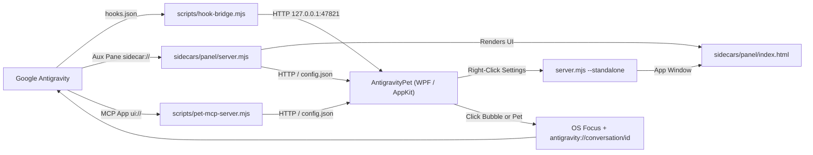

<div align="center">


# 🐾 Antigravity Pet

**A native Windows & macOS pixel desktop companion plugin for Google Antigravity — zero third-party runtime dependencies.**

[](https://github.com/Wlaeg/antigravity-pet/releases/latest)
[](https://github.com/Wlaeg/antigravity-pet)
[](app)
[](pets)
[](#english)
[](LICENSE)

[English](#english) · [简体中文](#简体中文)

</div>

---

<a id="english"></a>

## English

**Antigravity Pet** brings a lightweight, reactive pixel-art companion directly to your Windows & macOS desktop while you work with **Google Antigravity**. Powered by a native transparent overlay (**C# WPF** on Windows / **Swift AppKit** on macOS), Antigravity lifecycle hooks, a standalone desktop Settings window, and an integrated Aux Pane / MCP App panel, it works out of the box with zero external SDKs or runtimes.

### ✨ Highlights

- **Standalone Settings Window & 5-Tab Modern UI**
  - Right-click **Settings** on the pet to launch a dedicated standalone settings window (`460×800` app-mode window) directly — no need to switch to Antigravity; also available inside Antigravity via `...` Sidecar or MCP App.
  - Reorganized into 5 clean tabs (**Characters**, **Behavior**, **Bubbles**, **System**, **Updates**) with a compact fixed overview header, `0.33x–3.00x` logarithmic scale slider, collapsible Developer Debug accordion, and **live GitHub Releases** viewer + one-click self-updater.
- **11-Locale Full-Stack Localization**
  - Full UI, pet pack names, approval bubble buttons, and right-click context menu translations for **11 locales**: `English`, `简体中文`, `繁體中文 (TW)`, `Français`, `Deutsch`, `日本語`, `한국어`, `हिन्दी`, `ไทย`, `Español (ES)`, and `Español (MX)`.
- **Procedural Animation Engine, Tiered Boredom & Privacy-First Typing Rhythm**
  - Smooth procedural breathing, parabolic roaming hops, damped squash-and-stretch bounce, `BitmapScalingMode.HighQuality` anti-aliasing, and a 3-tier boredom state machine (`0–2m` breathing → `2–10m` roaming & pixel cues `... / ? / ♪` → `10m+` sleepy nap with floating `Zzz`).
  - Optional Windows Raw Input typing rhythm interaction (counts keystrokes in a 1.5s sliding window without logging any keys/content; >5 keys/s triggers orbiting dizzy stars) and 16-direction cursor following.
- **Reverse Control: Double-Click Quick Dispatch & In-Bubble Approval**
  - **Double-click** (or double-tap on Windows touchscreens) the pet to open a quick prompt box and send tasks directly to Antigravity; single-click jumps straight to the active conversation via `antigravity://conversation/<id>`.
  - High-risk commands intercepted via `PreToolUse` show localized **✓ Allow / ✕ Deny** buttons right inside the pet's pixel bubble (`45s` timeout safely falls back to `"ask"`).
- **Screen-Edge Half-Body Peeking, Fullscreen Auto-Hide & DPI/Touch Support**
  - Dock to the left or right screen edge with a `14°` half-body peek and a `34×14` status color block that expands on hover; automatically hides during fullscreen apps and peeks back on urgent events (`Ready` / `Needs Input` / `Blocked`).
  - Per-Monitor V2 DPI awareness and native Windows tablet touch dragging.
- **Growth Pixel Accessories, Community Library & 1-Image Custom Pets**
  - Unlock and equip frame-synced **Glasses**, **Dev Cap**, **Coffee Cup**, and **Gold Crown**; browse and install packs from the built-in **Community Pet Library** (`cyber-panda`, `pixel-octopus`, `coffee-slime`); or drop **just 1 image** to let the built-in `hatch-pet` agent hatch a custom pet for you.

---

### 🎭 Built-in Pixel Characters

| ID | Display Name | Style & Personality | Pack Location |
| :--- | :--- | :--- | :--- |
| `cyber-fox` | **CyberFox** *(Default)* | Neon cyan cyber fox with glowing accents | [`pets/cyber-fox`](pets/cyber-fox) |
| `astro-bot` | **AstroBot** | Mini space explorer with animated visor | [`pets/astro-bot`](pets/astro-bot) |
| `shadow-cat` | **ShadowCat** | Nimble dark cat with bright golden eyes | [`pets/shadow-cat`](pets/shadow-cat) |
| `byte-ghost` | **ByteGhost** | Playful floating pixel spirit | [`pets/byte-ghost`](pets/byte-ghost) |
| `shiba-dog` | **ShibaDog** | Warm golden Shiba Inu companion | [`pets/shiba-dog`](pets/shiba-dog) |
| `pixel-dragon` | **PixelDragon** | Emerald mini dragon with golden horns | [`pets/pixel-dragon`](pets/pixel-dragon) |
| `android-bugdroid` | **Android Bugdroid** | Classic Google Android green robot mascot | [`pets/android-bugdroid`](pets/android-bugdroid) |
| `flutter-dash` | **Flutter Dash** | Official Google Flutter & Dart blue bird mascot | [`pets/flutter-dash`](pets/flutter-dash) |

> Custom pets require **as few as 1 single image** (`idle.png` / `pet.png` / `avatar.png`) thanks to the procedural animation fallback, or a full `1536×2288` (`8×11`) v3 spritesheet with `themeColor` and `.wav` sounds. Import `.zip` packs in **Settings**, install from the **Community** tab, or ask Antigravity using the built-in `hatch-pet` skill. See **[Custom Pet Pack Specification (v3)](CUSTOM_PET_SPEC.md)**.

---

### 🔔 Multi-Session Priority & Status Machine

When multiple Antigravity conversations run concurrently, the pet arbitrates display state strictly by priority:

| Priority | State | Trigger (`hooks.json`) | Visual & Bubble Feedback |
| :---: | :--- | :--- | :--- |
| **1** | `Needs Input` | User confirmation / question required | Amber halo + `!` badge + prompt bubble + optional chime |
| **2** | `Blocked` | Tool error or execution failure | Red halo + `✕` badge + error bubble (click to inspect) |
| **3** | `Ready` | Agent task finishes (`Stop`) | Green celebration loop + `✓` badge + clickable completion bubble |
| **4** | `Running` | Thinking, file edits, commands (`PreInvocation` / `PostToolUse`) | Cyan halo + busy working animation + live step bubble |
| **5** | `Idle` | No active tasks | Procedural breathing + tiered boredom + 16-dir eye follow |

---

### 🧩 Architecture & Project Structure



```text
antigravity-pet/
├── app/
│   ├── AntigravityPet.cs            # Windows native WPF overlay, HTTP server, DPI/touch & hotkey
│   ├── AntigravityPet.exe           # Prebuilt zero-dependency Windows executable
│   └── AntigravityPet.swift         # macOS native AppKit overlay, HTTP server & hotkey
├── assets/
│   ├── logo.svg                     # Plugin icon
│   └── preview.svg                  # Repository showcase banner
├── community/packs/                 # Built-in community pet pack fallback assets
├── pets/                            # 8 built-in pixel-art character packs
├── scripts/
│   ├── generate-default-pets.ps1    # Procedural 36x39 pixel-art spritesheet generator
│   ├── hook-bridge.mjs              # Cross-platform Antigravity hooks -> HTTP bridge
│   └── pet-mcp-server.mjs           # Cross-platform MCP server + MCP App UI provider
├── sidecars/panel/
│   ├── sidecar.json                 # Aux Pane integration manifest (... menu)
│   ├── server.mjs                   # Cross-platform Sidecar & standalone HTTP server
│   └── index.html                   # 11-locale 5-tab modern settings panel UI
├── skills/
│   ├── pet/SKILL.md                 # Skill guide for controlling the desktop pet
│   └── hatch-pet/SKILL.md           # Skill guide for hatching custom pixel pets
├── ui/settings.html                 # MCP App 5-tab settings UI (synced with panel)
├── build.ps1                        # Windows one-click builder & launcher
├── build.sh                         # macOS one-click Swift compiler & .app packager
├── CHANGELOG.md                     # SemVer changelog
├── community-pets.json              # Community pet catalog manifest
├── CUSTOM_PET_SPEC.md               # v1-v3 & single-image custom pet specification
├── hooks.json                       # Antigravity hook bindings
├── mcp_config.json                  # MCP server configuration
├── plugin.json                      # Antigravity plugin manifest
└── README.md
```

---

### 🚀 Installation & Quick Start

#### Windows 10 / 11

1. Clone or download the [latest release `.zip`](https://github.com/Wlaeg/antigravity-pet/releases/latest) into your Antigravity plugins directory:
   ```text
   %USERPROFILE%\.gemini\config\plugins\antigravity-pet\
   ```
2. Run the one-click build & launch script (uses built-in `.NET Framework 4.x` `csc.exe`, **no extra SDK required**):
   ```powershell
   cd "$env:USERPROFILE\.gemini\config\plugins\antigravity-pet"
   .\build.ps1 -Launch
   ```
3. Right-click the pet and choose **Settings** to open the standalone settings window anytime (or press **`Win + Alt + P`** to show/hide).

#### macOS 12+ (Apple Silicon & Intel)

1. Clone or download the [latest release `.zip`](https://github.com/Wlaeg/antigravity-pet/releases/latest) into your Antigravity plugins directory:
   ```text
   ~/.gemini/config/plugins/antigravity-pet/
   ```
2. Run the one-click Swift build & launch script (uses macOS built-in `swiftc`, **no extra SDK required**):
   ```bash
   cd ~/.gemini/config/plugins/antigravity-pet
   chmod +x build.sh && ./build.sh --launch
   ```
   *(If Xcode Command Line Tools are not installed yet, run `xcode-select --install` first. Antigravity hooks will also auto-compile on first start.)*
3. Open **Google Antigravity**, click **`...`** at the top-right for **Desktop Pet Settings**, or press **`⌥ + ⌘ + P`** (`Option + Command + P`) anytime to show/hide.

---

### 🌐 Local HTTP Control API (`http://127.0.0.1:47821`)

| Endpoint | Method | Description | Example Payload |
| :--- | :---: | :--- | :--- |
| `/health` | `GET` | Returns running status, effective locale, full config, stats, recent chats, and pet list | — |
| `/state` | `POST` | Updates conversation state (`idle` / `running` / `needs_input` / `ready` / `blocked`) | `{"conversationId":"abc","state":"running","message":"Thinking..."}` |
| `/skin` | `POST` | Switches the active character pack | `{"skin":"cyber-fox"}` |
| `/reload` | `POST` | Hot-reloads pet packs from `pets/` and `%USERPROFILE%\.antigravity-pet\pets\` | `{}` |
| `/control` | `POST` | Executes window & config actions (`show`/`hide`/`toggle`/`open`/`quit`/`language`/`scale`/`bubbleMode`/`updateConfig`/`dockLeft`/`dockRight`) | `{"action":"language","value":"en"}` |

---

<a id="简体中文"></a>

## 简体中文

**Antigravity Pet** 是专为 **Google Antigravity** 打造的原生跨平台（**Windows & macOS**）像素风桌面宠物插件。Windows 端基于原生 C# WPF 透明悬浮窗（`WS_EX_TOOLWINDOW`），macOS 端基于原生 Swift AppKit 悬浮窗（`LSUIElement`），结合 Antigravity 生命周期 Hooks、独立桌面设置窗口与 Sidecar / MCP App 设置面板，**零第三方运行时依赖，开箱即用**。

### ✨ 核心亮点

- **独立设置窗口 & 现代 5 分页设置面板**
  - 右键点击桌宠选择 **「⚙️ 设置」** 即可直接打开独立窄屏设置窗口（`460×800` 纯净应用窗口，不再跳转打断 Antigravity），同时保留 Antigravity 右上角 `...` 与 MCP App 入口。
  - 全新吸顶 5 分页结构（**角色 / 互动 / 气泡 / 系统 / 更新**），搭配常驻精简概览区、`0.33x–3.00x` 对数缩放滑块、默认折叠的开发者调试手风琴，以及独立 **「更新」** 分页（实时拉取 GitHub Releases 日志与附件、支持启动自动检查与一键原地更新）。
- **11 国/地区全链路本地化**
  - 设置界面、宠物角色名称、审批气泡按钮以及 **桌宠右键菜单** 已全面支持 **11 种语言/地区**：`English`、`简体中文`、`繁體中文（台湾）`、`Français`、`Deutsch`、`日本語`、`한국어`、`हिन्दी`、`ไทย`、`Español (ES)`、`Español (MX)`。
- **程序化动画引擎、三阶无聊待机 & 隐私安全键鼠互动**
  - 即使只有 **1 张静态图** 也能呈现细腻的呼吸起伏、抛物线漫步跳跃、Q 弹挤压拉伸与 `BitmapScalingMode.HighQuality` 抗锯齿。
  - 三阶无聊状态机：`0–2 分钟` 呼吸 → `2–10 分钟` 自由散步与头顶像素气泡（`...` / `?` / `♪`）→ `10 分钟+` 趴下打盹飘 `Zzz`。
  - 基于 Windows Raw Input 的键鼠互动：仅在 1.5 秒滑动窗口内统计按键频率（**绝不记录任何键码或输入内容**），高速敲击（>5 次/秒）触发三连星炫晕动画，配合 16 方向眼神跟随。
- **反向控制：双击快捷派活 & 气泡快捷审批**
  - **双击桌宠本体**（支持平板触控双击）即可呼出极简指令框直接向 Antigravity 派活（单击仍直达关联对话）。
  - 通过 `hooks.json` (`PreToolUse`) 拦截高危命令时，桌宠头顶气泡直接弹出本地化的 **✓ 允许 / ✕ 拒绝** 按钮（45 秒超时自动回退系统确认）。
- **左右贴边半身观察、全屏自动避让 & 高分屏/触控适配**
  - 拖至屏幕左/右边缘或一键贴边，自动藏起半身并微倾 `14°` 观察，气泡收缩为 `34×14` 高对比度状态色块，悬停即平滑探出；全屏游戏/视频时自动隐身，遇到完成/输入/报错时贴边弹出提醒；支持 Per-Monitor V2 DPI 自适应与 Windows 平板触控拖拽。
- **成长像素配饰、社区宠物库 & 单图孵化自定义宠物**
  - 随完成任务数解锁并佩戴 **像素墨镜、鸭舌帽、咖啡杯、黄金皇冠**；支持在设置页直接浏览安装 **社区宠物库**（`cyber-panda`、`pixel-octopus`、`coffee-slime`），或直接提交 1 张图片交由内置 `hatch-pet` 技能孵化专属宠物。

---

### 🎭 内置 8 款像素角色图鉴

| 皮肤 ID | 角色名称 | 外观特色 | 目录位置 |
| :--- | :--- | :--- | :--- |
| `cyber-fox` | **小蓝狐 CyberFox** *(默认)* | 赛博蓝荧光耳廓与灵动眼神 | [`pets/cyber-fox`](pets/cyber-fox) |
| `astro-bot` | **像素宇航员 AstroBot** | 发光头盔护目镜与太空服造型 | [`pets/astro-bot`](pets/astro-bot) |
| `shadow-cat` | **小黑猫 ShadowCat** | 金瞳神秘黑猫与精致铃铛 | [`pets/shadow-cat`](pets/shadow-cat) |
| `byte-ghost` | **电子幽灵 ByteGhost** | 半透明霓虹飘浮小幽灵 | [`pets/byte-ghost`](pets/byte-ghost) |
| `shiba-dog` | **像素柴犬 ShibaDog** | 暖黄色蓬松柴犬伙伴 | [`pets/shiba-dog`](pets/shiba-dog) |
| `pixel-dragon` | **像素小青龙 PixelDragon** | 翡翠绿身躯配金色小龙角 | [`pets/pixel-dragon`](pets/pixel-dragon) |
| `android-bugdroid` | **安卓小绿人 Bugdroid** | Google Android 官方经典绿色小机器人 | [`pets/android-bugdroid`](pets/android-bugdroid) |
| `flutter-dash` | **Flutter 小蓝鸟 Dash** | Google Flutter & Dart 官方吉祥物小蓝鸟 | [`pets/flutter-dash`](pets/flutter-dash) |

> 自定义宠物最低只需 **1 张待机图**（`idle.png` / `pet.png` / `avatar.png`），也支持完整 `1536×2288`（`8×11`）v3 图集、`themeColor` 与 `.wav` 自定义音效。可在设置页点击 **「导入宠物包」** 上传 `.zip`、前往 **「社区宠物库」** 一键安装，或直接让内置 `hatch-pet` 技能帮你孵化。完整规范见 **[自定义宠物包规范 (v3)](CUSTOM_PET_SPEC.md)**。

---

### 🔔 多会话状态仲裁与视觉反馈

当多个 Antigravity 对话并行执行时，桌宠严格按以下优先级展示最高优先级的会话状态：

| 优先级 | 状态 | 触发场景 (`hooks.json`) | 桌宠表现与交互 |
| :---: | :--- | :--- | :--- |
| **1** | `Needs Input` | Agent 需要用户审批或回答问题 | 琥珀色光环 + `!` 徽章 + 提示气泡 + 可选轻柔提示音 |
| **2** | `Blocked` | 工具调用报错或执行阻断 | 红色光环 + `✕` 徽章 + 报错气泡，点击直达排查 |
| **3** | `Ready` | 任务完成 (`Stop`) | 绿色光环 + 庆祝动画 + `✓` 徽章，点击打开结果对话 |
| **4** | `Running` | 思考规划、读写文件、运行命令 | 冰蓝色光环 + 忙碌动画 + 实时进度气泡 |
| **5** | `Idle` | 所有会话空闲 | 程序化呼吸 + 三阶无聊待机 + 16 方向眼神跟随 |

---

### 🚀 安装与一键编译指南

#### Windows 10 / 11

1. 下载 [最新 Release 压缩包](https://github.com/Wlaeg/antigravity-pet/releases/latest) 或克隆项目到 Antigravity 插件目录：
   ```text
   %USERPROFILE%\.gemini\config\plugins\antigravity-pet\
   ```
2. 执行一键构建与启动脚本（直接调用 Windows 自带 `.NET Framework 4.x` `csc.exe`，**无需安装额外 SDK**）：
   ```powershell
   cd "$env:USERPROFILE\.gemini\config\plugins\antigravity-pet"
   .\build.ps1 -Launch
   ```
3. 右键桌宠点击 **「⚙️ 设置」** 即可随时打开独立设置窗口；按 **`Win + Alt + P`** 可随时显隐桌宠。

#### macOS 12+ (Apple Silicon & Intel)

1. 下载 [最新 Release 压缩包](https://github.com/Wlaeg/antigravity-pet/releases/latest) 或克隆项目到 Antigravity 插件目录：
   ```text
   ~/.gemini/config/plugins/antigravity-pet/
   ```
2. 执行一键编译与启动脚本（调用系统自带 `swiftc` 编译为 `.app` 悬浮应用，**无需安装额外 SDK**）：
   ```bash
   cd ~/.gemini/config/plugins/antigravity-pet
   chmod +x build.sh && ./build.sh --launch
   ```
   *（若未安装命令行编译工具，系统提示时执行 `xcode-select --install` 即可；后续在 Antigravity 触发 Hooks 时也会自动检测并编译启动。）*
3. 打开 **Google Antigravity**，点击右上角 **`...`** 打开 **「桌面宠物设置」**，或随时按 **`⌥ + ⌘ + P`**（`Option + Command + P`）显隐桌宠。

---

### 🌐 本地 HTTP 控制接口 (`http://127.0.0.1:47821`)

| 接口 | 方法 | 说明 |
| :--- | :---: | :--- |
| `/health` | `GET` | 返回运行状态、当前生效语言、全量配置、统计数据、最近会话列表与宠物列表 |
| `/state` | `POST` | 更新指定 `conversationId` 的任务状态（`idle`/`running`/`needs_input`/`ready`/`blocked`） |
| `/skin` | `POST` | 切换宠物角色皮肤（如 `{"skin": "cyber-fox"}`） |
| `/reload` | `POST` | 热重载 `pets/` 与 `%USERPROFILE%\.antigravity-pet\pets/` 宠物包 |
| `/control` | `POST` | 执行窗口与配置控制（`show`/`hide`/`toggle`/`open`/`quit`/`language`/`scale`/`bubbleMode`/`updateConfig`/`dockLeft`/`dockRight`） |

---

### ❓ 常见问题 (FAQ)

- **Q：为什么 Windows 任务栏或 macOS Dock 栏里看不到桌宠？**
  - A：这是特意设计的纯净悬浮模式（Windows 使用 `WS_EX_TOOLWINDOW`，macOS 使用 `LSUIElement` + `.accessory`），避免占用任务栏、托盘与 Dock 空间。你可以通过右键桌宠、快捷键 `Win + Alt + P`（macOS 为 `⌥ + ⌘ + P`）随时显示、隐藏或打开独立设置窗口。
- **Q：如何关闭开机随 Windows 启动，仅在使用 Antigravity 时运行？**
  - A：默认即为 **「随 Antigravity 启动」**（打开客户端时拉起、关闭客户端时自动退出），不会写入开机自启注册表项。
- **Q：支持自定义生成新宠物吗？**
  - A：支持！只需准备 **1 张图片** 并在设置页点击「制作宠物包」，或直接在对话中对 Antigravity 说「帮我孵化一只赛博小熊猫桌面宠物」，内置 `hatch-pet` 技能即可为你生成并热切换。

---

### 📄 开源协议

本项目基于 [MIT License](LICENSE) 开源。
