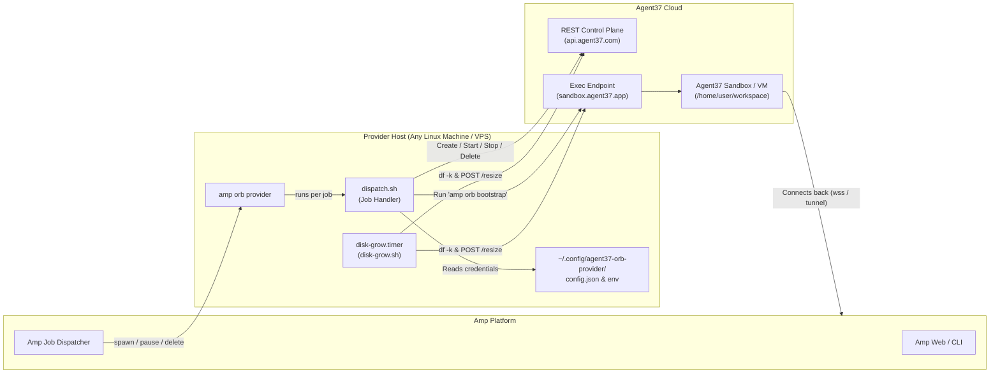

# Agent37 Orb Provider for Amp

[](LICENSE)
[](https://ampcode.com)
[](https://www.agent37.com)

Run [Amp](https://ampcode.com) self-hosted orbs seamlessly on [Agent37](https://www.agent37.com) cloud sandboxes.

`dispatch.sh` implements Amp's self-hosted orb provider contract on top of Agent37's Sandbox REST API. It gives you flexible compute shapes (containers and VMs), custom OS images, automatic disk resizing, and state persistence with minimal operational overhead.

---

## Architecture Overview



### How Amp Operations Map to Agent37

| Amp Job | Agent37 Action | Lifecycle & Cost Behavior |
| :--- | :--- | :--- |
| **`spawn`** | Finds instance by `metadata.amp_orb_id`, creates or starts it, waits for `running`, then starts `amp orb bootstrap` inside it. | Computes and bills memory while running. Automatically handles dormant/sleeping instances. |
| **`pause`** | Issues `POST /v1/instances/{id}/stop`. | **Releases compute/memory billing immediately**; persistent disk remains preserved for the next session. |
| **`delete`** | Issues `DELETE /v1/instances/{id}`. | Destroys instance and releases all storage. (HTTP 404 is treated as already deleted). |

---

## Key Features

- **Zero Heavy Runtimes**: Pure Bash, `curl`, `jq`, and `flock`. Communicates directly with the Agent37 Sandbox REST API without requiring external SDKs or heavy daemon dependencies.
- **Pre-Configured Sizing Matrix**: Out-of-the-box support for 16 orb shapes (Official Debian-based or Arch Linux × Container or Full VM × S / M / L / XL).
- **Automated Disk Growth**: Background systemd timer polls disk utilization on active orbs via `df` and calls Agent37's resize API before disks run out of space.
- **Fail-Safe Resilience**: Unified wall-clock execution budget (270s) prevents runaway jobs. Automatically retries transient HTTP 409 (`try_again`), 429 rate limits, and safely wakes cold-storage instances.
- **Turnkey Deployment**: Single-command interactive installer, automated template verification/patching, and full systemd user units with `loginctl linger` persistence across reboots.

---

## Quick Start

### Prerequisites

- **Provider Host**: Any Linux machine with a systemd user manager, bash, `curl`, `jq`, and `flock` (`util-linux`).
- **Network**: Outbound HTTPS access to `api.agent37.com`, `sandbox.agent37.app`, `ampcode.com`, and `static.ampcode.com`.
- **API Credentials**:
  - An Agent37 workspace API key (`sk_live_...`) from the [Agent37 Dashboard](https://www.agent37.com/dashboard/cloud/api-keys).
  - An Amp self-hosted provider token (`aop_live_...`) from **Amp Settings &rarr; Orbs**.

### One-Click Installation

Run the installer on your host machine:

```bash
curl -fsSL https://raw.githubusercontent.com/XYenon/agent37-orb-provider/main/install.sh | bash -s -- install
```

The installer will:
1. Ensure the `amp` CLI is installed (installs to `~/.local/bin/amp` if missing).
2. Interactively prompt for credentials, image preference, region, and default resources.
3. Automatically verify or register the required workspace template on Agent37.
4. Install systemd user services and enable persistent user lingering.

### Unattended / Non-Interactive Install

For automated provisioning or CI/CD pipelines:

```bash
curl -fsSL https://raw.githubusercontent.com/XYenon/agent37-orb-provider/main/install.sh | \
  bash -s -- install \
    --non-interactive \
    --token "aop_live_YOUR_TOKEN" \
    --api-key "sk_live_YOUR_KEY" \
    --image official \
    --region us
```

---

## Documentation Guide

Find the documentation tailored to your needs:

| Guide | Target Audience | Key Questions Answered |
| :--- | :--- | :--- |
| 📖 **[Installation Guide](docs/installation.md)** | **DevOps / Sysadmins** | How to install via CLI flags? How to verify systemd status? How to manually set up templates and services without the script? How to uninstall? |
| ⚙️ **[Configuration Reference](docs/configuration.md)** | **Administrators / Architects** | How to customize `config.json`? How to map custom CPU/RAM/Disk orb types? How does disk autogrow work? How to choose regions and VM vs default container? |
| 🛠️ **[Operations & Troubleshooting](docs/operations.md)** | **SREs / Operators** | How to inspect instances and bootstrap logs? How are states (`waking`, `stopping`, `failed`) handled? How to debug HTTP 409, 402, and timeout issues? |
| 💻 **[Development Guide](docs/development.md)** | **Contributors / Developers** | How is the project structured? What design choices govern idempotency and timeouts? How to run static checks and smoke tests? |

---

## Important Operational Notes

> [!IMPORTANT]
> **Single Provider Instance**: Run **exactly one** `amp orb provider` daemon per provider token. Running multiple daemons concurrently with the same token causes race conditions and split job handling.

> [!NOTE]
> **Data Residency**: Agent37 is a third-party cloud infrastructure provider. All repository clones, container runtimes, and persistent disk volumes reside within Agent37 data centers, not on the provider host.

---

## License

This project is licensed under the **AGPL-3.0-or-later** license. See the [LICENSE](LICENSE) file for details. If you run a modified version of this provider to serve others over a network, you are required to make the modified source code available.
