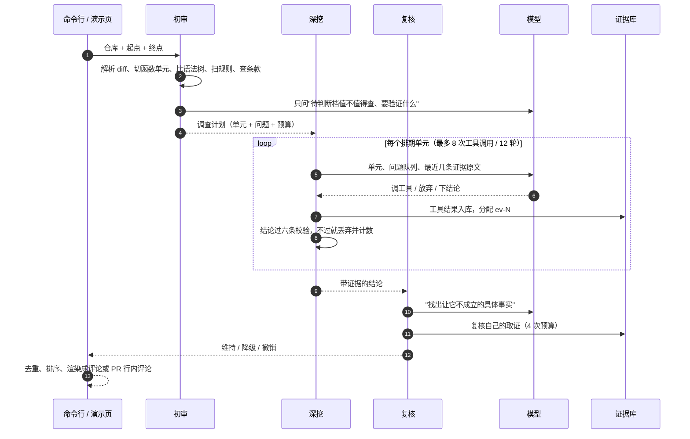

<div align="center">
  <h2>diff-review-agent</h2>

  <p>
    
    
    
    
    
    
    <a href="./LICENSE"></a>
  </p>

  <p><strong>读 git diff，判断哪些改动值得深查，调只读工具取证，只输出能被证据支持的评论。</strong></p>
</div>

> 大多数代码审查智能体靠提示词请求模型“不要编造”。这里换了个方向：**证据由程序校验**。评论里引用的每个编号、每个行号、每个符号，都必须能在工具真正读过的原文里对上；对不上，这条评论就不会出现。

## 项目预览

<p align="center"></p>
<p align="center"><sub>选两个提交、挑一个审查深度；也可以直接在页内改一个文件、就地提交，立刻审自己刚写的那次改动。</sub></p>

<p align="center"></p>
<p align="center"><sub>一次真实运行（deepseek-chat，3 个改动方法、14 次模型调用、约 20 秒）：口令比较、标准输出、税额计算三条评论，全部带证据编号；每个单元为什么被排期，也留在结果里。</sub></p>

三段式流水线：**初审**把 diff 切成函数级单元、先用规则和语法树找出形状变化；**深挖**带着问题读代码、查条款，逐个取证；**复核**换个视角找反证。三段之间只传结构化结论，不传聊天记录。

## 核心功能

### 01 · 初审：规则先走，模型后到

> 不把整个仓库丢给模型，只把值得看的改动递进去。

- 输入是仓库路径和两个提交。JGit 取出改动的文件、新旧行号区间、重命名和删除，再按行号把改动落到最内层的方法（函数外的改动归到字段、初始化块或类头），前后两版配对成分析单元。
- 前后两版用 JavaParser 解析成语法树。声明部分直接比签名、可见性、`throws`、注解；方法体先按语句序列对齐，再识别固定形状：判空消失、条件翻转、捕获后只打日志、资源未关闭、提前返回丢失、运算符变化、字面量变化、新增 null 实参、纯语句换序。
- 静态检查单独跑一遍，只保留落在新增行上的告警：用 `==` 比字符串、捕获 `Throwable`、打印堆栈、生产代码里的 `System.out`。
- 分三档：命中必查规则的直接查，模型不能否决；四行以内且没有任何已知形状的跳过；其余交给模型判断值不值得查。
- 每个单元在虚拟线程上并发，结果按原顺序收集；同一份输入重跑，计划一致。
- 作者说明也能进来：从 GitHub PR 读标题与描述，或从本地文件读第一行标题、其余描述。它进意图扫描的提示词，标明“作者自己的说法，不是证据”，不进证据库，也不参与证据校验。

### 02 · 深挖：有预算的取证循环

> 每个单元最多 8 次工具调用、12 轮；工具自己编不了证据编号。

- 七个通用只读工具：按行区间读文件、找声明、找引用、找调用点、判断对外可见性、全文搜索、查某几行的最近改动。仓库里有 `docs/policies` 时再加两个——**搜条款**收一句话（比如“口令比较 恒定时间”）返回最像的三条编号与摘录，**读条款**按编号取回全文，正文连同条款里的示例。
- 工具返回全部进证据库，编号 `ev-N` 在入库时统一分配：模型只能引用已经存在的编号，不能自己命名。
- 模型每轮只能做三件事：调工具、放弃并写理由、给出结论。结论要带证据编号和行号，并说明作者是该修（fix）还是该确认（confirm）。
- 提示词里只保留最近四条证据原文，更早的压成编号加位置；预算按单元数算，不按词元算，单个难单元不会把整场运行饿死。
- 连续多轮没有新证据、也没有新问题时提前收束，把“没查完”如实写进结局，而不是硬凑一条结论。

### 03 · 复核：专门找反证

> 只复核必查和高风险类别，给复核者一个新证据库和 4 次工具预算。

- 复核的问题不是“这条评论对不对”，而是“找出让它不成立的具体事实”。
- 撤销或降级必须引用它本轮真正读到的证据；引用不上就判无效、维持原结论。
- 结果三选一：维持成断言、降级成疑问句、撤销。`changedByCritic` 与 `invalidRetractions` 都进报告，避免“以为它在工作”。

### 04 · 政策检索：让团队规范参与审查

> 团队规范不是提示词里的装饰，而是能被检索、被引用、被校验的条款。

- 仓库里放一份 `docs/policies/*.md`，一个 `##` 一段，块编号带文件与标题（`pol-security-2`）。编号稳定，重跑时提示词里的引用不变。
- 初审检索条款时，带示例代码的条款按“改动后的代码与示例的相似度”打分，没有示例的退回正文匹配；标了 `[强制]` 的条款直接把单元推进必查档，不问模型意见。
- 深挖里同样是两个工具：先用一句话搜到候选条款，再按编号读全文（含正反示例），然后决定引不引；引用时结论里必须原样抄一句条款正文，抄不出来由正文校验丢弃。
- 不装向量数据库：几百段文档，内存里暴力余弦就是微秒级；嵌入由本地 Ollama 提供，不落盘。少一个服务、一份 schema、一种失败模式。

### 05 · 评测：把“看起来像”换成数字

> 每个用例都有标准答案，每次改动都能重放。

- 语料是变异体：在五个文件上累积注入 47 个改动，31 个有明确缺陷，16 个是等价重构或纯格式改动。
- 指标拆开看：初审单元级召回、干净改动误报率、端到端召回、证据覆盖率、维持/降级/撤销、模型调用与词元。前三段各自的贡献不混在一个分数里。
- 三档深度各跑一遍同一份语料，回答“深挖和复核到底买到了什么”。
- 离线确定性替身跑测试与回归，不联网、不花钱；`--real` 才调真模型。

## 系统流程



结论必须通过六条检查，任何一条不过都会被丢弃并计数：

| # | 检查 | 拦掉的东西 |
| :--- | :--- | :--- |
| 1 | 陈述非空 | 空话、占位符 |
| 2 | 必须引用证据编号 | “我觉得这里有问题” |
| 3 | 编号必须真实存在 | 模型自己编的 `ev-9` |
| 4 | 行号必须被证据或改动覆盖 | 指到没读过的行 |
| 5 | 反引号里的符号必须出现在证据或 diff 里 | 模型凭记忆写出的 API |
| 6 | 引用了条款就必须原样抄一句正文 | 只写“不符合规范”而不引原文 |

## 技术栈

| 层次 | 技术 | 用途 |
| :--- | :--- | :--- |
| 语言与运行时 | Java 21 | 虚拟线程、`record`、模式匹配、文本块 |
| 接入 | JDK HttpServer、单页 HTML | 演示页：浏览提交、页内改文件并提交、切换深度、拉回被筛文件 |
| 编排 | 虚拟线程、自写状态机 | 单元级并发、工具预算、问题队列、阶段间结构化交接 |
| 取证 | JGit、JavaParser、JavaParser Symbol Solver | diff 与重命名、语法树比对、类型级调用图 |
| 模型 | LangChain4j 1.24、强制工具调用 | 四种回复全部走 JSON Schema 约束的工具调用；全项目只有一个类 import 该 SDK |
| 输出 | Jackson、GitHub REST | 计划与报告序列化、Pull Request 行内评论 |
| 评测 | JUnit 5、AssertJ、变异体语料 | 191 个测试，全程离线；评估与消融各自可复现 |

## 评估

语料是变异体：在五个文件上累积注入 47 个改动，31 个有明确缺陷，16 个是等价重构或纯格式改动，每个都有标准答案。评估把每个用例提交进一个真实 git 仓库，再用完整流水线重放。

真模型（`deepseek-chat`，温度 0）最近一次 47 条：

| 指标 | 数值 |
| --- | --- |
| 初审单元级召回 | 77%（24/31） |
| 干净改动的误报率 | 6%（1/16） |
| findings（真正下了结论的条数） | 25 |
| 评论数（断言 + 提问） | 30 |
| 断言 / 提问 / 丢弃 | 14 / 16 / 0 |
| 无效撤销 | 2 |
| 端到端召回（落点附近即有评论） | 74% |
| 端到端召回（评论引用了证据） | 65% |

原始报告在 [`eval/real-surface/latest-report.md`](eval/real-surface/latest-report.md)。findings 只算真正下了结论的条数；必查单元最后没取到证据时也会生成一条提问，所以评论数 30 会多于 25。无效撤销指复核引用证据撤销，但那条证据并不足以支持撤销；单列出来，是为了不把复核的“敢撤”当成免费的优点。

语料从 22 条扩到 47 条，召回从 88% 掉到 77%。新增的用例里有人类一看就知道、但没有任何形状信号的行为变化（操作数互换、乘数改大），模型在待判断档上也会拒掉一些。语料变大让数字变差，这是它该走的方向。

三档深度各跑一遍同一份语料（22 条那一版）：

| 深度 | 抓到缺陷 | 标记干净改动 | 评论数 | 结论数 | 模型调用 | 词元 |
|---|---|---|---|---|---|---|
| 只做初审 | 13/16（81%） | 1/6（17%） | 21 | 0 | 39 | 17,290 |
| 加深挖 | 13/16（81%） | 1/6（17%） | 15 | 9 | 85 | 70,812 |
| 加复核 | 13/16（81%） | 1/6（17%） | 16 | 12 | 101 | 88,379 |

召回三行完全不动，因为召回是初审决定的：没被排期的单元，后面两段再强也救不回来。后两段买的是每条评论的可信度——21 条评论压到 16 条，覆盖的缺陷数没少。

政策检索单独有一张消融表：五条标记用例上，纯嵌入顶一命中 1/5，加词面加分 2/5，让模型把改动写成一句话再搜条款 3/5，条款附正反示例、代码比代码之后 5/5；代价是无关用例的意外命中从 7 条涨到 13 条。中间走过的弯路在 [`eval/latest-retrieval.md`](eval/latest-retrieval.md)。

开关不是另一份代码，`--no-policy` 关掉的是同一条流水线的检索：

```bash
java -cp "target/classes;<classpath>" com.codereview.agent.eval.EvalRunner target/eval-corpus eval/policy-off --no-policy
```

数字怎么读：这些是单次运行的样本，不是对模型的测量。同一份代码重跑，端到端召回能差九个点。规则决定的那几行不受模型影响，当稳定部分看。

复现：

```bash
java -cp "target/classes;<classpath>" com.codereview.agent.eval.EvalRunner target/eval-corpus eval/run --real
```

报告写到 `eval/run/latest-report.md`；去掉 `--real` 用离线替身，不花钱也不需要密钥。

## 本地运行

### 环境要求

| 组件 | 要求 | 说明 |
| :--- | :--- | :--- |
| JDK | 21 | 虚拟线程与 `record` 都要用到 |
| Maven | 3.9+ | 只用来构建；`mvn test` 不需要任何密钥 |
| 模型密钥 | 可选 | 只有 `--real` 需要，读环境变量 |
| Ollama | 可选 | 政策检索的嵌入与本地模型都要它；不装只是没有政策信号 |
| GitHub 令牌 | 可选 | 只有真发 PR 评论需要 |

### 1. 跑测试

```bash
mvn test
```

191 个用例，全用离线确定性替身，不联网、不花钱。

### 2. 审一个提交区间

```bash
mvn -q compile
java -cp "target/classes;<classpath>" com.codereview.agent.Main <仓库> <起点> <终点> [输出文件]
```

输出是一份调查计划（JSON）。这一段只用离线替身，不调模型，也不需要密钥。

`<classpath>` 是依赖 jar 列表：先跑 `mvn -q dependency:build-classpath -Dmdep.outputFile=target/cp.txt`，再把它填进来（Windows 用 `;` 分隔，macOS / Linux 用 `:`）。

### 3. 跑完整流水线

```bash
java -cp "target/classes;<classpath>" com.codereview.agent.review.ReviewPipeline <仓库> <起点> <终点>
```

写出 Markdown 与 JSON 两份报告，含每个单元的档位、结局、工具调用次数，以及通过复核的评论。

加 `--description note.txt`（第一行标题、其余描述）或 `--pr owner/name#123`（可选 `CODEREVIEW_GITHUB_TOKEN`）把作者说明带进意图扫描。

### 4. 打开演示页

```bash
java -cp "target/classes;<classpath>" com.codereview.agent.web.DemoServer
```

访问 `http://127.0.0.1:8099/`。服务只绑回环地址，默认离线替身，点一次不花钱；`--real` 才走真模型。页面上的提交列表、文件内容、页内提交都直接读写真仓库，建议指向演示语料。

### 5. 用真模型

```bash
export CODEREVIEW_LLM_API_KEY=...
# 可选：CODEREVIEW_LLM_BASE_URL（默认 https://api.deepseek.com/v1）
# 可选：CODEREVIEW_LLM_MODEL（默认 deepseek-chat）
```

密钥只从环境变量读，不落仓库、不进日志；模型描述里只打印“模型 at 地址”。

### 6. 用本地模型（Ollama）

```bash
ollama pull qwen2.5-coder:3b
OLLAMA_CONTEXT_LENGTH=8192 ollama serve
java -cp "target/classes;<classpath>" com.codereview.agent.web.DemoServer --ollama
```

默认连 `http://127.0.0.1:11434/v1`、模型是 `qwen2.5-coder:3b`，可用 `CODEREVIEW_OLLAMA_BASE_URL` 与 `CODEREVIEW_OLLAMA_MODEL` 改。Ollama 默认上下文是 4096，而本项目的提示词会带上整段证据，启动服务时按 8192 开，否则长单元会被截断。

本地生成慢，把超时调大：

```bash
export CODEREVIEW_LLM_TIMEOUT_SECONDS=600
```

有一个必须知道的行为：Ollama 的 OpenAI 兼容接口接受工具定义，却不返回 `tool_calls`。本项目第一次碰到就把同一份 schema 改成文字要求并继续跑，日志里会留一行提示。3B 能走完整个循环——真的调工具、真的记录放弃理由——但判断不准，经常读完就说没问题；这时管线不会编造结论，只会留下一条基于规则的问题，证据为空并注明未取证得出。

### 7. 回写 Pull Request

```bash
java -cp "target/classes;<classpath>" com.codereview.agent.publish.PostReview <仓库> <起点> <终点> <owner/name> <pull number> [--post]
```

默认是预演：打印请求体并写到 `eval/latest-review-payload.json`。真发需要 `GITHUB_TOKEN` 和显式的 `--post`。落在 diff 之外的评论会被移进评论正文，而不是丢掉。

### 常见问题

| 现象 | 处理方式 |
| :--- | :--- |
| `UnsupportedClassVersionError: class file version 65.0` | 用了 JDK 17 启动，换成 JDK 21 |
| 控制台中文乱码 | Windows 控制台代码页问题，把输出写成文件再看 |
| `NoClassDefFoundError: CombinedTypeSolver` | `target/cp.txt` 是旧的，重新执行 `mvn dependency:build-classpath -Dmdep.outputFile=target/cp.txt` |
| 报 `CODEREVIEW_LLM_API_KEY is not set` | 没配密钥就用了 `--real`，去掉参数或先设环境变量 |
| 演示页提示没有评论 | 没有单元被排期，或结论都没通过证据校验；看单元表的“结局”列 |
| `--ollama` 连不上 | 没启动 `ollama serve`，或端口不是 11434；用 `CODEREVIEW_OLLAMA_BASE_URL` 指过去 |
| 本地模型答非所问、反复读同一处 | 上下文被截断或模型太小；按 8192 启动，先换 7B 试 |
| 本地模型很慢 | CPU 推理就是这个速度；演示时先挑一个单元的区间 |
| 政策检索没有命中 | 确认仓库里有 `docs/policies/*.md`，且 Ollama 在跑；不命中只是“没有政策信号”，不是运行失败 |

## 目录结构

```text
diff-review-agent
├── src/main/java/com/codereview/agent/
│   ├── triage/          # 初审：diff 解析、单元映射、结构比对、规则、分档、计划
│   │   ├── structure/   # 语法树比对与形状识别（判空、运算符、字面量、换序……）
│   │   ├── rules/       # 规则目录与风险类别
│   │   ├── staticanalysis/  # 第二路事实来源，只报新增行
│   │   └── policy/      # 政策文档切块、索引、混合打分
│   ├── investigate/     # 深挖：证据库、只读工具、政策工具、问题队列循环、结论校验
│   │   ├── tool/        # read_lines、find_definition、find_references、search_policy、read_policy……
│   │   └── graph/       # 类型级调用图
│   ├── verify/          # 复核：对称取证、维持 / 降级 / 撤销
│   ├── review/          # 流水线、深度切换、抽样、报告与评论去重
│   ├── model/           # 薄接口 + LangChain4j 适配器 + Schema + 词元账本
│   ├── eval/            # 变异体语料、评估、消融、抽样扫描、调用图对照
│   ├── publish/         # GitHub 行内评论（默认预演）
│   └── web/             # 演示服务器（回环地址）
├── src/main/resources/web/index.html   # 演示页
├── docs/images/         # README 截图
└── eval/                # 每次运行的报告与数据
```

## 设计取舍

- **证据是校验出来的，不是请求出来的** — 别人靠提示词要求模型别编，这里靠程序：编号要能解析、行要在证据覆盖范围内、符号要在原文里出现、条款要能对回原文，不过就丢。
- **单元就是函数** — 静态分析、测试覆盖、调用点本来就以方法为单位，选函数当单元，外部信号一次映射都不用做。
- **预算按单元数，不按词元** — 词元预算是花完才知道花在哪，还会把单个难单元饿死在半路；单元预算事前定得下、可复现、计划里解释得清。
- **阶段之间只传结论和发现，不传聊天记录** — 每段都能单独跑、单独打分、单独换模型，上下文也不会线性膨胀。
- **回答的形状是 schema，不是请求** — 四种回复全部走强制工具调用，字段由代码里的 JSON Schema 定死；DeepSeek 不支持 `json_schema`，`json_object` 又只管“是合法 JSON”，强制工具调用把两件事都约束住。
- **失败按块计，不按任务计** — 每个单元独立成败：正常出结论、因预算跳过、模型反复不合规被放弃，分别计数；一个单元翻车不连累整单。
- **模型层是薄接口** — 换模型等于加一个适配类；测试永远跑离线替身。
- **为什么不是 MCP** — MCP 解决的是跨进程、跨产品的工具发现与调用；这里只是读一个文档，加一层协议要多一个子进程、一套序列化、一类新的失败模式，换不到任何东西。知道边界，不为一个请求引入协议。

## 已知限制

- **政策检索在我们语料上几乎没改变召回。** 强制条款大多能被别的规则抓到，真正无法用形状表达的条款只补了两条用例。机制是通的，价值还没被这份语料证明。
- **语义类缺陷基本靠运气** — SQL 拼接、语句换序、边界魔法数这类改动，形状规则能覆盖一部分，真正的业务语义程序判不了；位置敏感（认证、支付、迁移）的还能靠路径规则推进去，藏在普通业务逻辑里的会漏。
- **太胖的方法不切** — 单元就是方法，一千行的方法会让提示词过长、结论发散；按语句块再切需要重新映射所有外部信号，暂时没做。
- **被筛文件只能在前端拉回** — `Screening` 的决定如实记录并展示，命令行没有 `--include` 开关。
- **复核在这份语料上没赚回成本** — 它会降级、但从未撤销，因为合成缺陷大多是真的，确实没有反证可拿；`changedByCritic` 一直打印，就是为了让这件事不被“以为它在工作”掩盖。
- **评估语料是合成变异体** — 有标准答案，也因此偏向“能被形状发现”的缺陷；真实提交没有标准答案，要人工标注。
- **单次运行只是样本** — 同一份代码重跑，端到端召回差九个点；文档里给了宽度也给了这句话。
- **不跑测试** — 只读边界、要编译目标仓库、偶发失败会污染证据，三条加起来的代价大于收益；真要做，`run_test` 是下一个工具。
- **本地小模型判断不准** — 3B 级的本地模型能把循环走完、会调工具、会给放弃理由，但它常常读完就说没问题；这时输出会退化成一条基于规则、没有证据的问题，而不是一条编造的结论。
- **GitHub 回写只做了评论** — 没做状态检查与自动修；也刻意没接“自动改代码”，那是另一个产品。

## License

本项目基于 [MIT License](LICENSE) 开源。
