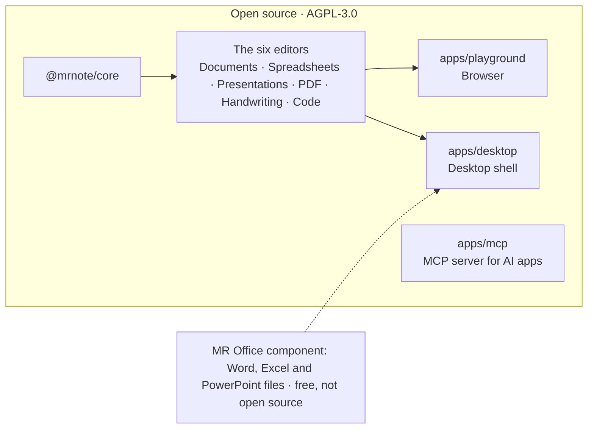

# MR Office

<p align="center"><sub>🌐 <a href="README.md">English</a> · <a href="i18n/README.en-GB.md">English (UK)</a> · <a href="i18n/README.zh.md">简体中文</a> · <a href="i18n/README.zh-TW.md">繁體中文</a> · <a href="i18n/README.ja.md">日本語</a> · <a href="i18n/README.ko.md">한국어</a> · <a href="i18n/README.de.md">Deutsch</a> · <a href="i18n/README.fr.md">Français</a> · <a href="i18n/README.es.md">Español</a> · <a href="i18n/README.es-419.md">Español (Latinoamérica)</a> · <a href="i18n/README.pt-BR.md">Português (Brasil)</a> · <a href="i18n/README.it.md">Italiano</a> · <a href="i18n/README.nl.md">Nederlands</a> · <a href="i18n/README.sv.md">Svenska</a> · <a href="i18n/README.da.md">Dansk</a> · <a href="i18n/README.no.md">Norsk</a> · <a href="i18n/README.fi.md">Suomi</a> · <a href="i18n/README.id.md">Bahasa Indonesia</a> · <a href="i18n/README.th.md">ไทย</a> · <a href="i18n/README.vi.md">Tiếng Việt</a></sub></p>

<p align="center"><b>The open-source editors of MR Office, the editor closest to Microsoft Office — documents, spreadsheets, presentations, PDF, handwriting and code — running in the browser.</b></p>

<p align="center"><a href="https://mroffice.ai/en"><b>▶ Try online</b></a> · <a href="https://mroffice.ai/en/office/download"><b>⬇ Download</b></a> · <a href="https://mroffice.ai">🌐 mroffice.ai</a><br><a href="https://mroffice.ai/en/developers">🧑‍💻 Developers</a> · <a href="https://mroffice.ai/en/developers/embed">🧩 Embed</a> · <a href="https://mroffice.ai/en/developers/mcp">🤖 MCP for AI apps</a> · <a href="https://www.npmjs.com/package/mroffice-embed">📦 npm SDK</a> · <a href="https://mroffice.ai/en/developers/oauth">🔑 Sign in with MR Office</a></p>

<p align="center"><a href="LICENSE"></a> <a href="https://github.com/XinaTian/MROffice/releases"></a> <a href="https://github.com/XinaTian/MROffice/actions/workflows/ci.yml"></a> <a href="https://github.com/XinaTian/MROffice/stargazers"></a></p>

<p align="center"><a href="https://mroffice.ai/en"></a></p>

<p align="center"><a href="https://demo.mroffice.ai/media/mr-office-demo.mp4">🔊 Watch the 50-second tour with sound</a></p>

<table>
<tr>
<td align="center" width="50%"><a href="https://mroffice.ai/en"></a><br><b>Documents</b></td>
<td align="center" width="50%"><a href="https://mroffice.ai/en"></a><br><b>Spreadsheets</b></td>
</tr>
<tr>
<td align="center" width="50%"><a href="https://mroffice.ai/en"></a><br><b>Presentations</b></td>
<td align="center" width="50%"><a href="https://mroffice.ai/en"></a><br><b>PDF</b></td>
</tr>
<tr>
<td align="center" width="50%"><a href="https://mroffice.ai/en"></a><br><b>Handwriting</b></td>
<td align="center" width="50%"><a href="https://mroffice.ai/en"></a><br><b>Code</b></td>
</tr>
</table>

MR Office is a workspace for notes, AI and real files. This repository publishes the source code of its editors: the same editors MR Office runs, which you can build, run and embed on your own. They are open-source editors, not a complete open-source office suite: the reading and writing of Microsoft Office files stays in MR Office (see below).

## For developers

Everything for developers is at **[MR Office Developers](https://mroffice.ai/en/developers)** — self-serve, no application: sign in with any MR Office account and start.

### Embed the editors in your web app (recommended)

MR Office hosts the editors; your server signs a short-lived session token and your page opens the editor. It edits real Word, Excel, PowerPoint and PDF files (.docx, .xlsx, .pptx, .pdf), with co-editing, uploads, every export format, printing, and saves sent back to your server in a signed callback. Free plan: 1,000 sessions a month on localhost, 100 on your own domains, up to 2 apps. It is a hosted commercial service, so your own app is not bound by this repository's AGPL license.

1. In your project's folder run `npx mroffice-embed init` (or create an app in the developer console): one "Allow" in the browser, and the app's keys are written to `.env.local` / `.env`.
2. Your server mints a session token with `createSessionToken` from `mroffice-embed/server`; the secret key never leaves the server.
3. Your page opens the editor with `open()` from `mroffice-embed` (or the script `https://mroffice.ai/embed/v1/embed.js`).

```js
// server: GET /api/mroffice/session (check who is signed in first)
import { createSessionToken } from "mroffice-embed/server";
const token = await createSessionToken({
  appId: process.env.MROFFICE_APP_ID,
  secretKey: process.env.MROFFICE_SECRET_KEY, // mro_sk_..., server only
  file: { key: "contract-42", name: "contract.docx", url: signedUrlToTheFile },
  user: { id: user.id, name: user.name },
  mode: "edit",
});

// page
import { open } from "mroffice-embed";
open({ container: "#editor", token: () => fetch("/api/mroffice/session").then((r) => r.json()).then((b) => b.token) });
```

[Embed guide](https://mroffice.ai/en/developers/embed) · [The guide as Markdown (for AI agents)](https://mroffice.ai/developers/embed.md) · [Pricing and limits](https://mroffice.ai/en/developers/pricing) · [Developer console](https://mroffice.ai/en/developers/console) · [Live demo](https://mroffice.ai/en/developers/embed/demo)

### AI apps: the MCP server

AI apps open, read, edit and export documents in the real MR Office editor through its MCP server: connect the hosted endpoint `https://mcp.mroffice.ai/mcp` (sign in with your MR Office account, no key), or run `npx -y mroffice-mcp` on your own computer. Its source is in `apps/mcp`. [MCP guide →](https://mroffice.ai/en/developers/mcp)

### Sign in with MR Office (OAuth)

MR Office is an OAuth 2.1 authorization server (PKCE, client ID metadata documents, dynamic registration): your app can sign people in with their MR Office account and act with the scopes they allow. [OAuth guide →](https://mroffice.ai/en/developers/oauth)

### Self-host the open-source editors

The six editors in this repository can be built into your own product under the AGPL-3.0: if people use a modified version over a network, you must offer them its complete source code, and keep the "MR Office" attribution (NOTICE.md). They open their own formats, CSV, HTML, Markdown and PDF; Word, Excel and PowerPoint files are not part of the open-source editors (the hosted embed above has them). A commercial license is available from support@mr-note.com. [Open-source guide →](https://mroffice.ai/en/developers/open-source)

The editors are on npm as React components: `npm i mroffice-docs mroffice-core` (and `mroffice-sheets`, `mroffice-slides`, `mroffice-pdf`, `mroffice-ink`, `mroffice-code`); each package's README shows how to embed it.

## The editors

What each editor does in this repository:

- **Documents** — a paged word processor: styles, fonts, lists, tables, headers and footers, sections and columns, shapes and equations, cover pages and tables of contents, comments and tracked changes, and pen ink on the page. Saves its own format (.mrdoc); opens HTML, Markdown and plain text.
- **Spreadsheets** — cells and formulas, number formats, conditional formatting, sorting and filtering, frozen panes and several sheets, with sums and averages of the selection. Arithmetic between cells (=A1*B1+10) is calculated in the browser as you type; formulas with functions (SUM, IF, VLOOKUP …) are kept as written. Saves its own format (.mrsheet); opens and saves CSV and TSV.
- **Presentations** — slides with eight themes of its own, layouts, slide master and layout views, text, shapes, text boxes, tables, WordArt and equations, comments, sections, transitions and animations with preview, and a slide show. Saves its own format (.mrslides).
- **PDF** — read, search, present and print PDF files, copy and read aloud their text, and mark up selected text (highlight, underline, strikethrough, squiggly) with notes and a comments panel while a file is open; saving hands back the file as it was opened.
- **Handwriting** — handwritten notes with pressure-sensitive pens, highlighters, erasers, lasso and ruler, and ink turned into shapes. Saves its own format (.mrink).
- **Code** — a lightweight code editor with syntax highlighting for many languages, an outline, and find and replace; JavaScript/TypeScript, Python, SQL, Lua and shell run right in the browser.

Calculating formulas with functions, drawing charts and laying out SmartArt run in MR Office's own engine, in the MR Office desktop app: the open-source editors keep the formulas, charts and SmartArt a file holds, and show SmartArt as it was saved.

## Run the editors

**▶ [Try the live demo — no install](https://mroffice.ai/en)**

The six editors are in `packages/` (`@mrnote/docs`, `sheets`, `slides`, `pdf`, `ink`, `code`, sharing `@mrnote/core`) and run together in `apps/playground`:

```bash
npm install
npm run fonts     # the open substitutes for Office's fonts
npm run build
npm run preview   # http://localhost:5178
```

`npm run dev` starts a development server at the same address, and `npm run smoke` checks a build. Each package's README lists what it does in detail and shows how to embed it.

## Desktop app

[`apps/desktop`](apps/desktop) holds **MR Office Editors**: the source of the MR Office desktop app's shell (Electron), under an identity of its own. With the free MR Office component from Releases, it is the MR Office desktop app, with Word, Excel, PowerPoint and PDF files, sign-in and AI. Without the component, it runs the open-source editors on their own, which open .mrdoc, .mrsheet, .mrslides and .mrink files, CSV, HTML, Markdown and PDF. The shell and the editors are AGPL source code; the component is compiled, free to use and not open source. After `npm run build`, start it with:

```bash
npm run desktop
```

## For the full experience, install the MR Office desktop app (free)

The MR Office desktop app is free, has these editors and the full service, and works offline on your own computer. It adds what the open-source editors leave out:

- Opening and saving Word, Excel and PowerPoint files (.docx, .xlsx, .pptx)
- Formulas with functions (SUM, IF, VLOOKUP …), calculated
- Charts
- SmartArt editing
- Saving PDF edits back into the file

**[Download MR Office (free) →](https://mroffice.ai/en/office/download)**

### Word, Excel, PowerPoint and PDF files

Opening and saving Word, Excel and PowerPoint files (.docx, .xlsx, .pptx), and saving PDF edits back into the file, are provided by the MR Office desktop app (free), which has all of these editors and works offline on your own computer:

## How the pieces fit



## License

Open source under the GNU Affero General Public License v3.0 (LICENSE), with the additional terms in NOTICE.md: keep the "MR Office" attribution and link to https://mroffice.ai, and no rights to the MR Office name or logo. A commercial license is available from support@mr-note.com. Third-party software and data are listed in THIRD_PARTY_NOTICES.md. Contributions: see CONTRIBUTING.md.

## More

Website and the full product: **https://mroffice.ai** · Questions and feedback: support@mr-note.com

<p align="center">If MR Office is useful to you, a ⭐ on GitHub helps other people find it.</p>
