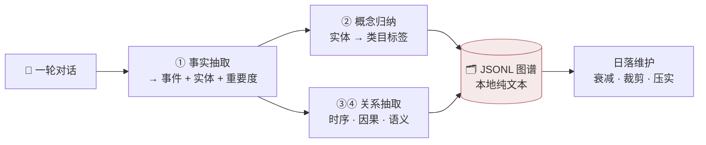
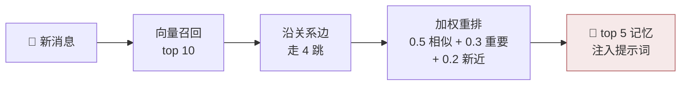

<div align="center">


# 🐟 大肥鱼好记性

**都说鱼只有七秒记忆 —— 你的大肥鱼，不该只有七秒。**

给 [DSH](https://github.com/mario841859784/dsh-onebot)（DeepSeek Harness）QQ 机器人装上一套**会遗忘的长期记忆图谱**：
聊天被自动整理成事件与关系，回复前自动想起该想起的事，久不提起的记忆按遗忘曲线慢慢淡去。

零依赖 · 纯本地 · 任何 OpenAI 兼容模型都能喂 · 双击就能看图谱

[快速开始](#-快速开始) · [工作原理](#-它是怎么做到的) · [可视化](#-看看她的记忆长什么样) · [踩坑手册](docs/pitfalls.md) · [English](README.en.md)

</div>

---

## 🥺 没有记忆的大肥鱼，每天都刚醒来

> **你**：周末去爬山怎么样？
>
> **没有记忆的她**：好呀！要带什么装备吗？（第无数次问出这句话）
>
> **有大肥鱼好记性的她**：可以呀！你上次说山顶风大记得带外套——防晒霜也别忘了，你可是怕晒的人。

她不是变聪明了，只是终于**记得你**：记住了你怕晒、你爱草莓蛋糕、你答应过的事、你们吵过的架和和好的理由。而且和"聊天记录堆进提示词"的土办法不同——

**每次回复，她只带最相关的五条记忆出门，永远轻装上阵。**

## 🧠 它是怎么做到的

**写入（后台悄悄进行，绝不拖慢回复）**



**读取（每条消息一次，本地部分 < 100ms）**



被召回的记忆会刷新"最近想起"时间戳——**你们常聊的事，她会记得越来越牢**；而三个月没人提起的琐事，重要度按 30 天半衰期慢慢衰减，低于阈值自动淡忘。像人一样。

## ⚖️ 为什么不是又一个「总结式记忆」

| | 滚动总结（常见方案） | 🐟 大肥鱼好记性 |
| --- | --- | --- |
| 记的是 | 一段越滚越长的摘要 | 结构化图谱：事件/实体/概念 + 语义/时序/因果边 |
| 每次带多少 | 全文塞进上下文，几万字起步 | **恒定 ≤ 5 条**，几十~几百字 |
| 时间感 | 旧事被新总结覆盖丢失 | 重要度+新近度加权，被想起就刷新 |
| 遗忘 | 没有，或不分轻重 | 30 天半衰期，冷记忆淘汰；钉住的记忆永不衰减 |
| 虚构污染 | 剧情对话混进真实记忆 | 角色扮演/场景回合整体跳过 |
| 运维 | 黑盒 | JSONL 纯文本，`cat` 可读，拷目录即备份 |

## ✨ 特性一览

- 🧩 **四阶段 LLM 抽取**：事实 → 概念 → 实体关系 → 事件时序/因果（后两步可选）
- 🗣 **QQ 内管理指令**：`记住：…` 钉住、`忘掉 …` 删除、`我的记忆`、`记忆统计`、`整理记忆`——命中即答，不消耗模型回合
- 📝 **摘要层**：同一主题的事件定期被归纳成「长期主题」摘要，参与检索（幂等改写，防编造）
- 🔀 **向量 + 图混合检索**：topK 召回 → 沿边走 4 跳 → 相似度门限 → 加权重排 → top 5
- 🪶 **零依赖**：纯 Node ≥18，没有原生模块、没有数据库；LLM/向量走任意 OpenAI 兼容端点（SiliconFlow 免费档 bge-m3、本地 Ollama 都行）
- 🐠 **每条鱼一个记忆库**：私聊/群聊互不串；虚构场景回合不污染记忆
- 📍 **钉住机制**："这条不许忘"——重要度拉满、检索加分、永不衰减
- 🩺 **上线自检工具**：向量模型中文塌缩/维度校验（不通过就不许上线，见踩坑手册）
- 🖼 **可视化面板**：力导向知识图谱，双击即看（[往下看](#-看看她的记忆长什么样)）
- 🏭 **生产实证**：在 7×24 真实 QQ 机器人上长期运行

## 🚀 快速开始

前置：DSH 已装好 [dsh-onebot-qq](https://github.com/mario841859784/dsh-onebot)（0.9.x）并能正常收发消息。

```bash
git clone https://github.com/YeStarOne/dsh-plugin-memory-graph.git
cd dsh-plugin-memory-graph

node installer/install.mjs   # 自动找到 dsh-onebot-qq 打补丁（带备份；--check 预览 / --uninstall 还原）
```

在 dsh-onebot-qq 配置里加 `memory:` 块（照抄 [examples/cordis-memory.yml](examples/cordis-memory.yml) 改两个端点），设好环境变量，重启 dsh：

```bash
export MEMORY_GRAPH_CHAT_API_KEY=xxx     # 抽取用对话模型
export MEMORY_GRAPH_EMBED_API_KEY=xxx    # 向量模型
```

**上线前 30 秒自检**（能省掉 90% 的"为什么召回是空的"）：

```bash
node <dsh-onebot-qq>/lib/memory-graph-engine/tools/check_embedding.js \
  --base-url https://api.siliconflow.cn/v1 --model BAAI/bge-m3 --dim 1024 --api-key xxx
```

重启后随便聊两句，日志出现 `memory-hub: turn buffered ...` 即在工作；攒满一批（默认 2 轮）自动抽取入库。

## 🗣 对大肥鱼直接说：管理指令

| 对她说 | 她会 |
| --- | --- |
| `记住：我对花生过敏，点外卖要避开` | 立刻写入一条**钉住记忆**（永不遗忘、检索加权），秒回确认 |
| `不许忘：…` | 同上（别名，语义更狠一点） |
| `忘掉 花生` | 删除匹配的记忆（精确优先、子串兜底），报告删了几条 |
| `我的记忆` | 最近 10 条记忆 + 库存构成 |
| `记忆统计` | 节点/关系边/库大小/待入库 |
| `整理记忆` | 立即跑一次主题归纳，回复整理出的长期主题 |

命令由插件**直接应答**（不派发模型回合，零 API 成本、秒回）；必须带标点或空白分隔才会被拦截——"记住这个教训"这类普通句子照常进对话。虚构场景回合（角色扮演）里说的"记住"不生效，防止剧情污染真实记忆。

> 💡 想先无网试跑？`chatBaseUrl` 和 `embedBaseUrl` 都填 `offline`——引擎走内置规则抽取 + n-gram 向量，全管线可验证（质量有限，仅验证用）。

## 🔍 看看她的记忆长什么样

```bash
npm run graph -- ~/.dsh/memory-graph-data viewer    # 导出（--all 可合并全部聊天）
```

然后双击 `viewer/index.html`：力导向图谱、时间范围筛选、节点类型勾选、搜索、节点详情与关系漫游，全都有。数据契约是公开的 JSON（[docs/visualization.md](docs/visualization.md)），Python / Go 写的机器人也能喂同一个页面。

## ⚙️ 配置速览

| 关键配置 | 说明 |
| --- | --- |
| `chatBaseUrl` / `chatModel` | 抽取用对话模型（OpenAI 兼容） |
| `embedBaseUrl` / `embedModel` / `dim` | 向量模型与维度（**dim 填错检索静默失效**） |
| `chatApiKeyEnv` / `embedApiKeyEnv` | key 走环境变量，不进配置文件 |
| `chatHeaders` | 网关要求自定义头时用 |
| `personaName` / `genderTerm` | 抽取提示词里的角色名与称呼（决定她怎么"记"你） |
| `dataDir` | 数据目录（默认 `~/.dsh/memory-graph-data`，每 chatId 一个子库） |

全部字段与维护脚本（查/钉/删/重算向量）见 [docs/config.md](docs/config.md)。

## ⚠️ 踩坑手册（血泪浓缩，按踩到的概率排序）

1. **向量模型中文塌缩**：某些模型无关文本余弦也 0.99+，检索等于没做——实测 nomic-embed-text-v1.5 无关词对余弦 **0.9935**，bge-m3 是 **0.4977**。上线前必跑自检工具。
2. **维度不符**：不报错、不抛异常，召回永远为空。换模型后必须改 `dim` + 重算向量。
3. **捕获点要在回复生成处**：挂在投递层会把气泡拆分的碎片当对话抽进图谱，事件全是断句。

完整十条见 [docs/pitfalls.md](docs/pitfalls.md)——每一条都是真实 7×24 环境里踩出来的。

## 🧪 记忆评测：官方基准 714 题作者侧自测

在 [chat-memory-benchmark](https://github.com/Ornn8/chat-memory-benchmark)（六人物正式集 714 题、每人 182 天历史、最远 45 天提问）上，用官方判分流程 `grade.py` 跑了完整一卷：


- **整题通过 502 / 714（70.3%）**：相关性 100%、事实项 70.3%；最好人物 81.8%，最长时程（45 天档）62.3%。
- **胜在便宜**：整套作答链路（记忆抽取 + 向量嵌入 + 作答）按公开单价折算 **¥2.91**，平均每通过 1 题 **¥0.0058**。记忆全存本地 JSONL、检索在本地跑，没有数据库、不需要常驻大模型。
- 口径：作者侧自测；判卷 glm-5.3-flash 单票（非官方 Codex 判卷），与其他系统的对比仅作量级参考；免费车道也按公开单价折算，判卷开销不计入。

## 🗄 备份

数据是纯文本 JSONL，直接进 git（建议私有仓）：[examples/backup-sync.sh](examples/backup-sync.sh) + cron 一行。记忆是你们俩的事，别放在只有一份的地方。

## 🗺 路线图

- [x] 四阶段抽取 / 混合检索 / 衰减 / 每聊天分库 / 场景隔离
- [x] 安装器（幂等/备份/卸载）+ HTTP 侧车
- [x] 记忆图谱可视化面板（`viewer/index.html` 双击即用 + `npm run graph` 导出）
- [x] QQ 内管理指令（"记住这条" / "忘掉这条" / "整理记忆"）
- [x] 摘要层（跨事件的长期主题归纳，每日自动 + 指令手动）

欢迎 issue / PR。如果大肥鱼的记性真的变好了，回来点个 star 就是全部动力 🐟💙

## License

[MIT](LICENSE)
