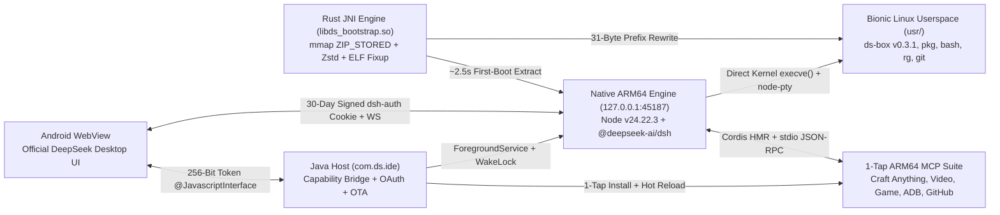

<div align="center">

  <br/>

  

  <h1 align="center">DeepSeek for Android</h1>

  <p><font color="#7d8590">Standalone <b>DeepSeek Harness Desktop (<code>@deepseek-ai/dsh v0.2.2-rc.5</code>)</b> autonomous coding IDE &amp; native <b>ARM64 Android</b> APK — created and engineered by <a href="https://github.com/Yhoanes"><b>Yhoanes</b></a> (zero PRoot, zero cloud relay, zero Gradle).</font></p>

  <p>
    <code>v0.2.2-r4</code> &nbsp;&bull;&nbsp;
    <code>Android 9.0+ (API 28+)</code> &nbsp;&bull;&nbsp;
    <code>Direct Kernel execve() ARM64</code> &nbsp;&bull;&nbsp;
    <code>Native Rust Zstd Bootstrap (~2.5s)</code> &nbsp;&bull;&nbsp;
    <code>Native Rust ds-box v0.3.1</code> &nbsp;&bull;&nbsp;
    <code>15 Native ARM64 MCP Plugins</code> &nbsp;&bull;&nbsp;
    <code>ADB Bridge / Shizuku + Live OTA</code>
  </p>

  <br/>

  

</div>

<br/>

---

## Architectural Overview

**DeepSeek for Android (`v0.2.2-r4`)** brings the official **DeepSeek Harness Desktop (`@deepseek-ai/dsh`)** autonomous software engineering workspace directly to Android phones and tablets as a self-contained `91 MB` native APK (`com.ds.ide`).

Instead of slow `proot-distro` containers, emulated Linux VMs, or remote SSH wrappers, **DeepSeek for Android** executes directly on mobile silicon via Linux kernel `execve()`: combining a zero-dependency **Native Rust + Zstandard JNI bootstrap engine (`libds_bootstrap.so`)**, an isolated `Node.js v24.22.3 LTS` ARM64 runtime (`PT_INTERP` + `$ORIGIN` RPATH + persistent V8 `NODE_COMPILE_CACHE`), and a full **10-byte parity Android Bionic Linux userspace** (`/data/user/0/com.ds.ide/files/usr`) powered by **`ds-box v0.3.1`**.

> [!IMPORTANT]
> **10-Byte Native Prefix Parity (`com.ds.ide` == `com.termux`):** By engineering an exact 10-byte Android package identifier (`com.ds.ide` for release, `com.ds.dev` for side-by-side dev builds), the embedded Bionic userspace maintains binary path-length parity with standard Bionic packages — enabling native execution of `clang`, `rust`, `python`, `nodejs`, `git`, `ripgrep`, `ghidra`, and `openjdk-21` at physical UFS storage speeds with **zero `PRoot` syscall translation overhead**.



---

## Core Engineering Pillars

| Subsystem | Technical Implementation |
| :--- | :--- |
| **Desktop-Identical DeepSeek Experience** | Runs the authentic `@deepseek-ai/dsh-web-app` & Cordis plugin architecture locally on `127.0.0.1:45187` — complete with multi-session agent threads, Standard & Creator (`cordis`) modes, subagents, goal mode, background jobs, file tree & code diffs, `@xterm/headless` PTY terminal, Office/PDF skills, and offline `sherpa-onnx` SenseVoice speech input. |
| **Native Rust + Zstandard Bootstrap (`libds_bootstrap.so`)** | Memory-maps (`mmap` + `MADV_SEQUENTIAL`) `ZIP_STORED` `.tar.zst` archives directly from the APK, verifies SHA-256 in memory, streams Zstandard decompression, and performs in-place 31-byte ELF & shebang prefix fixups in **~2.5 seconds** on cold install (`< 1 ms` `VERSION_CODE`-guarded fast-path on daily launches). |
| **PC-Parity DeepSeek PKCE OAuth & API Keys** | Full desktop onboarding parity (`DesktopOnboardingController`) supporting 1-click **DeepSeek Account** PKCE sign-in via Chrome Custom Tabs (`deepseek://oauth-success` instant foreground trampoline), API keys, and custom OpenAI/Anthropic-compatible models. |
| **Capability-Hardened Security Architecture** | Non-exported internal activities, randomized native binding names, per-session 256-bit constant-time `bridgeAuthToken` verification across all mutating JS bridge calls, canonical path confinement, event-driven `inotify` (`FileObserver`) IPC queues (`0%` idle CPU polling), and a `2.5s` MIUI/HyperOS-safe `rish` watchdog. |
| **Native Rust `ds-box v0.3.1` Userspace** | Multicall pure-Bionic ARM64 Rust toolkit providing 4-thread parallel `pkg` (`apt`), `ds-daemon` autonomous background scheduler, parallel SIMD `ds-fix-paths`, and native `ds-notify` Android notification tray integration. |
| **1-Tap ARM64 Plugins & Live GitHub OTA** | Built-in **Android Native Plugins** hub inside **Plugins (`Complementos`)** hot-mounts native Rust MCP servers into `~/.dsh/cordis.patch.yml` via `dsh-hmr` with zero server restart, paired with automatic & manual **GitHub Releases OTA updates** signed with the dedicated production RSA-4096 certificate. |

---

## Visual Walkthrough

### 1. Native ARM64 Plugins Hub & Experimental Agent Capabilities
Manage built-in agent loops, web search, shell limits, experimental **SenseVoice** offline voice input, custom plugin indices, auto-review mode, Git worktrees, and **1-Tap Native Android ARM64 MCP Plugins** directly from **Plugins (`Complementos`)**:

<p align="center">
  
</p>

| Native ARM64 Plugin | Version | Capabilities on Android |
| :--- | :---: | :--- |
| **AGY Video Studio 3D (Rust)** | `v3.0.2` | 18 native Rust MCP tools + **Blender 5.0.0 Headless** (`Cycles` + `OpenImageDenoise`), `blender-3d-director` skill, 48 kHz Rust music/SFX DSP, `h264_mediacodec` 60 FPS GPU encode, CapCut & Shizuku. |
| **PeakCut Pro: Live & AI Clipper** | `v1.0.0` | 12 native Rust MCP tools for hot live-stream clipping (YouTube, Twitch & Kick while live) & `9:16` Shorts with `auto_face` speaker tracking, Split-Screen, karaoke captions & offline `sherpa-onnx`. |
| **Remotion Studio Android** | `v1.0.1` | 10 native Rust MCP tools + ported **Remotion `4.0.544`** engine (`musl` Rust compositor + Headless Chromium + `h264_mediacodec` GPU) to program and render 60 FPS React/TypeScript videos. |
| **Craft Anything + Ghidra** | `v0.5.0` | **335 native Rust MCP tools** (`<50 MB` RAM) for ELF/PE/Mach-O, APK/DEX, `.NET`/NativeAOT, WASM, ESP32/UF2, Godot `.pck`, Unity IL2CPP & GameCube/Wii `.dol` + on-demand ARM64 **Ghidra 12.1.4**. |
| **CLI-Anything Studio & Hub** | `v1.0.0` | 10 native Rust MCP tools + `cli-hub v0.4.1` to browse/install **103+ agent-native CLIs** in `<3s`, run Capability Matrices, and scaffold/validate PEP 420 harnesses (`52/52` checks). |
| **ARTEX Security Suite (3 Plugins)** | `v1.0.0` | **`artex-audit`** (Dual-Graph SQLite WAL + `127.0.0.1:8787` console), **`artex-recon`** (JS bundle/SPA RBAC/Shadow API recon), and **`artex-defense`** (Sigma, Suricata, MITRE ATT&CK v16 & host triage). |
| **Game Studio 2D/3D** | `v2.0.0` | 16 native Rust MCP tools + ARM64 `GDExtension` (`C++`/`Rust`) compiler + 100% local offline signed `.apk` builder and 120–144 FPS Vulkan profiler for **Godot 4.7**. |
| **Unity Studio Android** | `v1.0.0` | 13 native Rust MCP tools + ported **Unity CLI `v1.0.0`** for Unity 6.3 LTS URP 2D/3D scaffolding, deterministic `.meta`/YAML auditing, `$0` GameCI builds, and live `rish` debugging. |
| **AGY ADB Bridge** | `v1.0.1` | Standalone native Rust wireless ADB 6-digit pairing (`127.0.0.1:5555` offline TCP mode — **no external Shizuku app required**), zero-polling mDNS discovery, and 2s Shizuku fallback. |
| **GitHub MCP** | `v2.1.1` | 91 native ARM64 GitHub tools (repositories, PRs, code reviews, Issues, Actions CI/CD logs, security alerts) + native Bionic OAuth setup. |
| **Chrome DevTools MCP** | `v1.10.4` | Headless native ARM64 Chromium automation via Chrome DevTools Protocol (DOM snapshots, network inspection, screenshots, and performance auditing). |
| **Android CLI & Science Suite** | `v1.0+` | On-device APK/DEX inspection, `logcat`/`dumpsys` telemetry, plus structured scientific computing & research skills. |

---

### 2. Full Desktop Settings, Built-in Cordis Tools & Agent Presets
Complete parity with DeepSeek Desktop's configuration architecture — **Account**, **General** (permissions, language, Light/Dark/System appearance synced to Android status bars & dynamic launcher icon, font sizing, coding view, keyboard shortcuts), **Models**, **Built-in Plugins**, and **Agent Presets** (`Standard` & `Creator / Cordis` modes):

<p align="center">
  
  
  
</p>

---

## System Requirements

| Component | Minimum | Recommended |
| :--- | :--- | :--- |
| **OS Version** | Android 9.0 Pie (`API 28`) | Android 12 – 16+ |
| **CPU Architecture** | `arm64-v8a` (`aarch64`) | Snapdragon 8 Gen 1+ / Tensor G2+ / Dimensity 9000+ |
| **Memory (RAM)** | `4 GB` | `8 GB – 16 GB` (especially when running Ghidra 12.1.4 or Chromium) |
| **Free Storage** | `800 MB` (91 MB APK + extracted runtime) | `4 GB+` (for `clang`, `rust`, `python`, `openjdk-21`, and Ghidra) |
| **Root Access** | **Not Required** | Optional **AGY ADB Bridge** plugin (or **Shizuku**) for `uid=2000(shell)` |

---

## Installation & Building From Source

### Option A — Install Official Signed Release APK (OTA-Enabled)
1. Download `DeepSeek-v0.2.2-r4.apk` from [**GitHub Releases**](https://github.com/Yhoanes/deepseek-android/releases/latest).
2. Install on your Android phone or tablet (future releases update seamlessly in-place via the built-in OTA updater):
   ```bash
   # Via ADB from PC:
   adb install -r DeepSeek-v0.2.2-r4.apk

   # Or on-device via AGY ADB Bridge / Shizuku:
   rish -c "pm install -r /sdcard/Download/DeepSeek-v0.2.2-r4.apk"
   ```

### Option B — Gradle-Free Deterministic Build Pipeline
**DeepSeek for Android** compiles end-to-end **without Gradle or Android Studio** — on Linux (`aarch64`/`x86_64`) or **directly on-device on Android** using `clang`, `rustc`, `zstd`, `aapt`, `javac`, `d8` (`r8.jar`), `zipalign`, and `apksigner`:

```bash
git clone https://github.com/Yhoanes/deepseek-android.git
cd deepseek-android

# Release APK -> dist/DeepSeek-v0.2.2-r4.apk (package: com.ds.ide, port: 45187)
bash build.sh

# Side-by-Side Dev APK -> dist/DeepSeek-Dev-v0.2.2-r4.apk (package: com.ds.dev, port: 45188)
bash build.sh --dev
```

---

## Frequently Asked Questions

**Does DeepSeek for Android require Root, Termux, or PRoot?**  
No. It runs **100% natively in Android userspace** inside its own standalone sandbox (`com.ds.ide`) with zero Termux dependency and zero `PRoot` overhead.

**Do I need the external Shizuku app for elevated `uid=2000(shell)` ADB features?**  
No! You can simply install the **AGY ADB Bridge** plugin directly from **Plugins &rarr; Android Native Plugins** inside DeepSeek, pair once with Android's 6-digit Wireless Debugging code, and enjoy persistent `127.0.0.1:5555` shell access (even offline and immune to MIUI/HyperOS background killing). If you already use the external Shizuku app, DeepSeek supports it out of the box as well.

**How do updates work?**  
Official releases published on [GitHub Releases](https://github.com/Yhoanes/deepseek-android/releases) are signed with the dedicated DeepSeek Android production RSA-4096 certificate. DeepSeek automatically checks for updates in the background (or manually via **Check updates** in **Plugins**) and installs them in-place without losing your accounts, sessions, installed packages, or workspaces.

---

## Repository Structure

```text
deepseek-android/
├── app/src/main/           # Hardened Java 8 Android Host (com.ds.ide), OAuth, SAF, OTA & Bridges
├── build.sh                # Deterministic 12-phase Gradle-free APK build orchestrator
├── build/                  # Modular build phases (00-dev .. 09b-verify) & BuildConfig generator
├── config/                 # Centralized app identity (app.env), paths & default Android AGENTS.md
├── core/                   # Zstd-compressed ARM64 DeepSeek core (deepseek-core.tar.zst), certs & shims
├── dist/                   # Output directory for aligned & v2/v3-signed APKs
├── docs/                   # Architecture specification (ARCHITECTURE.md) & UI screenshots
├── env/                    # Bionic Linux bootstrap.tar.zst, Rust ds-box v0.3.1 source/binary & pkg
├── tools/                  # On-device android.jar, r8.jar, and Rust JNI engine (tools/rust-bootstrap)
└── web/                    # Mobile/Desktop bridge (__ds_android_boot.js) & ARM64 MCP catalog
```

---

## License, Copyright & Attribution Terms

**Copyright &copy; 2026 [Yhoanes](https://github.com/Yhoanes)** — Created and engineered by **Yhoanes**. All rights reserved over the standalone Android host architecture, native Rust `libds_bootstrap.so` Zstandard bootstrap engine, `ds-box` multicall runtime, capability-hardened WebView & OAuth integration, native ARM64 MCP plugins hub, build pipeline, documentation, visual assets, and compiled APK distributions.

Pursuant to **Section 4 of the Apache License, Version 2.0**, **DeepSeek for Android** is licensed under the **Non-Commercial &amp; Mandatory Attribution License (`BY-NC`)** (see [`LICENSE`](LICENSE) and [`NOTICE`](NOTICE)):

* **Mandatory Attribution (`BY`):** Any copy, fork, redistribution, modified version, derivative work, or binary/APK distribution **must** retain the [`LICENSE`](LICENSE) and [`NOTICE`](NOTICE) files intact, prominently credit **Yhoanes** as the original creator and author of **DeepSeek for Android**, and include a visible link to [https://github.com/Yhoanes/deepseek-android](https://github.com/Yhoanes/deepseek-android).
* **Strict Non-Commercial Use Only (`NC`):** Selling, monetizing, charging any fee/subscription/paywall, commercial hardware/software bundling, or commercial distribution of this software, modified versions, or its compiled APK binaries is **strictly prohibited** without prior written authorization from **Yhoanes**.

<div align="center">
  <p><font color="#7d8590">Copyright &copy; 2026 <a href="https://github.com/Yhoanes">Yhoanes</a> &nbsp;&bull;&nbsp; <a href="LICENSE">Non-Commercial &amp; Mandatory Attribution License (BY-NC)</a></font></p>
</div>
