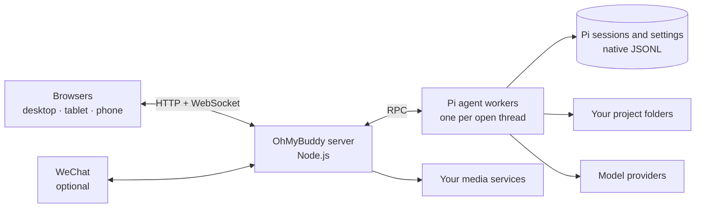

<div align="center">


# OhMyBuddy

**A self-hosted AI buddy that remembers you and gets real work done, from any browser, your phone or WeChat.**

An open-source personal AI agent with a full coding-agent workspace, built on the [Pi coding agent](https://pi.dev).<br>
Bring your own models: Claude, GPT, Gemini, DeepSeek, Qwen, Kimi and more. Your chats, memory and keys stay on your machine.

[](https://github.com/YogurtJ/OhMyBuddy/releases/latest)
[](LICENSE)
[](docs/en/INSTALL.md)
[](#platforms)
[](https://pi.dev)

**English** · [简体中文](README.zh-CN.md)

[Download](https://github.com/YogurtJ/OhMyBuddy/releases/latest) · [Install](docs/en/INSTALL.md) · [User guide](docs/en/USER_GUIDE.md) · [Changelog](CHANGELOG.md) · [Report an issue](https://github.com/YogurtJ/OhMyBuddy/issues/new/choose) · [Discussions](https://github.com/YogurtJ/OhMyBuddy/discussions)


</div>

> Formerly **Pivane**. Existing installations keep their data and settings; see the [rename notes](docs/development/NAMING.md).

## What is OhMyBuddy?

OhMyBuddy is a self-hosted web app that turns the Pi coding agent into a personal AI assistant you can reach from anywhere. Install it on a computer you own (Linux, macOS, Windows or even a Raspberry Pi), then use it from any browser on your desktop, tablet or phone, or message it from WeChat.

It has two sides that share the same runtime, models and tools:

- **Buddy: a personal assistant that knows you.** A Buddy has a name, a look and a personality. It keeps one ongoing conversation with you, remembers what matters across chats, and handles everyday questions, plans, notes, research, reminders and small jobs on your computer.
- **Workspace: the full agent workspace.** For project work in real folders, you get threads, streaming tool calls, diffs, subagents, side chats and session trees. Sessions stay compatible with Pi CLI.

## Why OhMyBuddy

- **It remembers you, and you can see what it remembers.** Each Buddy keeps notes about you, long-term memory, learned skills and a notebook for every chat. When a reply saves something, a receipt appears under it, and every memory and skill can be reviewed, edited or undone.
- **One buddy on every screen.** Sessions live on your server, so your desktop, phone and WeChat continue the same conversation. Install it to your home screen and get notified when a reply finishes.
- **It does real work.** Buddies and agents can read and write files, run commands, use the web and MCP tools, start subagents and run scheduled tasks on your machine. Buddies offer three working styles: Hands-off, Careful and Ask every time.
- **Your models, your keys, your machine.** Use any provider Pi supports, including Anthropic, OpenAI, Google Gemini, GitHub Copilot, OpenRouter, DeepSeek, Qwen, Kimi, MiniMax, xAI and Mistral, with an API key, OAuth or your own OpenAI-compatible endpoint. Credentials and history stay on your machine.
- **Grows with Pi's ecosystem.** Install Pi packages, skills, prompt templates and MCP servers from the browser, or ask the built-in extension assistant to find and set them up.
- **Images, video and voice built in.** Connect your own image, video and speech services, describe what you want and get editable parameters. Dictate messages and have replies read aloud.

### Who it's for

- You want an assistant like ChatGPT that runs on your own computer, uses your own API keys and remembers you across conversations.
- You use Pi or another coding agent and want to start a long task at your desk and check on it from your phone.
- You live in WeChat and want to hand tasks to an agent at home, then get the finished files back in the chat.
- You want one place for chat, agents, scheduled jobs and media generation instead of several tools.

## Features

### Buddies: personal assistants that remember you

<p align="center"></p>

- Give a Buddy a name, a personality and a working folder. Choose an avatar preset, combine its shape, colors and expression, or upload a picture. An optional two-to-three-minute interview covers how it should address you, what it helps with and how it should work.
- Each Buddy has one ongoing main chat and up to 100 topics. Organize topics into groups, search them and move several at once. Deleted topics go to a recoverable trash. Every chat has its own notebook, "What I'm keeping in mind", while topics share the Buddy's memory and skills.
- Long chats stay usable. Old tool output is trimmed and summaries are written while the chat is idle. Earlier parts of the chat stay readable, and the Buddy can search their original wording.
- Each turn shows one reply and a one-line summary of the process, which you can expand. Memory, notebook, skill, settings and schedule changes appear as receipts you can open.
- Run several Buddies side by side, each with separate memory. A new Buddy can copy the "About you" notes you select from another Buddy.
- Proactive messages and background learning have their own switches and budgets in the Buddy settings. See the [Buddy guide](docs/en/BUDDY.md).

<p align="center"></p>

### Workspace: projects, threads and tools

<p align="center"></p>

- Threads are organized by project and run directly in folders on the server.
- Replies stream in with thinking, tool calls and the files changed in each turn. The default compact view folds each finished turn into a one-line "time · tool calls" summary.
- Attach images and files by paste or drag-and-drop, reference project files with `@`, or quote a text selection into your next message. DOCX, XLSX, PPTX and PDF uploads keep their originals, and the agent reads selected ranges on demand.
- While a task runs, you can steer it or queue a follow-up. You can also stop, retry or compact the context.
- `!command` runs a shell command on the server, and `!!command` keeps its output out of the model context.
- The model picker has search, favorites that sync across devices, per-model thinking levels and a context usage meter. A progress card shows the plan the agent is following.
- Start a thread in any project as one of your Buddies to bring its personality, memory and skills into project work.

### Sessions and history

- Sessions use Pi's native JSONL files, so they stay compatible with Pi CLI and are never copied into a separate chat database.
- Search the full text of all threads, bookmark messages, browse the session tree, fork a conversation, or edit and retry a message.
- Import Pi sessions and export them as HTML or JSONL.
- Archive projects and threads, or move a thread to another project. New threads get generated titles automatically.

### Multi-agent and automation

<p align="center"></p>

- Subagents are built in through [pi-subagents](https://pi.dev/packages/pi-subagents). A live panel shows each run's status and models, lets you steer, stop or continue it, and reports token usage and cost.
- An agent can start a new task thread or message another thread in the same project.
- A side chat lets you ask a quick question without derailing the main task. It can read files and, with your approval for that reply, make small edits.
- Scheduled tasks can be cron-based or one-time. They support time zones, previews of upcoming runs, budgets and run history.

### Memory and learning

- Buddies and assistant profiles each have their own persona, notes about you and long-term memory, powered by [pi-hermes-memory](https://pi.dev/packages/pi-hermes-memory?name=memory). Overview, Settings, Memories, Skills and Learning have separate pages for reviewing changes and budgets.
- Optional background learning picks up your corrections and preferences within daily budgets.

### WeChat

<p align="center"></p>

<p align="center"><sub>Real WeChat screenshots (Chinese interface). The demo data is synthetic.</sub></p>

- Install the optional WeChat connector, sign in with a QR code and allow specific users. It connects a WeChat ClawBot (iLink) bot identity and does not take over your personal account's chats.
- Chat with a Buddy in WeChat, or bind a private chat to a Workspace thread. Send text and images; get final replies, delivered files and scheduled notifications back.
- Slash commands switch Buddies (`/bot` or `/buddy`) and topics (`/topic`), change the model or thinking level, and check status, stop or confirm work. Connection status and delivery receipts are shown in the browser. See [messaging channels (Chinese)](docs/MESSAGE_CHANNELS.md).

### Files and rendering

- Browse and search project files, review each turn's diff and compare it with the current file.
- Previews cover Markdown, code, images, PDF, CSV/TSV, SVG, audio and sandboxed HTML. Full-screen reading keeps your position; images support pan and zoom, and PDFs keep the page and zoom level.
- Agents can publish finished files as unchangeable snapshots that you can open and download from the chat.
- Markdown is rendered with syntax highlighting, LaTeX math (KaTeX) and Mermaid diagrams.

### Extensions and MCP

- Manage Pi packages, skills, extensions, prompt templates and themes globally or for a single project.
- MCP uses Pi's native support, including Codemode and tool search. Servers and OAuth sign-ins are managed in the browser.
- A discovery page filters recommended packages by type and installation state, with requirements and examples inside each card. The extension assistant checks sources and installs only after you ask. Installed packages and skills show versions and offer explicit update checks.
- Edit the system prompt and inspect the full prompt that any thread receives.

### Media lab and voice

<p align="center"></p>

- Add image, video, text-to-speech and speech-to-text services. Presets cover OpenAI, Google Gemini, Volcengine Ark (Seedream and Seedance) and Alibaba Cloud Model Studio, and any compatible HTTP API can be added manually.
- An agent drafts editable parameters from a plain-language request in chat or the lab. Per-type chat preferences decide whether a card runs automatically or asks for confirmation; video requires confirmation by default. Reference images or videos can be attached when the model supports them.
- Generation history lets you preview, reuse and download earlier results.
- Dictate messages into the composer and have replies or selected text read aloud.

### Everyday use

<p align="center"></p>

- Layouts adapt to desktop, tablet and phone screens, and OhMyBuddy can be installed to your home screen.
- In-page notifications and sounds are available, with optional Web Push for background alerts.
- A usage dashboard breaks down tokens and estimated cost by day, provider, model, project and session.
- Light and dark color themes, adjustable font sizes, and an English or Simplified Chinese interface are available.
- An access token protects your instance. OhMyBuddy runs as a background service with a desktop shortcut, checks for new releases and gives you an upgrade prompt to hand to an agent on the host.

## Quick start

Use **Node.js 22.x (22.19.0 or later)** with npm to satisfy the current locked dependencies, plus `bash` and [ripgrep](https://github.com/BurntSushi/ripgrep) (on Windows, Git for Windows provides Bash). You also need an account with a model provider. You do not need a global Pi installation, a frontend build step or a GPU.

```bash
# 1. Download ohmybuddy-<version>.tar.gz and its .sha256 file from Releases, then verify the archive
sha256sum -c ohmybuddy-<version>.tar.gz.sha256    # macOS: shasum -a 256 -c …
tar -xzf ohmybuddy-<version>.tar.gz && cd ohmybuddy-<version>

# 2. Install the locked dependencies, including the pinned Pi runtime
node scripts/install.cjs

# 3. Run it in the foreground to try it out
npm start
```

Open <http://127.0.0.1:11408>, check **Settings → Providers and models**, then open **Buddy** to meet your first one, or pick a project folder in **Workspace**.

For everyday use, follow the [installation guide](docs/en/INSTALL.md) to keep your data outside the app directory, then run `node scripts/install-service.cjs`. This keeps OhMyBuddy running in the background and starts it when you log in. On macOS and Windows, it also adds a desktop shortcut.

**Let your coding agent install it.** Paste this into Claude Code, Codex, Pi or another agent on the target computer:

```text
Install OhMyBuddy from https://github.com/YogurtJ/OhMyBuddy on this computer.
Follow docs/AGENT_GUIDE.md and the installation guide for this platform:
use the latest release, verify its checksum, install it as a background service,
and tell me the URL, version and data paths. Never print or copy my API keys.
```

> **Already using Pi CLI?** OhMyBuddy uses the same Pi identity by default, so your models, logins, settings and sessions are available right away. Avoid writing to the same session from the CLI and the browser at the same time. See [existing Pi users](docs/en/INSTALL.md#existing-pi-cli-users).

## Platforms

OhMyBuddy runs **natively on Linux, macOS and Windows** (no WSL or Docker required). It is light enough to host on a Raspberry Pi, and you can use it from any modern browser.

OhMyBuddy listens on localhost by default. To reach it from your phone or another computer, turn on the access token, then connect over your LAN, a VPN such as Tailscale, or an HTTPS reverse proxy. See [Network & access](docs/en/USER_GUIDE.md#network--access).

## How it works



- A Node.js server (Express and WebSocket) serves a plain JavaScript frontend, so there is no build step.
- Each persistent thread, including every Buddy chat and topic, is served by exactly one Pi worker process, and every browser that opens it connects to that worker.
- Pi's SessionManager and JSONL files are the only record of each conversation. Usage statistics are kept in a separate ledger that stores no message content.
- Each OhMyBuddy release bundles a tested version of Pi, which is upgraded together with OhMyBuddy.

## Security model

- OhMyBuddy is meant for **personal, single-user** instances. Everyone who has the access token shares the same instance, and there are no separate user accounts.
- Project roots limit which folders you can browse, but they are **not a sandbox**. Buddies, agents, the shell, packages and extensions all run with the permissions of the server's user account. A Buddy's working style controls when it asks first; it is not an operating-system sandbox either. Install only extensions you trust.
- Only allowed WeChat users can reach a bound chat, and they can use that chat's tools, so add only people you trust.
- Media execution follows your per-type chat settings and confirmation policy. OhMyBuddy never automatically replays failed or uncertain submissions.

## FAQ

**What is the difference between Buddy and Workspace?** A Buddy is one ongoing, personal conversation that hides projects, models and context controls. Workspace is the full agent workspace for project folders. Both use the same Pi runtime, and you can start a Workspace thread as a Buddy to bring its memory along.

**Is OhMyBuddy just a web UI for Pi?** It started that way, as Pivane. It still runs Pi's own runtime and session files, but Buddies, visible memory, WeChat, scheduled tasks and the media lab make it a personal agent you can use every day without opening a terminal.

**How does it compare with OpenClaw or Hermes Agent?** All of them run an agent on your own hardware with your own models. OhMyBuddy is browser-first: memory changes appear as receipts you can review, the Pi coding workspace is included, and WeChat works through ClawBot. If you mainly want one assistant inside many chat apps, OpenClaw's channel list is wider.

**Is it a replacement for Pi CLI?** No, it is a companion. Both share the same Pi identity, so you can use whichever fits the moment.

**Does it need a GPU?** No. Models run at your providers or on endpoints you configure.

**How do I upgrade?** **Settings → Versions and updates** shows available releases. Complete platform bundles with a signed distribution source can confirm an update there; an independent launcher verifies, backs up and switches versions. Source installations and older installs retain the independent Agent prompt. See [updates](docs/UPDATES.md) and [installation and recovery](docs/en/INSTALL.md#backups-upgrades-and-recovery).

**Which languages are supported?** The interface is available in English and Simplified Chinese. Your conversations can be in any language your model supports.

## For AI agents

If you are an AI agent helping someone install, configure, upgrade or troubleshoot OhMyBuddy, start with the [agent operations guide](docs/AGENT_GUIDE.md). Read [AGENTS.md](AGENTS.md) only when you are asked to change the source code.

- **What it is:** a self-hosted personal AI agent ("Buddies" with memory) plus a coding-agent workspace ("Workspace"), formerly named Pivane. ISC license.
- **Names in code:** the API, data directories and WeChat command call Buddies `bot` (`/api/pi/bots`, `/bot`); the Workspace tab is `chat`.
- **Runtime:** Node.js 22.x (22.19.0 or later), npm, `bash` and ripgrep. No build step, GPU, Docker or global Pi installation.
- **Default address:** `http://127.0.0.1:11408`. It listens on localhost by default; turn on the access token before allowing other devices.
- **Engine:** a pinned [Pi coding agent](https://pi.dev) runtime. Conversations are Pi-native JSONL sessions, compatible with Pi CLI.
- **Interfaces:** [REST and WebSocket API](docs/API.md), [background service](docs/BACKGROUND_SERVICE.md), [Pi CLI coexistence](docs/PI_CLI.md).

## Documentation

| Topic | Where to start |
|---|---|
| Install, upgrade and recover | [Installation guide](docs/en/INSTALL.md) · [Background service](docs/BACKGROUND_SERVICE.md) |
| Daily use | [User guide](docs/en/USER_GUIDE.md) |
| Buddies | [Buddy guide](docs/en/BUDDY.md) |
| All features, in detail (mostly in Chinese) | [Documentation index](docs/README.md) |
| REST and WebSocket API | [API reference](docs/API.md) |
| Help from your own agent | [Agent operations guide](docs/AGENT_GUIDE.md) |
| What's new and what's next | [Changelog](CHANGELOG.md) · [Releases](https://github.com/YogurtJ/OhMyBuddy/releases) · [Roadmap](docs/ROADMAP.md) |

## Contributing

Feedback of any kind is welcome. Start with the [welcome post](https://github.com/YogurtJ/OhMyBuddy/discussions/5).

- **Bugs and feature requests:** [open an issue](https://github.com/YogurtJ/OhMyBuddy/issues/new/choose). For bugs, include your OhMyBuddy version and the shortest steps that reproduce it.
- **Questions, chat and sharing:** post in [Discussions](https://github.com/YogurtJ/OhMyBuddy/discussions) or reply to the welcome post. Not sure where something belongs? Post it anywhere and I'll see it.
- **Pull requests:** welcome. Issues labeled [`good first issue`](https://github.com/YogurtJ/OhMyBuddy/labels/good%20first%20issue) are a good place to start.

Remove credentials and private content from logs and screenshots first.

Read [CONTRIBUTING.md](CONTRIBUTING.md) and the [development docs](docs/development/README.md), then run `node scripts/install.cjs` to set up development. Choose targeted tests and checks from the [validation matrix](docs/development/WORKFLOW.md#验证矩阵); documentation-only changes need fact checking and `npm run check:docs`. Coding agents should also read [AGENTS.md](AGENTS.md).

If OhMyBuddy is useful to you, a star helps other people find it.

## License

OhMyBuddy is released under the [ISC License](LICENSE). Pi, Font Awesome, KaTeX, Mermaid and other bundled components keep their own licenses; see [Third-party notices](THIRD_PARTY_NOTICES.md).
