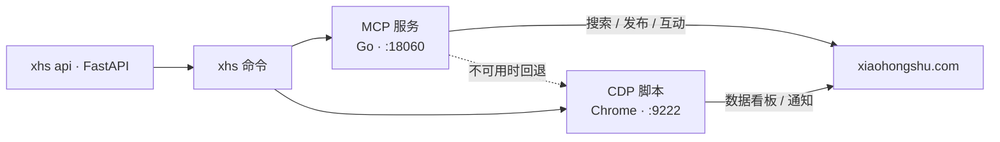

<p align="center">
  <h1 align="center">📕 redbook-cli</h1>
  <p align="center">小红书命令行工具 — 搜索、发布、互动、数据分析，对 AI Agent 友好。</p>
</p>

<p align="center">
  <a href="https://pypi.org/project/redbook-cli/"></a>
  <a href="https://github.com/Youhai020616/xiaohongshu/actions"></a>
  <a href="https://pypi.org/project/redbook-cli/"></a>
  <a href="./LICENSE"></a>
</p>

<p align="center">
  <a href="#安装">安装</a> •
  <a href="#快速开始">快速开始</a> •
  <a href="#命令">命令</a> •
  <a href="#面向-ai-agent-的结构化输出">Agent 输出</a> •
  <a href="#docker">Docker</a> •
  <a href="#rest-api">REST API</a> •
  <a href="./README.en.md">English</a>
</p>

---

<p align="center">
  
</p>

## 安装

```bash
pip install redbook-cli
xhs init                    # 引导：环境检查 → 代理 → 启动 MCP → 扫码登录（一次即可）
```

源码安装：

```bash
git clone https://github.com/Youhai020616/xiaohongshu.git
cd xiaohongshu && bash setup.sh
```

Docker（无需本地 Go / 二进制 / Chrome，见 [Docker](#docker)）：

```bash
docker compose up -d && docker compose exec cli xhs login
```

> **依赖说明**
> - Python ≥ 3.10
> - MCP 服务二进制 — `xhs init` / `xhs server start` 会从上游 Releases 自动下载（darwin-arm64、linux-amd64、windows-amd64）
> - Google Chrome — 仅 CDP 功能需要（数据看板、通知、`xhs login --cdp`）
> - 可选：`pip install 'redbook-cli[api]'` 启用 REST API 服务

## 快速开始

```bash
xhs init                                 # 首次引导设置
xhs search "美食"                         # 搜索 → 结果自动缓存
xhs read 1                               # 查看第 1 条（短索引）
xhs like 1                               # 点赞第 1 条
xhs fav 2                                # 收藏第 2 条
xhs comment 1 -c "好文!"                  # 评论第 1 条
xhs publish -t "标题" -c "内容" -i img.jpg  # 发布图文
```

## 功能特性

- 🔍 **搜索** — 关键词搜索，支持排序 / 类型 / 时间 / 范围 / 位置筛选，导出 CSV / JSON
- 📝 **发布** — 图文与视频，支持标签、定时、可见范围、原创声明、商品关联
- 💬 **互动** — 点赞、收藏、评论、回复（支持短索引）
- 📊 **数据看板** — 创作者后台数据导出（CDP）
- 🔔 **通知** — @提及与互动通知
- 👤 **主页** — 用户信息与笔记列表
- 🔢 **短索引** — `xhs search → xhs read 1 → xhs like 1`，无需复制 ID
- 📦 **导出** — `xhs search "AI" -o results.csv`
- 🔐 **登录** — MCP 扫码 + CDP 浏览器登录
- 👥 **多账号** — 独立 Chrome Profile 隔离
- 🏗️ **双引擎** — MCP 服务（快）+ CDP 自动回退
- 🤖 **Agent 友好** — `--json-output` 成功与失败都输出统一信封；stdout 只有数据，进度走 stderr
- 🌐 **REST API** — `xhs api start` 以 HTTP 暴露全部能力（FastAPI）
- 🐳 **Docker** — 一条 `docker compose up` 在 Linux 上跑起 MCP + Chrome + CLI

## 命令

### 搜索与查看

```bash
xhs search "关键词"                        # 基础搜索
xhs search "旅行" --sort 最多点赞          # 按点赞排序
xhs search "穿搭" --type 图文             # 按类型筛选
xhs search "AI" -o results.csv           # 导出 CSV
xhs search "咖啡" --engine cdp            # CDP 引擎（额外返回推荐词）
xhs read 1                               # 按短索引查看
xhs detail 1 --comments                  # 同时加载评论
xhs detail FEED_ID -t TOKEN              # 按 ID + xsec_token 查看
xhs feeds                                # 首页推荐
```

### 发布

```bash
xhs publish -t "标题" -c "正文" -i photo.jpg                       # 图文
xhs publish -t "标题" -c "正文" -v video.mp4                       # 视频
xhs publish -t "标题" -c "正文" -i img.jpg --tags 旅行 --tags 美食  # 带标签
xhs publish -t "测试" -c "内容" -i img.jpg --visibility 仅自己可见   # 私密
xhs publish -t "标题" -c "正文" -i img.jpg --schedule "2026-05-01T10:00:00+08:00"  # 定时
xhs pub -t "标题" -c "正文" -i img.jpg --dry-run                    # 仅预览
```

### 互动

```bash
xhs like 1                               # 点赞（短索引）
xhs like FEED_ID -t TOKEN --unlike       # 取消点赞
xhs fav 1                                # 收藏
xhs comment 1 -c "写得好!"               # 评论
xhs reply 1 --comment-id X --user-id Y -c "回复"  # 回复评论
```

### 数据与主页

```bash
xhs analytics                            # 创作者数据看板（CDP）
xhs analytics --csv data.csv             # 导出 CSV
xhs notifications                        # 提及 / 互动通知（CDP）
xhs me                                   # 我的信息
xhs profile USER_ID -t TOKEN             # 用户主页
```

### 服务、账号与配置

```bash
xhs login                                # MCP 扫码登录（自动启动 MCP 服务）
xhs login --cdp                          # CDP 浏览器登录
xhs status                               # 两个引擎的登录状态
xhs server start                         # 启动 MCP 服务（二进制，自动安装）
xhs server start --docker                # 以 Docker 启动 MCP 服务
xhs server status | stop | log           # 管理 MCP 服务
xhs account list                         # 列出账号
xhs config show                          # 查看配置
xhs config set mcp.proxy http://...      # 设置代理
```

### 别名

| 简写 | 命令 | | 简写 | 命令 |
|------|------|---|------|------|
| `xhs s` | `search` | | `xhs r` / `xhs read` | `detail` |
| `xhs pub` | `publish` | | `xhs fav` | `favorite` |
| `xhs cfg` | `config` | | `xhs acc` | `account` |
| `xhs srv` | `server` | | `xhs noti` | `notifications` |

## 面向 AI Agent 的结构化输出

几乎所有命令支持 `--json-output`：stdout 只输出**一个 JSON 信封**，进度与提示全部走 stderr，可直接管道给 `jq` 或由 Agent 解析：

```bash
xhs status --json-output | jq '.data.authenticated'
xhs search "AI" --json-output | jq '.data'
xhs like 1 --json-output               # 变更类命令也返回结构化结果
```

```json
{ "ok": true,  "schema_version": "1", "data": ... }
{ "ok": false, "schema_version": "1", "error": { "code": "mcp_error", "message": "..." } }
```

失败时退出码为 1，`error.code` 取值固定（`not_authenticated` / `invalid_argument` / `mcp_error` / `cdp_error` / `action_failed` 等）。完整约定见 [SCHEMA.md](./SCHEMA.md)，作为 Agent Skill 使用见 [SKILL.md](./SKILL.md)。

## REST API

```bash
pip install 'redbook-cli[api]'
xhs api start --port 8080              # Swagger 文档: http://127.0.0.1:8080/docs
```

`/api/v1` 下的端点：`login/status` · `login/qrcode` · `search` · `publish` · `feeds/detail` · `feeds/list` · `feeds/like` · `feeds/favorite` · `feeds/comment` · `feeds/comment/reply` · `user/me` · `user/profile` · `analytics` · `notifications` · `/health`。

## Docker

镜像在上游 `xpzouying/xiaohongshu-mcp` 之上叠加 Python CLI 与 Chrome，Linux amd64 无需安装 Go 或二进制即可运行 MCP：

```bash
docker compose up -d                                  # 构建并启动（MCP :18060，CDP :9222）
docker compose exec cli xhs login                     # 扫码登录
docker compose exec cli xhs search "美食"
docker compose exec cli xhs publish -t "标题" -c "正文" -i /app/data/images/photo.jpg
docker compose logs -f                                # 日志
docker compose down                                   # 停止
```

持久化数据在 `./docker/data/`（`cookies/` 登录态，`images/` 待发布素材）。详见 [docker/README.md](./docker/README.md)。

## 配置

| 路径 | 用途 |
|------|------|
| `~/.xhs/config.json` | 全局配置 |
| `~/.xhs/index_cache.json` | 上次搜索的短索引缓存 |

默认配置（`xhs config show`）：

```json
{
  "mcp":     { "host": "127.0.0.1", "port": 18060, "proxy": "", "auto_start": true },
  "cdp":     { "host": "127.0.0.1", "port": 9222,  "headless": false },
  "default": { "account": "default", "engine": "auto", "output": "table" }
}
```

```bash
xhs config set mcp.proxy http://127.0.0.1:7897   # MCP 代理
xhs config set default.engine cdp                # 强制引擎：auto | mcp | cdp
xhs config set cdp.headless true                 # CDP 使用无头 Chrome
xhs config get mcp.port
xhs config reset
```

## 架构

| 引擎 | 负责 | 技术 |
|------|------|------|
| **MCP 服务** | 搜索、发布、点赞、收藏、评论、回复、主页、推荐 | Go 二进制（上游 [xiaohongshu-mcp](https://github.com/xpzouying/xiaohongshu-mcp)），HTTP JSON-RPC |
| **CDP 脚本** | 数据看板、通知、多账号；搜索 / 点赞 / 评论 / 发布的回退 | Python + Chrome DevTools Protocol |



引擎自动选择：MCP 服务在运行则用 MCP，否则用 CDP。可用 `--engine` 或 `default.engine` 覆盖。

## 平台支持

| 组件 | macOS ARM64 | macOS x86 | Linux amd64 | Windows amd64 |
|------|:-----------:|:---------:|:-----------:|:-------------:|
| **xhs CLI** | ✅ | ✅ | ✅ | ✅ |
| MCP 服务（自动安装二进制） | ✅ | ❌ | ✅ | ✅ |
| MCP 服务（Docker） | ✅ | ✅ | ✅ | ✅ |
| CDP 脚本 | ✅ | ✅ | ✅ | ✅ |

二进制来自上游 Releases；macOS x86 上游没有构建 —— 请用 Docker 或纯 CDP 模式。WSL 已适配（自动延长超时）。

## 开发

```bash
git clone https://github.com/Youhai020616/xiaohongshu.git && cd xiaohongshu
python3 -m venv .venv && source .venv/bin/activate
pip install -e . && pip install pytest ruff
ruff check src/ tests/
pytest tests/ -v
```

CI 在 Python 3.10 / 3.12 上运行 lint 与测试。

## 文档

- [README.en.md](./README.en.md) — English
- [SCHEMA.md](./SCHEMA.md) — 结构化输出约定
- [SKILL.md](./SKILL.md) — 作为 AI Agent Skill 使用
- [docker/README.md](./docker/README.md) — Docker 部署

## 免责声明

本项目通过 MCP 服务与 Chrome 自动化驱动小红书网页端，目前处于 **Alpha** 阶段，仅供学习与研究使用。平台更新可能导致选择器或接口失效；自动化操作存在账号风控风险。请遵守小红书用户协议，使用后果自行承担。

## 许可证

[MIT](./LICENSE)

## 🔗 生态

| 项目 | 说明 |
|------|------|
| [AgentMind](https://github.com/Youhai020616/Agentmind) | AI Agent 自学习记忆系统 |
| [stealth-cli](https://github.com/Youhai020616/stealth-cli) | 基于 Camoufox 的反检测浏览器 CLI |
| [stealth-x](https://github.com/Youhai020616/stealth-x) | X/Twitter 隐身自动化 |
| [dy-cli](https://github.com/Youhai020616/douyin) | 抖音 CLI |
| [freepost](https://github.com/Youhai020616/freepost-saas) | AI 社媒管理 |
