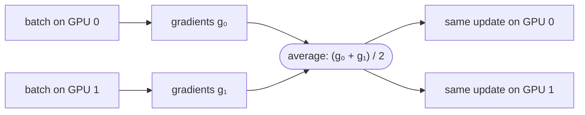
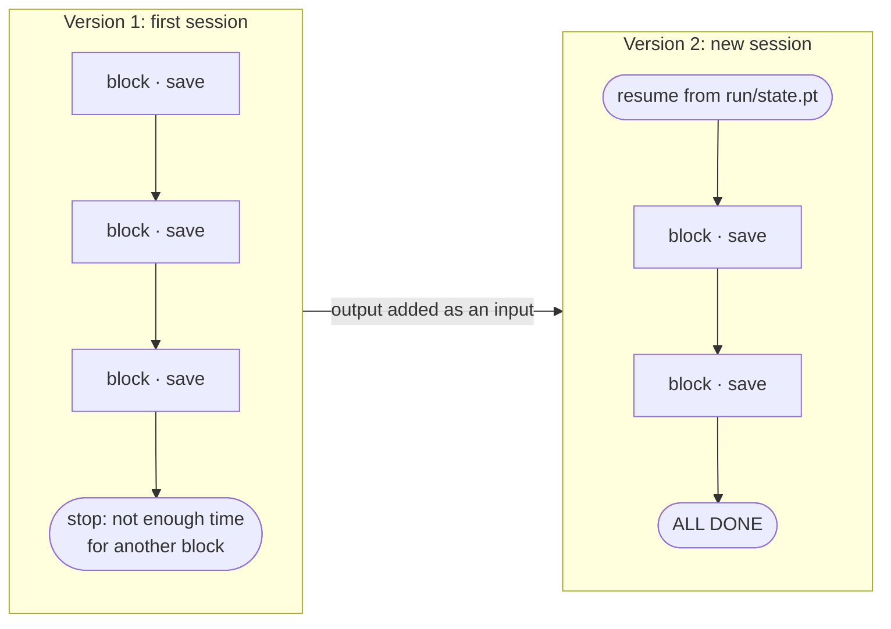

# Make the Most of Kaggle GPUs

**Use both T4s and resume training correctly across sessions**

[](https://kaggle.com/kernels/welcome?src=https://github.com/YounesToukal/kaggle-multi-gpu-training-resume/blob/main/kaggle_template.ipynb)

Kaggle gives you two T4 GPUs, but a standard PyTorch training loop uses only one of them, and every session ends after 12 hours. This template fixes both. It splits training across the two GPUs with PyTorch's DistributedDataParallel (DDP) [1], and it stops before the session runs out, so the next session continues exactly where the last one stopped. For a more detailed explanation, see [*Make the Most of Kaggle GPUs*](https://medium.com/@younesstoukal2/make-the-most-of-kaggle-gpus-use-both-t4s-and-resume-training-correctly-across-sessions-334dee5ecfd5) on Medium.

With this template:

- **Both GPUs train at once.** In the article's test, this was 1.9× faster than a single T4.
- **Training stops in time.** It saves regularly and stops while there is still time for a final save.
- **A resumed run matches an uninterrupted one.** The tests confirm that a run paused twice finishes with exactly the same weights as a run that never stopped.

## Quick Start

1. Open the notebook with the **Open in Kaggle** badge above.
2. In the notebook settings, choose **GPU T4 x2**.
3. Click **Save Version → Save & Run All (Commit) → Save**.

The notebook trains a small model on a toy dataset, so you can try the whole process first. To train your own model, see [Adapting it to your project](#adapting-it-to-your-project). If training needs more than one session, see [Continuing in a new Kaggle session](#continuing-in-a-new-kaggle-session).

## Table of Contents

- [1. Making the Most of Both GPUs](#1-making-the-most-of-both-gpus)
- [2. Handling the 12-Hour Limit](#2-handling-the-12-hour-limit)
- [3. The Notebook Template](#3-the-notebook-template)
- [References](#references)
- [License](#license)

## 1. Making the Most of Both GPUs

When you select **GPU T4 x2** on Kaggle, you get two GPUs, but a typical training loop uses only one. DDP runs a copy of the training script on each GPU. Each copy trains on its own batches, and after every backward pass the two copies average their gradients, so both models stay identical (Figure 1).



<p align="center"><em>Figure 1. One DDP step on two GPUs.</em></p>

In the article's test, this setup trained 1.9× faster than a single T4.

### Setting up DDP

DDP needs one process per GPU, each identified by its rank: 0 and 1 on Kaggle's two T4s. A notebook runs as a single process, so the template is split into two cells. The first writes the training code to `train.py`, and the second launches it on both GPUs with `torchrun`, which gives each copy its rank. The launcher also sets `NCCL_P2P_DISABLE=1`, which avoids communication issues between the two GPUs on Kaggle.

Compared with a standard PyTorch loop, only a few lines of the training code change:

```diff
  import torch
  from torch.utils.data import DataLoader
+ import os, torch.distributed as dist
+ from torch.nn.parallel import DistributedDataParallel as DDP
+ from torch.utils.data import DistributedSampler
+
+ RANK, WORLD, LOCAL = int(os.environ["RANK"]), int(os.environ["WORLD_SIZE"]), int(os.environ["LOCAL_RANK"])
+ torch.cuda.set_device(LOCAL)
+ dist.init_process_group("nccl")
- dev = torch.device("cuda")
+ dev = torch.device("cuda", LOCAL)

  torch.manual_seed(42)
  model = build_model().to(dev)
+ ddp = DDP(model, device_ids=[LOCAL])

- loader = DataLoader(dataset, batch_size=32, shuffle=True)
+ sampler = DistributedSampler(dataset, num_replicas=WORLD, rank=RANK, shuffle=True, seed=42)
+ loader = DataLoader(dataset, batch_size=32, sampler=sampler)

  for epoch in range(EPOCHS):
+     sampler.set_epoch(epoch)
      for x, y in loader:
          optimizer.zero_grad()
-         loss = loss_fn(model(x.to(dev)), y.to(dev))
+         loss = loss_fn(ddp(x.to(dev)), y.to(dev))
          loss.backward()
          optimizer.step()
-     torch.save(model.state_dict(), "model.pt")
+     if RANK == 0:
+         torch.save(model.state_dict(), "model.pt")
+ dist.destroy_process_group()
```

### Three common mistakes

If training on two GPUs does not work as expected, check these three things first:

| Mistake | What goes wrong | Fix |
|---|---|---|
| Not calling `sampler.set_epoch(epoch)` | The model sees the data in the same order in every epoch. | Call `sampler.set_epoch(epoch)` at the start of each epoch. |
| Saving the checkpoint from both GPUs | Both GPUs write to the same file at the same time, which can corrupt it. | Save only from the first GPU (rank 0). |
| Splitting the validation set with `DistributedSampler` | If the validation set cannot be divided evenly between the GPUs, some samples are counted twice, which makes the scores inaccurate [2]. | Give each GPU its own part of the validation set without repeats, then add up the results from both GPUs with `all_reduce`. |

### Keeping the two GPUs in sync

The two processes have to stay in lockstep. If one stops or skips a step while the other carries on, they end up waiting for each other and the notebook hangs. The template prevents this with three rules:

1. Both GPUs run the same number of steps. If the loss is NaN on either one, both skip the step.
2. Rank 0 makes every decision, such as when to stop, and passes it to the other GPU. It is also the only process that writes files.
3. Both GPUs start from the same weights.

## 2. Handling the 12-Hour Limit

When training needs more than one session, the run is split into blocks of steps, with a save after each block. Each version trains block by block, and when there is no time left for another block, the next version takes over from the last save (Figure 2).



<p align="center"><em>Figure 2. One run across two Kaggle versions.</em></p>

### Stopping before the deadline

A new block starts only if there is enough time to finish it, judging by how long the previous blocks took. The deadline is set to 11.25 hours, which leaves room for the final save. The length of a block is set with `SAVE_EVERY`, and blocks of 10 to 30 minutes work well.

### Saving the complete state

The weights alone are not enough to continue the same run. The checkpoint, `run/state.pt`, also stores the optimizer, the learning-rate schedule, the gradient scaler, the step count and each GPU's random state. It is written to a temporary file first and then renamed, so a session that ends in the middle of a save leaves the previous checkpoint untouched.

### Resuming mid-epoch

If a session ends partway through an epoch, the next one rebuilds the same batch order and skips the batches it has already trained on:

```python
epoch, first = divmod(step, STEPS_PER_EPOCH)
sampler.set_epoch(epoch)
order = list(sampler)[first * BATCH:STEPS_PER_EPOCH * BATCH]      # only the batches not yet trained
loader = DataLoader(data, batch_size=BATCH, sampler=order, num_workers=WORKERS,
                    generator=torch.Generator().manual_seed(SEED + epoch))
```

The `generator=` argument gives the data loader its own random numbers, so creating a new loader does not disturb the random numbers used by dropout.

### Continuing in a new Kaggle session

Each **Save & Run All** creates a new version of the notebook with its own 12-hour session.

To start a run, click **Save Version → Save & Run All (Commit) → Save**. The session runs in the background, so you can close the browser.

To resume an interrupted run:

1. Add the previous version's output as an input (**Add Input → Your Work → Notebooks** then add your previous version's notebook). Its files then appear under `/kaggle/input`.
2. Run **Save & Run All** again. The launcher finds the saved `state.pt` and continues from it.
3. Check that the log shows `continuing from …` and `resumed at step …`.

If you have less than 12 GPU hours left in your weekly quota, lower `BUDGET_H` in the launcher.

## 3. The Notebook Template

**`kaggle_template.ipynb` is all you need on Kaggle.** Its first cell is the training script, with the two-GPU and resume code, and its second cell starts it on both GPUs. The same code is also kept as two plain files, so it is easy to read on GitHub and the tests can run it:

```
├── kaggle_template.ipynb   # the notebook to run on Kaggle
├── train.py                # its first cell: the training script
├── launch.py               # its second cell: the launcher
└── tests/test_resume.py    # resume tests
```

### Adapting it to your project

Replace the sections of `train.py` marked `YOUR DATA` and `YOUR MODEL`, and leave the sampler, the `generator=` argument and the seeds as they are. Then adjust these settings:

| Setting | Meaning |
|---|---|
| `EPOCHS` | epochs for the whole run |
| `BATCH` | batch size per GPU |
| `LR`, `SEED` | learning rate and random seed |
| `SAVE_EVERY` | steps per block, aiming for 10 to 30 minutes |
| `FIRST_BLOCK_MIN` | your estimate of the first block's length, in minutes |

If you use data augmentation, seed it with the epoch and the sample index, as the `Toy` dataset does, so that a resumed run sees the same augmented samples.

### Testing the resume

Before a long experiment, check that resuming works with your model. Run it once normally, then once with `os.environ["EXTRA"] = "--max-steps-now 20"` set before the launcher cell, and resume it in a new version. Both runs should finish with the same weights.

The tests in [`tests/test_resume.py`](tests/test_resume.py) run the same check on the toy model: they pause a run twice and confirm that it finishes with the same weights as a run that never stopped. On GPU, tiny differences can appear, because some operations are not fully deterministic [3].

To run them in a Kaggle notebook, turn on **Internet** in the session options and run:

```python
!git clone https://github.com/YounesToukal/kaggle-multi-gpu-training-resume.git
%cd kaggle-multi-gpu-training-resume
!python -m pytest tests -v
```

Or in a Linux terminal:

```sh
git clone https://github.com/YounesToukal/kaggle-multi-gpu-training-resume.git
cd kaggle-multi-gpu-training-resume
pip install -r requirements.txt
python -m pytest tests -v
```

## References

1. PyTorch. Getting started with Distributed Data Parallel. [pytorch.org/tutorials/intermediate/ddp_tutorial.html](https://pytorch.org/tutorials/intermediate/ddp_tutorial.html)
2. PyTorch. `DistributedSampler`. [pytorch.org/docs/stable/data.html](https://pytorch.org/docs/stable/data.html#torch.utils.data.distributed.DistributedSampler)
3. PyTorch. Reproducibility. [pytorch.org/docs/stable/notes/randomness.html](https://pytorch.org/docs/stable/notes/randomness.html)

## License

Distributed under the MIT License. See [`LICENSE`](LICENSE) for more information.
