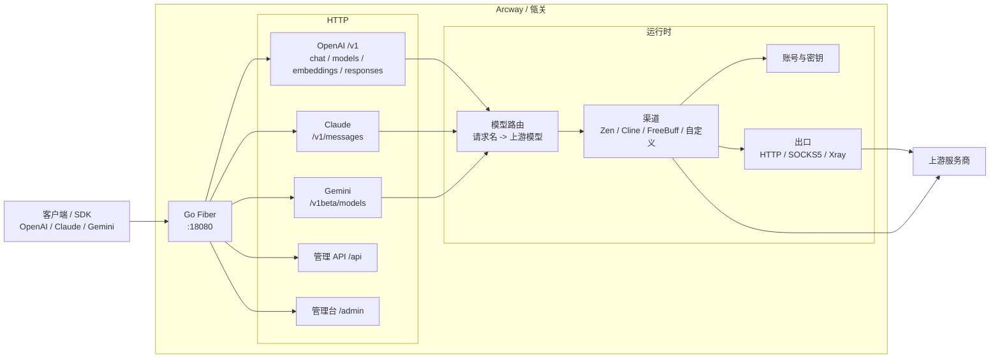

<p align="center">
  
</p>

<h1 align="center">Arcway · 瓴关</h1>

<p align="center">
  <a href="https://github.com/YuJunZhiXue/arcway"></a>
  
  
  <a href="https://github.com/YuJunZhiXue/arcway/releases"></a>
  
  
</p>

语言 / Language: [中文](README.md) | [English](README.en.md)

把多家上游接到一个 OpenAI / Claude / Gemini 兼容出口。核心后端是 **Go**，管理台是 **Next.js**（源码在 `frontend/`）。账号、密钥、渠道实例和数据库只写在本机 `data/`，不会进 git。

English name **Arcway** · 中文名 **瓴关** · Author: anonymous

## Star History

[](https://www.star-history.com/#YuJunZhiXue/arcway&Date)

> **重要免责声明**
>
> 本仓库仅供学习、研究、个人实验和内部验证使用，不提供任何形式的商业授权、适用性保证或结果保证。
>
> 作者及仓库维护者不对因使用、修改、分发、部署或依赖本项目而产生的任何直接或间接损失、账号封禁、数据丢失、法律风险或第三方索赔负责。
>
> 请勿将本项目用于违反服务条款、协议、法律法规或平台规则的场景。使用前请自行确认上游服务商的条款，以及你是否有权使用对应账号与密钥。

## 目录

- [架构概览（摘要）](#架构概览摘要)
- [核心能力](#核心能力)
- [平台兼容矩阵](#平台兼容矩阵)
- [模型支持](#模型支持)
- [如何配置模型（图文）](#如何配置模型图文)
- [快速开始](#快速开始)
  - [方式一：下载 Release 构建包](#方式一下载-release-构建包)
  - [方式二：Docker 运行](#方式二docker-运行)
  - [方式三：本地源码运行](#方式三本地源码运行)
- [配置说明](#配置说明)
- [鉴权模式](#鉴权模式)
- [Release 自动构建（GitHub Actions）](#release-自动构建github-actions)
- [免责声明](#免责声明)

## 架构概览（摘要）



- **后端**：Go（根目录 `main.go`、`cmd/unified-gateway/`、`internal/`、`pkg/`）
- **前端**：Next.js 管理台（`frontend/`），默认端口 `14000`，也可由后端反代
- **部署**：本地运行、Docker Compose、GitHub Release 二进制

## 核心能力

| 能力 | 说明 |
| --- | --- |
| OpenAI 兼容 | `GET /v1/models`、`GET /v1/models/{id}`、`POST /v1/chat/completions`、`POST /v1/responses`、`GET /v1/responses/{id}`、`POST /v1/embeddings` |
| Claude 兼容 | `POST /v1/messages`、`GET /anthropic/v1/models` |
| Gemini 兼容 | `POST /v1beta/models/{model}:generateContent` 等 Gemini 路径 |
| 免费渠道 | Zen / Cline / FreeBuff：后台登录账号后即可调用；Cline 目录会进入 `/v1/models`，方便 sub2api 一类工具抓模型 id |
| 自定义上游 | NVIDIA 等密钥挂在对应渠道上，一把钥匙一张卡片 |
| 模型路由 | 客户端只填你起的请求名，后台映射到真实上游模型，可按顺序故障转移 |
| 下游密钥 | 给客户端发网关 API Key，可创建、复制、轮换、停用 |
| 出口 | HTTP / SOCKS5 / Xray，渠道可换出口 IP |
| 管理台 | `http://127.0.0.1:14000/admin`：渠道、路由、账号、密钥、节点、任务、用量 |
| 运维探针 | `GET /health`、`GET /healthz`、`GET /readyz` |

## 平台兼容矩阵

| 级别 | 平台 | 当前状态 |
| --- | --- | --- |
| P0 | OpenAI SDK / 任意 OpenAI 兼容客户端 | 支持 |
| P0 | 填 Base URL 的桌面客户端（Cursor、Cline、OpenCode 等） | 支持 |
| P0 | Anthropic SDK（`/v1/messages`） | 支持 |
| P1 | OpenWebUI / LangChain（OpenAI 兼容接入） | 支持 |
| P1 | Gemini 客户端（generateContent） | 支持 |

把网关根地址指到 `http://127.0.0.1:18080`，API Key 用管理台里创建的下游密钥。请求里的 `model` 填 `/v1/models` 返回的 id，或你在「模型路由」里配置的名称。

## 模型支持

瓴关不内置一份写死的上游模型表。`GET /v1/models` 会合并：

1. 管理台「模型路由」里已启用、且当前能跑通的请求名
2. Cline 账号目录（登录后会刷新）
3. Zen 免费模型
4. 其他已接入的免费 / 自定义上游目录

因此别人用 sub2api、OneAPI 一类工具去抓 `/v1/models` 时，能看到 Cline 拉下来的 id，而不只是你手工建的路由名。

聊天时：若 id 在 Cline 目录里，会走 Cline 账号；若是你配置的请求名，会按路由表选渠道和上游模型。

## 如何配置模型（图文）

目标：在管理台挂好上游 Key，再把「客户端请求名」映射到真实上游模型，最后用下游 API Key 调 `/v1/chat/completions`。

管理台默认地址：`http://127.0.0.1:14000/admin`（也可经后端反代）。模型 API：`http://127.0.0.1:18080/v1`。

### 1. 登录管理台

打开管理台，输入 `.env` 里的 `ADMIN_PASSWORD`（示例环境常见为 `change-me`，登录后务必改掉）。


### 2. 配置自定义渠道与上游 Key（以 NVIDIA 为例）

左侧进入 **渠道管理 → 自定义渠道**。可新建渠道，或展开已有 **NVIDIA** 渠道：

1. 确认渠道已启用
2. 在渠道卡片里添加 / 导入 API Key（一把钥匙一张卡片）
3. 点 **测试** / **重新测试** 确认 Key 可用
4. 需要时点 **同步模型目录**，把上游可调用的模型 id 拉进本地缓存


免费渠道（Zen / Cline / FreeBuff）在 **渠道管理 → 免费渠道**，按页面提示登录账号即可，不需要 NVIDIA 那种 Key 卡片。

### 3. 配置模型路由（客户端请求名 → 上游）

左侧进入 **系统 → 模型路由**。每一条路由包含：

- **请求名**：客户端 `model` 字段填的名字，例如 `deepseek-v4-flash`
- **候选链路**：按优先级尝试的「渠道 + 上游模型 id」
- 可配置多条候选做故障转移（前一条渠道钥匙耗尽或失败后再试下一条）


示例：

| 请求名 | 候选 1 | 候选 2（可选） |
| --- | --- | --- |
| `deepseek-v4-flash` | NVIDIA / `deepseek-ai/deepseek-v4-flash-0731` | Zen / `deepseek-v4-flash-free` |
| `llama-vision-test` | NVIDIA / `meta/llama-3.2-11b-vision-instruct` | — |

保存后，`GET /v1/models` 里应能看到这些请求名。

### 4. 创建下游 API Key

左侧进入 **系统 → API 密钥**，新建一把给客户端用的 Key。页面会提示 Base URL，例如 `http://127.0.0.1:18080/v1`。


### 5. 客户端怎么填

以任意 OpenAI 兼容客户端为例：

- Base URL：`http://127.0.0.1:18080/v1`
- API Key：上一步创建的下游密钥
- Model：模型路由里的请求名（如 `deepseek-v4-flash`）

```bash
curl http://127.0.0.1:18080/v1/chat/completions \
  -H "Authorization: Bearer <下游 API Key>" \
  -H "Content-Type: application/json" \
  -d "{\"model\":\"deepseek-v4-flash\",\"messages\":[{\"role\":\"user\",\"content\":\"hello\"}]}"
```

Pi Agent / Cursor / Cline 等同理：把 Provider 指到上述 Base URL 与 Key，模型名填路由请求名。

### 6. 排错要点

- `/v1/models` 很慢或为空：先看渠道是否启用、模型目录是否已同步、路由是否启用
- NVIDIA **列模型成功但聊天超时**：多半是上游该模型排队/过载或出口网络问题；网关会在竞速时限内返回错误，而不是一直挂死。可换已验证可聊的上游 id，或给 NVIDIA Key 绑定可用代理后再试
- `capacity_exhausted` / 无可用钥匙：Key 冷却、并发打满或渠道关闭；到自定义渠道卡片看可用 Key 数
- 免费渠道候选失败：确认对应免费渠道已登录且处于可调度状态

## 快速开始

推荐顺序：

1. **下载 Release 构建包**：适合大多数用户
2. **Docker**：适合容器或服务器
3. **本地源码运行**：适合开发和改代码

### 通用第一步

```bash
cp .env.example .env
# 编辑 .env：至少改掉 ADMIN_PASSWORD=change-me
```

Windows：

```powershell
copy .env.example .env
```

不要把 `.env` 或 `data/` 提交到 git。首次启动会自动创建 `data/`。

### 方式一：下载 Release 构建包

推送到 `main` 后，GitHub Actions 会自动打版本并上传多平台二进制，见 [Releases](https://github.com/YuJunZhiXue/arcway/releases)。

```bash
# 下载对应平台的文件后
cp .env.example .env
# 编辑 .env
./arcway-linux-amd64
```

Windows 使用 `arcway-windows-amd64.exe`。Release 里是 Go 二进制；管理台在 `frontend/`，需要 Node 才能起来。要一次拿到 API 和管理后台，用 Docker 或下面的源码运行。

### 方式二：Docker 运行

```bash
cp .env.example .env
# 编辑 .env，设置 ADMIN_PASSWORD
docker compose up --build -d
docker compose logs -f
```

默认端口：

- API / 健康检查：`18080`
- 管理台：`14000`（一般由后端反代，也可单独访问）

数据目录挂载为 `./data:/app/data`。备份时复制整个 `data/`。

更新：`docker compose up -d --build`

### 方式三：本地源码运行

**前置要求**：Go 1.26+，Node.js 20+（构建 / 热更新管理台时需要）

```bash
git clone https://github.com/YuJunZhiXue/arcway.git
cd arcway
cp .env.example .env
go run .
```

也可以：

```bash
go run ./cmd/unified-gateway
```

默认地址：

| 用途 | 地址 |
| --- | --- |
| 模型 API | http://127.0.0.1:18080 |
| 管理后台 | http://127.0.0.1:14000/admin |
| 健康检查 | http://127.0.0.1:18080/healthz |

服务绑定双栈（IPv4 / IPv6）。局域网访问时把 `127.0.0.1` 换成这台机器的地址，并按需设置 `PUBLIC_GATEWAY_BASE_URL`。

`.env.example` 里的管理密码是 `change-me`。登录后必须改成你自己的密码，否则管理台不能继续使用。

开发时热更新前端：

```powershell
$env:GATEWAY_FE_MODE='dev'; go run .
```

## 配置说明

完整变量见 [`.env.example`](.env.example)。常用项：

| 变量 | 说明 |
| --- | --- |
| `ADMIN_PASSWORD` | 管理台登录密码。示例值 `change-me` 仅用于第一次登录 |
| `ENCRYPTION_KEY` | 加密落盘的密钥和 token。建议随机 32 字节，见示例文件里的生成命令 |
| `PORT` / `BACKEND_PORT` | 后端端口，默认 `18080` |
| `FRONTEND_PORT` | 管理台端口，默认 `14000` |
| `GATEWAY_DATA_DIR` | 数据目录，默认 `data` |
| `REDIS_URL` | 可选。不设则用进程内存储 |
| `PUBLIC_GATEWAY_BASE_URL` | 对外展示的网关根 URL |
| `GATEWAY_FE_MODE=dev` | 强制前端热更新 |

渠道账号、上游密钥、路由、下游 API Key 都在管理台里改，不写进仓库。

## 鉴权模式

| 入口 | 说明 |
| --- | --- |
| 管理台 `/admin`、`/api/*` | 管理密码登录，拿到会话 token |
| 模型 API `/v1/*` | `Authorization: Bearer <下游 API Key>`。在「API 密钥」页创建 |

调用示例：

```bash
curl http://127.0.0.1:18080/v1/models \
  -H "Authorization: Bearer <your-api-key>"
```

```bash
curl http://127.0.0.1:18080/v1/chat/completions \
  -H "Authorization: Bearer <your-api-key>" \
  -H "Content-Type: application/json" \
  -d "{\"model\":\"your-model-name\",\"messages\":[{\"role\":\"user\",\"content\":\"hello\"}]}"
```

## Release 自动构建（GitHub Actions）

工作流文件：[`.github/workflows/release.yml`](.github/workflows/release.yml)

- **触发条件**：推送到 `main`
- **版本**：从 `v0.0.1` 起自动加补丁号
- **说明**：Release 正文列出相对上一版本的提交标题
- **产物**：`linux/amd64`、`windows/amd64`、`darwin/amd64`、`darwin/arm64` 二进制

发布记录：[Releases](https://github.com/YuJunZhiXue/arcway/releases)

## 免责声明

本项目将你自己的上游账号与密钥接到标准 API 上，仅供学习、研究、个人实验和内部验证使用，不提供商业授权、稳定性保证或可用性保证。作者及仓库维护者不对因使用、修改、分发、部署或依赖本项目而产生的任何直接或间接损失、账号封禁、数据丢失、法律风险或第三方索赔负责。

请勿将本项目用于违反服务条款、协议、法律法规或平台规则的场景。
